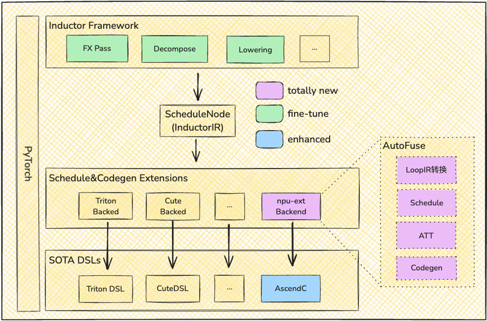
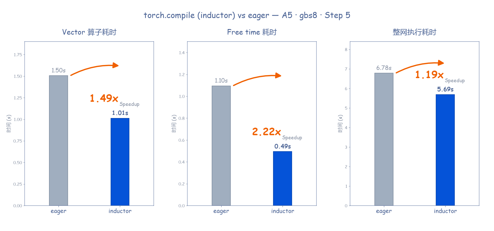
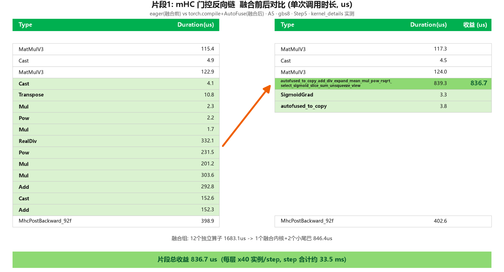
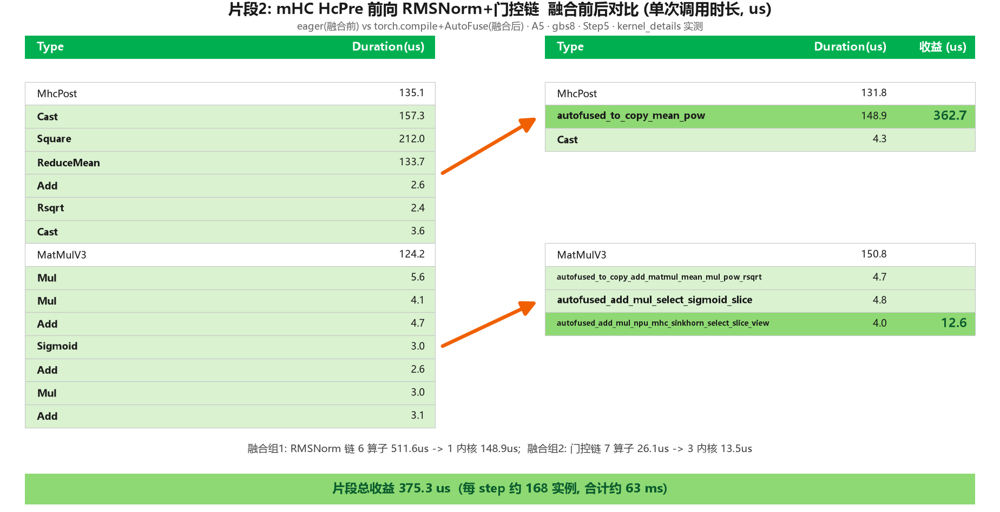

# Ascend C 算子自动融合

[返回总览](../ascend950_superpod_moe_pretrain_system_reference.md)

## Highlights

* **端到端 Vector 算子自动融合**：依托 Inductor + [Ascend C AutoFuse](https://gitcode.com/cann/graph-autofusion)，复用 torch.compile 编译入口自动生成面向昇腾 NPU 的 Ascend C 融合算子，消除中间张量换入换出开销，实现“零开发成本、高执行性能”。
* **模型吞吐提升**：在本文 DeepSeek-V4.1-Flash 训练中，使能 AutoFuse 后整网**开箱加速比超19%**，收益主要来自 AIV 算子融合及 Host Bound 缓解带来的 Free Time 减少。

## 1. torch.compile inductor + AutoFuse 简介

随着 MoE 与多模态架构的普及，动态、细粒度的小算子组合已成为主流设计模式。以 DeepSeek 提出的 mHC 为例，其将 HC 过程分解为 HcRes、HcPre 与 HcPost 三部分，分别通过双随机矩阵与 Sigmoid 门控系数保障数学性质，但实现上依赖大量细碎的 PyTorch 操作。这类灵活结构在模型设计中日益普遍，若延续传统手写融合算子的方式，开发效率已难以匹配模型迭代速度，算子自动化融合能力由此成为刚需。

torch.compile 为此提供了基础能力：通过捕获 FX 计算图将模型逻辑转换为算子图表示，交由 Inductor 后端进行算子融合与代码生成。Inductor 通过垂直与水平融合策略，将多个细碎操作合并为单一高效内核，实现跨算子的全局优化。**TorchTitan 对 torch.compile 提供了原生深度支持**，可充分复用 PyTorch 现有的编译生态基础设施与优化成果。

然而，NPU 与 GPU 在内存架构与计算范式上存在本质差异，直接沿用 GPU 优化策略难以充分释放 NPU 潜力。为此，CANN 框架的 AutoFuse 组件在继承 Inductor 整体流程的基础上，实现了目标为 Ascend C 的 Schedule & Codegen 后端。通过架构感知的融合策略与指令调度，实现从计算图到高效 NPU 算子代码的自动化映射，显著提升融合算子在昇腾平台上的执行效率。

在本实践的训练场景中，由于不开启 TP 切分使得各算子的计算量本身较大，做算子融合后 Kernel Launch 开销占比极低，不存在静态图的收益空间。因而我们采用动态图 Eager 模式执行编译后的算子图，且 Eager 模式无需处理动态 Shape 约束，更为简洁灵活，已可获取融合的主要性能收益。

## 2. AutoFuse 亮点

* 使用简单：PyTorch 前端增加一行代码即可使能
* 性能提升：依赖 NPU 亲和的算子生成技术，本次模型融合收益约 19%

  * 亲和 NPU，模板规约的 Schedule 技术
  * 基于硬件建模，动态求解的算子 Tiling 技术
  * 基于 Ascend LoopIR 表达的，Ascend C 算子 kernel 代码生成技术
* 泛化与完备度：当前已支持 152 个 LoopIR 表达中的 140 个，未来将逐步补齐，与 LoopIR 完整对等

## 3. AutoFuse收益分析

使能 AutoFuse 后 DeepSeek-V4.1-Flash 模型整网吞吐收益为 19%，具体性能提升数据拆解如下表所示，收益主要来自 AIV 的算子融合，以及 Host Bound 缓解带来的 Free Time 减少：

1. AIV 的收益主要来自各类算子融合：

| **融合后算子名称**                                                                | **数量(Count)**    | **融合后总耗时 (s)** | **融合前总耗时 (s)** | **净收益时间 (s)** | **优化核心**                                                                                         |
| ----------------------------------------------------------------------------------- | -------------------- | ---------------------- | ---------------------- | -------------------- | ------------------------------------------------------------------------------------------------------ |
| autofused_to_copy_mean_pow 系列（RMSNorm 归一化前向链）                           | 160                | 0.090                | 0.025                | 0.065              | 带宽优化：Cast/Square/ReduceMean/Add/Rsqrt 六段“读-算-写”合并为单一内核，中间张量驻留片上缓存。    |
| autofused_add_div_expand_mean_mul_pow_rsqrt_select_sigmoid 系列（mHC 门控反向链） | 40                 | 0.067                | 0.034                | 0.034              | 指令加速：12 个独立算子（含高延迟 Pow/RealDiv）合为 1 个融合内核，门控 Sigmoid/Select/Slice 就地融合 |
| 基础逐元素融合（Mul/Add，聚合项）                                                 | \~4,456 次下发消减 | 0.287                | 0.082                | 0.205              | 访存收敛：Mul 4,701→2,220、Add 2,787→812，独立乘/加内核大幅合并，减少内存总访问次数。              |
| autofused_to_copy 系列（Cast/TensorMove 吸收，聚合项）                            | \~4,923 次下发消减 | 0.299                | 0.107                | 0.192              | 调度简化：Cast 5,519→2,972、TensorMove 3,589→1,213，类型转换与拷贝就地吸收，降低 Host 下发频率。   |
| autofused_cat 系列（ConcatD 消减）                                                | 1,748→262         | 0.128                | 0.011                | 0.117              | 隐式拼接：cat/view 逻辑合并，基本消除物理内存拷贝耗时。                                              |

**以下以其中几个片段为例说明：**

三大核心收益来源：

* 消除“访存墙” \(Memory Bound\)

  * 将 12 个独立算子的“读\-算\-写”循环，重构为 2 个高集成度融合内核
  * 中间张量驻留片上缓存 \(SRAM/L1\)，规避了频繁读写 HBM（全局内存） 的巨大带宽开销
* 掩盖高耗时指令 \(Operator Hiding\)

  * 通过编译器对 Pow/RealDiv 等高周期算子进行指令级重排
  * 计算压力被掩盖在矢量计算流水线中，实现非线性数学公式链的“近乎零成本”合并
* 精简内核启动开销 \(Launch Overhead\)

  * 大幅减少 Host\-to\-Device 握手次数。
  * 清理了重量级算子（如 MatMul）之间的“计算碎屑”，确保 NPU 核心持续处于高负载产出状态

## 4. 未来技术演进

AutoFuse在不断挖掘执行性能的同时，在编译性能上也将持续优化。后续计划增加引入新的MindSpore DVM（Device Virtual Machine）虚拟机技术（[代码链接](https://gitcode.com/mindspore/dvm)），以期进一步提升编译性能。DVM基于元算子虚拟机算子编译和执行技术，拥有us级别的实时编译能力：

* 整个编译过程都是基于内存的，消除了传统编译器文件输入/文件输出所需要的磁盘读写开销；
* 编译过程生成虚拟字节码指令即终止，消除了硬件native编译过程（cce编译）；
* 字节码指令以大颗粒的Tile元算子为粒度，既消除了传统算子编译循环Lower等复杂编译过程，又与输入的元算子构图直接呼应，无需额外数据结构转换开销。

---

[返回总览](../ascend950_superpod_moe_pretrain_system_reference.md)
