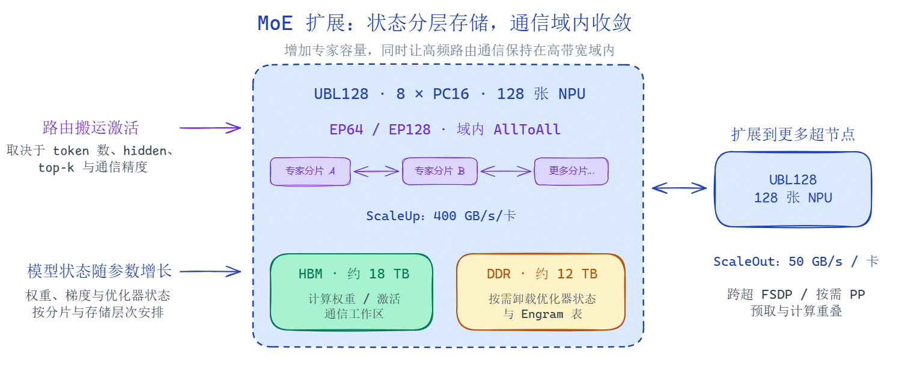
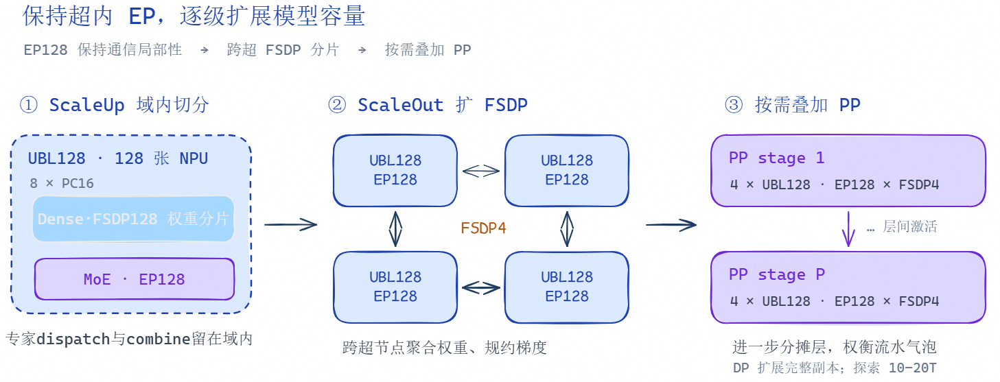

# PyTorch 原生训练框架下的 950 超节点部署策略

[返回总览](../ascend950_superpod_moe_pretrain_system_reference.md)

## Highlights

* 昇腾 950 超节点以 128 卡高带宽 ScaleUp 域为核心，将 MoE 高频专家通信收敛在超节点内，并通过跨超节点 FSDP、分层内存与按需 PP，实现从 550B、1.6T 向 10T 级模型的平滑扩展。
* 基于 torchtitan-npu 的 PC16 集群已完成 DeepSeek-V4-Flash 端到端持续预训练验证，64 卡 4K 吞吐达到 2131 tokens/s/卡，验证了超节点架构在大规模 MoE 训练中的工程可行性。

## 1. 从参数扩展到系统扩展：

大模型沿着 Scaling Law 持续演进，MoE 通过稀疏激活，为模型容量与计算开销之间提供了更灵活的选择：增加专家可以扩大总参数容量，而每个 token 只调用其中一部分专家，让单 token 计算量更多地取决于激活参数。能否把这种扩展潜力转化为训练效率，关键在于底层系统能否同时接住更大的模型状态与高频的专家通信。

这两类压力有着不同的增长方式。权重、梯度和优化器状态的总容量通常随参数规模增长；专家路由中的 AllToAll 则主要搬运激活，其逻辑数据量取决于 token 数、隐藏维度、top-k 和通信精度。在这些条件保持一致时，增加专家数量并不必然带来同比例的路由流量增长。但如果通信跨越更多节点，或路由负载失衡，即使数据量相近，实际耗时也可能增加。**MoE 扩展的系统要点，是让专家容量可以增长，同时把高频路由通信保持在高带宽域内。**

### 1.1 昇腾 950 超节点亲和超大规模 MoE

950 超节点的架构：具体结构可参考[昇腾 950 NPU 架构白皮书](https://public-download.obs.cn-east-2.myhuaweicloud.com/ascend/%E6%98%87%E8%85%BE950%20NPU%E6%9E%B6%E6%9E%84%E7%99%BD%E7%9A%AE%E4%B9%A6.pdf)和[灵衢超节点参考架构白皮书](https://www.unifiedbus.com/zh/white-papers/UB-SuperPoD-Architecture-White-Paper-zh)。

* 128 × Ascend 950DT = 8 × PC16 服务器，采用了128 卡全互联架构；
* 每卡 UB 3.2Tbps（8×400G），scaleup 域有效带宽 400GB/s/卡；scaleout 50GB/s/卡——8× 带宽分层
* 超节点内存池：18TB HBM（144GB × 128，组网物理口径）+ 12TB DDR（8 × 1536GB）

**通信策略：**

ScaleUp 域，**灵衢总线**提供每卡 400GB/s 的域内带宽，ScaleOut 侧为每卡 50GB/s。面对这一带宽层次，模型的切分策略也应有所侧重：将 EP 专家并行优先部署在超节点内部，使 token 的分发与汇聚充分使用域内互联；当模型状态超过单超节点预算时，再向超节点之间扩展权重分片，并通过预取与计算重叠降低通信暴露。核心目标是**尽量把通信收敛在 scaleup 域内以提升 MFU**

**内存策略：**

UBL128 按物理规格约有 **18TB HBM** 与 **12TB Host DDR**。HBM 优先保障计算权重、激活和通信工作区，适合卸载的优化器状态及 Engram 表可按需放入 DDR。分层存储扩大了可部署空间，也引入了数据访问和搬运开销，因此必须连同带宽与重叠窗口一起设计。

由此，超节点成为超大规模 MoE 的扩展单元：**域内承接频繁的专家交互**，**域间承担容量扩展和副本协同**。模型从千亿走向万亿、十万亿参数时，可以沿着相同的通信局部性原则逐步扩展。

### 1.2 PC16：高密度、易扩展的超节点计算单元

PC16（Atlas 850e 16P）每台集成 16 张 NPU，8 台即可组成一个 128 卡全互联超节点。服务器数量和组网方式固定，部署时可以按这套配置安排设备、布线和维护；扩容时复用相同的超节点配置即可。

对 MoE 大模型训练，PC16 组成的超节点可以将专家分发与集合通信放在高速 UB 网络内。服务器上的大容量 Host DDR 可用于卸载优化器状态和 Engram 表，减轻 HBM 的存储压力。模型需要更多资源时，再通过 UBG 连接多个超节点，扩展权重分片范围。

---

## 2. 从550B、1.6T 到 10T：昇腾 950 超节点上的大规模 MoE 切分策略

不同规模的模型，需要在模型状态、长序列激活、集合通信和流水气泡之间寻找合适的平衡。550B 档优先发挥单超节点的通信优势，1.6T 档通过流水并行分摊层与激活，而面向 10T 的外推，则采用“超内大 EP、超间扩 FSDP、按需加 PP”的分层路线。

本文中，**550B**对应**DeepSeek V4.1 Flash**，另有约 196.6B Engram 参数，合计约 749B；**1.6T**则对应 **DeepSeek V4 Pro**；10T 为规模外推，不对应已验证模型。三档的策略与权衡如下。

| 对比维度     | 550B：DeepSeek V4.1 Flash                                             | 1.6T：DeepSeek V4 Pro                                           | 10T：规模外推                                               |
| -------------- | ----------------------------------------------------------------------- | ----------------------------------------------------------------- | ------------------------------------------------------------- |
| 切分出发点   | 优先单超节点容纳副本，减少调度复杂度                                  | 保持 EP 通信在超内，通过跨超节点 FSDP 分摊权重                      | 固定 EP128 域，结合跨超节点 FSDP 与 PP 控制每个 stage 的峰值    |
| 代表性切分   | Dense部分 FSDP128，EP64 + 专家侧 eFSDP2；EP128 可作容量与负载对比候选 | MoE EP128 × FSDP2；Attn 在 CP1–128、FSDP1–128 范围内选型     | EP128 × FSDP4 × PP2 为拓扑候选，FSDP 与 PP 根据模型调整   |
| 单副本资源   | 1 × UBL128，128 张 NPU                                               | 2 × UBL128，256 张 NPU                                         | 上述 PP2 候选为 8 × UBL128、1024 张 NPU                    |
| EP 通信范围  | 64 或 128 卡组，均在超节点内                                          | 每个 UBL128 内的 128 卡组                                       | 每个 UBL128 内的 128 卡组，随扩容保持不变                   |
| 主要扩容手段 | 域内 FSDP，按需卸载 Engram 与优化器状态                               | 跨两个超节点做 FSDP2，不切 PP                                   | 跨超节点 FSDP 分摊状态，并通过 PP 分摊层与临时聚合权重          |
| 获得的收益   | 超节点内带宽支持权重分片、高速通信                                    | 无 PP 气泡；所给单层方案中，FSDP 跨超通信量与耗时均小于 PP 切分 | 控制每个 stage 的模型状态和临时聚合权重，保持 EP 通信局部性 |

**550B 单个超节点即可部署**

EP64 与专家侧 eFSDP2 组合，是一种 128 卡部署方式；EP128 则扩大专家分布范围。若 Engram 表随 EP 组独立放置，后者还可减少表的副本数。

**1.6T 的 V4 Pro scaleout域扩FSDP**

在 256 卡对比方案中，两个 UBL128 各设 EP128，跨超节点做 FSDP2；Attn 侧可在 CP1–128、FSDP1–128 范围内选型。所给单层通信对比中，EP128 域内 AllToAll 为 168M / 0.2ms，跨超节点 FSDP2 为 190M / 2.2ms。若改用 EP128 + PP2，跨超 send/recv 约为 250M / 5ms；因为如今的mHC 使残差传输变大，是 PP 边界开销较高的原因之一。FSDP 在这组条件下的跨超数据量和耗时都更小，还可省去流水气泡。

**10T 模型按需扩流水**

第一层仍在 ScaleUp 域内使用 EP128；跨超节点 FSDP 分摊权重状态，可以先承接向 6–10T 的扩展。但面对10T及以上规模的模型时，纯 FSDP 的每层 AllGather 会带来过大的临时完整权重，权重聚合与梯度规约的通信量也随之增加。增加 PP 后，每个 stage 只承担部分层，降低阶段内的状态与临时聚合峰值，也缩短需要搬运的权重范围；代价是 mHC 激活沿 stage 边界传输，以及流水气泡。EP128 × FSDP4 × PP2 可作为 10T 的核算起点，需要进一步根据层划分、状态精度、激活峰值和通信重叠来调整实际的集群规模。

## 3. PC16 集群 - 预训练 DeepSeek-V4-Flash

基于 torchtitan-npu，在 PC16 集群上完成 DeepSeek-V4-Flash（284B 总参数 / 13.8B 激活参数）持续预训练配置的端到端验证。通过 FSDP 与 EP 并行切分，结合 mxFP8 量化、权重预取和通信域分离，64 卡 4K 序列训练吞吐达到 **2131 tokens/s/卡**。

### 3.1 训练设置

训练使用 PC16 服务器，8 台服务器构成一个 128 卡 UB 超节点。本实验的 64P 配置使用 4 台服务器，训练中的集合通信均在超节点内完成。

训练序列长度为 4K，MBS=2，GBS=512；并行策略为 EP=64、CP=1、DP shard=64（FSDP2），TP=PP=1。稠密参数在 64 卡间分片，每卡放置 4 个路由专家。

训练采用 mxFP8 块量化与 Muon 优化器。权重和激活按 128×128 块量化，Indexer 使用 FP8，KV-norm 使用 mxFP8（块大小 64）；矩阵参数使用 Muon，1D 参数、embedding 和 norm 使用 AdamW。启用选择性激活检查点与 torch.compile 逐层编译。通信优化采用 FSDP 分片预量化与逐层权重预取，减少传输量并提前发起参数聚合；为 EP 分配独立的 HCCL 通信域，使 EP AlltoAll 与 FSDP AllGather/ReduceScatter 能够并发执行，减少通信串行等待。

### 3.2 训练性能

该配置的实测内存占用为 103.95 GB，吞吐为 **2131 tokens/s/卡**，MFU 为 38.03%。

单步时间拆解：

| 分解项 | 耗时（s） | 耗时占比 |
| ---------------------------- | --------------------- | ------------------ |
| MatMul | 5.503 | 35.8% |
| Vector | 5.712 | 37.1% |
| FA/FAG | 1.484 | 9.7% |
| AICPU（metadata） | 0.028 | 0.2% |
| mHC pre/post | 0.866 | 5.6% |
| **计算合计** | **13.606** | **88.5%** |
| EP域未掩盖通信 | 1.251 | 8.1% |
| FSDP域未掩盖通信 | 0.346 | 2.3% |
| **未掩盖通信合计** | **1.559** | **10.1%** |
| **FREE（流水空隙）** | **0.211** | **1.4%** |
| **E2E** | **15.376** | **100.0%** |

**注**：未掩盖通信小计为 EP 与 FSDP 域暴露时间窗的并集，存在重叠，不能直接相加；计算合计、未掩盖通信合计与 FREE 构成 E2E。

4K 配置依托每卡 144 GB HBM，4 台 PC16 即可完成完整模型训练。计算耗时占 **88.5%**，FREE 仅 **1.4%**，计算流水利用充分。

---

[返回总览](../ascend950_superpod_moe_pretrain_system_reference.md)
