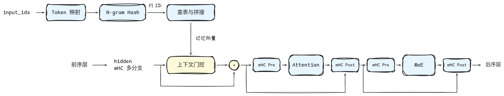
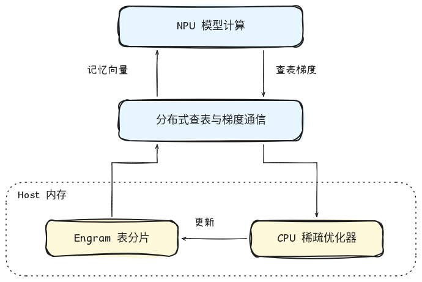
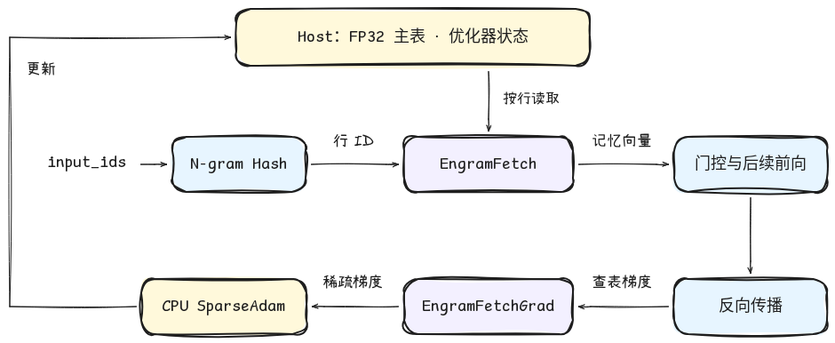
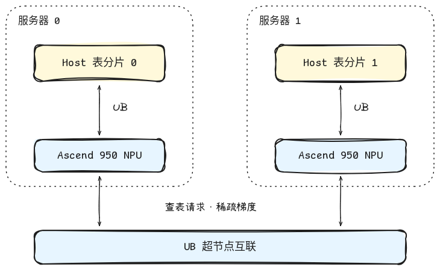
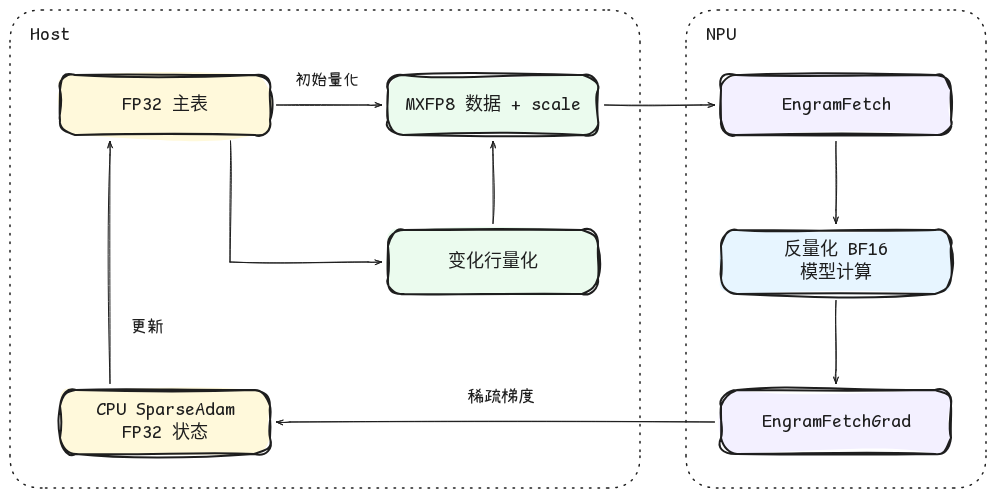

# DeepSeek-V4.1-Flash Engram 基于 950 的训练实现

[返回总览](../ascend950_superpod_moe_pretrain_system_reference.md)

## Highlights

* **面向 950 超节点的大容量记忆表训练**：结合 UB 互联、Host 存储与 EP × EFSDP 联合分片，将 Engram 表及优化器状态分摊到超节点的 Host 内存，按需访问表行，减少 NPU 显存占用。
* **MXFP8 查表与 CPU 稀疏更新**：查表数据及 Scale 的体积约为 FP32 的 25.8%；保留 FP32 主表，由 CPU SparseAdam 更新命中行并刷新量化副本，避免每步搬运和更新整表。

## 1. 背景和整体方案

Engram 是基于局部 N-gram 的可训练记忆模块。DeepSeek-V4.1-Flash 在两个模型层中引入 Engram，使用 2、3、4-gram 和多头哈希，将局部 token 组合映射到记忆表。检索结果经过投影和上下文门控，以残差形式加入模型隐状态。 Engram 插入在指定 Decoder 层的 Attention 之前：记忆向量由 token 序列独立检索，门控结合当前隐状态调节记忆贡献，并以残差形式更新各 mHC 分支；更新后的隐状态进入 mHC 包裹的 Attention 和 MoE 子层。

图 1：DeepSeek-V4.1-Flash Engram 计算原理

表容量随记忆规模增长，但每步训练只访问其中一部分行。将整张表和优化器状态常驻 NPU，或在计算前收集完整表，会产生与实际访问量不相称的存储和通信开销。因此，训练实现采用 Host 存储、分布式行分片和按需访问，将表容量与单步数据搬运量分开管理。

对于 packed sequence，N-gram 构造遵循文档边界，避免不同样本之间的 token 组合相互污染。

整体方案分为三个层次：NPU 承担模型计算，查表与梯度通信连接模型和分布式记忆表，Host 保存表分片并执行稀疏更新。前向按需获取记忆向量，反向将梯度送回所属分片，完成表参数更新。

图 2：Engram 训练整体方案。

950 超节点为这一部署方式提供了两类硬件基础：一是经灵衢（Unified Bus，UB）访问 Host 内存，二是在超节点内连接多颗 NPU 并交换数据。对应到 Engram，前者承载 Host 表的按需读取，后者承载不同分片之间的请求、返回数据和梯度交换。

Host offload 本身并不限定使用 UB，Torch 路径也能通过常规数据搬运和分布式通信完成训练；950 的意义在于为 AscendC 路径提供 Host 访问与超节点互联基础，使表容量可以与通信能力一同扩展。这里的 UB 指系统互联总线。

## 2. Host 存储与稀疏访问

### 2.1 训练流程与算子接口

主表和优化器状态常驻 Host（CPU 内存），按以下流程完成一次训练更新：

1. **1.前向查表**：按哈希生成的行 ID 向对应分片请求数据，仅将命中的记忆向量传入 NPU，参与投影、门控和残差计算。
2. **2.反向归并**：将行梯度送回所属分片，合并重复访问及副本梯度，并与普通参数梯度共同参与全局范数计算和裁剪。
3. **3.权重更新**：CPU SparseAdam 更新本步涉及的表行；门控等普通参数沿用整网优化器策略。选择 Muon 时，门控投影使用 Muon，归一化参数使用 AdamW。

torchtitan-npu 提供三种可选择的 Engram 查表后端。Torch 路径具备完整训练能力；AscendC 路径通过配置替换查表及其反向通信，继续复用哈希、上下文门控和稀疏优化器逻辑。

| 后端          | 查表方式                                          | 训练权重更新                           |
| --------------- | --------------------------------------------------- | ---------------------------------------- |
| Torch         | Torch 查表与分布式路由                            | CPU SparseAdam 更新 FP32 主表          |
| AscendC FP32  | `EngramFetch`/`EngramFetchGrad`完成查表与梯度返回 | 原位更新注册的 FP32 主表               |
| AscendC MXFP8 | 获取量化数据及 scale，在 NPU 反量化后参与计算     | 更新 FP32 主表，再刷新变化行的量化副本 |

三种后端共享模型层计算和 FP32 主表更新逻辑，差别集中在查表数据表示及通信实现。

从调用者看，AscendC 训练路径由存储注册、前向 Fetch 和反向 FetchGrad 三部分组成：

* **存储注册**：训练框架提供地址稳定的锁页 Host 表，`engram_write` 将其注册为通信可达的存储。训练模式直接映射这块内存，避免另建一份完整的 FP32 查表副本；这不表示后续查表没有数据搬运。
* **EngramFetch**：接收全局行 ID，向行所属 rank 发送请求，由所属 rank 读取本地表后返回数据，并恢复原请求顺序。同时保存反向所需的通信上下文。
* **EngramFetchGrad**：接收查表结果的梯度和前向上下文，将梯度送回表所属 rank，按本地行归并，返回行 ID 与梯度。优化器更新由训练框架执行。

训练态通过请求交换完成分布式查表。算子负责数据访问及梯度通信，哈希、门控、优化器更新和量化刷新由训练框架负责。

图 3：Engram 前向查表、反向梯度与 Host 更新流程。紫色框表示 AscendC 算子。

### 2.2 CPU 稀疏优化器

Host 表采用 FP32 权重和 CPU SparseAdam。每步将各次查表产生的梯度按行 ID 累计：同一行在不同 token 或微批次中出现时先求和；存在数据并行副本时，再按副本关系完成梯度归并。随后把表梯度计入全局范数、执行裁剪，将合并后的稀疏梯度交给优化器。

SparseAdam 在本步梯度涉及的行上更新一阶矩、二阶矩和权重，未出现在稀疏梯度索引中的行保持不变。这是带掩码的稀疏更新语义，并非把所有未访问行补零后执行一次稠密 Adam。若本地表有 `R` 行、宽度为 `D`，本步只涉及 `K` 个不同行，更新主要围绕 `K × D` 数据进行，避免构造 `R × D` 的稠密表梯度；但两份 moment 仍占用完整的 `R × D` 存储。

把更新计算留在 CPU，可以避免为优化器更新将整张表及两份状态搬入 NPU。FP32 算子路径直接读取原位更新后的主表；MXFP8 路径在同一次优化器更新中刷新变化行的量化副本。CPU 更新和量化的成本随访问行数增长，因此该设计适合表容量大、单步访问相对稀疏的场景，并不意味着更新成本可以忽略。

Engram 的 Host 表存储独立于整网 CPU offload 开关。开启普通参数的 CPU offload 后，Engram 继续在 CPU 上执行 SparseAdam，普通参数沿用对应的 offload 优化器路径。原生 checkpoint 保存主表和优化器状态，支持同一分片布局下的完整续训。

## 3. EP × EFSDP 分布式分片

Engram 的表按行划分，由各 rank 负责对应范围的存储和更新。默认布局沿 EP（专家并行）维度切分，在 EFSDP（专家参数的 FSDP 分片维度）保留表副本；启用联合切分后，EFSDP 维度也用于划分表行，进一步分摊 Host 内存占用。

| 表布局               | 每 rank 持有的表比例 | EFSDP 维度的作用 |
| ---------------------- | ---------------------- | ------------------ |
| EP 分片              | `1 / EP`             | 保存表副本       |
| EP × EFSDP 联合分片 | `1 / (EP × EFSDP)`  | 切分表行         |

例如，单机 8 卡采用 EP4 × EFSDP2 时，联合切分将每卡表及对应优化器状态从全量的 1/4 降至 1/8，这部分常驻内存减半。若另有数据并行复制维度，则仍沿该维度保留副本。

表的分片和通信由 Engram 自身管理，前向按行请求数据，无需通过 FSDP 收集整张表。门控等普通模型参数则继续使用原有 FSDP 训练机制。Engram 复用这些并行维度组织表的存储和访问，不改变 MoE 专家的划分方式。

在 950 超节点上，表的逻辑分片可以映射到不同服务器的 Host 内存，卡间与跨机通信负责把行请求和梯度送达相应分片。因此，扩展表容量不仅依赖更多 Host 内存，也依赖跨 rank 的可达性和通信效率。UB Switch 组网为这种超节点内扩展提供硬件基础；软件侧仍需显式划分表、注册存储并建立通信域，不能把不同进程的 Host 内存直接当作一个无需管理的共享张量。

图 4：950 超节点内的 Engram 表分片部署。

图中为部署关系示意，跨机 rank 必须处于算子支持的通信域并具备相应 Host 访问链路。超节点的硬件互联规模不等于单个算子的通信域上限，实际带宽与延迟也取决于组网、数据分布和访问负载。

## 4. MXFP8 量化查表

MXFP8 后端采用 E4M3 数据格式，每 32 个元素共享一个 E8M0 scale。与每元素 4 字节的 FP32 表数据相比，量化数据及 scale 平均占用 **1.03125 字节/元素，约为 FP32 的 25.8%**。这一比例描述的是查表数据格式，不等同于整网通信量或训练耗时的降幅。

训练以 FP32 主表保存可更新权重，以 MXFP8 副本提供前向查表数据：

图 5：MXFP8 查表与 FP32 主表更新。

SparseAdam 完成更新后，由优化器统一刷新本次变化行的量化数据，无需每一步重新量化整张表。量化在 CPU 执行，前向使用刷新后的副本；初始化和恢复权重时则重建量化表。

这种设计将量化查表与权重更新分开：前向采用较小的数据表示，优化器仍在 FP32 权重上累积和更新。其代价是额外保存量化副本，并承担变化行的量化计算，因此 MXFP8 压缩的是查表数据，训练总 Host 内存不会按相同比例缩减。

## 5. 内存开销分析

SparseAdam 按行更新，但一阶、二阶矩仍以稠密 FP32 张量保存，其形状与本地表相同。设所有 Engram 物理表共有 `P` 个元素，表的分片数为 `S`：EP 布局下 `S = EP`，联合布局下 `S = EP × EFSDP`。首次建立优化器状态时仍需分配并初始化完整的本地 moment 张量，因此稀疏更新不会消除状态初始化开销。每个 rank 的主要常驻内存为：

| 对象                             | 每 rank 内存（字节） |
| ---------------------------------- | ---------------------- |
| FP32 主表                        | `4P / S`             |
| SparseAdam 两份状态              | `8P / S`             |
| MXFP8 数据与 scale（仅量化后端） | `1.03125P / S`       |

以 DeepSeek-V4.1-Flash 正式配置的两层 Engram、每层 3 个 N-gram 阶数、每阶 8 个哈希头、每头约 1600 万行及行宽 256 估算，表元素总数约为 1966 亿。一个完整表副本对应的 FP32 主表与 SparseAdam 状态合计约 **2.36 TB**；加上 MXFP8 副本后约 **2.56 TB**，均为十进制容量。上述数值不包含梯度、通信缓冲和其他模型开销。若存在额外复制维度，还需计入对应副本。联合分片降低每 rank 的持有量；节点容量规划应汇总节点内各 rank 的占用，并为其他训练资源预留空间。

## 6. 未来计划

后续优化重点是查表预取与计算重叠。Engram 的行 ID 由输入 token 决定，可探索在目标层执行前生成请求并预取记忆向量，使查表通信与前序层计算重叠。预取需要控制额外缓冲，并保证使用的表版本与优化器更新一致。此外，可进一步优化变化行量化、请求组织和梯度归并，降低 CPU 量化、通信及稀疏更新开销。

---

[返回总览](../ascend950_superpod_moe_pretrain_system_reference.md)
