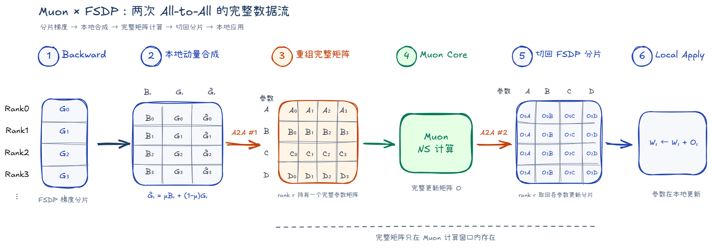
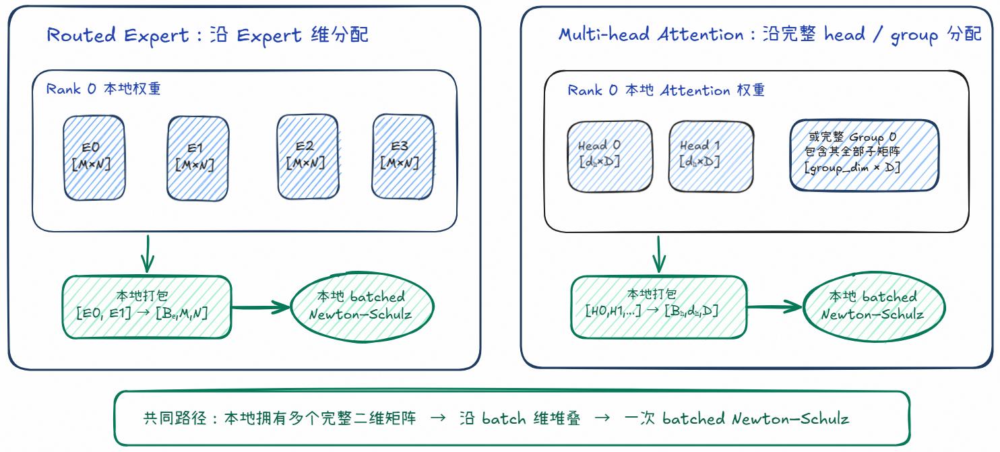
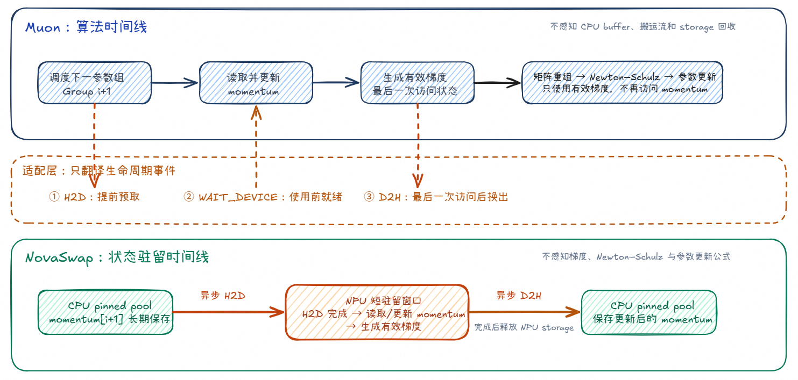
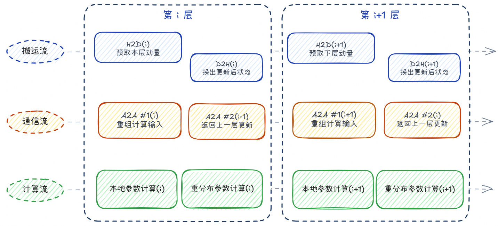
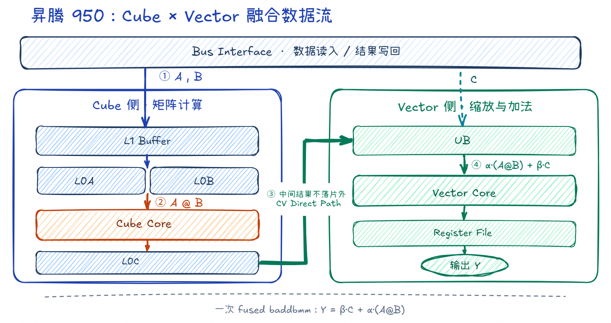
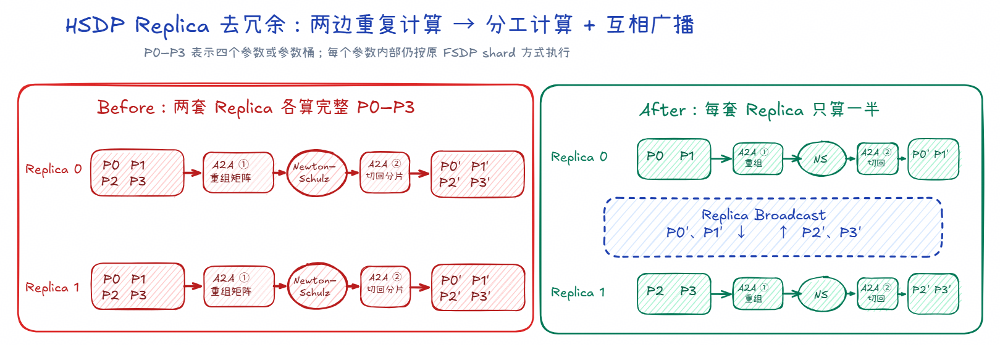

# FlexMuon：面向分布式训练的通信、内存与计算协同优化

[返回总览](../ascend950_superpod_moe_pretrain_system_reference.md)

## Highlights

* **通信/拷贝/计算多重overlap**：按需重组参数布局与层级流水掩盖机制，解决 FSDP 分片与 Muon 全矩阵计算的天然冲突，充分重叠掩盖 AllToAllV 通信及 Host-Device 状态搬运耗时。
* **HSDP 去冗余**：进一步采用“计算一次、广播结果”的方式，消除 Replica 维度上重复的状态、计算与优化器通信。
* **NovaSwap 内存优化**：实现优化器状态存储与算法逻辑的解耦，大幅降低 NPU 显存常驻负担。
* **Newton–Schulz Fused Matmul**：结合昇腾 950 专属的 Cube–Vector 跨核深度融合 Kernel，减少迭代过程中的中间数据落地，提升大规模 Muon 训练效率。

## 1 背景

Muon 以二维权重矩阵为更新单元，将梯度动量通过 Newton–Schulz 迭代转化为近似正交的更新方向。它利用了权重的矩阵结构，并且对矩阵参数只需维护一份动量。Moonlight、 Kimi K3 、DeepSeek-V4和DeepSeek-V4.1的实践表明，Muon 已经从中小规模实验走向大模型预训练，并进一步发展出面向 head、group 和 Expert 等细粒度矩阵结构的计算方式。

大规模训练通常会沿数据并行维度切分参数、梯度和优化器状态，以降低单卡的长期显存占用；但 Newton–Schulz 必须作用于完整逻辑矩阵，不能直接在任意 local shard 上执行。业界方案因此普遍采用“状态长期分片、计算时临时恢复完整矩阵”的思路。Moonlight 提出了 ZeRO-1 风格的 Distributed Muon，在数据并行 rank 之间分片参数与优化器状态，并在更新前聚合完整矩阵；Kimi K3 进一步结合 ZeRO-1、Pipeline ZeRO-2 和分布式优化器，只通过 P2P 通信收集当前 rank 所负责参数的必要分片，避免在所有 rank 上同时构造完整参数缓冲区。

针对完整矩阵计算带来的通信开销，以及优化器状态长期驻留造成的显存压力，我们基于 TorchTitan 的 FSDP 训练框架提出 FlexMuon。FlexMuon 面向昇腾平台，从通信、内存、流水调度和矩阵计算四个层面协同优化分布式 Muon，在保持算法语义的同时降低大规模训练的资源与执行开销。

## 2 通信优化：根据计算布局按需重组

FlexMuon 是否发起通信，由当前分片布局能否提供完整的 Muon 二维计算单元决定。普通 Dense 权重通常需要跨 rank 重组；如果 Expert、head 或 group 已经以完整矩阵形式落在本地，则可以跳过重组通信。

### 2.1 普通 Dense 权重：两次 AllToAllV 完成布局转换

普通 Dense 权重通常分散在多个 FSDP rank 上，需要两次 AllToAllV 完成布局转换。各 rank 先在本地用梯度更新优化器状态，生成本次 Muon 使用的有效梯度。第一次 AllToAllV 将有效梯度分片送到不同的计算 rank，每个 rank 只重组并计算自己负责的完整矩阵；Newton–Schulz 完成后，第二次 AllToAllV 再将更新方向切回原 FSDP 布局，由参数所属 rank 在本地完成更新。多个参数的分片可以合并通信，减少小消息数量。这两次通信完成的是一组可逆的布局转换：第一次把 FSDP 存储分片转换成完整计算矩阵，第二次把完整更新方向转换回原来的 FSDP 分片。完整矩阵由选定的计算 rank 分别负责，从而避免重复存储和重复执行 Newton–Schulz。

### 2.2 本地完整矩阵：按 batch 执行 Newton–Schulz

如果一个 rank 已经持有一个或多个完整的 Muon 二维矩阵，就不需要为了优化器计算额外通信。Routed Expert 权重按 Expert 维分配时，每个 rank 可以保留若干完整 Expert，并将这些 Expert 沿 batch 维组织后执行 Newton–Schulz。多头 Attention 权重按完整 head 或 group 分配时，也可以把本地多个同形的小矩阵组成 batch，在当前 rank 上完成计算。

本地计算和通信重组使用同一个判断标准：Newton–Schulz 的输入必须是完整逻辑矩阵。如果普通 FSDP 的分片边界穿过单个 head 或 group，或者 eFSDP 切开了单个 Expert 的二维矩阵，即使参数属于 Attention 或 Expert，也不能直接在 local shard 上计算，仍需先通过AllToAllV 恢复完整矩阵；计算结束后，再把更新方向切回原来的存储分片。

## 3 内存优化：基于 NovaSwap 的解耦式状态管理

Muon 为每个矩阵参数保存一份优化器状态。FSDP 可以把状态分散到不同 rank，却无法消除它在 NPU 上的长期占用。模型增大后，暂时不用的优化器状态仍会与参数、梯度、激活叠加。NovaSwap是一个统一内存卸载方案，它可以将优化器状态卸载到 CPU，只在优化器步骤内搬回 NPU。采用novaswap后，在deepseekV4等效裁剪模型中，可节省显存23.8%。

### 3.1 Swap 与 Muon 功能解耦

Muon 负责用梯度更新优化器状态、生成有效梯度并计算参数更新；NovaSwap 负责优化器状态的驻留位置、异步搬运和设备空间释放。两者只在状态使用边界连接。开启 Swap 不改变 Muon 的更新公式、逻辑矩阵边界和计算语义；关闭 Swap 后，Muon 仍沿原路径执行。同一套 NovaSwap 也可以管理 AdamW 状态，因此它是一层独立于具体优化器算法的内存能力。

### 3.2 按参数组换入、计算与换出

NovaSwap 以 Muon 的参数组作为状态驻留边界。处理一组参数前，系统提前为这组优化器状态发起异步 H2D；Muon 真正读取状态时，只等待设备侧数据就绪。随后 Muon 更新优化器状态，并用它生成本次 Newton–Schulz 所需的有效梯度。有效梯度生成后，后续计算不再访问优化器状态，系统便可异步执行 D2H，将更新后的状态写回 CPU，并在复制完成后释放对应的 NPU 存储空间。

因此，NPU 只需保留当前参数组以及已提前预取的状态。H2D 和 D2H 在独立传输流上执行，“提前发起、使用前等待”避免每次搬运都成为全局同步点。异步搬运能隐藏多少时间取决于计算窗口和 CPU—NPU 带宽。

### 3.3 CPU 内存池承接长期状态

状态换出后长期停留在锁页 CPU 内存中。若每次 D2H 都重新申请一块内存，大量参数组会带来频繁分配、释放和内存碎片。NovaSwap 使用 CPU 内存池管理锁页内存：先申请较大的内存块，再从中划分空间承接不同状态；状态不再占用某段空间后，将其归还内存池供后续搬运复用。CPU内存池可以避免常规Swap中重复申请内存空间而产生的开销。

### 3.4 Checkpoint 与断点续训

Checkpoint 可以直接读写 NovaSwap 保存的 CPU 状态。保存时，系统在 CPU buffer 上建立包含全局形状和本地分片范围的逻辑视图，分布式 checkpoint 据此保存每个 rank 负责的状态。加载时，checkpoint 数据写回对应的 CPU buffer。

优化器在保存和加载过程中始终保留原来的状态对象及其 FSDP 分片关系。加载完成后，后续 H2D 会把恢复后的优化器状态搬回同一个设备对象，Muon 因而继续使用 checkpoint 中的状态值。Swap 只改变优化器状态的驻留位置，不改变状态内容与参数归属。

## 4 流水优化：以层为单位掩盖搬运、通信与计算

FlexMuon 以模型层为调度单元，把每层参数归为两类：已经具备完整逻辑矩阵的参数直接在本地计算；矩阵被分片的参数先通信重组，再执行计算。两类参数共享同一层的执行窗口，为通信和状态搬运提供互相掩盖的空间。

进入第 (i) 层前，NovaSwap 提前进行H2D，将本层动量细粒度地从 CPU 搬回 NPU。状态就绪后，通信流为需要重分布的参数生成有效梯度并发起第一次 AllToAllV；计算流同时处理不需要重分布的参数，包括动量更新、Newton–Schulz 和本地参数更新。

本地计算结束后，计算流才等待第一次 AllToAllV。若通信已经完成，重分布后的完整矩阵可以直接进入 Newton–Schulz；若通信更慢，只有未被本地计算覆盖的尾部进入关键路径。因此，本地参数既是一类无需通信的工作，也承担了隐藏第一次通信延迟的作用。Newton–Schulz 使用的是已经生成的有效梯度，不再读取动量。每个参数完成动量更新和有效梯度生成后，NovaSwap 即可异步执行 D2H，将更新后的状态写回 CPU并释放 NPU 存储空间。D2H 无需等待整层 Newton–Schulz 和参数更新全部结束。

重分布参数完成 Newton–Schulz 后，更新方向还需要通过第二次 AllToAllV 返回原参数分片。这次通信不再阻塞当前矩阵计算，可以向后移动。当前实现先提交下一层的第一次 AllToAllV，再提交上一层的第二次 AllToAllV；两次通信在同一通信流上保持顺序，上一层的返回通信可以与下一层随后开始的矩阵计算重叠。

运行时维护两套可复用 buffer：一套承载当前层，另一套准备下一层。第 (i) 层完成重分布计算后，第 (i+1) 层可以在另一套 buffer 中开始准备；第 (i) 层的更新方向则在通信流上返回。对应 buffer 再次使用前，运行时会等待第二次 AllToAllV 和本地参数更新完成，避免数据被提前覆盖。

进入稳态后，相邻两层形成以下关系：第一次 AllToAllV 与本层无需重分布参数的计算重叠；细粒度 H2D 与当前层计算重叠；上一层第二次 AllToAllV 与下一层的矩阵计算重叠。通过以层为单位掩盖搬运、通信与计算，总体只在首尾保留少量气泡，优化器部分未掩盖通信耗时相对下降99%。

## 5 计算优化：A5 Newton–Schulz Fused Matmul

Muon 的主要计算来自 Newton–Schulz 迭代。对于一批矩阵 $X$，每轮计算可以写成：

$$
\begin{aligned}
G &= XX^{\mathsf{T}}, \\
\widehat{G} &= bG + cG^2, \\
X_{\text{next}} &= aX + \widehat{G}X.
\end{aligned}
$$

其中既有批量矩阵乘，也有标量乘和矩阵加法。若分别执行这些操作，矩阵乘结果需要写回片外存储，再由后续向量算子读取、缩放和相加；多轮 Newton–Schulz 会重复产生中间张量和算子下发开销。昇腾 950（A5）的融合实现以 `baddbmm` 为边界，将一次矩阵乘及其后的线性组合放进同一个算子。

### 5.1 融合范围

为统一描述，先把批量矩阵乘和融合批量矩阵乘加分别记为

$$
\begin{aligned}
\operatorname{BMM}(A, B) &= AB, \\
\operatorname{BAddBMM}(C, A, B; \beta, \alpha)
  &= \beta C + \alpha\operatorname{BMM}(A, B).
\end{aligned}
$$

其中，$C$ 是被累加的输入矩阵，$A$ 和 $B$ 是批量矩阵乘的两个输入，$\alpha$ 和 $\beta$ 分别控制两条数据路径的缩放系数。因此，一轮 Newton–Schulz 可统一写成：

$$
\begin{aligned}
G &= \operatorname{BMM}(X, X^{\mathsf{T}}), \\
\widehat{G} &= \operatorname{BAddBMM}(G, G, G; b, c) = bG + cG^2, \\
X_{\text{next}} &= \operatorname{BAddBMM}(X, \widehat{G}, X; a, 1)
  = aX + \widehat{G}X.
\end{aligned}
$$

A5 融合算子 `fused_matmul` 覆盖后两式：在算子内部完成批量矩阵乘、两路标量缩放与矩阵加法，不再把 $G^2$ 或 $GX$ 作为独立中间结果交给后续向量算子处理。

### 5.2 昇腾 950 的 Cube–Vector 协同

Newton–Schulz 的 `baddbmm` 同时包含两类计算。批量矩阵乘适合由 Cube Core 执行，标量缩放和矩阵加法适合由 Vector Core 执行。传统拆分方式会在两个算子之间保存矩阵乘中间结果，增加片外读写和同步。

昇腾 950 的 AI 子系统由 Cube Core 和 Vector Core 组成，并提供 Cube L1 Buffer 到 Vector Unified Buffer 的直接数据通路。Cube 产生的矩阵块可以直接交给 Vector 完成缩放和累加，减少经过 L2 的数据交换。Vector Core 原生支持 BF16，并在 Unified Buffer 与 Vector ALU 之间增加 RegFile，适合复用正在处理的数据块；更大的 Cube L0C Buffer 则为矩阵乘提供更灵活的切分和累加空间。

`fused_matmul` 与这种 CV 融合结构相匹配：Cube 负责 $AB$，Vector 在中间结果仍处于片上数据通路时完成 $\alpha AB$、$\beta C$ 的缩放和加法，最终只输出 $Y$。其主要目标是减少中间结果落地、降低数据搬运并减少算子边界。通过算子融合优化，在保留标准 PyTorch 接口与原有 Muon 算法不变的同时，优化器中该部分的计算耗时降低16.8%。

## 6 HSDP 去冗余：计算一次，广播结果

HSDP 包含两个并行维度。参数先在 FSDP shard 维切分，再在 replica 维复制。以 8 个 Rank、HSDP replica degree 为 2 为例，Rank 0～3 组成一组 FSDP，Rank 4～7 组成另一组。参数在每组中都被切成P0\~P3，因此集群中保存了两套相同的参数分片。反向传播结束后，对应副本上的参数和梯度相同。若仍让每个 replica 独立运行优化器，两组设备就会保存相同的优化器状态，分别执行一次矩阵重组、Newton–Schulz 和切回分片。两条路径输入相同，输出也相同，但计算和优化器通信都做了两遍。

受[HyperParallel](https://arxiv.org/pdf/2609.21594 "HyperParallel")的启发，我们对HSDP进行了去冗余操作，为每个参数选择一个 owner replica。假设参数由 Replica 0 负责，Rank 0～3 按原有 FSDP 分工完成 Muon；Rank 4～7 不再保存Replica 0的优化器状态，也不执行这套计算和布局转换。更新结束后，四个 owner rank 分别把本地的新参数分片广播给对应副本。广播的是更新后的参数分片，不影响FSDP 的切分方式。下一轮前向开始前，两套 replica 再次持有一致的参数。

去冗余主要是为了取消副本上的重复优化器流程。原来，两套 replica 各执行一次 Muon 和两次布局转换通信；现在，这套流程只由 owner 执行一次，另一套 replica 只接收最终参数。新增一次 replica broadcast，换掉一整套重复的计算与优化器通信。Owner 按参数分散到不同 replica，这样既能分摊 Muon 负载，也能保证每个参数只有一份 momentum 和一条有效更新路径。保存 checkpoint 时，再临时补齐标准状态布局；恢复训练后重新确定 owner，并删除非 owner 上的状态。

以HSDP=2为例，通过取消副本上的重复优化器流程，可以减少46%的优化器部分耗时。

---

[返回总览](../ascend950_superpod_moe_pretrain_system_reference.md)
