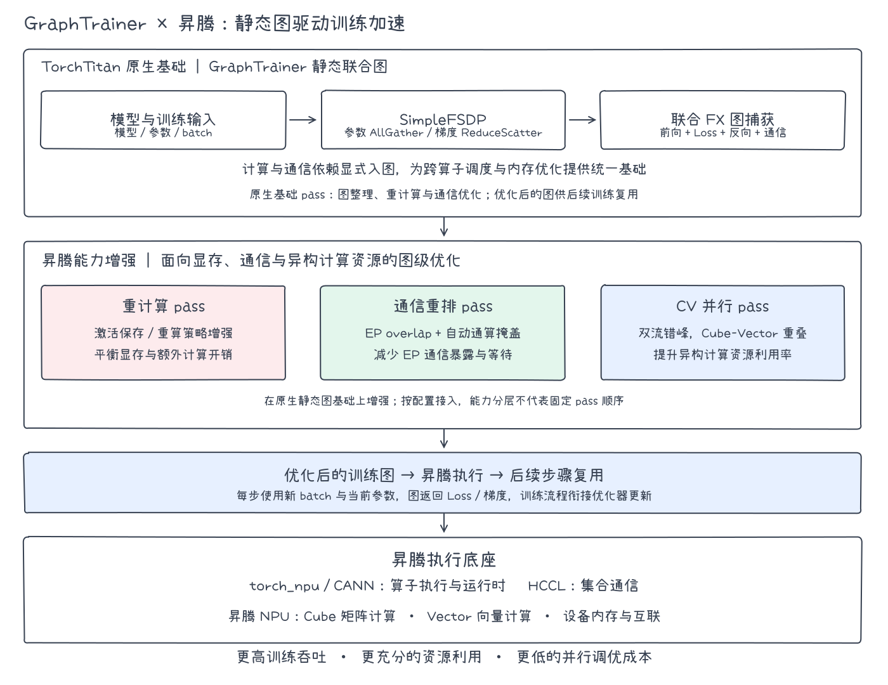
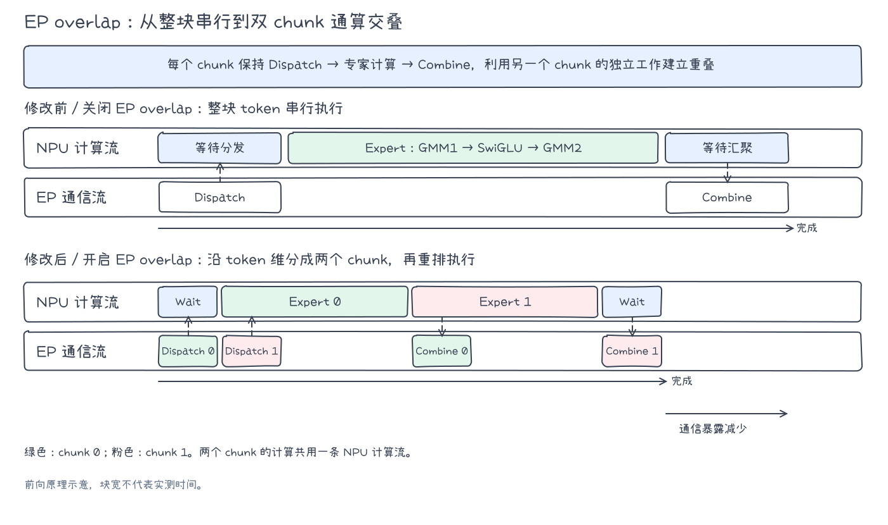
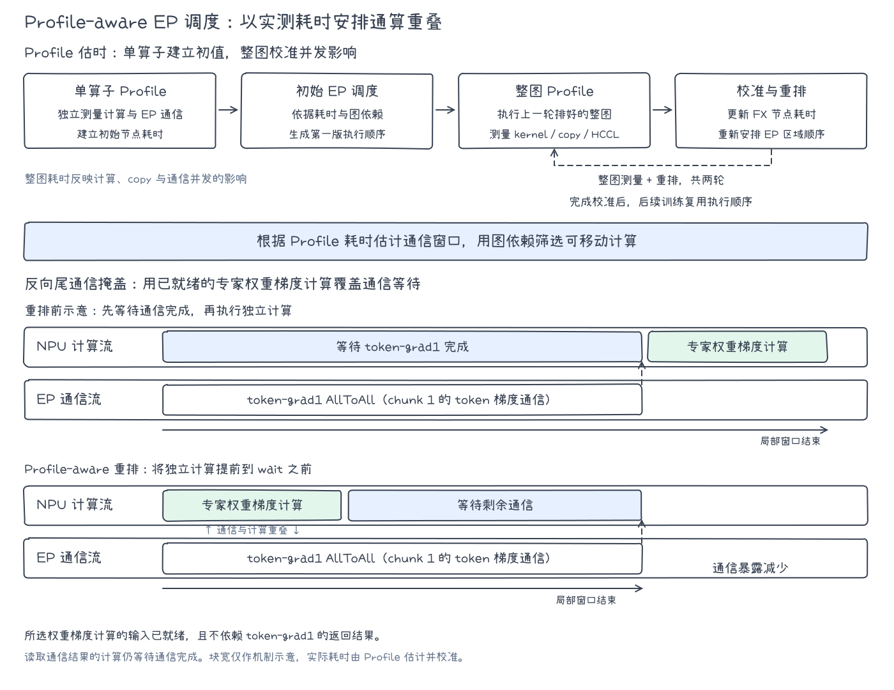
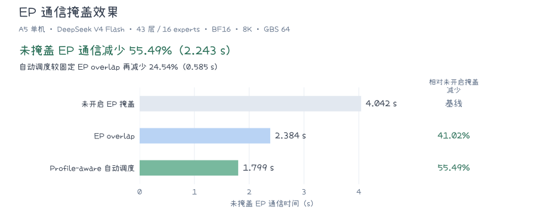
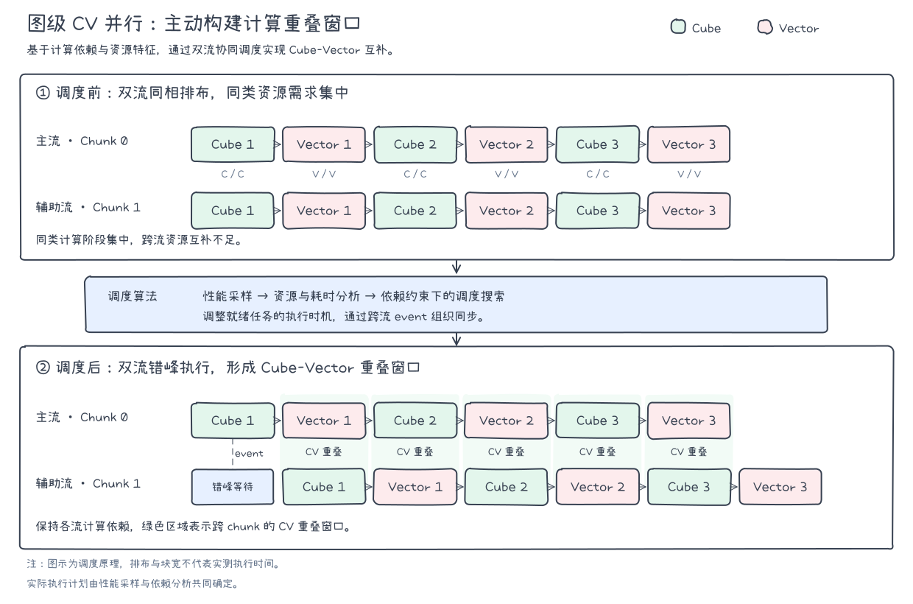
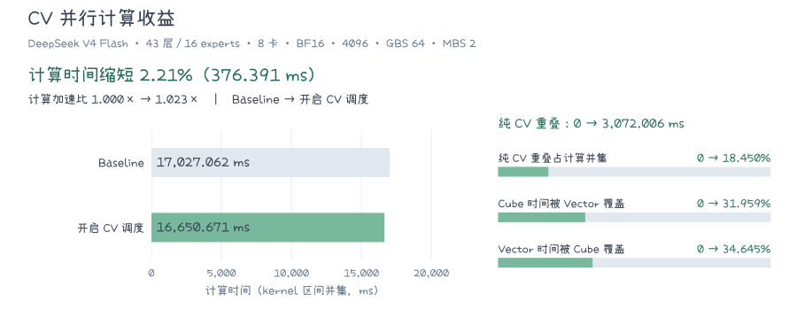

# 训练图优化能力：Profile-aware 通算与 CV 掩盖

[返回总览](../ascend950_superpod_moe_pretrain_system_reference.md)

## Highlights

- **静态图整网加速** 面向昇腾 950 的计算与通信特点，联合 [HyperParallel](https://github.com/mindspore-ai/hyper-parallel) 团队，在 TorchTitan-NPU GraphTrainer 中优化图级训练机制。典型双机裁剪配置下，BF16 吞吐较未开启 compile 的 FSDP2 eager 提升 **12.79%**，通信未掩盖时间占比仅为 **3.84%** 。
- **Profile-aware EP 通信掩盖** 用单算子 Profile 估时、整图 Profile 校准，自动编排 EP 通信与计算；基于 950 超节点实测，未掩盖 EP 通信时间减少 **55.49%**。
- **图级 CV 并行** 让一个 chunk 的 Cube 计算与另一 chunk 的 Vector 计算在双流上重叠；独立实验中，计算时间缩短 **2.21%**。

## 1. GraphTrainer：静态图加速

DeepSeek-V4 的一个训练 step 包含专家路由和 AllToAll、专家矩阵乘、注意力中的向量处理，以及参数收集和梯度归约。即使单个算子执行更快，通信等待、Cube 与 Vector 的交替空闲、激活保存和重算仍可能限制整步性能。昇腾 950DT 具备面向训练的高速互联与更强的 Vector Core；这些硬件能力能否转化为吞吐收益，还取决于任务间的依赖和执行顺序。

TorchTitan 原生 GraphTrainer 将前向、Loss 与反向捕获为联合 FX 图，并通过 **SimpleFSDP** 将参数 AllGather 与梯度 ReduceScatter 显式表达为图内操作。这使计算、通信和激活保存/重算能够按图依赖一并分析。图优化后的执行计划供后续 step 复用。

TorchTitan-NPU 在此基础上增加三类昇腾图级能力：**重计算 pass** 调整激活保存与重算策略，**通信重排 pass** 深化 EP overlap 与自动通算掩盖，**CV 并行 pass** 在双计算流上错峰安排 Cube 与 Vector 任务。优化后的图由昇腾软件栈与 NPU 执行。

*图 1：基于 TorchTitan 原生静态图基础，面向昇腾增强重计算、通信重排与 CV 并行能力。*

### 1.1 整网收益

在 **A5 双机、序列长度 4096、MBS=2 的 DeepSeek-V4 裁剪配置**下，GraphTrainer BF16 的实际吞吐由 FSDP2 eager 的 1696 TPS 提升至 1913 TPS，提升 **12.79%**，通信未掩盖时间从746ms优化到347ms，占比 **3.84%**。本组 FSDP2 未开启 compile。

| 指标 | FSDP2 eager BF16 | GraphTrainer BF16 | GraphTrainer MXFP8 |
|---|---:|---:|---:|
| 计算（ms / 占 E2E） | 8403 / 78.81% | 7923 / 87.77% | 6980 / 88.49% |
| Free（ms / 占 E2E） | 1514 / 14.20% | 757 / 8.39% | 409 / 5.19% |
| 通信总时长（ms / 占 E2E） | 1309 / 12.28% | 1590 / 17.61% | 1674 / 21.22% |
| 未掩盖通信（ms / 占 E2E） | 746 / 7.00% | **347 / 3.84%** | 499 / 6.33% |
| E2E 估算（ms） | 10663 | 9027 | 7888 |
| 实际吞吐（TPS） | 1696 | 1913 | 2160 |
| 相对 FSDP2 eager BF16 | 基线 | +12.79% | +27.36% |

*E2E 按“计算 + Free + 未掩盖通信”推算；各占比以对应方案的 E2E 估算值为分母。Profile 采集可能拉长执行时间，因此 E2E 估算值不替代同表的实际 TPS。MXFP8 相对 BF16 基线的吞吐变化还包含精度变化，不能视为纯图优化收益。GraphTrainer 的显存优势为选择性重计算留出更多调整空间，故本组计算时间低于 FSDP2。*

## 2. EP 通信掩盖

### 2.1 场景与瓶颈

DeepSeek-V4 的 MoE 层先通过 AllToAll 将 token 分发给专家，完成专家计算后再通过 AllToAll 汇聚。通信与计算存在先后依赖。动态路由还会使各 rank 的 token 数、通信量和专家计算耗时随输入变化。若整个 MoE 区域串行执行，通信等待会进入训练关键路径。即使计算和通信使用不同流，也需要独立的计算任务才能掩盖等待。

EP overlap 在 A3 上已打通，但现有实践中端到端收益尚不理想。能掩盖多少通信，取决于实际通信时延、专家计算窗口和路由负载。DeepSeek-V4 的专家计算与两次 AllToAll 交替出现；分块后可能出现跨 chunk 的独立任务。昇腾 950DT 的单芯片对外 IO 带宽峰值为 2 TB/s，并配备灵衢互联。参见[昇腾 950 NPU 架构白皮书](https://public-download.obs.cn-east-2.myhuaweicloud.com/ascend/%E6%98%87%E8%85%BE950%20NPU%E6%9E%B6%E6%9E%84%E7%99%BD%E7%9A%AE%E4%B9%A6.pdf)和[灵衢超节点参考架构白皮书](https://github.com/codehubcloud/UnifiedBus/blob/master/UB-SuperPoD-Architecture-White-Paper-zh.pdf)。互联能力有望缩短通信时长，图级调度可利用剩余通信窗口。950 相对 A3 的 EP overlap 增量仍需同配置实测。

**基于 HyperParallel 的静态图技术，结合 TorchTitan 社区的双 chunk EP 切图，在 GraphTrainer 中推进 EP 通信掩盖：先形成可重叠的 MoE 图，再利用静态图依赖与设备 Profile，按实测通算成本决定节点顺序。**

### 2.2 EP overlap

EP overlap 将 MoE 区域拆成两个 chunk。一个 chunk 执行专家计算时，另一个 chunk 可执行 EP 通信，从而减少通信暴露。

在昇腾上，两个 chunk 的专家计算共用计算流，EP AllToAll 由通信流推进：chunk 0 的专家计算覆盖 chunk 1 的 Dispatch，chunk 1 的专家计算覆盖 chunk 0 的 Combine，使原本串行暴露的通信与计算交叠。

*图 2：EP overlap 将整块串行执行转为双 chunk 通算交叠。*

TorchTitan 社区的原生 EP 调度依据图结构、AllToAll 的 launch/wait 标记和固定规则排列两个 chunk，不使用设备实测耗时选择顺序。我们与 TorchTitan-NPU 社区基于现有 EP overlap 切图，完成通信组隔离与符号 shape 处理，打通了 DeepSeek-V4 在昇腾上的分块执行和通信重叠。相关能力已合入 TorchTitan-NPU。下节的 Profile-aware 调度保留这些切图结果，替换原生固定调度。

### 2.3 Profile-aware 自动通算掩盖

DeepSeek-V4 的 MoE 图包含 routed expert、shared expert、路由权重处理及多次 AllToAll。相同的计算任务放在不同通信窗口中，会产生不同的掩盖效果；token 规模、算子布局和昇腾设备的执行特性又会改变窗口长度。通算重叠后，计算、copy 与 HCCL 的资源竞争还可能拉长节点耗时，单算子独立运行时的测量值无法完整反映这一变化。

HyperParallel 和 TorchTitan-NPU 社区协作实现的 Profile-aware 自动通算掩盖以 **“单算子 Profile 建立初始耗时、整图 Profile 校准并发耗时”** 构建 cost model，再根据图依赖估算不同顺序的通信暴露时间。这是与 TorchTitan 社区原生 EP 固定调度的核心区别：调度决策引入目标 NPU 的实测耗时，并随整图测量结果迭代修正。该能力已合入 TorchTitan-NPU，方案见 [Issue #136](https://gitcode.com/cann/torchtitan-npu/issues/136)。

1. **单算子 Profile：建立初始耗时。** 在目标 NPU 上分别执行计算与通信算子的 benchmark，测量设备侧耗时，形成节点级 cost model。输入保留 shape、dtype 和布局；MoE 动态路由部分按负载均衡假设，为 AllToAll、Grouped MM 和 permute/unpermute 构造匹配的 token workload，使通信量与专家计算量相互对应。对测量结果进行跨 rank 对齐后，用于首次调度。
2. **按耗时调度：把计算放入合适的通信窗口。** 调度器根据 cost model 估计通信剩余时间和下一次通信的输入准备耗时，优先保持通信连续下发，再用已就绪的独立计算填充窗口。它同时比较候选通信顺序的预计收益，尽早解锁后续专家计算。节点移动遵循图依赖，各 rank 保持一致的通信下发顺序。
3. **整图 Profile：校准并发耗时，再次调度。** 执行上一轮排好的完整 GraphTrainer 图，采集计算 kernel、copy 和 HCCL 通信在真实执行上下文中的耗时，关联回 FX 节点并进行跨 rank 对齐。这样，通算并发引起的耗时变化能够反馈到 cost model，用于下一轮排程。当前流程在首次调度后进行两轮整图测量与重排，生成的执行顺序供后续训练复用。

*图 3：上半部分展示基于 Profile 的耗时估计与调度迭代，下半部分展示反向尾通信的调度前后对比。chunk 1 的 token 梯度 AllToAll（token-grad1）下发后，将输入已就绪、且不依赖该通信返回的专家权重梯度计算提前到 wait 之前，覆盖部分通信等待。读取通信结果的后续计算仍在通信完成后执行。图中块宽为机制示意，不代表实测耗时。*

在 DeepSeek-V4 中，自动调度利用前向与反向的多类 EP 通信窗口，将已就绪的专家计算、梯度计算和后续通信准备工作安排到通信执行期间：

- **前向 token/score 分发通信。** 按预计收益调整 token 与 score 的 Dispatch 顺序，更早解锁 chunk 0 的 routed-expert 计算，用于掩盖 chunk 1 的分发通信。shared-expert 计算则按窗口长度分配到首尾通信，减少计算集中在首段、尾段缺少掩盖的问题。
- **反向 combine-grad 通信。** 这类通信将输出梯度送回专家侧。其执行期间，可安排另一 chunk 的通信输入准备、已就绪的 shared-expert 反向计算，或另一 chunk 的 routed-expert 第一阶段反向计算。
- **反向 score-grad 通信。** 专家反向先通过 W2 的输入梯度计算得到中间梯度，并形成 score 梯度通信；乘 score、SwiGLU 反向及 Wg/Wu 的输入梯度计算继续推进 token 梯度。调度器利用两个 chunk 的阶段差，将已就绪的专家反向计算和下一次通信准备安排到 score-grad 窗口中。
- **反向 token-grad 通信。** 在 chunk 0 的 token 梯度通信期间，可推进 chunk 1 的专家后续反向计算与通信准备；到 chunk 1 的尾通信阶段，则利用已就绪的 routed-expert 权重梯度、shared-expert 反向和 router/gate 反向计算掩盖等待。图 3 展示了其中权重梯度计算与尾通信的重叠关系。
- **token-count exchange 通信。** 路由计数交换也纳入通信掩盖范围，用已就绪且无依赖冲突的计算覆盖其等待。配套的 D2H 优化将双 chunk 的计数拷贝集中下发，并合并 host 同步，进一步减少通信准备阶段的阻塞。

DeepSeek-V4 的 [Profile 对比](https://gitcode.com/cann/torchtitan-npu/issues/136#52-profiling%E5%AF%B9%E6%AF%94)展示了共享专家计算在首尾通信间的重新分配，以及 token/score 通信顺序调整带来的掩盖变化。Profile 提供节点耗时，调度器据此估计各段通信窗口，再结合图依赖选择可移入的计算。

### 2.4 性能验证

未开启 EP 掩盖时，baseline 单步时间约 **40.14 s**，其中未掩盖 EP 通信为 **4.042 s，占 10.07%**。本组在相同优化特性下，对比关闭 EP 掩盖、固定 EP overlap 和 Profile-aware 自动调度，观察通信暴露的变化，属于非最优整网性能场景。实验采用 A5 单机、DeepSeek V4 Flash 适配配置（43 层、16 experts）、BF16、序列长度 8192、GBS=64。

*图 4：柱长表示未掩盖 EP 通信时间，右侧列出相对 baseline 的降幅。EP overlap 减少 41.02%，Profile-aware 自动调度减少 55.49%；图上方另列自动调度相对固定 EP overlap 的增量收益。所有降幅均针对通信暴露时间。*

双 chunk 切分先为计算与通信创造重叠机会，Profile-aware 调度再根据实测耗时调整任务顺序，使未掩盖 EP 通信进一步降至 1.799 s。两阶段累计减少 2.243 s 的通信暴露。

## 3. CV 并行

### 3.1 场景与瓶颈

稀疏注意力、MoE 和复杂残差连接使矩阵乘与归一化、归约、索引选择等操作在训练图中交错出现。矩阵计算加快后，非矩阵阶段及其串行等待可能占据更多时间。Ascend 的 Cube 与 Vector 分别承担不同类型的计算；若所有任务沿单条依赖链顺序执行，两类资源会交替空闲。

DeepSeek V4 的压缩稀疏注意力（CSA）、高度压缩注意力（HCA）和流形约束超连接（mHC）包含选择、归一化、残差混合等向量侧工作，并与专家矩阵乘、线性投影交错。V4.1-Flash 的 CSA2 还引入跨层 KV 与索引复用。相关结构参见[DeepSeek V4 模型卡](https://fe-static.deepseek.com/chat/transparency/deepseek-V4-model-card-EN.pdf)与[DeepSeek V4.1-Flash 模型说明](https://huggingface.co/deepseek-ai/DeepSeek-V4.1-Flash)。在这种混合负载下，不同数据块可能同时有已就绪的 Cube 与 Vector 任务；实际重叠程度仍取决于算子耗时和数据依赖。

**昇腾 950DT 增强了 Vector 执行与存储能力。** [华为昇腾 950 NPU 架构白皮书](https://public-download.obs.cn-east-2.myhuaweicloud.com/ascend/%E6%98%87%E8%85%BE950%20NPU%E6%9E%B6%E6%9E%84%E7%99%BD%E7%9A%AE%E4%B9%A6.pdf)给出：第三代 Vector Core 的单核 FP16/FP32 峰值算力较上一版本提升 100%；Unified Buffer 与 Vector ALU 之间新增 RegFile，支持更高的内部带宽和数据复用；950DT 的单芯片高速内存带宽最高 4 TB/s。这些改进可能缩短向量阶段长尾，改变 Cube 与 Vector 任务的耗时关系。**4 TB/s 是芯片级内存带宽，并非每个 Vector Core 的专属带宽**；白皮书未给出图级 CV 并行的端到端增益，目标模型的收益仍需实测。

**针对 DeepSeek-V4 的混合负载与昇腾 950 的异构资源，联合 [HyperParallel](https://github.com/mindspore-ai/hyper-parallel) 团队，在 GraphTrainer 的图级 CV 调度中结合静态图依赖分析、资源识别与设备耗时测量，寻找不同数据块之间的 Cube–Vector 并行窗口。**

### 3.2 双流调度

图级 Cube–Vector（CV）并行沿 batch 维度拆分两个 chunk，并将它们安排在两条计算流上。调度器根据设备采样得到的资源类型与执行耗时，在满足原有依赖的前提下调整任务顺序和跨流同步。一个 chunk 执行矩阵计算时，另一个 chunk 已就绪的向量任务可进入同一时间窗口，形成 CV 重叠。

*图 5：通过双流错峰与跨流同步形成 CV 重叠窗口，算子顺序满足原有计算依赖。*

**算子优化影响向量任务的执行时间，图级调度决定这些任务能否与矩阵计算重叠。** 当任务粒度匹配时，一个 chunk 的向量任务可利用另一 chunk 的矩阵执行窗口，减少串行等待和向量长尾。白皮书还介绍了芯片内 Cube 与 Vector 直接交换数据的算子级 CV 融合通路；本文讨论的是训练图中的跨算子双流调度，两类收益不能直接相加。

GraphTrainer 将 chunk 切分与 CV 调度封装为图优化 pass，可通过配置手动开启。切分 pass 按 batch 构建双 chunk 计算图，调度 pass 编排算子顺序与跨流同步，由 NPU 侧运行时执行。模型代码无需逐层编写并行逻辑。

调度器根据计算依赖、资源类型和设备实测耗时，通过流内重排与跨流 event 搜索 Cube/Vector 重叠时序，并约束预计执行跨度。采样、搜索和实测验收在启动阶段完成；稳态训练复用执行计划。

新模型接入时需检查 batch/seq 可拆分性、metadata 对齐和依赖语义。满足这些条件后，可复用已有切分与调度 pass，无需另写调度算法或专用融合 kernel。模型规模或算子实现变化时，可重新采样并调整执行计划。

### 3.3 计算收益

CV 并行聚焦**计算时间与 Cube–Vector 资源重叠**。采用 DeepSeek V4 Flash 适配配置（43 层、16 experts），在 8 卡、BF16、序列长度 4096、GBS=64、MBS=2 条件下，对比 baseline 与开启 CV 调度的 chunk_scheduled。

*图 6：左侧比较计算时间，按 kernel 执行区间的并集统计，坐标从零起算；右侧展示纯 CV 重叠时长及三项资源重叠比例，各比例条的满幅为 100%。箭头两端依次为 baseline 和开启 CV 调度后的结果。*

开启调度后，原本顺序执行的矩阵与向量任务形成了 3072.006 ms 的纯 CV 重叠。从各类资源自身的执行时间看，31.959% 的 Cube 时间与 Vector 重叠，34.645% 的 Vector 时间与 Cube 重叠；在本次配置下，计算并集同时缩短了 376.391 ms。

*计算时间按 kernel 执行区间的并集统计，重叠部分只计一次，不含纯通信和空闲区间；纯 CV 重叠不含 MIX 算子。两项覆盖比例分别以 Cube 和 Vector 时间为分母，不作相加。计算加速比为 baseline 与 chunk_scheduled 的计算时间之比。*

### 3.4 未来规划

下一阶段将在现有 CV 并行方案基础上，探索基于 QoS 的自适应带宽调度。Cube 与 Vector 具备并行计算能力，但并发运行时仍会竞争共享内存带宽。后续将根据运行时负载和性能反馈，自适应调整并行时两类任务的 QoS 带宽优先级，缓解带宽竞争，进一步提升 CV 并行效率和整体性能。

## 4. ChunkLoss 优化

大词表训练中，完整 logits 占用较多显存。ChunkLoss 将 LM head 与 Loss 按 chunk 分段计算，以控制中间张量规模。在 GraphTrainer 的 SimpleFSDP 路径中，各 chunk 可能分别触发一次 head 梯度 ReduceScatter；chunk 数增加时，重复通信也会增加。

优化保留分块计算，将**同一 microbatch 内各 chunk 的 head 梯度先在本地以 FP32 累加，再统一执行一次 ReduceScatter**。对于满足条件、包含 K 个 loss chunk 的 head，梯度归约由 K 次合并为 1 次，减少集合通信的重复启动与传输。梯度作为显式输出进入 GraphTrainer 训练流程，跨 microbatch 的梯度累加语义保持不变。

该优化已合入 TorchTitan-NPU，对应改进也已提交 TorchTitan 社区。目前覆盖满足约束的一维 SimpleFSDP Linear head 路径，使用 FP32 主参数与梯度归约；其他配置沿用原路径。实际收益需同时查看 head 梯度暂存显存、通信耗时和整网吞吐。

---

[返回总览](../ascend950_superpod_moe_pretrain_system_reference.md)
