# 面向千卡、万卡集群的预训练高可用能力

[返回总览](../ascend950_superpod_moe_pretrain_system_reference.md)

## Highlights

* **故障恢复加速**：结合 HCCL 超簇建链、page cache 预热和编译缓存，DeepSeek-V4 Flash 128 卡进程恢复时间**小于 5 分钟**。
* **DP 弹性**：以训练副本为故障处置单元。副本故障后，健康副本既可以缩减规模继续训练，也可以在线等待副本补齐；替换副本同步状态后重新加入。
* **SDC 检测**：复用 eager 模式的原生检测能力，并扩展到编译训练。梯度检测与累积边界对齐，矩阵校验预置在图中、运行时按需激活，通信检测独立运行。
* **Loss spike 回滚**：从 checkpoint 恢复后，在一段区间内启用前瞻路由，通过路由预计算、缓存与回放，有效降低异常复发的概率。

## 1. 背景

训练故障的代价包括停机等待、进度回退后的重算，以及恢复前的准备工作。TorchTitan-NPU 的各项高可用能力分别作用于训练与恢复的不同阶段（图 1）：正常训练中，SDC 检测负责发现计算、梯度与通信异常；副本故障由 DP 弹性训练应对，loss 异常则通过 Loss spike 回滚处理；需要重新拉起进程时，通信建链优化与缓存复用可以缩短恢复准备时间。这些能力都用于保障训练连续性，但在正常训练中也会引入检测与协调开销，这部分开销同样需要控制。

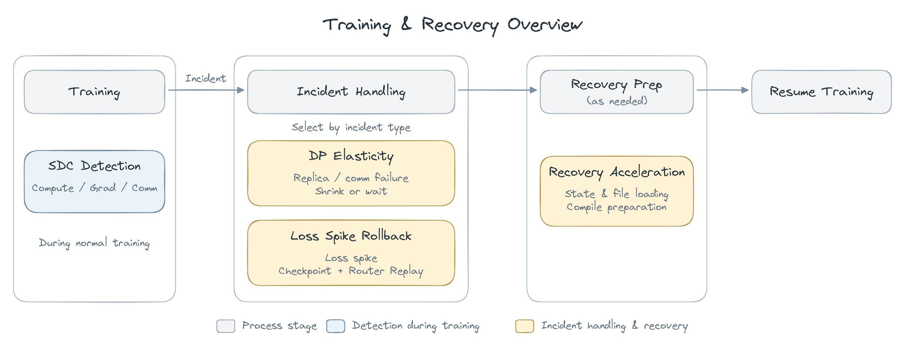

*图 1：训练与恢复过程总览*

TorchTitan-NPU 是 TorchTitan 的昇腾适配层，负责将设备、通信、算子及高可用能力接入训练流程。其依赖的软件栈如图 2 所示：PyTorch 提供 FSDP2、分布式 checkpoint（DCP）和 `torch.compile` / TorchInductor；torch-npu 提供 NPU 设备、算子和原生检测接口；CANN 提供算子、Runtime 与 HCCL 通信，AutoFuse 支撑对应编译路径的代码生成与优化。

在部署层面，本实践使用 Docker 提供运行环境，由 Kubernetes（K8s）编排训练任务并拉起替换进程；checkpoint 存储用于持久化训练状态，文件页缓存与编译缓存则让恢复过程可以复用已完成的准备工作。

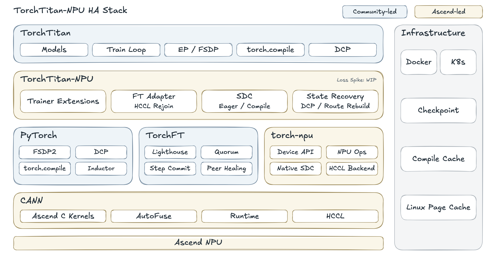

*图 2：高可用训练软件栈*

## 2. 故障恢复加速

故障恢复既要重新获取可用资源，也要恢复训练状态和执行环境。在需要重新拉起进程的场景下，从故障发生到完成首次有效更新、再到吞吐恢复稳定，其间的准备工作直接影响训练中断的时长。

### 2.1 恢复流程与耗时瓶颈

故障处置完成、资源就绪后，系统重新拉起训练进程，加载代码与依赖，初始化模型和通信，再从 checkpoint 或健康副本恢复训练状态。开启 `torch.compile` 的任务还需要准备编译产物，之后才能恢复训练，并逐步达到稳定吞吐。

这一过程的耗时主要集中在**通信建链、checkpoint 磁盘读取和图编译**三个环节：大规模通信域的拓扑分发与并发连接容易拉长建链等待；大体量权重和优化器状态的读取受存储带宽限制；未命中编译缓存时，训练图需要重新编译。

### 2.2 优化方案

针对这三个环节，分别采用 HCCL 超簇建链、page cache 预热和编译缓存，减少建链、读取和编译的等待时间。图 3 标出了训练进程启动流程中的关键瓶颈及对应的优化手段。

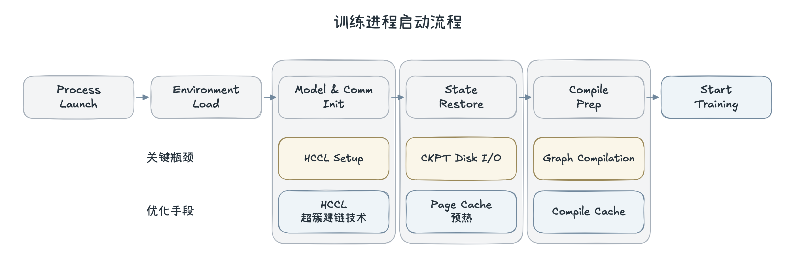

*图 3：训练进程启动流程*

* **HCCL 超簇建链技术优化通信初始化。** 该技术面向大规模通信域的创建，复用 HCCL 的分层广播与连接重试能力：拓扑信息由 root、leader、rank 分层分发，分散主节点的数据发送负载；连接失败时按间隔重试，并通过超时保护控制等待时间，缓解建链拥塞。在故障后需要重新创建通信域的场景中，该能力可以缩短建链等待、提高建链成功率。详见 [HCCL 超簇建链技术介绍](https://hwcomputing.csdn.net/6a68638310ee7a33f293361b.html)。

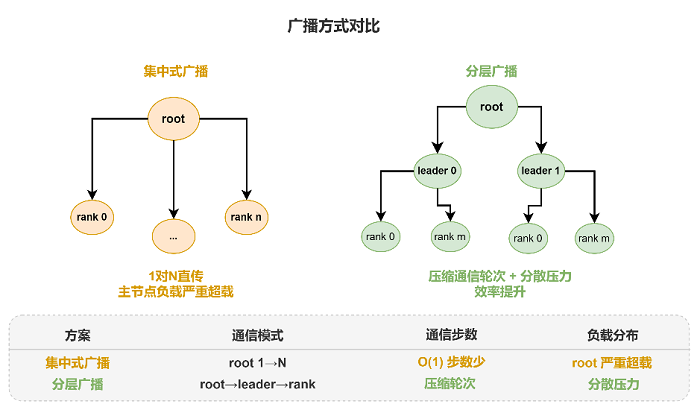

*图 4：HCCL 集中式广播与分层广播对比*

以下引用了昇腾 A3 超节点上的公开测试结果，对比集中式建链与 HCCL 超簇建链在不同卡数下的耗时。在 51,200 卡规模下，建链耗时由 5,034.45 秒降至 417.59 秒。

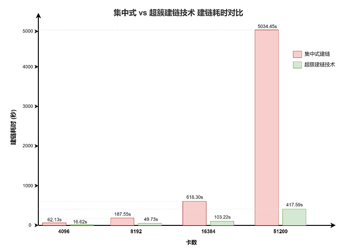

*图 5：集中式建链与 HCCL 超簇建链耗时对比*

* **Linux page cache（页缓存）预热减少磁盘读取。** 预先读取所需的代码、依赖库及 checkpoint 文件，使文件页进入主机内存缓存。之后同一宿主机上的训练进程加载这些文件时，只要缓存仍然驻留，就能减少磁盘访问，缩短环境加载与状态读取中的 I/O 等待。详见 [Linux page cache](https://docs.kernel.org/admin-guide/mm/concepts.html)。
* **编译缓存复用训练图的编译结果。** 保留 `torch.compile` 的编译产物，由恢复后的进程直接加载，减少重复编译。复用的前提是对应的 NPU 编译后端支持缓存复用，且软件版本、硬件、训练图与输入形状均与生成缓存时一致；实际收益取决于缓存命中情况。详见 [PyTorch 编译缓存](https://docs.pytorch.org/tutorials/recipes/torch_compile_caching_tutorial.html)、[缓存配置](https://docs.pytorch.org/tutorials/recipes/torch_compile_caching_configuration_tutorial.html)。

两类缓存在新进程恢复流程中的作用位置如图 6 所示。

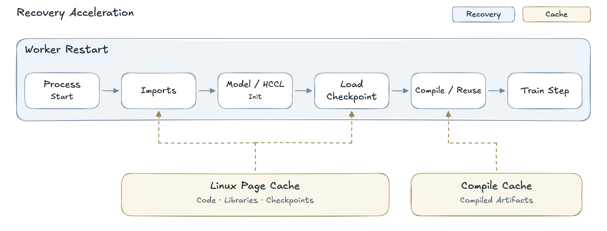

*图 6：故障恢复中的缓存作用位置*

### 2.3 实验结果

以 DeepSeek-V4 Flash 128 卡训练为例，开启 `torch.compile` 并加载权重和优化器状态（约 2.2 TB）时，训练进程拉起原本约需 30 分钟，其中编译耗时 19 分钟，权重加载耗时 8 分钟。开启 HCCL 超簇建链、Inductor 编译缓存和 page cache 预热后，进程拉起时间缩短至约 4.7 分钟（图 7）。由于资源限制，只做了128卡实验，而且Hccl超簇建链已默认使能，因此Hccl建链耗时占比相对较小。

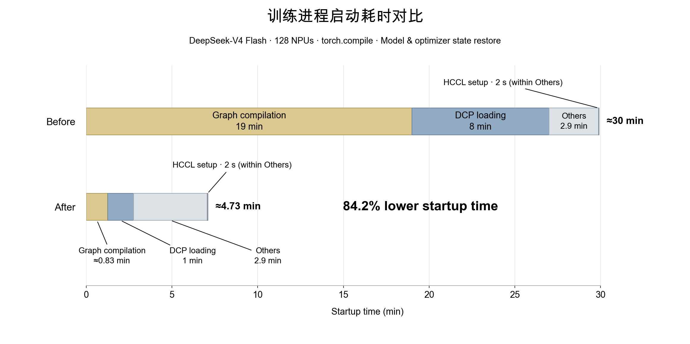

*图 7：训练进程启动耗时对比*

## 3. DP 级弹性训练

DP 级弹性训练以训练副本为故障处置单元。部分副本退出后，可以采用两种续训方案：**弹性续训**允许健康副本缩减规模继续训练，替换副本就绪后再加入；**在线等待续训**保留健康副本的进程，等副本补齐后再恢复训练。前者侧重减少训练停顿，后者适用于要求维持原有 DP 副本规模的任务。

### 3.1 方案介绍

TorchFT 以 replica（训练副本）为协调单元：一个副本由一张或多张 NPU 构成，副本内部可以使用 FSDP、EP 等并行策略，副本之间同步梯度、共同更新模型。在整体分工上，TorchTitan 负责训练循环、并行切分和训练状态保存，TorchFT 提供副本协调、更新提交决策和状态同步，TorchTitan-NPU 则将这些能力接入昇腾设备与 HCCL 通信。

NPU 侧的适配包括设备与通信恢复、训练现场清理和状态承接三部分。通信故障后，按需通过 `stop_device` / `restart_device` 停止并恢复设备任务，恢复仍保留的 HCCL 通信器，并在副本重新协调时重建故障通信组；随后清理残留梯度及 FSDP、MoE 等临时状态。替换副本需要承接状态时，由健康副本按需生成 CPU 状态快照，供替换副本恢复模型、优化器等状态。

两种方案共用上述恢复机制，区别在于继续训练所需的最小副本规模，以及替换副本就绪前是否继续推进训练。

#### 3.1.1 弹性续训：缩减副本继续训练

如果允许副本数减少，可以将最小参与规模 n_min 设为小于初始副本数 n。一个副本故障退出后，只要剩余副本满足 n−1 ≥ n_min，健康副本即可在缩减规模下持续训练，无需等待缺失副本补齐（图 8）。

1. **1.退出故障副本并恢复通信。** TorchFT 重新协调可参与训练的副本集合，TorchTitan-NPU 处理受影响的设备与 HCCL 通信，使健康副本重新具备执行条件。
2. **2.健康副本继续训练。** 当 n−1 ≥ n_min 时，健康副本清理残留梯度和临时训练状态，丢弃被中断的未提交尝试，然后读取新数据继续训练。
3. **3.按需补回副本。** 如需恢复原有副本规模，K8s 拉起替换副本后，替换副本从健康副本获取模型、优化器等已提交状态，并从自身 checkpoint 恢复数据位置。完成同步协调后，替换副本加入后续训练，副本数恢复到 n。

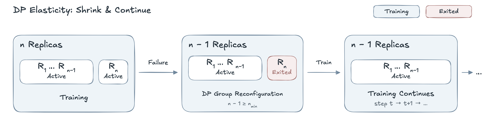

*图 8：弹性续训：缩减副本继续训练*

#### 3.1.2 在线等待续训：副本补齐后继续训练

如果需要维持原有 DP 副本规模，则将最小参与规模 n_min 设为 n。此时单个副本退出后，剩余 n−1 个副本不足以继续训练。健康副本会保留进程和已提交的训练状态，暂停训练更新，等待 K8s 拉起替换副本。替换副本完成状态承接和数据位置恢复后，TorchFT 重新协调全部 n 个副本，共同恢复训练。

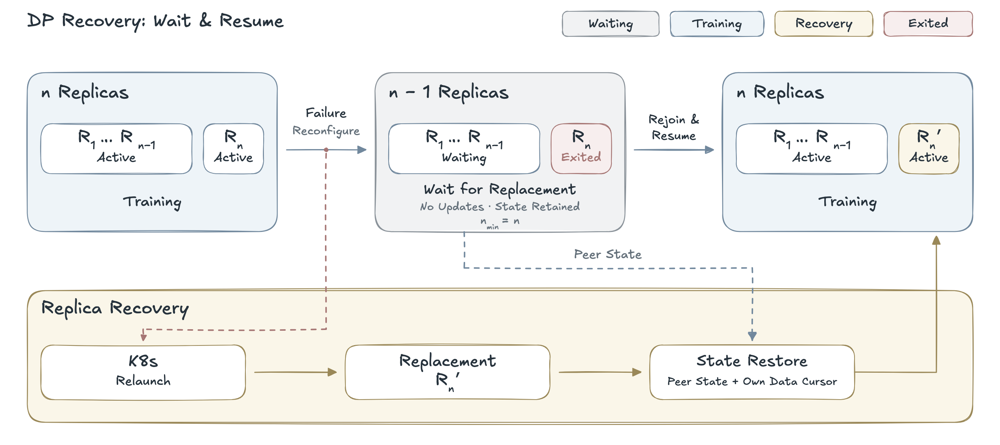

*图 9：在线等待续训：副本补齐后继续训练*

这种方案避免了健康副本随故障副本一起重启，但训练暂停时间包含替换副本的启动与状态同步耗时，等待时长也受协调超时等配置约束。与图 8 所示的弹性续训相比，在线等待方案没有 n−1 个副本继续训练的阶段。

### 3.2 实验结果

本节围绕 DeepSeek-V4 训练，分别考察 TorchFT 开关的精度差异、故障恢复后的精度，以及启用 TorchFT 对训练性能的影响。

1. TorchFT 开关精度对照。 以关闭 TorchFT 的训练为基线，与开启 TorchFT 的双副本训练进行比较。

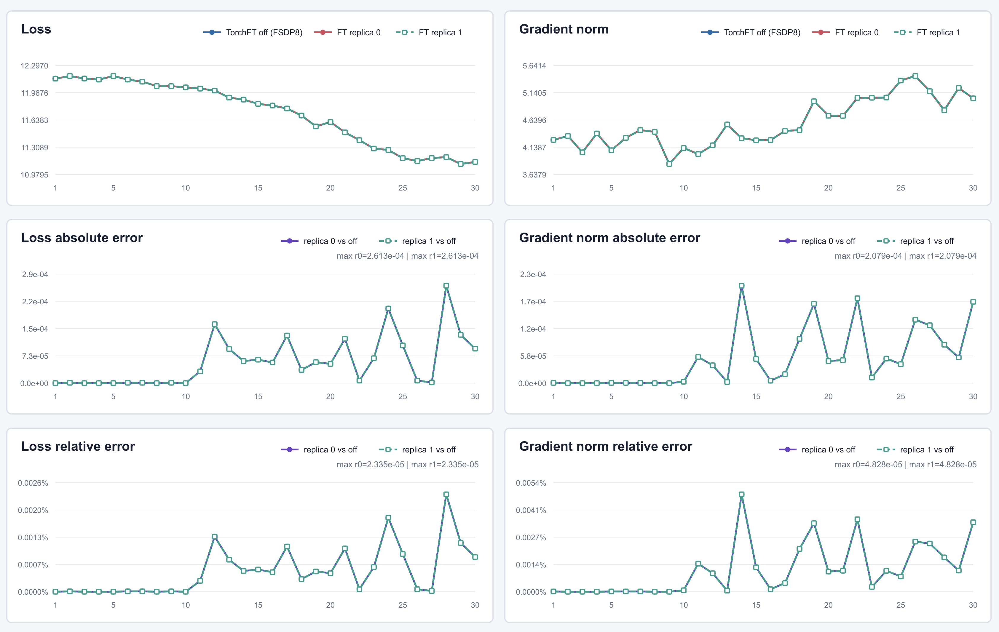

*图 10：TorchFT 开启与关闭的训练精度对照*

2. TorchFT 故障恢复精度对照。 开启 TorchFT 并注入单副本故障，以无故障训练为基线，比较存活副本恢复训练与替换副本接续的结果。
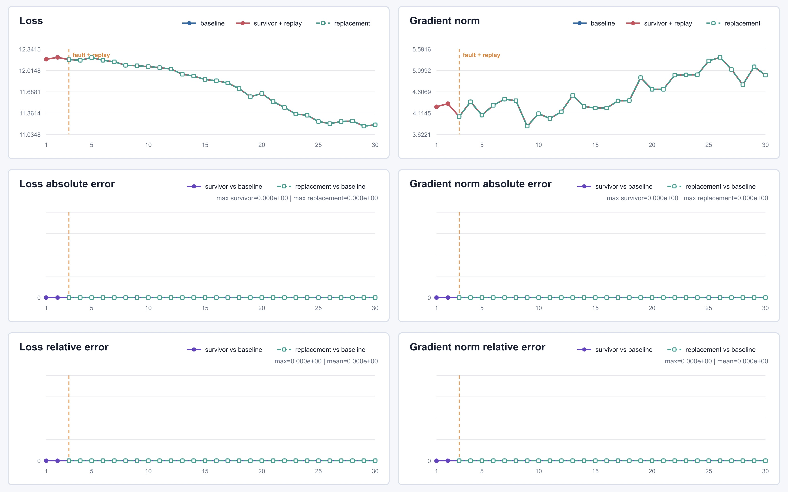

*图 11：TorchFT 历史重放策略的恢复精度对照*

## 4. SDC 检测

SDC（Silent Data Corruption，静默数据损坏）指未被常规错误机制及时报告的数据或计算结果异常，可能来自 HBM 比特翻转、总线或网络故障、计算核出错等。SDC 发生后，训练任务可能仍在推进，错误却随参数更新不断传播，直到一段时间后才表现为 loss 等指标异常。因此，检测需要深入计算和通信过程，不能只依赖任务是否报错。

### 4.1 检测方法与昇腾原生能力

业界常见的检测方法分别基于计算冗余、数据完整性、代数约束或统计特征识别异常：

| 检测方式               | 基本思路                                                                                                                                                                                                                  |
| ------------------------ | --------------------------------------------------------------------------------------------------------------------------------------------------------------------------------------------------------------------------- |
| 冗余计算               | 对同一输入重复执行关键计算，比较结果是否一致。                                                                                                                                                                            |
| 数据完整性校验         | 使用校验和（Checksum）、CRC 或哈希摘要（如 SHA-256），比对数据在读写、传输前后是否一致。                                                                                                                                  |
| ABFT（基于算法的容错） | 为 GEMM 等矩阵运算构造行、列校验和，检查计算结果是否满足对应的代数约束。[ABFT 原理](https://www.netlib.org/utk/people/JackDongarra/PAPERS/alg-based-ft-09.pdf)                                                               |
| 特征值检测             | 采集梯度等张量的统计特征，根据阈值或历史变化识别异常。[昇腾检测示例](https://www.hiascend.com/document/detail/zh/Pytorch/730/ptmoddevg/Frameworkfeatures/docs/zh/framework_feature_guide_pytorch/feature_value_detection.md) |

昇腾通过 torch-npu 提供 eager 模式下的原生 SDC 检测能力，将梯度特征值检测与矩阵 Checksum 校验结合：先观测梯度，异常达到触发条件后再激活矩阵计算校验；通信异常则由 HCCL 独立检测。其中，梯度检测提供异常线索，矩阵校验和通信检测分别检查计算与传输环节。

### 4.2 方案介绍

上述原生能力面向 eager 模式，而编译训练需要把校验纳入训练图，并让梯度检测与训练步对齐。为此，TorchTitan-NPU 复用昇腾原生检测算法，扩展了对 `torch.compile` 的支持。当前的编译适配面向使用 Inductor 的标准 NPU 训练流程，不支持流水线并行。

检测流程如图 12 所示：

1. **1.编译图预置校验。** 首次编译时，通过图变换（Graph Pass）在支持的 BF16 矩阵乘法后插入 Checksum，使校验路径随训练图一同编译。
2. **2.梯度检测与累积边界对齐。** 每个梯度累积窗口完成反向传播后，对选定参数提交检测。检测对象是完整的累积梯度，因此检测节奏与参数更新保持一致。
3. **3.运行时按需激活。** 梯度异常达到触发条件后，在后续训练步激活前向、反向图中预置的矩阵校验。由于校验路径已存在于原图，激活时无需重新编译。

HCCL 检测独立于上述触发过程，在模型构建完成后启用，覆盖此后前向、反向以及训练步之间的相关集合通信，但不覆盖训练器构造期间的初始化通信。

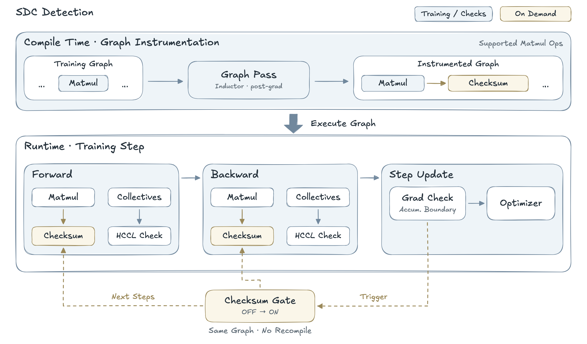

*图 12：SDC 检测流程*

### 4.3 实验结果

以dsv4flash为例，对比开启和关闭梯度检测、通信检测，loss和grad norm一致，开启检测后，性能损失3%以内。

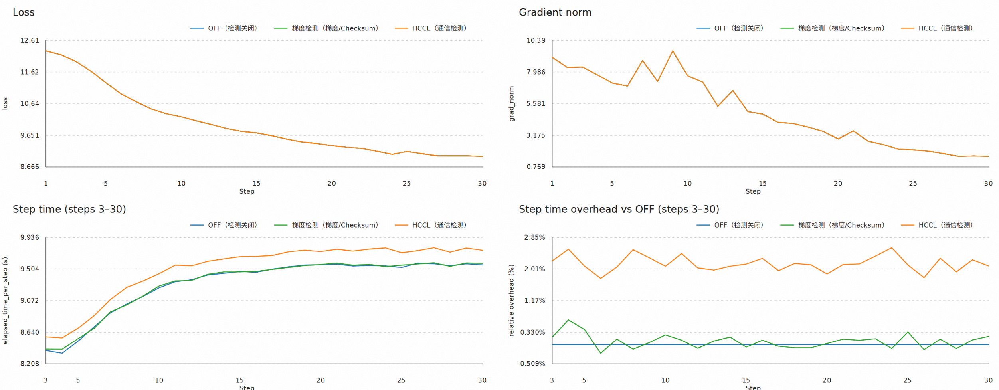

## 5. Loss spike 回滚

MoE 训练出现 Loss spike（loss 突增）后，可以通过 checkpoint 恢复到异常前的状态，但恢复状态本身并不能保证异常不再出现。因此，本文的回滚设计将 checkpoint 恢复与前瞻路由结合，在恢复区间内调整专家的选择方式。

### 5.1 方案介绍

前瞻路由参考了 DeepSeek-V4 技术报告中的 [Anticipatory Routing（§4.2.3）](https://arxiv.org/html/2606.19348v1)：提前读取后续训练数据，计算并缓存各 MoE 层的 Top-k 专家索引；等这些数据参与训练时，再回放已缓存的索引。这样，模型计算和参数更新使用当前权重，专家选择则来自较早时刻的权重。该方案预期通过在时间上错开路由选择与参数更新，降低 Loss spike 复发的概率。

图 13 以同一批数据 Dₜ 为例，展示路由的缓存与回放：在 t−Δt 时刻，使用权重 θ(t−Δt) 预计算路由 Rₜ；到第 t 步训练时，回放 Rₜ 确定专家选择，并使用当前权重 θ(t) 完成计算与参数更新。

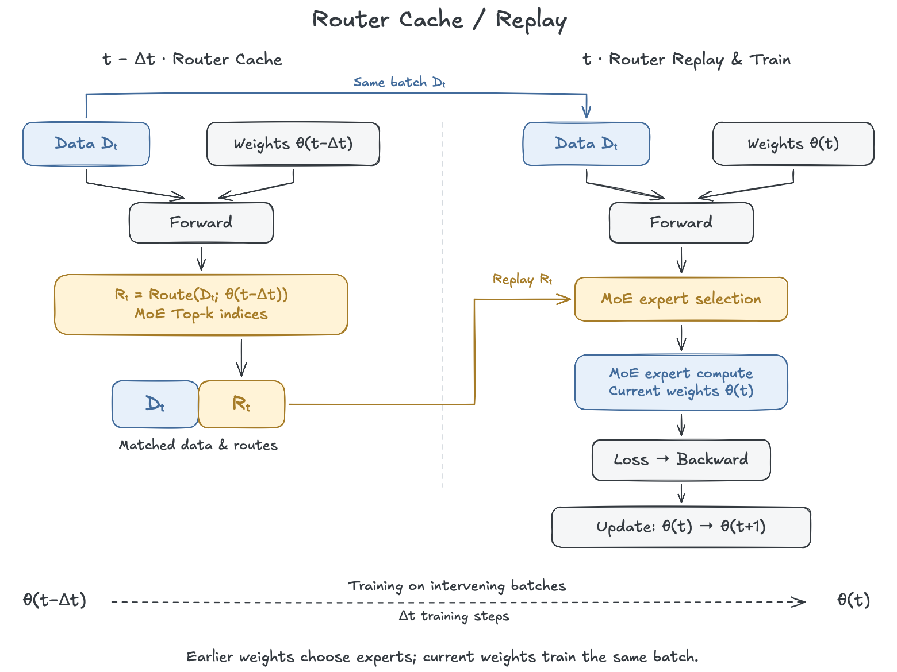

*图 13：Router Cache / Replay 原理*

回滚与前瞻路由按以下顺序衔接（图 14）：

1. **1.恢复 checkpoint。** 选择异常发生前的有效恢复点，恢复模型、优化器、学习率进度和数据位置，并从该位置开始建立前瞻路由窗口。
2. **2.预填充路由窗口（WARMUP）。** 提前读取后续若干批数据，用恢复后的权重执行前向计算，将路由索引与对应数据关联后缓存。此阶段不执行反向传播，也不更新参数。
3. **3.交替预计算与训练（ACTIVE）。** 每一轮先用当前权重为更靠后的一批数据计算路由并追加到缓存，再训练当前批数据：回放其缓存路由，完成前向、反向和参数更新。下一轮使用更新后的权重进行路由预计算，窗口随训练向前推进。
4. **4.排空缓存并返回常规训练（DRAIN）。** 完成预定的交替训练阶段后，停止新的路由预计算，按顺序训练缓存中剩余的数据。缓存消费完毕后，恢复为使用当前权重选择专家的常规训练。

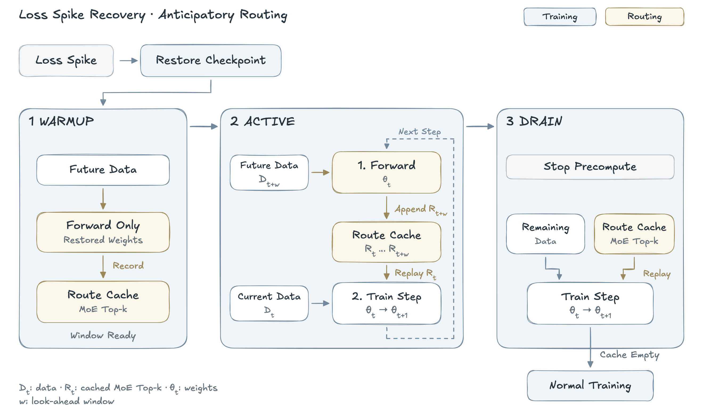

*图 14：Loss spike 回滚与前瞻路由流程*

### 5.2 实验结果

以deepseekv4-flash为例，loss spike发生后触发回滚，并正常进入WARMUP、ACTIVE、DRAIN阶段。

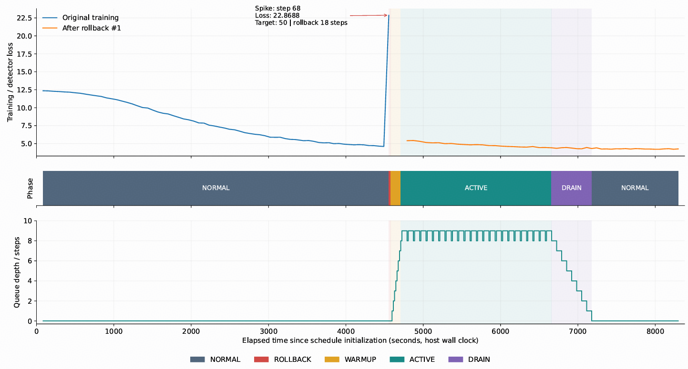

---

[返回总览](../ascend950_superpod_moe_pretrain_system_reference.md)
