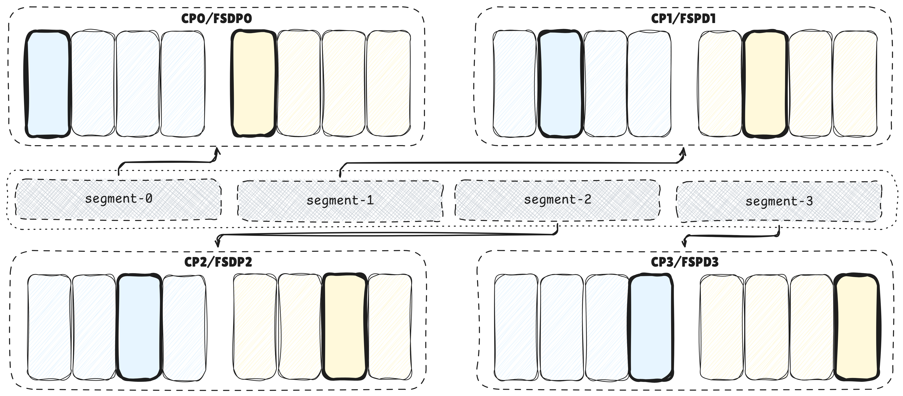
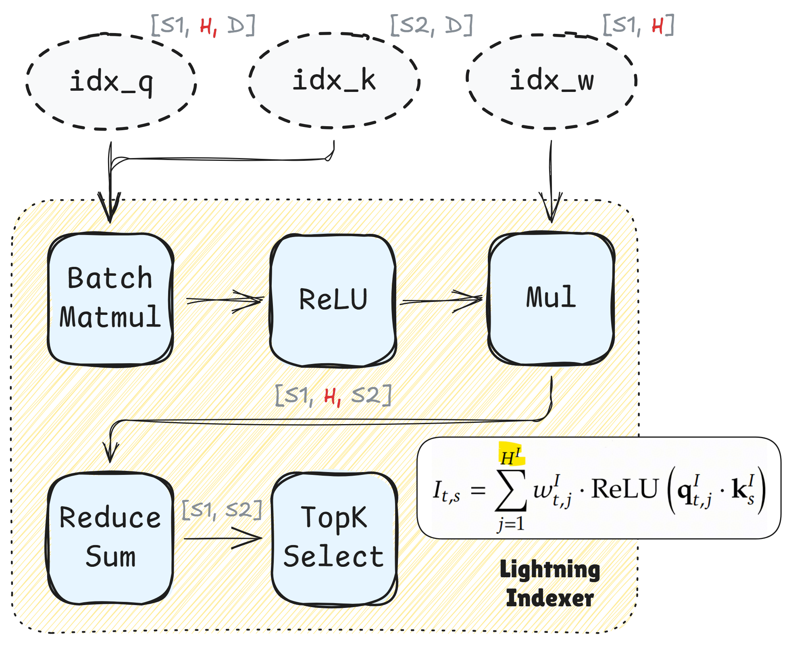
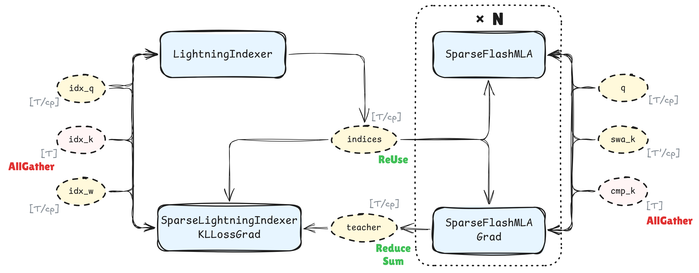
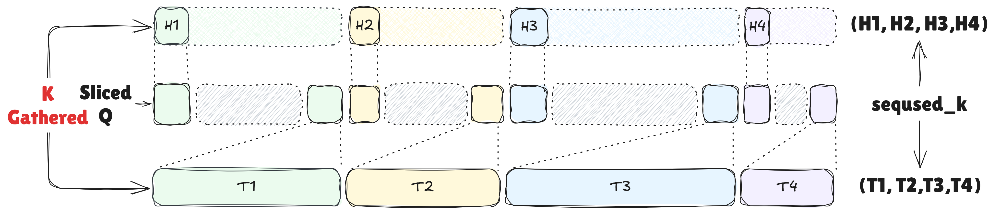

# 128P 规模 950 超节点实现 1M 长序列部署能力

[返回总览](../ascend950_superpod_moe_pretrain_system_reference.md)

## Highlights

* 基于昇腾 950 超节点，在部署策略上采用 CP 域复用 FSDP 域，使用 KVAllGather 序列切分方案，支持 **128P** 部署DeepSeek-V4/V4.1 模型 1M 超长序列训练能力，完成端到端预训练验证。
* 结合昇腾 950 专用融合算子，高效支持 DeepSeek-V4/V4.1 新结构下的长序列切分与动态负载均衡。

## 1. 序列切分整体分布式部署模式及KVAllGather方案选择背景

### 1.1 torchtitan框架下的FSDP+CP混合并行

torchtitan的“底色”是FSDP：每张卡在逻辑上部署完整的模型权重，按照DP域的模式处理不同数据；物理上仅部署部分权重，在前向执行时逐层将模型权重AllGather预取，前向计算结束后丢弃多余权重。序列切分（Context Parallelism， CP）切分的是输入的激活值而非权重，因此FSDP与CP可以完美共存——128P场景下实现FSDP128 + CP128的效果。

### 1.2 为什么选择KVAllGather

DeepSeek系列模型在演进过程中持续通过压缩KVCache降低推理存储开销，并通过稀疏计算降低推理计算与访存开销。V3.2引入的LightningIndexer机制被V4系列继承：注意力计算前，Indexer对完整KV序列打分并选取Top-K，因此注意力计算过程必须提供完整KV序列。可选的CP通信模式为KVAllGather或Ulysses，最终选择KVAllGather，原因如下：

* **KV维度天然精简**：DeepSeek从V2起均采用MQA变种设计，KV向量长度远小于Q向量。V4进一步采用“Shared Key-Value MQA”，将压缩后的KV条目同时作为Key和Value使用，KVAllGather的总通信量因而较低。
* **Indexer融合算子的兼容性**：Indexer在打分并选取Top-K时涉及各Head维度的累加计算，该过程在NPU融合算子内部执行。Ulysses会切分Q向量的Head维度，导致融合算子无法使用；KVAllGather保留完整Head维度，天然适配NPU融合算子。

## 2. DeepSeek-V4系列注意力模型结构在昇腾平台上的融合算子实现

DeepSeek-V4的核心注意力创新是CSA（Compressed Sparse Attention）：先沿序列维度将KV压缩为压缩条目，再在压缩后的KV上执行DSA稀疏注意力。V4.1在此基础上引入CSA2，将每层静态划分为Full / ReIndex / ReUse三种模式，实现跨层KV与索引的复用。

**昇腾平台为此实现了四个核心融合算子：**

* **LI** （LightningIndexer）：对完整KV打分并输出Top-K索引；
* **SMLA** （SparseFlashMLA）：在稀疏选中的KV上执行FlashAttention前向；
* **SMLAG** （SparseFlashMLAGrad）：对应的反向梯度算子；
* **SLIKG** （SparseLightningIndexerKLLossGrad）：Indexer反向算子；

基于上述算子实现DeepSeek-V4.1整网计算结构的流程图如下所示：

### 2.1. DeepSeek-V4.1注意力索引重用结构下的整网优化

V4.1 的 ReUse 设计带来一个整网层面的优化空间：原理上每层都应计算 Indexer 损失，而这一环节涉及对 K 向量的通信操作和 QK 点积重计算。由 Indexer 损失的数学定义可知，其对 student logits 的梯度是教师分布的**线性**函数：

$$
\begin{gathered}
\mathcal{L}^{I}\stackrel{\triangle}{=}\sum_{t}Z_{t}\;\mathbb{D}_{\mathrm{KL}}\left(\tilde{p}_{t}\;\|\;\mathrm{Softmax}\left(I_{t}\right)\right)=\sum_{t}Z_{t}\;\mathbb{D}_{\mathrm{KL}}\left(\tilde{p}_{t}\;\|\;Y_{t}\right)\\
\nabla_{I_t}\mathcal L^I
=
-\left(\frac{\partial \log Y_t}{\partial I_t}\right)^\top p_t
=
\left(Y_t\mathbf 1^\top-I_K\right)p_t
\end{gathered}

$$

因此，在 SparseFlashMLAGrad 的反向封装中，可将未归一化教师分布返回值 `cmp_softmax_l1_norm` 作为教师项梯度贡献回传，借助 PyTorch 自动微分框架完成对 Indexer Loss 中 KL 散度教师分布的自动累加。由于最终教师分布本身是各层注意力分布的加权，因此可以在 ReIndex 层集中计算一次损失梯度，而非每层重复计算。这一优化将 Indexer Loss 相关的 CP 通信与计算次数从$O(L)$降至$O(L_{ReIndex})$。

## 3. KVAllGather序列并行与ZigZag负载均衡实现

### 3.1 序列压缩块的边界对齐

DeepSeek-V4在机制上存在序列维度的压缩逻辑：CSA以压缩率m将每m个token压缩为一个KV条目。序列切分时，如果切分边界落在压缩块内部，会导致Compressor在跨rank场景下处理逻辑复杂化。解决方案是在序列packing前，将序列长度按 **压缩率 × CP × 2** 向上补齐，确保切分边界始终与压缩块边界对齐。这一预处理简化了Compressor在Varlen变长序列打包场景下的处理逻辑。

### 3.2 序列顺序保持与低秩Q重排

多序列拼接场景下，我们选择不对整体序列做任何预先的顺序调整。原因在于：若预先调整token顺序，AllGather后得到的KV张量是乱序的，需要额外做一次重排才能恢复原始长序列的KV排布。这一KV张量在1M序列下内存占用极大，离散访存开销不可忽略。替代方案是保持KV的自然顺序，在AllGather后直接得到原始排布，仅对每层的低秩Q向量做运行时重排——Q向量维度远小于KV，重排开销可接受。

### 3.3 Varlen场景下的负载均衡

CP下Indexer因果注意力的计算量天然不均：靠后的序列段需要attend更长的历史KV。ZigZag方案将每个文档切分为CP份后，让各rank持有首尾配对的分段（[0， -1]， [1， -2]， [2， -3]， …），使每个rank的总计算量趋于均衡。

在Varlen场景下，ZigZag的实现面临额外挑战：每个rank上持有多个文档的多个分段，每个分段的KV偏移量不同，且需要与正确的序列边界对齐。我们利用NPU算子实现的 **seqused_** 参数解决了这一问题：该参数支持对完整Varlen KV序列做分段掩码，确保每个rank上每个文档的首尾段与正确的偏移量KV对齐。ZigZag的配对逻辑在文档级别执行，seqused_ 参数在token级别保证掩码正确性，两者配合实现了Varlen场景下CP切分的正确性与负载均衡。

## 4. 1M长序列训练实测

以BF16计算，KVAllGather在1M长序列场景下最多引入 1M × 512 × 2B（约1GB）的峰值内存；该开销不随序列长度增长而显著膨胀，为超长序列训练提供了可控的显存边界。基于KVAllGather序列切分方案，我们已在128P昇腾950超节点上实际实现了DeepSeek-V4系列模型的1M长序列训练，实测性能表现及单步时间拆解如下（MFU按照causal mask计算）。相对于非负载均衡场景，实测数据集上的未掩盖通信占比由56.95%降低至39.3%。

| 配置         | 内存占用（GB）   | 吞吐（tokens/s/卡）   |
| ------------ | ---------------- | --------------------- |
| 128P · 1M    | 77.95            | **1441**              |

| 分解项                 | 128P · 1M 耗时（s）    | 耗时占比     |
| ---------------------- | ---------------------- | ------------ |
| MatMul                 | 9.355                  | 20.6%        |
| Vector                 | 13.346                 | 29.4%        |
| FA/FAG                 | 3.489                  | 7.7%         |
| **计算合计**           | **26.220**             | **57.7%**    |
| EP域未掩盖通信         | 8.430                  | 18.5%        |
| CP域未掩盖通信         | 6.678                  | 14.7%        |
| FSDP域未掩盖通信       | 2.862                  | 6.3%         |
| **未掩盖通信合计**     | **17.890**             | **39.3%**    |
| **FREE（流水空隙）**   | **1.369**              | **3.0%**     |
| **E2E**                | **45.479**             | **100.0%**   |

## 5. 未来工作

V4.1的CSA2 ReUse层复用了前面Full层已经计算好的Indexer K。这意味着在CP场景下，ReUse层做KVAllGather时通信的K向量并非当前层新计算的，而是前面某层已计算并缓存的。这一特性为CP通信的进一步掩盖提供了可能：ReUse层的AllGather通信可以与Full层的计算重叠，因为通信的数据已经就绪，无需等待当前层的K计算完成。若能将CP AllGather的通信窗口前移至前一层的计算阶段，理论上有望将CP引入的额外通信开销完全隐藏在计算之下，实现更低通信开销的序列并行。

---

[返回总览](../ascend950_superpod_moe_pretrain_system_reference.md)
