# 低精度量化训练实践

[返回总览](../ascend950_superpod_moe_pretrain_system_reference.md)

## Highlights
* 低精使能上，基于 torchao `quantize_()` 接口进行模型遍历，并构建配套昇腾场景的`ModuleSwapConfig`和`ParamSwapConfig`实现模块和参数无感低精替换。
* 对于Linear和MoE Group-MM等典型大模型计算场景，通过定义昇腾适配的Wrapper Tensor，并通过 `__torch_function__`拦截机制和自定义autograd，实现基础算子的高效前反向计算。
* 针对稀疏attention等有高性能融合算子支持的模块，通过`ModuleSwapConfig`机制替换，实现融合模块的高效前反向计算。
* 分布式通信上，通过FSDP2提供的预取机制的钩子，实现预取阶段All-Gather前权重预量化，降低通信和量化计算开销，当前支持Block MX等格式。
* 基于上述优化点，CANN 已基于 TorchTitan 支持 DeepSeek-V4-Flash/DeepSeek-V4.1-Flash 的模型训练，采用 950DT 在DeepSeek V4-Flash 模型上实践，MXFP8训练相较BF16，可实现1.2x端到端性能加速，HiFloat8训练相较BF16，可实现1.3x端到端性能加速。

## 1. 背景
大模型训练的核心瓶颈已经不只是显存容量，计算和通信的开销也越来越突出。因此低精训练的核心目标，就是在尽量保证训练精度的前提下，把原来的BF16计算逐步降低到FP8, FP4等更低精度，从而达成以下目的：
- 降低矩阵乘的计算成本；
- 降低训练过程中的数据搬运和显存压力；
- 为大模型预训练和量化感知训练提供统一低精能力。

同时真正的低精训练并不只是把BF16 Tensor cast成FP8，它需要解决三个问题：
- 模型里面哪些模块需要量化；
- 不同模块应该采用哪一种低精策略；
- 低精计算怎么和TorchTitan现有的模型构建，torch.compile、FSDP以及分布式训练流程结合起来。
昇腾950DT提供了丰富的低精度支持。在数据格式上，原生支持HiF8、MXFP8、FP8、MXFP4等前沿低精度格式，完美契合大模型量化需求，降低存储成本；在量化和GEMM支持上，配套的 torch_npu、CANN、HCCL 和融合算子，实现丰富的高性能低精算子支持，降低计算成本。

## 2. 低精配置
### 2.1 支持的低精格式配置
当前支持的低精格式配置需要按计算语义区分。MXFP8 和 Block FP8 可用于前向、输入梯度和权重梯度的真实低精矩阵乘；FP8 Fake Quant、MXFP4 QAT 以及 KV QAT执行量化—反量化（Q/DQ），返回的仍是高精 Tensor；Lightning Indexer（LI）的 FP8、MXFP8、MXFP4 和 HiF8 则由低精融合算子直接计算。

| 格式 | 量化值与 scale | 当前计算语义 | 当前主要应用场景 |
| --- | --- | --- | --- |
| FP8 Fake Quant | E4M3FN 或 E5M2 + 沿矩阵收缩维做 Per-Row scale | 对激活和权重执行 Q/DQ，矩阵乘仍接收高精 Tensor；反向使用 STE | `linear`、`mm/matmul`、`addmm`、`bmm`、`_grouped_mm` 的精度仿真和 QAT |
| MXFP8 | FP8 `qdata` + E8M0 block scale；默认每 32 个元素共享 scale | 前向、dgrad、wgrad 均调用真实低精 MM/BMM/GMM | attention、dense 和 shared expert；LI Q/K；KV norm Q/DQ |
| MXFP4 | 打包 FP4 `qdata` + E8M0 block scale；默认每 32 个元素共享 scale | 底层支持 MX 量化和低精算子；当前 TorchTitan recipe 主要将其用于 QAT 数值约束或融合 LI | routed expert 权重 QAT、LI Q/K、推理量化 Tensor |
| Block FP8 | FP8 权重码 + 沿矩阵两个方向组织的两组 E8M0 scale；基础块为 32 × 32 | activation 使用双轴 MX 量化，weight 使用 Block MX 量化，前向、dgrad、wgrad 执行真实低精计算 | `all_block_fp8`；`mix` 中的 routed grouped experts；可选 FSDP 低精 all-gather |
| 动态 FP8 | E4M3FN；LI 中使用 per-token-head scale | Q/K 量化结果由 LI 融合算子消费 | `--extension.quantization.li-quantization fp8` |
| HiF8 | `torch_npu.hifloat8`；当前 LI 使用 per-tensor scale | Q/K 量化结果由 LI 融合算子消费 | `--extension.quantization.li-quantization hif8` |
| HiF8（矩阵乘） | `torch_npu.hifloat8`；权重、激活、激活梯度均为 per-tensor，scale 为 FP32 标量 | current tensor scaling，前向、dgrad、wgrad 均调用真实低精 MM/BMM/GMM，见 [量化方案二：HiFloat8](#量化方案二hifloat8) | `all_hif8`：attention、dense、shared expert 与 routed experts |
| KV MXFP4 + BF16 scale | MXFP4 码，group size 为 16 或 32，scale 为 BF16 | Q/DQ 后仍返回 BF16，通过 STE 传递梯度 | DeepSeek-V4.1 source Compressor 生成的 main KV |
| KV MXFP8 + BF16 scale | MXFP8 码，group size 为 32，scale 为 BF16 | Q/DQ 后仍返回 BF16，前反向复用同一份 Q/DQ 后的 SWA KV | DeepSeek-V4.1 sparse attention 的 sliding-window KV |

### 2.2 Recipe 与选型建议

当前 TorchTitan-NPU 的矩阵乘 recipe 映射如下：

| Recipe | Attention、dense、shared expert | Routed grouped experts | 建议用途 |
| --- | --- | --- | --- |
| `all_mxfp8` | MXFP8 | MXFP8 | 使用统一 MXFP8 语义，便于建立低精基线 |
| `mix` | MXFP8 | Block FP8 | dense 保持 MXFP8，MoE 专家使用 Block FP8 |
| `all_block_fp8` | Block FP8 | Block FP8 | 所有已匹配矩阵乘均使用 Block FP8，并可配合 FSDP 预量化通信 |
| `all_hif8` | HiFloat8 | HiFloat8 | 所有已匹配矩阵乘均使用 HiFloat8 per-tensor current scaling；暂不支持 FSDP 预量化 |

选型时需要区分目标：

1. 需要真实低精矩阵乘时，选择 MXFP8 或 Block FP8 recipe；
2. 需要让 routed expert 权重学习适应 4-bit 舍入误差时，在包含 Block FP8 的 recipe 上增加 `enable_mxfp4_qat`；
3. 需要量化 LI Q/K 时，单独选择 `fp8`、`mxfp8`、`mxfp4` 或 `hif8`；
4. 需要模拟 DeepSeek-V4.1 低比特 KV 时，启用 sparse-attention quantization；该路径是 Q/DQ 数值约束，仍会在 sparse attention 时接受高精输入；
5. 参数、optimizer state 和 checkpoint 仍以训练框架配置的高精格式管理。低精格式主要存在于算子输入、临时量化码及可选的 FSDP all-gather 载荷中。

## 3. 如何使能低精训练

低精转换发生在模型构造完成、训练开始之前。TorchTitan 负责描述和构造模型，TorchAO-NPU 负责将已构造的高精度 module tree 转换为低精度实现。

### 3.1 配置职责

TorchTitan 的 `Module.Config` 是模型结构说明：它定义模块的超参数、子模块配置和构造方式。配置本身不代表实际 module；调用 `build()` 后，才会创建高精度 module tree。

TorchAO 的 `AOBaseConfig` 作用于已经构造的模型，用于指定目标模块的 dtype、量化粒度和替换策略。TorchAO-NPU 将这些量化配置接入 TorchTitan 的生命周期，使模型在 `build()` 后可以直接转换为低精度版本。

### 3.1 Convert 机制

量化转换包括以下步骤：

1. **模块过滤。** 根据模型类型、模块类型或名称匹配规则，确定需要量化的 module。
2. **策略分发。** 按量化配置为不同 module 选择对应的低精度方案。
3. **模块替换。** 对参数或运算路径应用 Tensor Swap；对需要重写 `forward`、组织多路输入或调用融合 kernel 的模块应用 Module Swap。

TorchAO-NPU 通过 `quantize_()` 递归遍历实际的 module tree，根据配置类型将目标模块分发到对应的 Tensor Swap 或 Module Swap 处理器。转换完成后，模型保留原有的上层调用关系，但目标模块已绑定低精度参数、运算或 `forward` 行为；随后即可构造 optimizer 并开始训练。

```text
TorchTitan Module.Config
  → build()：创建高精度 module tree
  → AOBaseConfig：配置量化策略
  → quantize_()：遍历、过滤并分发
  → Tensor Swap / Module Swap
  → 低精度模型
```

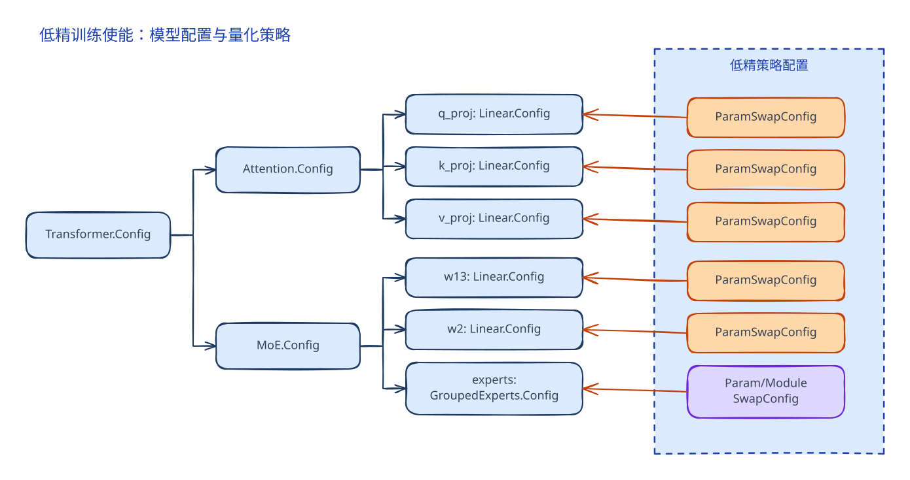

## 4. 低精基础算子接入TensorSwap
### 4.1 权重替换与矩阵乘拦截

低精训练的接入点选在权重张量上。做法是把 `Parameter.data` 上的张量替换为我们的 wrapper tensor：wrapper 内部保存原始的高精权重（下称主权重）与这份权重对应的量化配置，对外则表现得与普通张量一致，形状、步长、dtype、device 都取自主权重。

wrapper 是一个张量子类，通过自定义的 `__torch_function__` 与 `__torch_dispatch__` 接管发生在自己身上的操作：

- **`__torch_function__` 拦截矩阵乘类操作。** 命中的操作包括 `torch.mm`、`torch.matmul`、`torch.nn.functional.linear`、`torch.addmm`、`torch.bmm`，以及 MoE 的分组矩阵乘 `torch._grouped_mm`。一旦命中，wrapper 解包出主权重，连同激活与权重的量化配置一起交给对应的量化矩阵乘算子。
- **`__torch_dispatch__` 接管其余操作。** 形状变换、转置、类型转换、属性查询等不在拦截之列，直接作用于主权重，因此 wrapper 在非计算路径上的行为与普通张量相同；其中形状变换与转置等操作产出的张量仍然是 wrapper，量化配置随张量一起传递。

效果是：模型代码里原本的高精矩阵乘，实际执行时变成「先量化、再做低精矩阵乘」，而调用方不需要改动。

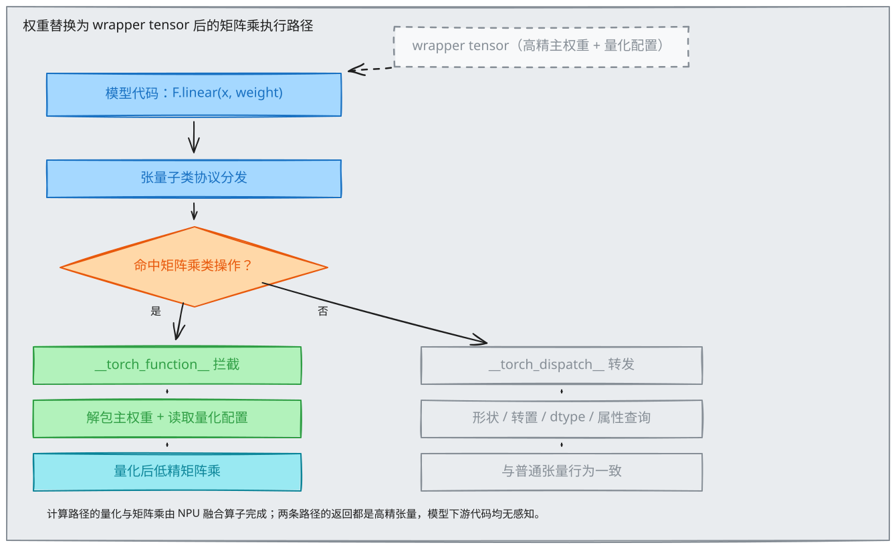

*权重被替换为 wrapper tensor 后，高精模型前向矩阵乘的执行路径。矩阵乘类操作被 `__torch_function__` 拦截并改走量化矩阵乘，其余操作由 `__torch_dispatch__` 解包转发到主权重。*

Linear 层是最常见的形态，其权重是二维，参与 `F.linear` 调用：

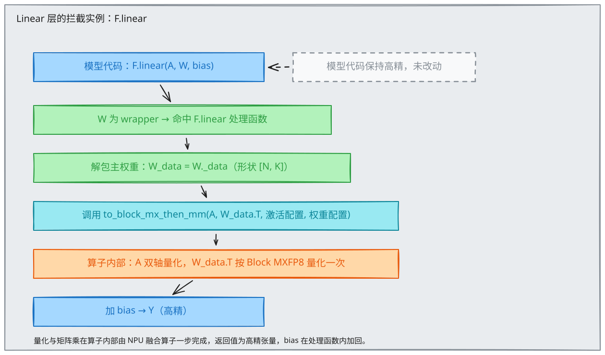

*`F.linear` 中权重为 wrapper，处理函数解包主权重后按 `A @ W.T + bias` 走量化矩阵乘。*

**这种接入方式的好处：**

- **只与权重的位置有关，与模型结构无关。** 量化只需要知道哪些权重需要量化，机制本身对模型长什么样没有假设。因此同一套机制既能覆盖有标准实现的 Linear 层，也能覆盖没有标准实现的路由专家层，只要它的权重最终参与上述几种矩阵乘之一。
- **高精模型代码零改动。** 训练前把指定权重的 `data` 临时替换为 wrapper 即可，模型定义、前向代码与并行切分逻辑都不需要感知低精的存在。高精模型因此可以继续作为基线维护，两条路径共用同一份模型实现。

### 4.2 预训练量化方案一：MXFP8

方案一使用 MXFP8 系列格式，对应 `all_block_fp8`、`all_mxfp8` 与 `mix` 三个 recipe。下文以 `all_block_fp8` 为例：权重使用 Block MXFP8，激活与激活梯度使用标准 MXFP8；整体复刻DeepSeek-V4-Flash/DeepSeek-V4.1-Flash原生量化方案，另两个 recipe 的差异见本节末尾。

#### 4.2.1 权重量化：Block MXFP8

标准 MXFP8 是每 32 个元素共享一个 E8M0 缩放系数的 FP8 量化格式。

我们额外使用了 Block MXFP8：以 32×32 的正方形块为单位对权重做一次量化。概念上每个 32×32 块共享一个缩放系数；量化算子在输出时把该系数分别沿 -1 轴与 -2 轴广播，得到 s1 与 s2 两套缩放系数。s1 与 qdata 结合，逻辑上等同于沿 -1 轴的标准 MXFP8 量化；s2 与 qdata 结合，逻辑上等同于沿 -2 轴的标准 MXFP8 量化。因此在矩阵乘等运算中，Block MXFP8 的量化结果可以按标准 MXFP8 的格式直接使用，前向与反向都不需要额外的格式转换。

与标准 MXFP8 的差别在于前反向数值的一致性。若对权重使用标准 MXFP8，前向沿 K 收缩时需要沿 -2 轴的量化结果，反向求输入梯度沿 N 收缩时需要沿 -1 轴的量化结果，两次量化给出两份不同的量化数值，同一张权重在前向与反向读到的是不一致的近似。Block MXFP8 对权重只量化一次，两个方向共享同一份 qdata 与同一组块系数，前向与反向读到完全一致的数值。这是我们对权重采用 Block MXFP8 的原因。

#### 4.2.2 激活量化：标准 MXFP8 的双轴实现

激活使用标准 MXFP8。前向的矩阵乘沿 -1 轴（K）消费激活，反向的权重梯度沿 -2 轴（M）消费激活，两个方向各需要一份沿对应轴的量化结果。实现上使用双轴量化算子，一次调用同时算出两个方向的量化结果。这是利用融合算子减少量化开销的实现选择，不引入新的数据格式：产出的两份结果各自就是沿对应轴的标准 MXFP8 量化。

#### 4.2.3 前向与反向
wrapper 解包后交给量化算子，量化与矩阵乘都在算子内部完成。前向分三步：激活用双轴量化算子一次得到两个方向的量化结果，权重用 Block MXFP8 量化一次，两者进入量化矩阵乘，沿 K 收缩。此处激活取沿 K 方向的视图，权重取沿 K 方向的缩放视图。

反向只需要一次新的量化。前后三个矩阵乘中，只有激活梯度 `dY` 需要量化，而且用双轴算子一次得到两个方向的视图；另两个操作数全部复用前向的结果：

- **激活梯度** `dA` 沿 N 收缩：权重侧复用前向的 `B_q`（转置后）与沿 N 方向的缩放视图，梯度侧使用 `dY` 沿 N 方向的视图；
- **权重梯度** `dB` 沿 M 收缩：激活侧复用前向沿 M 方向的那份量化结果，梯度侧使用 `dY` 沿 M 方向的视图。

复用既省下量化的算力，也省下为反向保存高精操作数的显存。

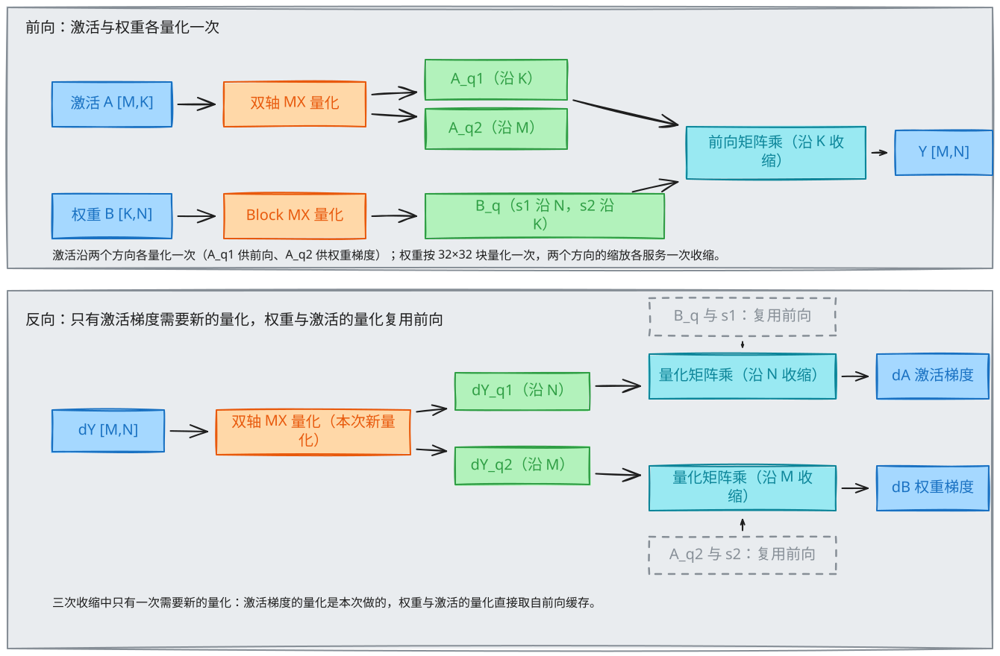

*前向量化激活与权重各一次；反向中只有激活梯度需要新的量化，权重与激活均复用前向的量化结果。*

### 4.3 预训练量化方案二：HiFloat8

方案二对应 `all_hif8` recipe：所有已匹配矩阵乘的权重、激活与激活梯度都使用 HiFloat8（下文简称 HiF8）per-tensor 量化，scale 采用 current tensor scaling。量化点与方案一相同。通过 `--extension.quantization.enable-quantized-training --extension.quantization.recipe all_hif8` 启用。

#### 4.3.1 HiF8 格式简介

HiF8 是昇腾 950 支持的 8-bit 浮点格式，在 torch_npu 中对应 `torch_npu.hifloat8`。与 E4M3、E5M2 固定的指数和尾数位宽不同，HiF8 的尾数位宽随数值大小变化：靠近 1 的数值有 3 位尾数，往两端逐级减少到 2 位、1 位、0 位。这种「中间精度高、两端范围大」的锥形精度覆盖 [-22, 15] 共 38 个指数，接近 FP16 的 40 个（E4M3 只有 18 个），因此整张量共用一个 scale 即可，不需要像 MXFP8 那样每 32 个元素配一个。

编码规则与格式设计的详细说明，可参考 CANN 开发者社区的文章：

- 《HiFloat8 浮点数据格式：既要又要之路》<https://cann.csdn.net/69d4c7c60a2f6a37c59d8f97.html>
- 《HiFloat8：高性能训练之路》<https://cann.csdn.net/69d4c25e0a2f6a37c59d8e4e.html>

#### 4.3.2 量化方式：per-tensor current scaling

每次量化都对整个张量求一次 amax，得到一个 FP32 scale，数据转为 HiF8：

```text
X_q, X_s = npu_dynamic_quant(X, dst_type=hifloat8, quant_mode="pertensor")
```

scale 每次调用现算，不跨 step、不跨调用保存状态，因此始终匹配当前数据，也无需在 checkpoint 中额外处理。由于 scale 是一个标量，与收缩方向无关，同一份量化结果转置后仍然有效。

#### 4.3.3 前向与反向
前向对激活与权重各量化一次；反向只对 `dY` 做一次新的量化，其余操作数全部复用前向结果的转置。三次矩阵乘都调用 `npu_quant_matmul`，路由专家的分组矩阵乘调用 `npu_grouped_matmul`，其中权重 `W[E,K,N]` 整体做一次 per-tensor 量化，标量 scale 广播到每个专家。

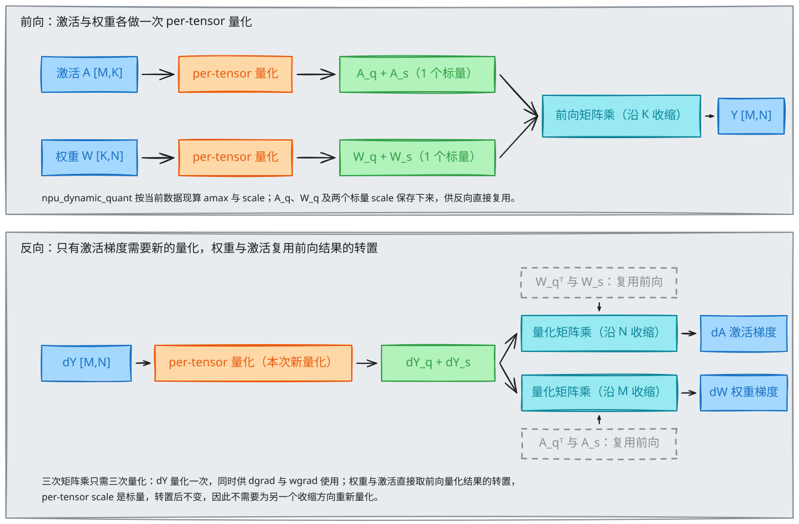

*前向量化激活与权重各一次；反向中只有激活梯度需要新的量化，权重与激活均复用前向量化结果的转置，per-tensor scale 在转置后不变。*

#### 4.3.4 当前限制与后续优化

- `all_hif8` 暂不支持 FSDP 预量化，也不支持 MXFP4 伪量化；
- current scaling 每次量化前都要把整个张量读一遍求 amax，这是纯访存开销。后续可引入 delay-scaling：连续若干步复用同一个 scale，只在窗口末尾更新，以省掉大部分 amax 统计。

### 4.4 其他 recipe：all_mxfp8 与 mix

以上以 all_block_fp8 为例：注意力与共享专家、路由专家的权重全部使用 Block MXFP8。在此基础上有另外两个 recipe：

| recipe | 注意力与共享专家 | 路由专家 |
| --- | --- | --- |
| all_mxfp8 | 标准 MXFP8 | 标准 MXFP8 |
| mix（默认） | 标准 MXFP8 | Block MXFP8 |
| all_block_fp8 | Block MXFP8 | Block MXFP8 |

路由专家使用标准 MXFP8 时不支持 MXFP4 伪量化：伪量化的第二步是 MXFP4 到 Block MXFP8 的融合转换，它以 Block MXFP8 为目标格式，标准 MXFP8 路径上没有这一转换。因此 enable-mxfp4-qat 只对包含 Block MXFP8 的 recipe 生效，即 mix 与 all_block_fp8。

### 4.5 QAT：路由专家权重的 MXFP4 伪量化

QAT 的目标是路由专家权重在训练完成后可以直接以 MXFP4 形式部署。为此训练时对专家权重做伪量化：先把高精权重量化到 MXFP4，再转换回 Block MXFP8 参与矩阵乘，使权重在整个训练过程中持续受到 MXFP4 数值格点的约束。

MXFP4 到 Block MXFP8 的转换不经过高精中间值。朴素做法是先把 MXFP4 反量化到高精，再重新量化为 Block MXFP8，两次经过量化边界；实现上使用融合算子一步完成从 MXFP4 到 Block MXFP8 的转换，省去一次中间格式的往返。

伪量化只施加数值约束，不改变存储与计算格式：权重主副本保持高精，训练中的矩阵乘仍在 Block MXFP8 上进行。

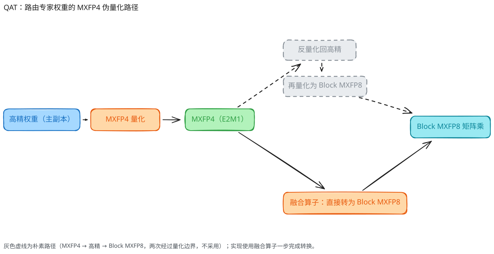

*路由专家权重的 MXFP4 伪量化路径。高精权重量化为 MXFP4 后，由融合算子一步转换为 Block MXFP8 参与矩阵乘，不经过高精中间值。*

## 5. 低精融合算子接入ModuleSwap

本章节介绍 TorchAO-NPU 对 DeepSeek-V4 和 DeepSeek-V4.1 Attention 融合算子的接入方式，以及 Lightning Indexer (LI)、Sliding-Window Attention KV (SWA KV, `swa_kv`) 和 Compressed KV (CMP KV, `cmp_kv`) 的量化方案。重点说明量化 module 的替换数据流、量化对象和精度与性能取舍。

### 5.1 Attention 融合算子替换

#### 5.1.1 替换机制

Linear 和 GMM 的低精路径是将权重标记为 wrapper tensor 然后使用 torch_function 机制拦截 mm、gmm 等完成量化替换。Attention 融合算子为双激活输入，同时需要处理序列的CP切分、融合 kernel 的反向计算，因此采用 TorchAO 的 `ModuleSwapConfig` 量化使能路径，替换原始 module 的 `forward` 行为。

Module swap 保留原 module 实例及其参数结构。量化转换时保存原始 `forward`，传入相应的量化参数，将带量化逻辑的 `forward` 实现绑定到同一 module；该实现负责组织输入、准备 metadata、执行必要的量化或伪量化，再调用融合算子。恢复阶段重新使用原始 `forward`。这种方式使量化路径可以接入现有 Attention 计算，而不改变上层模型的调用关系。

在绑定带量化逻辑的 `forward` 之前，converter 会按照模型类型和 Attention 层名 filter 匹配目标 module。只有匹配成功的 LI、Compressor 或 SMLA 层才会应用对应的 `ModuleSwapConfig`。

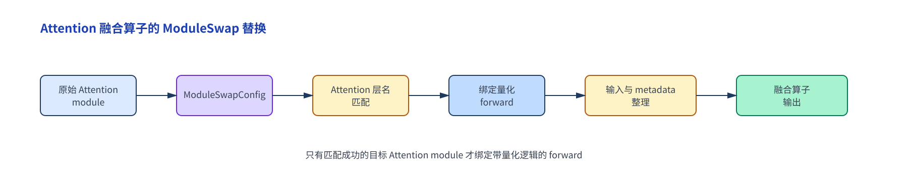

当前涉及三个 Attention module：

- **LI module**：对 LI 的 Q/K 路径执行量化计算，生成 sparse indices。
- **Compressor module**：生成 compressed KV，并在输出前执行 KV 伪量化。
- **SMLA module**：接收 Q、SWA KV、CMP KV 和 Sparse Indices，完成稀疏融合 Attention 计算。

LI 还需要配套的 metadata。它描述变长序列、压缩块和 kernel 布局，使量化后的 Q/K、metadata 与同一次 LI 计算保持一致。metadata 是 LI 数据流中的辅助部分，不改变 module swap 的主体机制。

### 5.2 Attention 量化方案

#### 5.2.1 DeepSeek-V4/V4.1：LI Q/K 量化

预训练阶段，LI 的 Q/K 计算路径采用 FP8。LI 位于长上下文 Attention 的候选筛选环节，Q/K 投影的 token 数量，以及 query 与 compressed key 之间的相似度评分规模，都会随上下文长度增长。FP8 在可表示范围、量化误差和硬件吞吐之间为较均衡的选择，并通过动态 scale 缓解有限表示范围带来的影响：较低的数据位宽减少 Q/K 的搬运量、中间结果存储压力和低精度计算成本，同时保留相似度评分所需的相对排序分辨率，使 LI 能稳定地产生 sparse indices。

量化感知训练阶段，LI 的 Q/K 路径进一步采用 MXFP4 约束低精度行为。MXFP4 以更低的元素位宽和块级 scale 表示 Q/K，模拟部署时的存储与计算条件。LI module 在 forward 中量化 Q/K 并调用量化 LI kernel，使 MXFP4 误差进入相似度计算和 top-k 边界；相关参数通过配套的 LI 反向或辅助损失路径优化。由于 sparse indices 的 top-k 选择是离散操作，梯度不会直接穿过该选择，而是使用量化前的高精度 Q/K 张量计算梯度。

在 DeepSeek-V4 的 LI 输入路径中，经过 rope 的 index query 和 Compressor 生成的 index key 还会经过归一化 Hadamard transform，然后进入 Q/K 量化和 LI kernel。该变换重分布特征维度上的幅值，减弱离群值对量化区间和 block scale 的支配，避免少数大幅值元素放大量化范围、增加小幅值元素的舍入误差。

同时 DeepSeek-V4.1 的 LI Q/K MXFP4 的量化感知训练也已经支持。同 V4 的区别是在 reindex 层复用 K 计算新的 sparse indices，在 reuse 层复用之前的 sparse indices 不做计算。在 V4.1 的 LI 中 Q/K 做 4bit 量化前不再做 Hadamard transform。

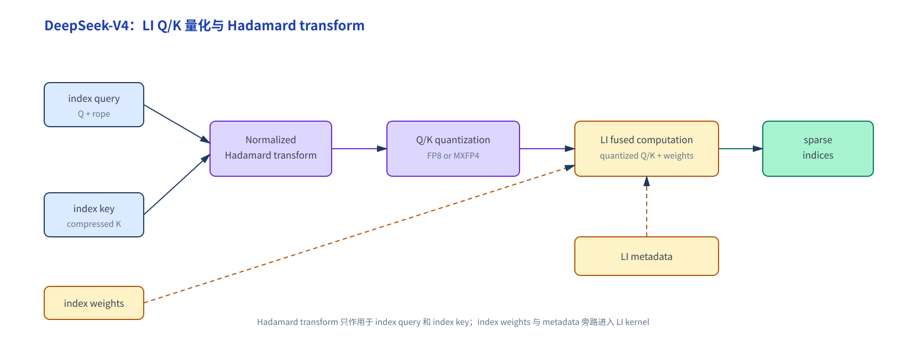

LI 输出的是 sparse indices，而不是 KV Cache。因而 LI 的 Q/K 量化应与后文的 KV Cache 量化分开讨论：前者影响候选选择，后者影响候选被选中后的 Attention 数值计算。

#### 5.2.2 DeepSeek-V4/V4.1：KV Cache 伪量化

在长上下文 Attention 中，KV Cache 的容量和读写流量随缓存长度增长，直接影响显存占用、带宽压力和 Attention kernel 的数据搬运。KV Cache 的伪量化只用于训练阶段：前向以量化-反量化模拟部署误差，使模型提前适应低精度 KV Cache；部署阶段则直接采用对应的实际量化存储和访问格式，减少缓存容量与读写带宽，从而改善长上下文场景下的 Attention 吞吐。DeepSeek-V4 只量化 `swa_kv` 和 `cmp_kv` 的 nope 部分，rope 相关部分保留高精度；DeepSeek-V4.1 则对 `swa_kv` 和 `cmp_kv` 的 nope 与 rope 相关部分一并量化，并使用 BF16 scale 保留缩放因子的精度。两条路径的反向计算均通过 STE 传递梯度。

##### 5.2.2.1 DeepSeek-V4：MXFP8 KV 量化

DeepSeek-V4 的 `swa_kv` 和 `cmp_kv` 均只对 nope 部分采用`group size=64` 的MXFP8。量化挂接在 `kv_norm` 和 `compressor.norm` 的激活输出上，量化对象是其中用于 KV Cache 的 nope 激活；norm 的权重参数不参与量化。

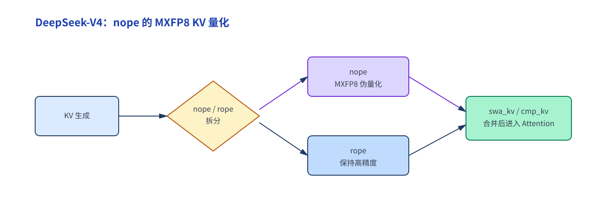

选择 MXFP8 的主要考虑是：

- 相比 BF16，8-bit 元素表示显著降低 KV Cache 的存储和读写流量，长上下文下收益更明显。
- 相比 MXFP4，MXFP8 具有更高的表示精度和动态范围，能够减少对 Attention 分数和输出的扰动。
- block scale 按局部幅值范围提供缩放，使 nope 通道的相对差异在压缩后仍得到保留。

因此，V4 的方案以 nope 的 MXFP8 压缩换取缓存容量和带宽收益，同时保持 Attention 的计算语义。

##### 5.2.2.2 DeepSeek-V4.1：分离的 SWA KV 和 Compressed KV 量化

DeepSeek-V4.1 对 `swa_kv` 和 `cmp_kv` 的 nope、rope 相关部分一并量化，再根据两类 KV 的数据来源、访问方式和精度敏感性分配不同格式：

- `swa_kv` 使用 `mxfp8_bf16`。
- `cmp_kv` 使用 `mxfp4_bf16`。

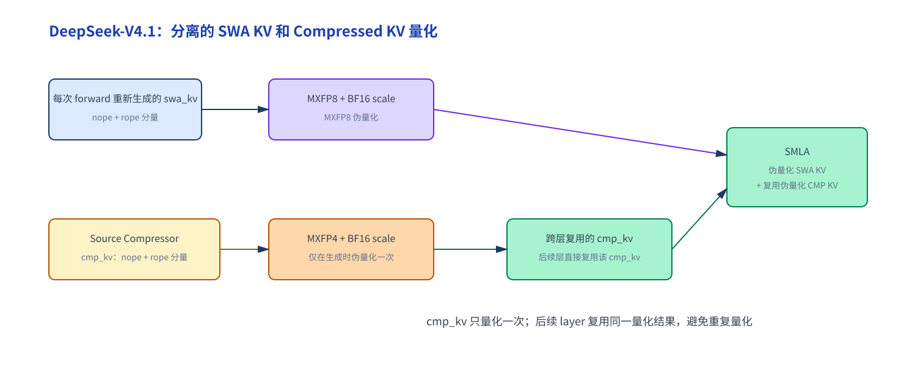

`swa_kv` 位于滑动窗口路径，由当前 Attention 层在每次 forward 中重新生成。它以较高的 token 分辨率参与局部 Attention，访问频繁且对量化误差敏感。使用 `mxfp8_bf16` 量化方式，按 1×32 粒度分组，以 8-bit 元素和 BF16 scale 表示 KV，在降低缓存带宽的同时保留较高数值精度，适合这条对输出敏感的路径。

`cmp_kv` 是经过压缩得到的 KV，单次 Attention 只访问候选子集，且同一份 compressed KV 可由多个 layer 复用。由于其缓存规模和跨层复用特征，存储效率和带宽占用更重要，因此采用 `mxfp4_bf16` 量化方式，按 1×16 粒度分组，以 4-bit 元素配合 BF16 scale，在降低缓存容量的同时保留块级幅值信息。

`cmp_kv` 在 Source Compressor 生成时完成一次伪量化，后续层直接复用该 cmp_kv 结果；SMLA 仅对当前 forward 的 `swa_kv` 执行伪量化，避免重复处理 `cmp_kv`。

| 数据 | 量化格式 | 设计侧重点 |
| --- | --- | --- |
| `swa_kv` | `mxfp8_bf16` | 高频访问，优先保持数值精度和 Attention 稳定性 |
| `cmp_kv` | `mxfp4_bf16` | 压缩存储，优先降低容量和带宽 |

V4.1 按数据流角色分配精度：高频访问的滑窗 KV 使用 MXFP8，已压缩且可复用的 compressed KV 使用 MXFP4。两条路径均在训练前向中模拟部署量化误差，并通过直通估计保持反向可训练。

### 5.3 方案对比

| 模型/路径 | 量化对象 | 量化格式 | 训练或计算方式 | 主要收益 |
| --- | --- | --- | --- | --- |
| DeepSeek-V4 LI 预训练 | LI Q/K | FP8 | 低精度融合计算 | 提高长上下文训练吞吐 |
| DeepSeek-V4 LI QAT | LI Q/K | MXFP4 | QAT 模拟低精度误差 | 适配低精度 LI 部署 |
| DeepSeek-V4 KV Cache | `swa_kv`、`cmp_kv` 的 nope 部分 | 标准 MXFP8 | fake quant | 降低 KV Cache 容量和带宽 |
| DeepSeek-V4.1 SWA | `swa_kv` 的 nope + rope 部分 | MXFP8 BF16 | fake quant | 在高频访问路径保持精度 |
| DeepSeek-V4.1 Compressed | `cmp_kv` 的 nope + rope 部分 | MXFP4 BF16 | 生成时 fake quant，跨层复用 | 进一步降低缓存和重复计算开销 |

> 待补充：融合算子接口、数据布局、性能收益和测试结果。

## 6. 低精通信

本章介绍低精训练与分布式参数管理、集合通信的关系。

### 6.1 当前能力

- 训练 wrapper 支持 FSDP2 参数 all-gather 生命周期；
- all-gather 后能够恢复低精配置，并继续执行低精矩阵乘；
- TP、CP、EP 等并行通信由上层训练框架管理。

### 6.2 FSDP Block FP8 低精通信

大规模训练中，FSDP 将参数分片保存于不同 rank。模块计算前需要通过 All-Gather 恢复完整参数，计算结束后再通过 Reduce-Scatter 规约梯度。对于 Block FP8 训练，如果仍以 BF16 参数完成 All-Gather，并在每个 MatMul 前临时量化，通信带宽和重复量化计算都会进入关键路径。

FSDP Block FP8 低精通信将量化边界前移：本地 rank 持有的权重分片在预取阶段先转换为 Block FP8 表示，再参与 All-Gather。量化后的权重数据与 Block scale 分开聚合；计算侧通过 wrapper 保持原有逻辑参数接口，但内部直接读取 FP8 权重和 scale。这样，通信 payload 与计算输入使用同一份量化数据，形成“预量化—低精通信—计算复用”的闭环。

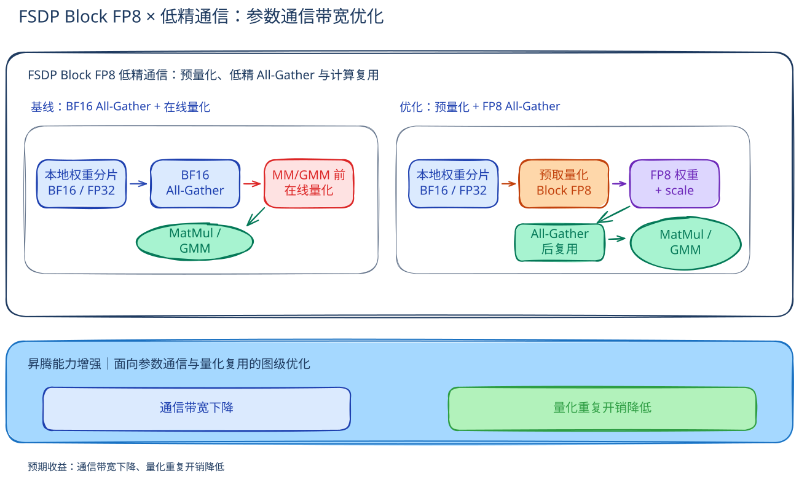

#### 6.2.1 预量化位置

FSDP 在 All-Gather 前调用参数 wrapper 的预处理逻辑。满足条件时，权重分片先转换到混合精度参数类型，再沿 Block 维度执行 Block FP8 量化，得到：

- `B_q`：FP8 权重数据；
- `B_s1`：沿一个权重维度组织的 Block scale；
- `B_s2`：沿另一权重维度组织的 Block scale。

FSDP 分别对这三类数据执行 All-Gather。通信完成后，wrapper 保存 `B_q` 与两组 scale，并继续以 BF16 逻辑 dtype 参与参数形状、梯度路由和 FSDP 状态管理。计算 kernel 则读取 wrapper 内部的 FP8 权重与 scale，直接走 Block FP8 MatMul 路径。

这一设计将“逻辑 dtype”和“物理通信/计算 payload”解耦：逻辑层面不改变模型参数和梯度语义，物理层面减少参数通信字节数，并把量化结果的生命周期延长到整个 unshard 周期。

#### 6.2.2 量化 payload 复用

在同一次参数 unshard 周期内，All-Gather 得到的 `B_q + scale` 被前向和反向计算共同使用。前向 MatMul 不再临时量化权重；反向涉及权重的计算同样复用已缓存的量化数据。只有当参数重新分片、下一次预取或权重更新后，才进入下一轮预量化。

这种复用关系带来两类理论收益：一是减少高精度参数在互联链路上的传输量，二是减少重复量化 kernel 的启动与执行开销。收益大小取决于参数通信在单步耗时中的占比、权重分片规模以及一次 unshard 周期内的计算复用程度。

### 6.3 参数通信与梯度通信

FSDP Block FP8 低精通信只改造参数 All-Gather，不改造梯度 Reduce-Scatter。前向路径接收低精 payload，计算结果仍按训练图产生逻辑梯度；反向结束后，梯度继续按照既有 `reduce_dtype` 完成规约和分片。优化器更新使用原有高精度参数状态，checkpoint 和参数逻辑接口也不因为通信 payload 的低精化而改变。

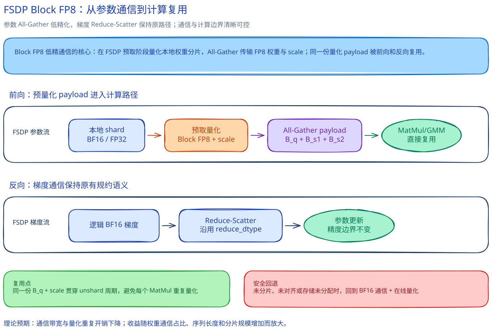

### 6.4 对齐条件与安全回退

Block FP8 量化依赖固定的块大小和 scale 打包布局。只有当本地 FSDP 分片在量化维度上满足 Block 对齐，并且当前确实存在可通信的分片存储时，局部量化后的 payload 才能在 All-Gather 后正确拼接为全局权重。

因此，预量化路径会检查以下条件：

1. 已启用 Block FP8 的 FSDP 预量化开关；
2. 当前参数存在 FSDP 分片，而不是单 rank 的未分片路径；
3. 本地权重存储已分配；
4. 分片维度满足 Block 与 scale 打包的对齐要求。

任一条件不满足时，系统回退到 BF16 参数通信，并在计算侧执行在线量化。回退保证了非标准分片、特殊并行配置和参数重建阶段的正确性，也使该优化可以作为现有 Block FP8 训练路径的增量能力接入。

### 6.5 理论预期

FSDP Block FP8 低精通信的预期收益集中在两个方面：

- **通信带宽**：参数 All-Gather 传输的数据从高精度权重转为 FP8 权重加 scale，降低参数通信的有效字节量；
- **量化开销**：同一份预量化 payload 跨前向和反向复用，减少在线量化的重复执行。

上述两项收益并非固定常数。长序列、大参数量、较高 FSDP 分片度以及参数通信占比较高的训练场景，更可能放大该机制的收益；如果通信已经被充分隐藏，或分片无法满足 Block 对齐，收益则主要体现为计算路径的简化，而不会直接等价为端到端吞吐提升。

---

[返回总览](../ascend950_superpod_moe_pretrain_system_reference.md)
