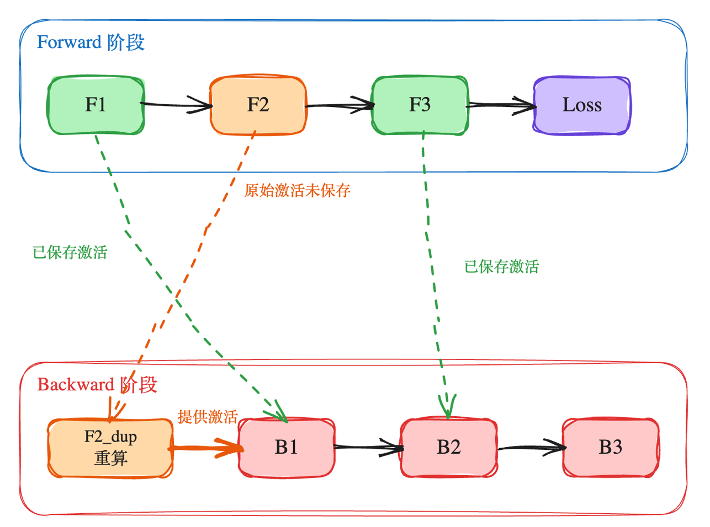
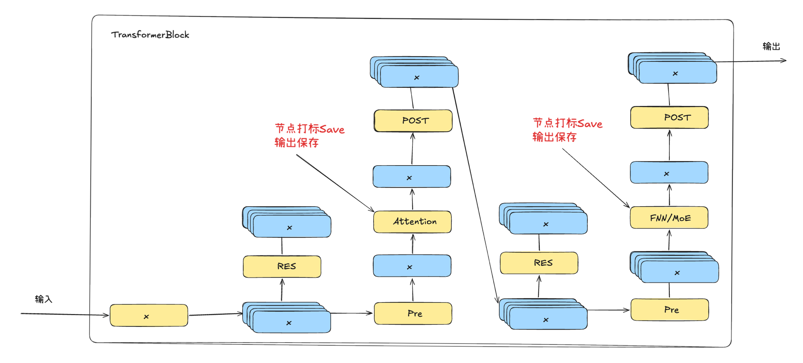
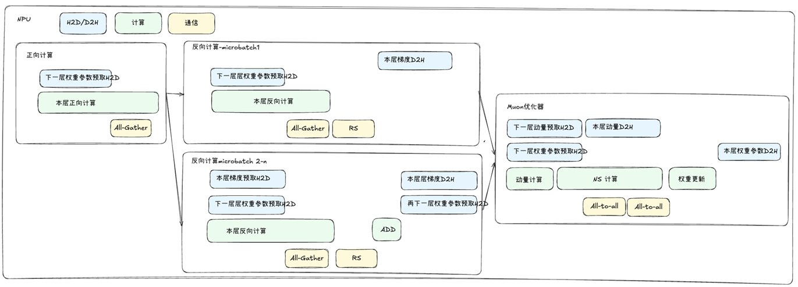
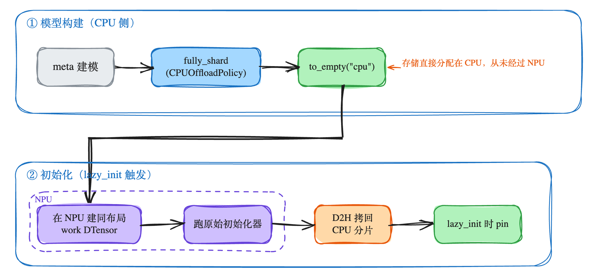
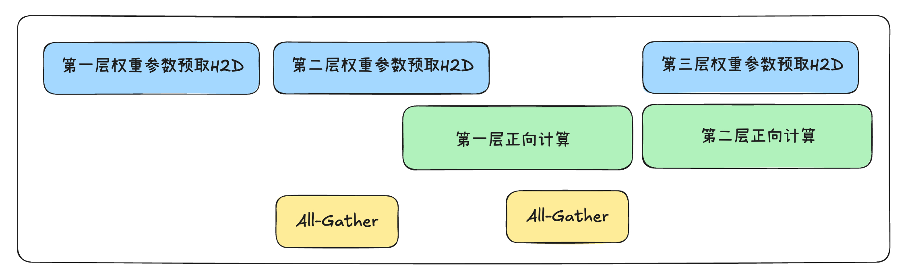
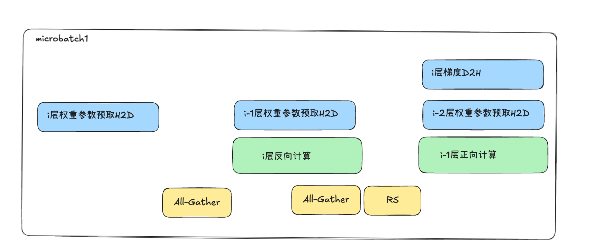
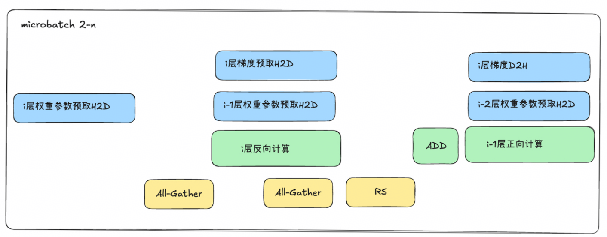
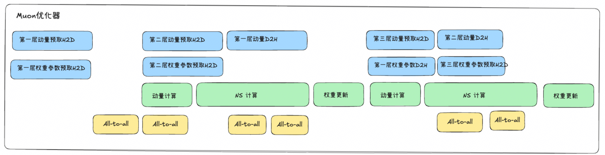

# 950 全局统一虚拟地址：整网内存优化

[返回总览](../ascend950_superpod_moe_pretrain_system_reference.md)

## Highlights

* **基于 GraphTrainer 的 Tensor 粒度重计算**：支持在 FX 图中以 Node 节点粒度精准指定重计算，实现 Tensor 粒度的激活重计算；相较于传统的模块（Module）级 Checkpoint，大幅减少冗余的张量保存与计算开销。
* **CPU offload 全栈卸载**：在前向计算、反向传播与优化器更新阶段，将参数、梯度及动量卸载至 Host CPU，并通过数据传输与计算流程的深度流水重叠，在显著释放 NPU 显存压力的同时，最大限度降低性能损耗。
* **轻量化部署**：基于 CPU offload 将梯度与参数卸载至 Host 内存，DeepSeek-V4.1-Flash 550B 模型最小仅需 **64P** 昇腾 950 即可跑通全参预训练（每卡 Host 内存占用约 124G，Device 显存占用约 71G）。

## 1. 显存挑战

大规模 MoE 训练中，参数、梯度、优化器状态三者常驻 HBM，对 DeepSeek 级别模型，仅参数和梯度就可达数百 GB，远超单卡容量。显存面临巨大挑战：

1. 权重、梯度和动量占用显存巨大
2. 重计算无法细化到 Tensor 粒度，导致保存无用数据、性价比低
3. CPU offload 频繁的卸载与重载会导致性能降低

当前业界的常见解决方案，大部分是针对特定子系统的定点优化，将对象卸载到 Host 侧。例如：DeepSeek-V3 采用了选择性卸载权重的方案，EMA（指数移动平均）参数存储在 CPU。训练期间，EMA 参数保存在 Host 内存中，每个训练步后异步更新。

而本方案通过将梯度、参数、动量全部卸载到 Host 侧来降低显存压力，让大模型可以在更少的卡数上训练。昇腾 950 系列具备超高单芯片互联带宽，并实现 UB 协议无缝接入以太网络，能够更好地支撑 CPU offload 方案，降低内存卸载到 CPU 带来的性能损耗。

## 2. Tensor粒度重计算

### 2.1 基于GraphTrainer的Tensor粒度重计算

#### 2.1.1 GraphTrainer

GraphTrainer 是 PyTorch 官方分布式训练框架 TorchTitan 中的一个实验性编译组件。它的核心逻辑是把整个训练步骤（fwd+loss+bwd）捕获成一张单一的“计算图”，然后在这张图上通过 passes 做各种优化，例如通信与计算的掩盖、指定节点的重计算等。

GraphTrainer 的优势非常独特：

1. 整步单图与精准控制：不同于常规的 torch.compile 会做 AOTAutograd 分割，GraphTrainer 把整个训练步骤压成一张图，反向计算在图里完全可见。这让开发者能像处理数据一样对梯度计算、通信操作进行重排、融合。

2. 通信与计算的重叠：它能把 FSDP（全分片数据并行）或 EP（专家并行）的集合通信操作，直接变成计算图里的节点，从而让通信被 pass 自动重排、融合，实现与计算的重叠，隐藏通信开销。

3. 极致的显存优化（节点级重计算）：它可以在计算图的节点级别决定哪些激活值保留、哪些重算，而不是像传统方法只能在模块边界做粗糙的 checkpoint。对于显存吃紧的大模型（如 DeepSeek-V4），这种细粒度控制能显著降低显存峰值。这一能力也是我们实现 mHC Tensor 粒度重计算策略的基础。

#### 2.1.2 指定node节点重计算实现

当前 GraphTrainer 通过遍历生成的 FX 图，用设定好的 memory_policy 对 forward 节点打标记，包含：*`MUST_RECOMPUTE`*、*`MUST_SAVE`*、*`PREFER_RECOMPUTE`*、*`PREFER_SAVE`* 等。针对已经打标的节点，如果标记了 *`RECOMPUTE`*，则递归查找到上一个已经保存的节点，形成副本并插入到 backward 中。在实际训练执行的过程中，就可以沿着这张图完成重计算流程。

但是当前 TorchTitan 中，只支持精确到 fqn 指定某类 op target 的节点，无法完全精确到指定 node 节点，且 TorchTitan 要求每层输出必须保存，而部分重计算场景实际涉及跨层保存。因此，基于当前 TorchTitan 提供的 GraphTrainer 节点重计算能力，我们以 fqn + node target + occurrence（该 op 在当前 fqn 出现的次数）作为 key，并增加层输出保存时的校验，完成精准指定 node 节点保存和跨层保存输出的能力。

### 2.2 mHC重计算策略

Manifold-Constrained Hyper-Connections（流形约束超连接）是对 Transformer 残差连接（residual connection）的一种扩展：它不再让 hidden state 走单一的恒等残差流，而是扩展为多条并行的残差流，并通过一组受流形约束的投影矩阵来动态混合这些流的信息。

mHC 激活随模型规模线性增长，限制 batch size 和长序列训练，这也是需要在 mHC 结构上选择重计算的原因。通过合适方式保存指定 Tensor，可以避免在重计算时一次性执行大量重计算、保存大量激活值；而是分段重计算，让重计算和 bwd 交替进行——前面的 bwd 完成后先释放显存，再进行后面的重计算和激活值保存，不给显存过大压力。

如图所示，mHC 的结构大致如下，其中计算开销较大的是 GMM。如果将反向计算拆开来看：当 mHC 中的 post 输入被保存之后，从 GMM2 到后面 unpermute 等一系列计算的输出，没有任何 bwd 需要使用，也就是在重计算中完全可以不触发这部分计算和通信。基于 GraphTrainer 的重计算可以通过对依赖的判断，在保存 post 后自动识别到没有任何 bwd 依赖的 GMM2，并在插入重计算节点时忽略这部分，从而减少重计算耗时、提升性能。

因此，在 GraphTrainer Tensor 粒度重计算的基础上，mHC 重计算策略选择保存每一层中 attention 模块的输出（即 attention 模块后 post 的输入）和 MoE 模块的输出（即 MoE 模块后 post 的输入）。

### 2.3 消融实验

在 950 上、DeepSeek-V4-Flash 16e 8rank 配置下，开启 GraphTrainer mHC 策略与不开启 GraphTrainer 的计算数据对比如下。反向计算时间的减少，主要源于未保存 GMM2 的大量输出时，GMM2 在重计算中不会被触发。

| **实验配置**     | **Memory** | **反向计算时间** |
| ------------------------ | ------------------ | ------------------------ |
| GraphTrainer + mHC 策略 | 46GiB            | 17446ms                |
| GraphTrainer + full 策略 | 47GiB            | 18848ms                |

## 3. CPU-Offload

### 3.1 整体方案

在大规模 MoE 训练中，参数、梯度、优化器状态三者常驻 NPU HBM，显存占用是三者的总和——对于 DeepSeek 级别模型，仅参数和梯度就可达数百 GB，远超单卡容量。CPU offload 方案将三者全部常驻 CPU、按需搬运、NPU 只做计算，大幅度减轻 NPU 显存的占用，用更少的卡数跑下更大的模型。

要做到“常驻 CPU 却不过分拖垮性能”，必须回答两个根本问题：

1. 状态怎么生——参数、梯度、动量三种张量，如何让它们“生在 CPU”而不是“生在 NPU 再搬下来”？

2. 搬运怎么管——每一步训练有数百次 H2D/D2H，分散在前向计算、反向计算、梯度累加、优化器等多个子系统里，如何统一编排，才能既不失控、也不拖累性能？

### 3.2 内存编排与状态生命周期管理

在大规模 MoE 训练场景下，CPU offload 的核心矛盾在于：**如何用最低的 Host 内存与跨设备传输开销换取最大的 NPU 显存节省，同时避免初始化阶段产生显存瞬时尖峰（Memory Spike）**。为此，本方案在底层构建了统一的传输编排层，并重构了参数、梯度与优化器状态的生命周期。

#### 3.2.1 统一传输编排层：CPUStaging

开启 CPU offload 后，前向预取、反向梯度累加、梯度裁剪及优化器更新等子系统会高频触发跨设备数据搬运（H2D/D2H）。若由各子系统独立申请 Stream 和 Pinned Memory，会引入三个典型的工程痛点：

* **Stream 数量超限与带宽争抢**：底层运行时支持的硬件 Stream 数量存在上限，各模块随意新建 Stream 极易在长周期训练中达到系统上限；同时，缺乏统筹的多流并发会引发底层 DMA 传输队列的无序争抢，反而劣化有效带宽。
* **Pinned Memory 内存浪费与分配开销**：Pinned Memory 分配代价高昂且无法被系统换页。各模块若各自维护一套私有缓冲，会导致 Host 侧 Pinned Memory 开销成倍膨胀，挤占宝贵的主机物理内存。
* **异步时序混乱导致死锁**：跨设备的 H2D/D2H 深度依赖 Event 同步。若缓冲与传输分散在各模块自行管理，极易因漏等 Event 或过早复用 Buffer 引发读写竞争（Race Condition）甚至多流相互等待导致死锁；在训练异常中断时，也难以安全回收未完成的异步任务。

针对上述问题，本方案设计了统一的传输编排层 **CPUStaging**，将所有跨设备数据流收敛至受控的异步通道：

1. **定长 Pinned Memory 环形缓冲池（Slot Buffer Pool）**
   摒弃各模块动态申请，预先构建固定数量（如 4 个 Slot）的 Pinned Memory 环形缓冲队列作为全局中转站。跨设备搬运与 Slot 绑定，执行 `CPU Host Buffer ↔ Pinned Buffer ↔ NPU Device Buffer` 的两阶段流转。槽位复用由硬件 Event 严格约束：必须在上一轮传输完成的 Event 触发后方可复用槽位，杜绝数据被提前覆写。

2. **Offload 拷贝专用 Stream**
   每个 CPUStaging 实例独占一条专用的 D2H/H2D Stream，与默认的计算流物理隔离，为后续计算与通信流水重叠（Overlap）提供底层硬件基础。

3. **Event 驱动的全异步调度**
   每次传输仅返回一个轻量级 Event 对象：Device 侧通过 `Stream.wait_event` 保证“搬完即算”，全程无需 CPU 介入；Host 侧仅在必要时显式同步，杜绝主线程出现忙等（Busy-waiting）与无谓阻塞。

#### 3.2.2 状态内存分配与生命周期管控

CPU offload 的一个常见误区是“在 NPU 上完成张量初始化，再搬运卸载至 CPU”。这种做法会在训练启动瞬间产生全量参数常驻的显存峰值，极易直接触发 OOM。

本方案针对模型参数、梯度及动量三类对象的**生命周期与访存特征**，制定了差异化的分配策略，从源头消除 Device 侧的显存尖峰：

1. **模型参数（Weights）：Host 原生初始化与按需切片加载**
   参数的物理存储直接在 CPU Host 内存完成分配与 Checkpoint 权重加载，NPU 侧在初始化期不持有全量实体。在实际训练执行时，仅配合流水线按层（Layer-wise）将当前计算所需的参数分片动态 H2D 至 NPU，计算完成后立即释放对应显存。

2. **梯度（Gradients）：延迟按需分配（Lazy Allocation）**
   放弃在 CPU 侧预先分配全量静态零张量的做法，梯度的 Host 存储采用**延迟按需分配**策略：
   - **首个 Microbatch**：直接在 Reduce-Scatter 通信完成后的 D2H 搬运阶段同步开辟 Host 存储，实现“数据写入即分配”；
   - **后续累加 Batch**：复用既有空间，通过 `CPU 旧值 H2D → NPU 分块 In-place 累加 → D2H 覆写回 Host` 的流水线完成就地更新，生命周期与 Autograd 严格对齐，避免无意义的内存常驻。

3. **动量与优化器状态（Optimizer States）：CPU 原地全零初始化**
   优化器状态（如 AdamW 的动量和二阶矩）初值恒为零，不具备反向计算依赖。本方案直接在 Host 内存原地完成全零张量分配，全程不经过 NPU 计算，完全消除优化器初始化带来的通信与算力浪费，仅在最终的 Parameter Update 阶段按桶（Bucket）参与流水更新。

### 3.3 流水排布

通过预取、掩盖等方式排布 offload 和 reload 的流水，让 H2D/D2H、通信和计算并发执行，在释放 NPU 显存的同时，减少传输对训练性能的影响。

#### 3.3.1 前向计算：层级参数预取与流并行掩盖

前向计算涉及的 CPU offload 对象只有参数，因此只要实现预取和并发，就可以自然达成计算掩盖 swap 的目标。

1. 参数按层预取：参数加载与同层前向计算部署于独立 stream，通过流级并行实现访存-计算重叠掩盖。第一层前会先取第一层所需参数对象，每一层的计算（包含第一层）都会同步进行下一层的参数 swap。

2. FSDP 协同：在 FSDP allgather 触发前完成参数抓取，避免通信与访存串行阻塞。

3. 非分片 experts 特例处理：对完整驻留于单 rank 的 experts（无 EFSDP）走旁路逻辑，规避冗余的 allgather 通信开销。

前向计算（模型：DeepSeek-V4-Flash，43 layers，16 experts，参数总量 24.579B，seq_len=4096，在 8 rank 上训练）：

| **涉及对象** | **总数量** | **一层数据量** | **期望H2D时间(层）** | **期望D2H时间(层）** | **950 实际H2D时间(不并发）(层）** | **950 实际H2D时间(梯度与参数并发）(层）** | **950 实际前向计算时间(层）** | **950 实际反向计算时间(层）** |
| -------------------- | ------------------ | ---------------------- | ---------------------------- | ---------------------------- | --------------------------------------- | ----------------------------------------------- | ----------------------------------- | ----------------------------------- |
| 权重               | 11.45G           | 0.266GB              | 6.65ms                     | 6.65ms                     | 6.14ms                                | 6.7-9.1ms                           | 16.5ms                            | 46ms                              |

#### 3.3.2 反向计算

反向计算涉及的 CPU offload 对象包含参数和每层计算产生的梯度；如果存在梯度累加，场景会更加复杂，但核心同样是实现预取和并发，让换入换出与计算相互掩盖。

1. 两条传输流并发执行：一条流负责权重的 H2D，另一条流负责梯度的 H2D 和 D2H。其中，同一份梯度的 H2D、add、D2H 三段在两条流上并发进行。

2. 针对第一个 microbatch，D2H 的下发依赖于本层 RS 的完成，但可以与 RS 后面的计算形成掩盖；针对第二个 microbatch，需要先取回前面 microbatch 的梯度结果与本层结果相加，同时存在每层预取下一层所需参数的逻辑——梯度相关的H2D 与本层的计算相互掩盖，D2H 则依旧在 RS 和add 后下发，与后面的计算相互掩盖。

反向计算（模型：DeepSeek-V4-Flash，43 layers，16 experts，参数总量 24.579B，seq_len=4096，在 8 rank 上训练）：

| **涉及对象** | **阶段**          | **总数量**  | **一层数据量** | **期望H2D时间(层）** | **期望D2H时间(层）** | **950 实际D2H + H2D时间(梯度与参数并发）(层）** | **950 实际反向计算时间(层）** |
| -------------------- | ------------------------- | ------------------- | ------------------------- | ---------------------------- | ---------------------------- | ----------------------------------------------------- | ----------------------------------- |
| 梯度               | **第一个batch**   | **11.45GB** | **0.266GB**       | /                          | **6.65ms**           | **7.2ms**                                     | **46ms**                    |
| 梯度               | **后续累积batch** | **11.45GB** | **0.266GB**       | **6.65ms**           | **6.65ms**           | **19ms**                                      | **46ms**                    |

#### 3.3.3 优化器

1. 梯度裁剪后驻留 NPU：裁剪后的梯度不再 offload，就地保留于 NPU 供动量计算消费，计算完毕后释放，省去一次 D2H→H2D 往返——clip 后的梯度到优化器只需一次 H2D，无额外交接搬运。

2. 优化器计算部分

- Muon：Muon 优化器中同时包含权重、动量的 swap 和 FSDP 通信，这里的 swap 配合当前上游的 Muon 优化器，同样可以做到按层预取的效果——三段式滚动流水 + 双通道并发，两槽滚动：prepare 第 i+1 桶与 compute 第 i 桶并发，finalize 第 i-1 桶与前两者并发。

### 3.4 计算优化

上游的默认行为是范数计算跟随梯度所在设备，这会导致开启 CPU offload 后，梯度在 CPU，范数的平方、求和、开方全部落在 Host 上执行。全量梯度是 GB 级数据，Host 逐元素运算受限于 Host 内存带宽和 CPU 核数，一次全量范数就是秒级的 Host 停顿——而这段计算在 NPU 上是毫秒级的内核。所以在 CPU offload 方案中，将 clip 搬到 NPU 上完成梯度裁剪计算。

### 3.5 消融实验

在 950 上、DeepSeek-V4-Flash 16e 8rank、GBS=64、MBS=2 的配置下，开启与不开启 CPU offload 的对比如下：整体节省显存约 29GiB，但性能也出现较明显的劣化，主要源于 swap 下发增多导致的 Host-Bound。

|                       | **memory** |
| ----------------------- | ------------------ |
| **开offload**   | 58.50GiB         |
| **不开offload** | 87.28GiB         |

## 4. 优化效果

DeepSeek-V4.1-Flash 550B 理论上需要在 128P 上才能完成训练部署，如果想在64P部署方案下,不开启engram offload，完成DeepSeek-V4.1-Flash 550B模型的预训练，理论常驻内存每张卡需要占用130.79GiB，如果包含激活值，将达到200.79GiB，超出当前限制。

但是当前基于cpu_offload方案，将梯度和参数以及engram表卸载到CPU上，dsv4.1 550B 在可以在仅64p 昇腾950上跑通训练， deepseekv4.1-flash预训练卸载到CPU内存达到124G/卡： device显存占用达到71G/卡

| **实验配置**    | **卡数** | **Memory** | **tps** |
| ----------------------- | ---------------- | ------------------ | --------------- |
| **不开启offload** | 64             | 200.79GiB（静态内存130.79GiB，激活内存按70GiB估算）         | /          |
| **开启参数+梯度 offload** | 64             | 136.49GiB（静态内存66.49GiB，激活内存按70GiB估算）        | /          |
| **开启参数+梯度+engram offload** | 64             | 71.79GiB         | 440           |

---

[返回总览](../ascend950_superpod_moe_pretrain_system_reference.md)
