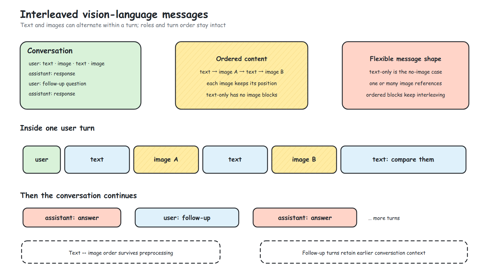
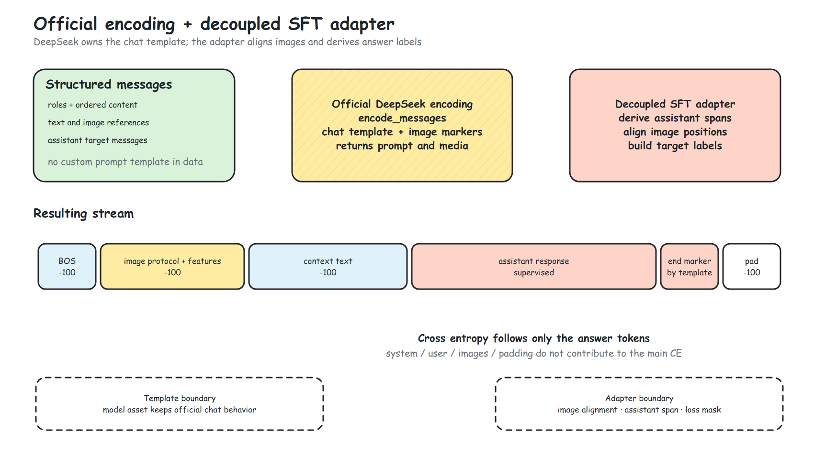
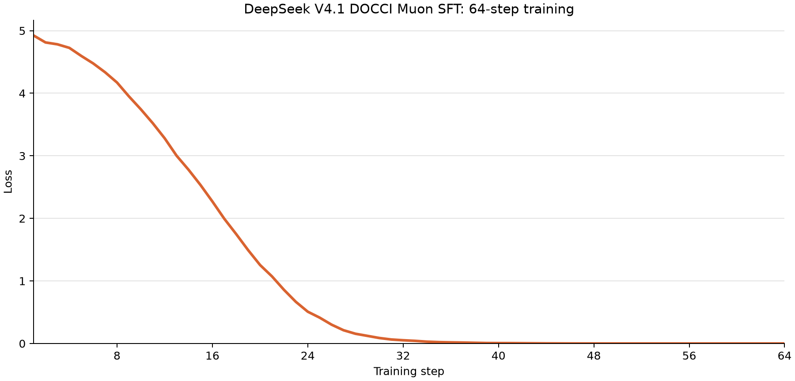

# DeepSeek-V4.1 图文多模态 SFT 训练

[返回总览](../ascend950_superpod_moe_pretrain_system_reference.md)

## Highlights

* 接入多种图文 SFT 数据格式，支持多轮对话中的图文交错、多图与纯文本对话 SFT，并兼容 LLaVA / ShareGPT 等常见数据格式；复用 DeepSeek-V4.1 官方 Encoding 逻辑，确保框架侧数据处理与官方发布模型完全对齐。

## 1. 图文消息格式

在 [DeepSeek V4.1 Flash 技术报告](https://arxiv.org/pdf/2609.19969) 中，模型被定位为原生处理图像与文本的多模态 MoE：DeepSeek-ViT 与投影器把图像转换为视觉嵌入，放入对应的图像 token 位置，与文本一同交给语言主干。报告将监督微调（SFT）列为后训练链路的起始环节。围绕这一图文能力，本文聚焦 SFT 数据与监督的适配：保留多轮消息中的图像位置和图文顺序，复用官方 encoding 组织模型输入，并构造 assistant 回答的 loss mask。

本文适配的是通用的结构化图文会话，不绑定某个数据集的字段：`messages` 按发生顺序保存每轮的 `role` 与 `content`；`content` 可以是交错排列的 text/image 内容块，同一轮支持多图，回答后仍可继续追问。纯文本对话是没有图片块的同一种格式。LLaVA/ShareGPT 和常见 instruction/output 输入也会归一为这套消息结构，再交给 DeepSeek V4.1 模型资产中的官方 encoding，用其图文聊天模板完成 SFT。

```json
{
  "id": "illustrative_cave_pier_multiturn",
  "messages": [
    {
      "role": "user",
      "content": [
        {"type": "text", "text": "First, inspect this cave: "},
        {"type": "image", "path": "images/train_04269.jpg"},
        {"type": "text", "text": " Now compare its lighting with the pier at dusk: "},
        {"type": "image", "path": "images/train_04176.jpg"},
        {"type": "text", "text": " Where is the warm light in each scene?"}
      ]
    },
    {"role": "assistant", "content": "A yellow light glows behind the cave draperies; warm dusk colors appear near the horizon beneath the pier."},
    {"role": "user", "content": "What else is visible in the cave foreground?"},
    {"role": "assistant", "content": "Sloping flowstone and a small light that casts shadows."}
  ]
}
```

这是一条 SFT Dataset 输入记录的格式示意，不是本轮模型生成结果。Dataset 保留图文顺序，并将 `path` 转为官方 encoding 使用的 `source`；图片路径默认相对数据文件目录，设置 `image_root` 时则相对该目录。若来源数据使用无路径的 `<image>` 标记，也可由 `image`/`images` 字段按标记顺序提供图片。



## 2. 官方 encoding 的解耦适配

DeepSeek 的官方 encoding 代码随模型资产提供，由 `encode_messages` 负责对话模板、图片占位和媒体顺序。我们的视觉语言适配层不仿写这些规则，而是从官方编码结果推导各轮 assistant 的监督区间，把图片位置与视觉输入对齐，再构造训练标签。loss mask 按官方编码结果确定 assistant 监督区间；图片及非目标上下文位置以 `-100` 忽略。这样，消息格式与模型模板各守自己的边界，模板调整也无需把规则复制进数据处理代码。



## 3. 数据集与示例

[DOCCI](https://huggingface.co/datasets/google/docci) 汇集约 1.5 万幅图像及人工撰写的英文细节描述。描述不仅覆盖主体，也记录背景、光照和场景特征；相近画面之间的差异同样得到细致表达。我们将其中的图像与提问组织为 user 消息，将描述组织为 assistant 回复，用于图文描述型 SFT。下图展示洞穴岩溶和暮色栈桥两类场景。

| **场景** | **图像**                                                                                                                                                    |
| ---------------- | ------------------------------------------------------------------------------------------------------------------------------------------------------------------- |
| 洞穴岩溶       |        |
| 暮色海面与栈桥 |  |

## 4. 训练曲线与验证

在选取的 64 条 DOCCI 训练样本上进行 64 步图文 SFT，loss 从 `4.92381` 降至 `0.00008`。保存并重载权重后，64 条训练样本的 teacher-forced token accuracy 为 100%；

| **验证项** | **验证设置**             | **结果**                                                 |
| ------------------ | -------------------------------- | ---------------------------------------------------------------- |
| 训练             | 固定 64 条训练样本             | loss`4.92381 → 0.00008`                                   |
| 保存与重载       | 进程加载保存权重               | 完成                                                           |
| Teacher-forced   | 同批 64 条，9,221 个监督 token | CE`7.67e-5`；token accuracy`100%`；整条一致`64/64` |
| 贪心生成         | 抽取 16 条，最多 192 新 token  | 到 EOS`16/16`；全文一致`16/16`                         |

抽取 16 条进行贪心生成，均到达 EOS，生成全文与参考描述一致。

### 4.1 训练曲线



### 4.2 生成描述样例

| **场景** | **模型生成描述（节选）**                                                                                                                                                                               | **生成正确** |
| ---------------- | -------------------------------------------------------------------------------------------------------------------------------------------------------------------------------------------------------------- | -------------------- |
| 树梢风筝       | “A high-angle shot, looking up at a yellow and black butterfly kite caught at the top of a tree. The kite is at the center of the shot, slightly to the left.”                                             | ✅                 |
| 花卉与石盆     | “A high-angle shot of a bush of Surfinia flowers in a gray round stone planter. The bush Is filled with an abundance of small flowers in hues of white, lavender, and magenta.”                            | ✅                 |
| 木制多米诺     | “An outdoor daytime closeup view of fourteen bare wooden dominoes scattered on a bed of brown chipped wood mulch. A few of the scattered dominoes are lying face down without any number of dots showing.” | ✅                 |
| 双层吊灯       | “Looking up at a medieval two-tiered chandelier. The chandelier is suspended from a dark tall ceiling in a large two story hall.”                                                                          | ✅                 |

✅ 表示生成全文与数据集中描述一致。

## 5. 总结

我们完成了 DeepSeek V4.1 的图文混合 SFT 适配，使图像与文字交错的对话能够进入训练流程，模型可以学习视觉内容与语言回复之间的对应关系。在典型图文数据上的训练与生成验证中，模型逐步拟合了目标描述，生成结果与参考内容一致。这表明该图文微调链路能够有效工作，也为后续更丰富的视觉语言指令训练提供了基础。

---

[返回总览](../ascend950_superpod_moe_pretrain_system_reference.md)
