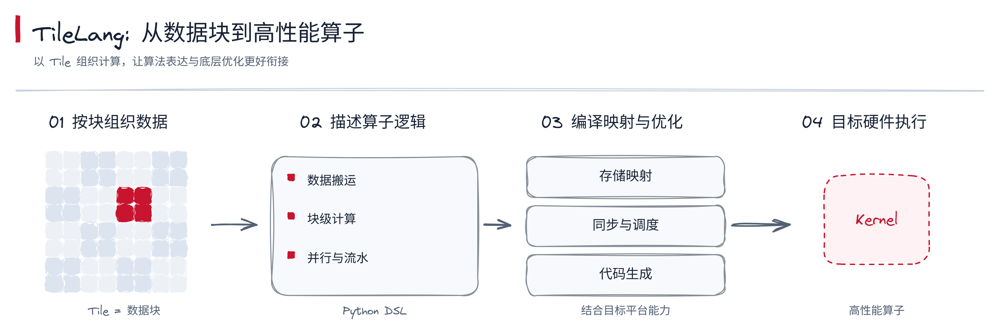
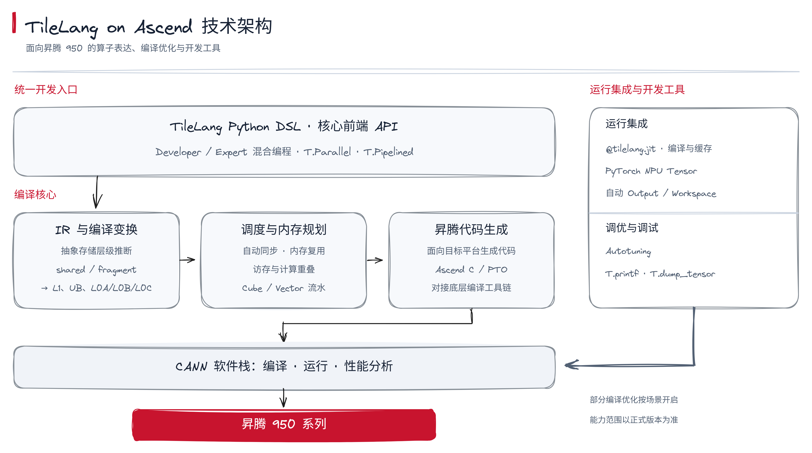
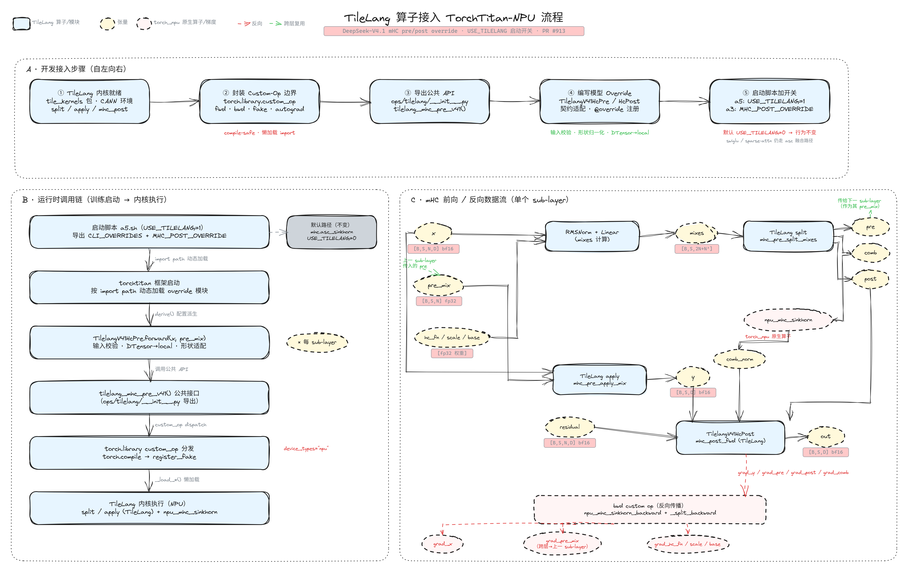
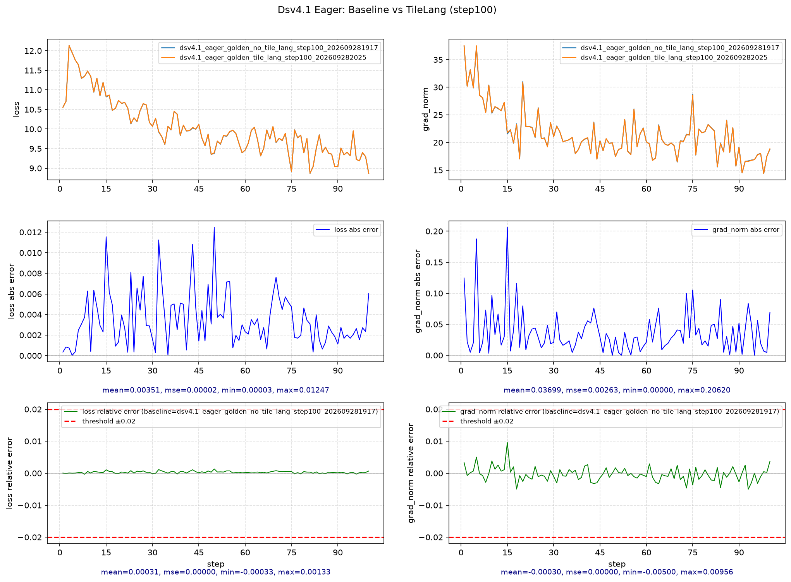

# TileLang 算子接入

[返回总览](../ascend950_superpod_moe_pretrain_system_reference.md)

## Highlights

* **TileLang DSL 开发与调优**：通过 Python DSL 表达算子，结合存储映射、自动同步与流水抽象，减少手工处理硬件细节的工作；支持从原型验证逐步深入性能调优。
* **DeepSeek-V4 / V4.1 训练接入**：在昇腾 950 上通过 TorchTitan / TorchTitan-NPU 接入 mhc_pre / mhc_post 相关 TileLang 算子，并提供接入前后 100 step 预训练精度曲线对比。

## 1. TileLang Ascend 框架介绍

**TileLang 以面向 Tile（数据块）的编程抽象连接算法表达与底层优化**，让开发者用更接近算法逻辑的方式描述算子，同时保留对数据搬运、存储层次、并行划分与流水调度等关键性能要素的控制能力。

*以数据块组织计算，通过编译优化连接算法表达与硬件执行。*

面向昇腾 950 系列，**TileLang on Ascend 以统一的 TileLang Python DSL 与核心前端 API 为开发入口**，贯通语言接口、IR 与编译变换、调度与内存规划、昇腾代码生成、CANN 编译运行及开发工具，形成从算子表达到硬件执行的完整链路。

* **分层且可混合的编程模型：** Developer 模式以 Tile 原语和抽象存储层级降低开发门槛，便于快速表达算法、搭建原型；Expert 模式开放存储、执行 Scope 与同步控制，适合对性能关键环节进行精细优化。两种方式可在同一算子中混合使用，让开发者按需逐步深入硬件细节。
* **面向昇腾存储层级的自动映射：** 编译器依据程序上下文，将 `shared`、`fragment` 等抽象存储映射至 L1、UB 与 L0A/L0B/L0C，减少手工绑定硬件存储的负担。
* **依赖感知的编译优化：** 支持按场景开启自动同步、片上内存规划与安全复用，通过分析 Buffer 读写依赖和生命周期，降低手工同步与内存管理复杂度。
* **并行与流水抽象：** `T.Parallel` 可将适合的 Tile 内并行计算下沉为昇腾 Vector 操作；`T.Pipelined` 用于组织访存与计算重叠，并支持 Cube、Vector 之间的流水协同，减少计算单元等待数据的时间，提高执行效率。
* **从开发到调优的工具闭环：** `@tilelang.jit` 支持按参数编译与缓存，直接衔接 PyTorch NPU Tensor，并提供自动 Output/Workspace 管理、Autotuning，以及 `T.printf`、`T.dump_tensor` 等调试能力。

*统一前端连接编译优化与 CANN 软件栈，运行集成与开发工具支撑验证和调优。*

在实际开发中，开发者可以先用 Tile 原语完成算子原型，接入 PyTorch NPU 验证精度，再结合性能分析调整数据块划分、存储使用和流水策略，并通过自动调优探索合适的参数配置。这条逐步优化的路径，可用于序列处理、索引转换和融合计算等模型算子，让新计算需求更快进入验证与迭代。

自动同步、片上内存规划与复用等能力可按场景配置，具体支持范围以正式发布版本说明为准。

## 2. TileLang Ascend 适配 DeepSeek-V4.1-Flash

基于 DeepSeek-V4 / DeepSeek-V4.1 网络在昇腾 950 系列完成了对 TileLang 的适配，当前 TileLang 的工程代码未开源，后续开源。基于 TorchTitan / TorchTitan-NPU 预训练接入，接入 mhc_pre / mhc_post 相关的 TileLang 算子，流程如下所示：

接入Tilelang前后的预训练100 step精度曲线对比如下：

---

[返回总览](../ascend950_superpod_moe_pretrain_system_reference.md)
