# 训练 Agent 性能调优与精度异常诊断实践

[返回总览](../ascend950_superpod_moe_pretrain_system_reference.md)

## Highlights

* KPBot：聚焦 Host-Bound 性能瓶颈，围绕 CPU/NPU 亲和性、性能库、编译链路及关键配置参数开展自动化分析与优化，提升主机侧执行效率。
* CANNBot：聚焦集群训练精度异常定位，面向数值偏差、NaN/Inf 和确定性不一致问题，通过复现收敛、异常溯源和根因验证，加速精度问题定位并减少人工介入。

## 1 基于KPBot 的Host-Bound性能协同优化 Agent

### 1.1.背景与目标

聚焦基于鲲鹏/ARM架构的CPU侧瓶颈（如数据加载、算子下发、线程调度与NUMA瓶颈），展现KPBot如何自动发现并消除Host侧对加速卡（NPU/GPU）的“喂食饥饿”。

### 1.2 性能优化工作流

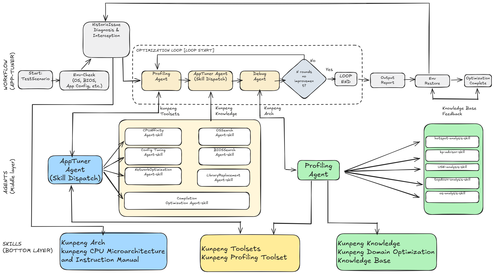

KPBot是基于鲲鹏（Kunpeng）处理器生态的性能优化智能体，目标是提升应用调优效率。它以硬件与性能监控信息为输入，通过workflow编排各级候选优化skill（涉及BIOS、OS、Network、亲和性、配置参数、性能库替换、编译优化等），迭代完成应用性能调优，从而复现调优专家经验；同时基于历史优化案例与新场景的迭代在持续炼化Agent。

开源仓：[https://gitcode.com/openeuler/KPBot](https://gitcode.com/openeuler/KPBot)

**亮点特色**

一键安装：调用app tuner plugin+prompt即可触发工作流使能识别瓶颈，编排候选优化skill

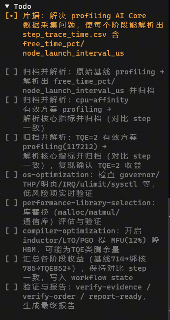

性能提升：依赖 亲和性优化、内存分配器性能库替换、task_queue 参数优化、BiSheng LTO+PGO 编译 的逐层优化下，最终在A5 单节点 8 卡 1K 训练场景提升端到端吞吐 +23.1%

* 亲和性优化，基于NPU及CPU L3 cluster的拓扑分析，同时保障核心线程运行的细粒度
* 性能库替换，基于perf采样热点+库依赖分析，推荐高性能库（malloc/memcpy/压缩/加密）替换
* 配置参数，从并行模型、队列深度、批量大小、缓存大小、连接池等应用层最佳性能配置推荐
* 编译优化，基于热点+topdown分析，给出架构参数、lto、pgo、向量化、LSE/CRC指令等编译优化

| **阶段**                  | **配置**              | **TPS**    | **阶段增益** | **累计增益** |
| --------------------------- | ----------------------- | ------------ | -------------- | -------------- |
| 基线                      | GCC / 无绑核          | 714        | —           | —           |
| 亲和性（拓扑）            | + NPU对齐+L3绑核      | 785        | +9.9%        | +9.9%        |
| 配置（task_queue_enable） | + task_queue_enable=2 | 852        | +8.5%        | +19.3%       |
| 性能库（tcmalloc）        | + LD_PRELOAD tcmalloc | **879**    | +3.0%        | **+23.1%**   |
| 编译（BiSheng）           | + LTO+PGO             | **待更新** |              |              |

基线

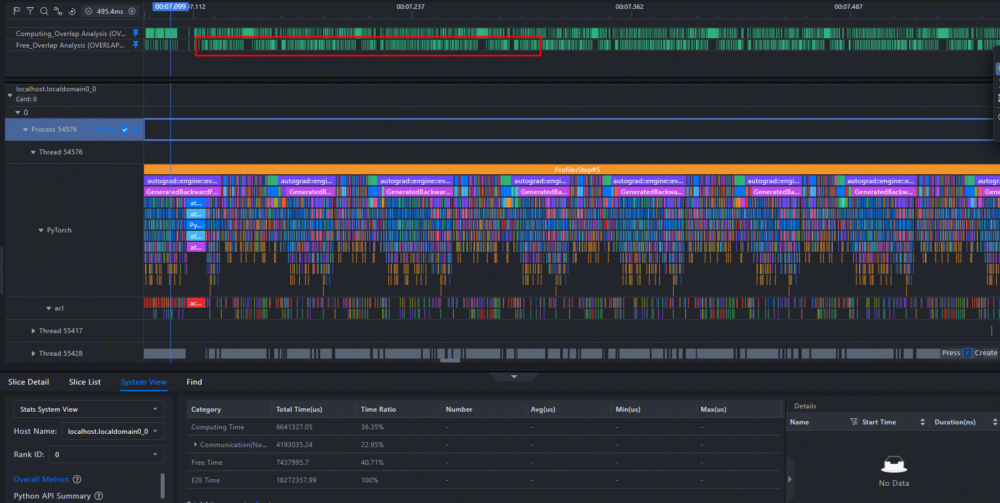

优化后

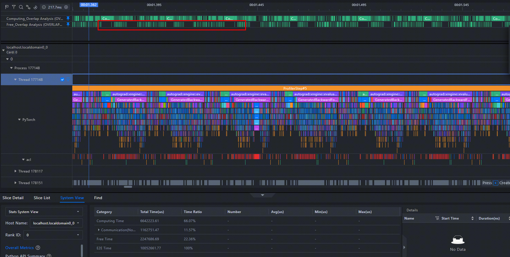

### 1.3 关键协同优化技术与案例验证（单机 DSV4）

#### 1.3.1 A5亲和性优化

问题分析：鲲鹏 950 拥有 384 核、4 个 NUMA 节点，每节点 96 核。基线配置下 8 个 worker 进程无任何 CPU 绑定，在全部 384 核上自由调度，导致：

1. 跨 NUMA 内存访问：采样显示 worker 与其 NPU 跨 socket 运行，每次算子下发的 host↔device 均跨 NUMA
2. L3 cache 失效：worker 在不同核间迁移时，L3 cache（每 Cluster 32MB）局部性完全丧失
3. 上下文切换风暴：41,362 次/s 的上下文切换中大量为跨核迁移触发

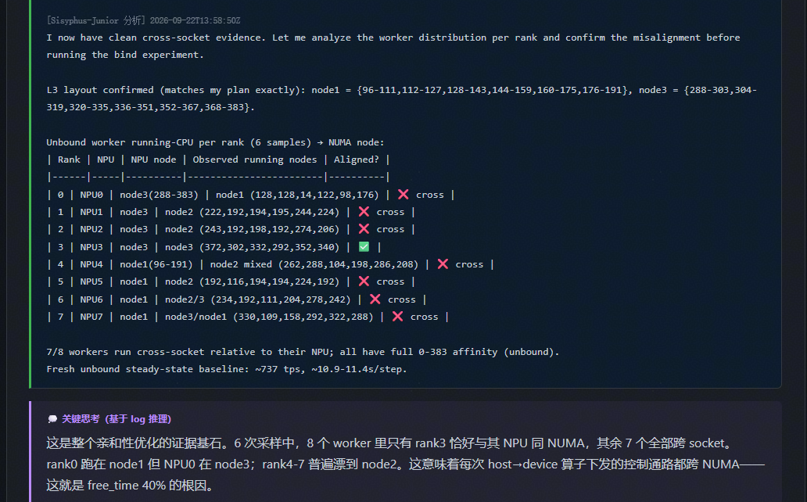

**结合NPU拓扑及CPU L3 Cluster 布局：**

* node1：96-111 / 112-127 / 128-143 / 144-159 / 160-175 / 176-191
* node3：288-303 / 304-319 / 320-335 / 336-351 / 352-367 / 368-383

**最终优化方案：**

1. NPU 设备对齐：rank→NPU(local_rank)→NUMA node 一一绑定
2. L3 宽松池绑核（每域 16 核，禁止单核独占下发主线程）：

| **Rank** | **NPU** | **NUMA node** | **L3 宽松池** |
| ---------- | --------- | --------------- | --------------- |
| 0        | NPU0    | node3         | 288-303       |
| 1        | NPU1    | node3         | 304-319       |
| 2        | NPU2    | node3         | 320-335       |
| 3        | NPU3    | node3         | 336-351       |
| 4        | NPU4    | node1         | 96-111        |
| 5        | NPU5    | node1         | 112-127       |
| 6        | NPU6    | node1         | 128-143       |
| 7        | NPU7    | node1         | 144-159       |

3. 关闭 numa_balancing：`echo 0 > /proc/sys/kernel/numa_balancing`（消除自动 NUMA 页迁移干扰）

**性能收益**：

| **指标**       | **基线** | **亲和性** | **变化**   |
| ---------------- | ---------- | ------------ | ------------ |
| tps            | 714      | **785**    | **+10%**   |
| elapsed/step   | 11.47s   | 10.43s     | -9.1%      |
| free_time_pct  | 40.7%    | **34.5%**  | **-15.2%** |
| worker 跨 NUMA | 7/8      | 0          | **消除**   |

**收益来源**：核心收益来自 L3 cache 局部性恢复与消除worker 跨 NUMA访存。worker 绑定至 NPU 卡所在 NUMA 节点的同域 L3 Cluster 后，host-side task queue 操作不再因跨 NUMA 内存访问和 L3 cache miss 而 stall，从而提升host launch feed 效率。

#### 1.3.2 配置参数优化（TASK_QUEUE_ENBALE）

**问题分析**：亲和性方案后稳态 tps 785、NPU 空闲率仍约 34%，device 仍有可观空闲，说明 host→device 算子下发的连续性不足，task queue 深度/调度策略仍有优化空间。`task_queue_enable` 是 torch_npu 的算子下发队列控制参数，使能后可提升算子下发连续性。

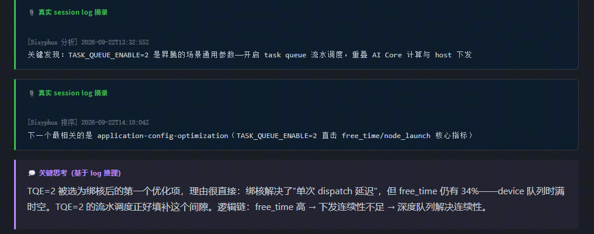

**优化方案**：在 torchrun 环境注入 `TASK_QUEUE_ENABLE=2`，开启 task_queue 算子下发队列的 Level 2 优化。

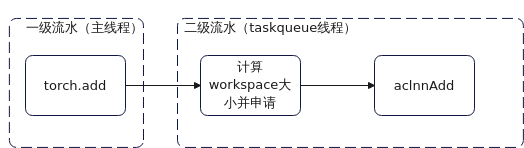

**性能收益**（单变量叠加 TQE=2）：

| **指标**              | **亲和性** | **变更后（+TQE=2）** | **变化**  |
| ----------------------- | ------------ | ---------------------- | ----------- |
| tps                   | 785        | **852**              | **+8.5%** |
| elapsed/step          | 10.43s     | 9.60s                | -8.0%     |
| free_time_pct         | 34.5%      | **31.5%**            | -**8.7%** |
| node_launch avg（us） | 7.932      | 7.232                | -8.8%     |

**收益来源**：TQE=2 改变 host 侧算子下发队列策略，使 device 队列更饱满、空闲窗口收紧，device 利用率提升直接转化为 tps 增益。

#### 1.3.3 性能库替换（jemalloc/tcmalloc）

问题分析：glibc malloc 在多线程场景下存在 arena 锁竞争和内存碎片问题，训练框架频繁进行小对象分配/释放，malloc 锁竞争会增加host算子下发延迟。当前 device 空闲率仍约 31.5%，host 侧 malloc 开销是进一步压缩空闲的候选方向。

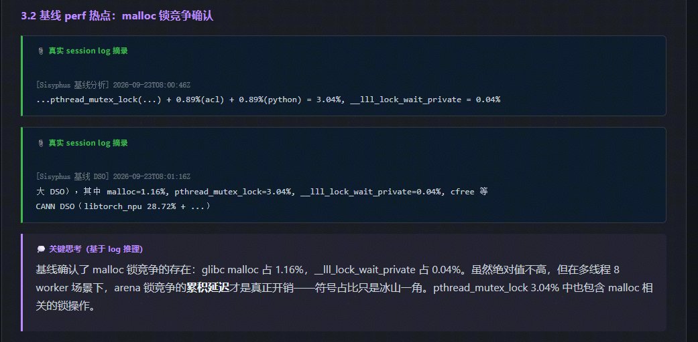

**优化方案**：通过 `LD_PRELOAD` 注入高性能分配器替换 glibc malloc，单变量 A/B 验证（仅变更分配器）：

* tcmalloc（gperftools 2.15）：per-thread cache 设计，每线程独立本地缓存，避免 arena 锁竞争；`export LD_PRELOAD=/usr/lib64/libtcmalloc.so.4`
* jemalloc（5.3.0）：per-arena + size-class 优化，多线程扩展性更好；`export LD_PRELOAD=/usr/lib64/libjemalloc.so.2`

**性能收益**：

| **指标**                   | **TQE基线(glibc)** | **+tcmalloc** | **+jemalloc** | **选择tcmalloc变化** |
| ---------------------------- | -------------------- | --------------- | --------------- | ---------------------- |
| tps                        | 852                | **879**       | 878           | **3.1%**             |
| free_time_pct（profiling） | 31.5%              | **22.36%**    | 25.22%        | **-29%**             |
| libc.so.6 DSO 占比         | 15.94%             | 12.76%        | 11.81%        | **-19.9%**           |

**收益来源**：tcmalloc/jemalloc 的 per-thread/per-arena cache 消除了多线程 malloc 锁竞争，host算子下发路径加速，同时二者比较下per-thread cache 设计加速更彻底，device 空闲窗口压缩更有效，因此综合**tcmalloc**为优选。

#### 1.3.4 编译优化（LTO+PGO）

**问题分析**：采样热点符号 `Repository::ReadQueue()`（21.91%）和 `Repository::Dequeue/StartConsume`（4.2%）是 Host侧 的 dequeue/consumption 主循环，属于 launch feed 路径的核心代码。该路径由 C++ 编译器生成，函数调用层次深、间接跳转多，适合 PGO（Profile-Guided Optimization）和 LTO（Link-Time Optimization）优化。

**优化方案**：使能编译 BiSheng编译 LTO+PGO ：

BiSheng 编译器（clang 19.1.7）对 Python 解释器、libtorch_cpu、libtorch_npu 实施 ThinLTO + PGO 优化：

* **PGO**：基于训练场景 profile 数据引导函数内联、分支预测和代码布局优化，减少 `Repository::ReadQueue` 等热路径的 icache miss 和分支预测失败
* **ThinLTO**：跨模块内联，将 `ReadQueue → Dequeue → StartConsume` 调用链内联为单一函数，消除间接跳转开销

**性能收益**：

| **指标**      | **tcmalloc** | **变更后（+BiSheng LTO+PGO）** | **变化** |
| --------------- | -------------- | -------------------------------- | ---------- |
| tps           | **879**      |                                |          |
| free_time_pct |              |                                |          |
| elapsed/step  |              |                                |          |

**收益来源**：BiSheng LTO+PGO 通过 PGO 引导的代码布局优化和 ThinLTO 跨模块内联，加速了 `Repository::ReadQueue()` host侧主循环。icache miss 降低和分支预测改善使每步dispatch 路径更快执行，NPU 等待时间进一步缩短，elapsed 从 xxx。

### 1.4 定位耗时成本对比

## 2 基于 CANNBot 的集群训练精度问题定位 Agent

**Highlight**

CANNBot `model-train-precision-diagnose` Plugin 融合训练源码与跨Node、跨 Rank、跨 Step 运行证据，自主决策单变量诊断实验，并依据实验反馈缩小排查范围，实现从训练精度异常到可验证候选根因的端到端定位。

### 2.1 背景与目标

聚焦 PyTorch on Ascend NPU 集群训练中的 Loss/GradNorm 有限值偏差、NaN/Inf 与溢出、受控重复运行不一致等问题，针对异常跨 Rank、跨 Step 传播以及运行时配置变化造成的定位困难，介绍 CANNBot 如何结合训练源码、运行环境和数值证据提出根因假设，选择单变量实验并依据结果缩小排查范围。重点阐述跨 Step 梯度更新偏差溯源、算子溢出源头定位与候选成因分析、运行时随机性和确定性设置跟踪，并通过修正、回退复跑及独立证据复核区分已验证根因与待验证候选。基于Torchtitan-NPU框架结合双机 DeepSeekv4 的三类故障案例，评估 Agent 从训练症状到根因验证的端到端定位能力以及定位耗时与人工介入情况。

### 2.2 诊断范围与支持现状

上述实践基于 [CANNBot 开源仓库](https://gitcode.com/cann/cannbot) 中的 `model-train-precision-diagnose` Plugin 当前已实现的诊断能力开展。该 Plugin 面向 PyTorch on Ascend NPU 训练，规划覆盖 10 种精度异常症状，其中正向数值偏差、反向信号偏差、非有限数值异常和确定性复现不一致 4 种已支持，其余 6 种纳入后续规划，具体如下：

| **精度异常症状** | **典型表现**                                                   | **支持状态** |
| ------------------ | ---------------------------------------------------------------- | -------------- |
| 正向数值偏差     | 同输入、同 Step 下，有限值 Loss、Logits 或正向输出与标杆不一致 | √           |
| 反向信号偏差     | 正向基本一致，但有限值梯度、GradNorm 或反向结果与标杆不一致    | √           |
| 非有限数值异常   | 激活、Loss、梯度、参数或优化器状态出现 NaN、Inf 或 Overflow    | √           |
| 确定性复现不一致 | 输入、权重、随机性及确定性设置等条件受控后，重复运行仍不一致   | √           |
| 参数更新异常     | 梯度存在且为有限值，但参数未更新、更新被跳过或更新量、方向异常 | 规划中       |
| 突发尖刺异常     | 有限值训练指标出现孤立尖刺或瞬时突增、突降                     | 规划中       |
| 收敛趋势异常     | Loss 长期下降缓慢、提前进入平台期或无法收敛                    | 规划中       |
| 持续振荡异常     | 有限值训练指标连续多个 Step 震荡或周期性波动                   | 规划中       |
| 训练连续性偏差   | Checkpoint 断点续训的轨迹或训练状态与连续训练不一致            | 规划中       |
| 训练评测效果偏差 | 训练或验证指标基本正常，但最终 Checkpoint 或下游评测效果异常   | 规划中       |

当前正向、反向数值偏差诊断要求目标运行自身可重复，并具有可比较的外部标杆；非有限数值异常不要求外部标杆；确定性复现偏差以受控重复运行为自身对照。正向与反向偏差由同一有限值偏差 Agent 处理，因此已支持的 4 种症状对应下图中的 3 类症状诊断 Agent。

### 2.3 精度诊断工作流

CANNBot 通过 `model-train-precision-diagnose` Plugin 组织训练精度诊断，由 Primary Agent 统一管理用户交互、诊断状态和实验派发，协调范围缩减、症状诊断与独立复核。症状诊断 Agent 调用 [cannbot-skills 开源仓库](https://gitcode.com/cann/cannbot-skills) 提供的有限值偏差、非有限值和确定性诊断 Skill，训练日志可视化 Skill 辅助对齐 Loss/GradNorm。Skill 提供诊断策略与操作规范，msProbe 等工具负责采集和分析数值证据，整体流程如图 X-X 所示。

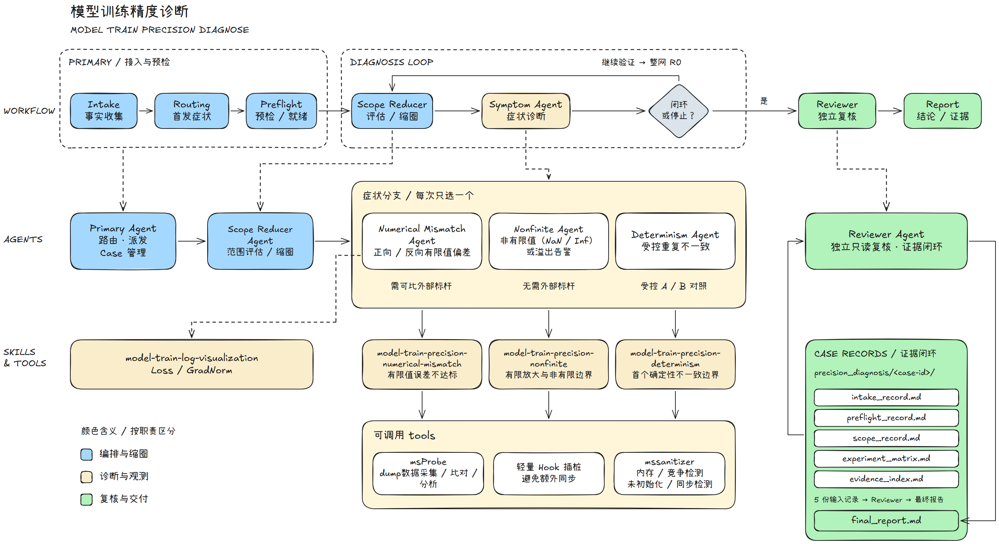

图 X-X：CANNBot 训练精度诊断Plugin工作流。

图中实线给出了从诊断准备到结果交付的主流程，各模块自上而下说明如下。

1. **1.Primary Agent：事实收集、路由与预检。** Intake 阶段确认训练入口、症状、复现窗口、集群拓扑和标杆条件；Routing 阶段依据最早已确认的异常选择诊断方向，后续传播形成的 NaN 或 Loss 跳变不覆盖更早的异常证据。Preflight 在实际训练所用的 Node、容器和 Python 环境中核对代码、数据、权重、配置与依赖，并确认资源、现场启动方式和授权范围。图中的“预检 / 就绪”合并展示环境预检与执行能力判定，后者决定下一阶段能否运行新实验，或只能分析已有产物。
2. **2.Scope Reducer Agent：保留症状的范围缩减。** 以已确认的整网复现基线 R0 为参照，评估 Node、Rank、Step、模型及并发配置等候选范围，按信息增益、成本和风险选择单变量实验。缩圈结果需要保留原症状，才能作为下一阶段的诊断范围。范围评估不可省略；当前已具备最小复现、用户拒绝实验或执行条件受限时，也需记录评估结果与未执行原因。
3. **3.症状诊断 Agent：沿单一路由定位。** 图中的三个并列框表示可选的诊断路径，每次只派发其中一位 Agent。Numerical Mismatch Agent 在目标运行自身稳定且存在可比外部标杆的条件下，分析正向或反向有限值偏差及其传播。Nonfinite Agent 处理 NaN、Inf 或溢出告警，沿数据依赖追溯有限放大起点、非有限转换边界和后续传播，不将首次观测到非有限值的位置直接认定为根因。Determinism Agent 以输入、权重、随机性及确定性设置受控的 A/B 运行为对照，先核验实际生效的控制条件，再定位首个可观测的不一致边界。
4. **4.Skill 与工具：执行诊断策略并获取证据。** 症状 Agent 分别调用 [cannbot-skills 开源仓库](https://gitcode.com/cann/cannbot-skills)中的 `model-train-precision-numerical-mismatch`、`model-train-precision-nonfinite` 和 `model-train-precision-determinism`；`model-train-log-visualization` 辅助对齐并展示 Loss/GradNorm。msProbe、轻量 Hook 插桩、msSanitizer等工具使用需核对现场版本与适用范围；采集后还需确认数据完整且原症状仍能复现，避免把插桩改变时序导致的症状消失误判为修复。
5. **5.诊断回环：依据实验反馈继续验证或结束定位。** 症状 Agent 优先验证预检发现的单一差异；若已通过修正、回退和同口径复跑形成因果证据，可直接进入 Reviewer，无需继续下钻到算子或 Tensor。尚未闭环时，继续内部定位和候选验证。最小脚本未复现整网异常时，Primary 沿顶部回环重新派发 Scope Reducer，回到 R0 检查缺失的整网上下文，再返回原症状 Agent。候选修正与回退由当前症状 Agent 执行，并记录异常是否消失、恢复或迁移。
6. **6.Reviewer 与 Case 记录：独立复核并交付结论。** 信息收集、预检、范围评估、实验矩阵和证据索引分别落盘至 `precision_diagnosis/<case-id>/` 下的五份过程记录。Reviewer 只读检查这些记录及引用证据，不加载症状 Skill，重点核验复现条件、定位依据和修正/回退验证是否相互支持。工具告警、首差异位置或单次正常运行均不足以单独确认根因。Reviewer 在 `final_report.md` 中给出“已验证根因”“强候选”或“证据不足”的结论，由 Primary 向用户交付证据路径和必要的下一步。图中的“闭环或停止”也覆盖资源受限、用户拒绝必要实验等情况，此时仍需复核并明确记录证据缺口和停止原因。

### 2.4 关键精度定位技术案例验证（双机 DSV4）

#### 2.4.1 首步Loss精度偏差异常定位

**精度异常症状：**

与标杆相比，首step Loss 相对误差大于 0.5%。

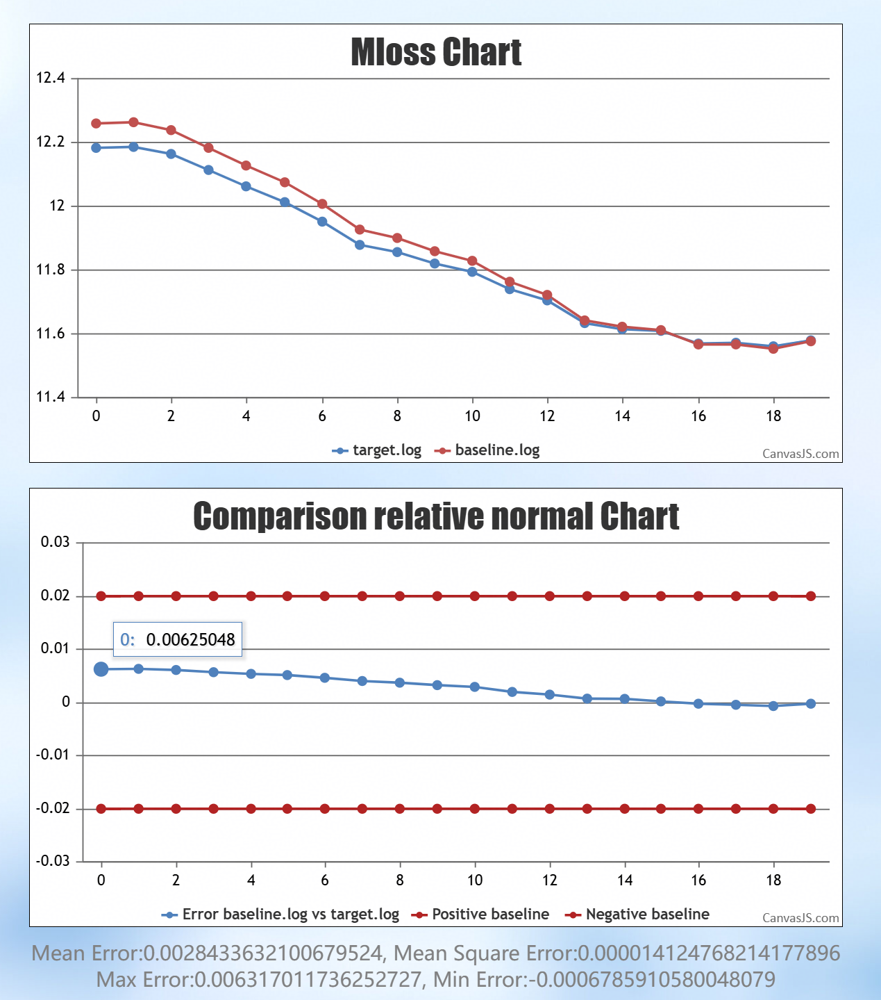

**TODO List：**

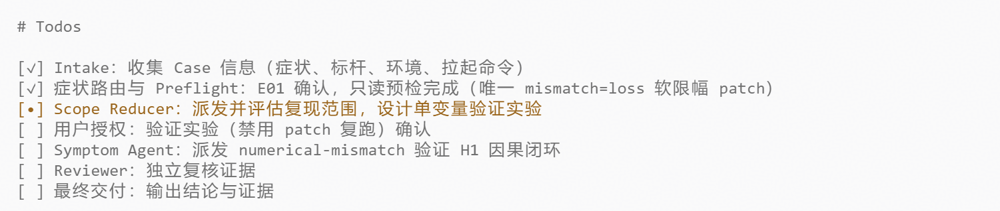

**推理链：**

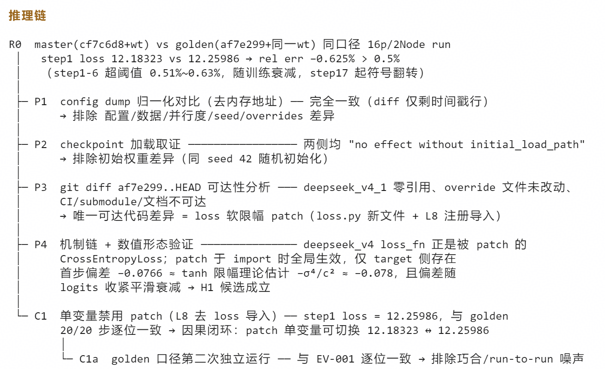

**中间实验矩阵：**

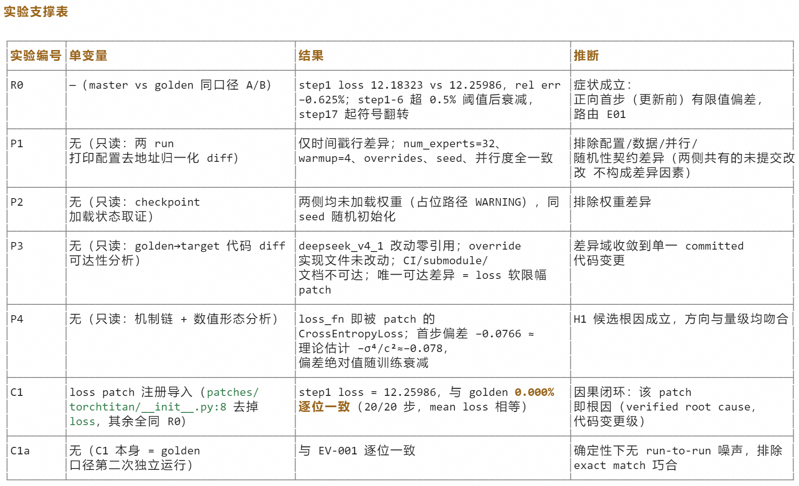

**形成候选根因：**

#### 2.4.2 **精度溢出源头算子节点定位**

**精度异常症状：**

step1 Loss 和 Gradnorm 正常；step2 出现 Loss NaN。

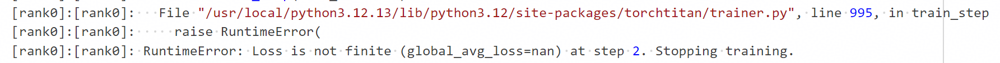

**TODO List：**

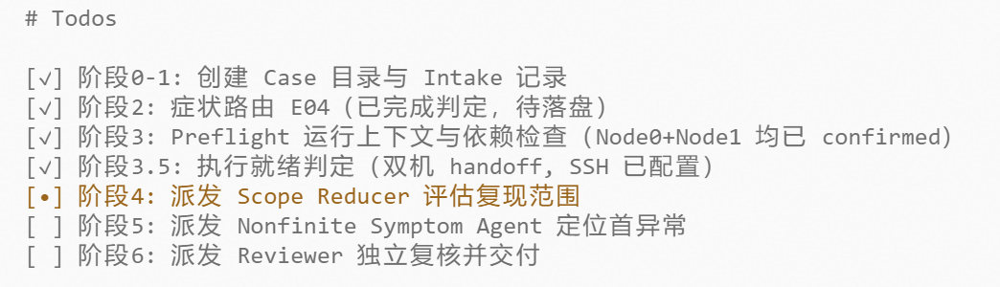

**推理链：**

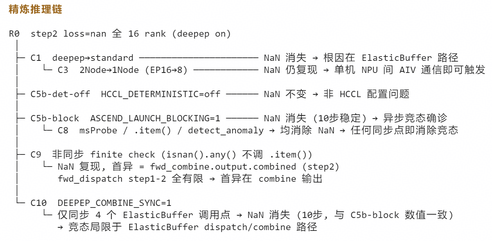

**中间实验矩阵：**

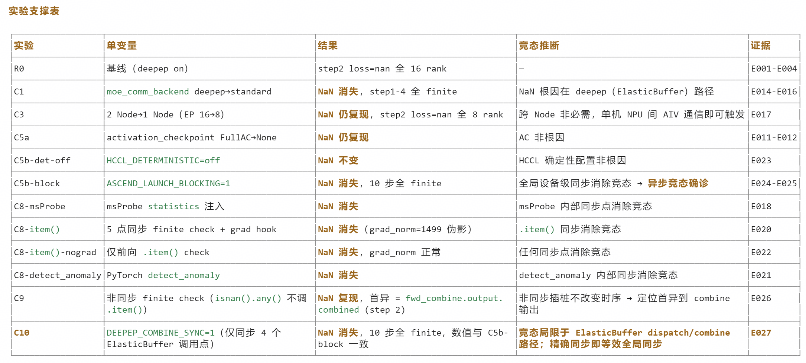

**形成候选根因：**

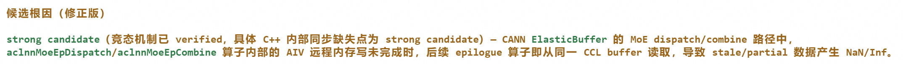

#### 2.4.3 运行时随机性设置异常覆盖定位

**精度异常症状：**

固定随机种子和开启确定性开关，连续跑两次Loss曲线不一致。

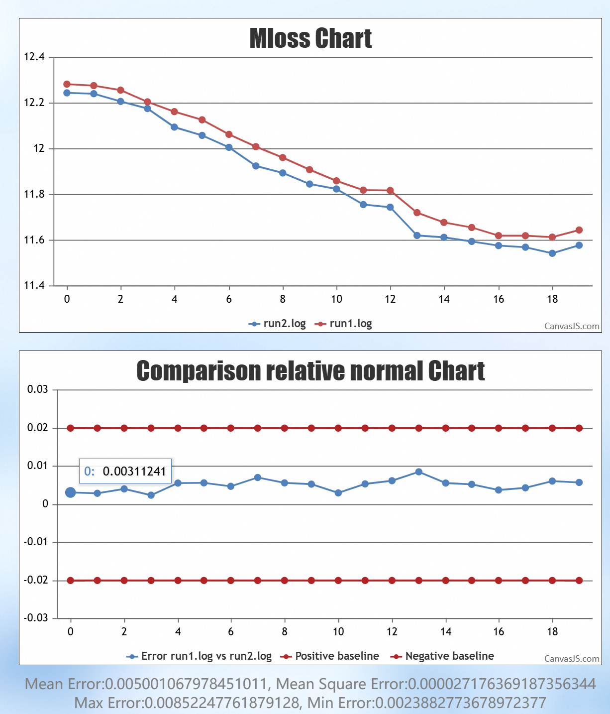

**TODO List：**

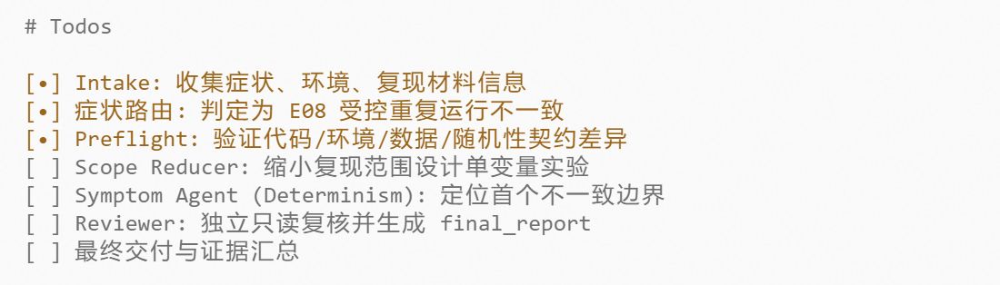

**推理链：**

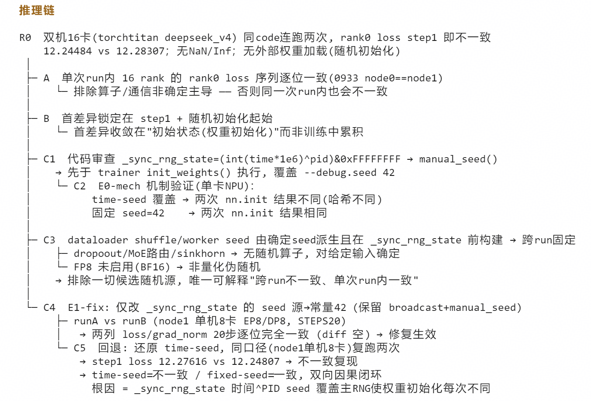

**中间实验矩阵：**

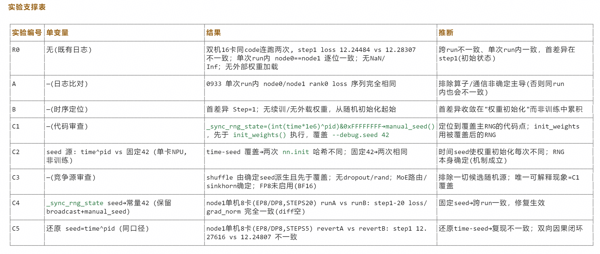

**形成候选根因：**

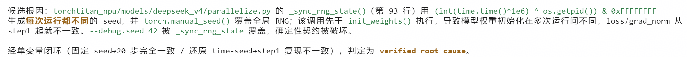

### 2.5 **定位**耗时对比

| **案例编号** | **人工定位耗时** | **Agent定位耗时** |
| -------------- | ------------------ | ------------------- |
| 1            | ≈1Day           | <1h               |
| 2            | ≈2Day           | <3h               |
| 3            | ≈1Day           | <1h               |

**结论**：基于 CANNBot 的集群训练精度问题定位 Agent **大幅度**减低了精度问题定位耗时成本。

---

[返回总览](../ascend950_superpod_moe_pretrain_system_reference.md)
