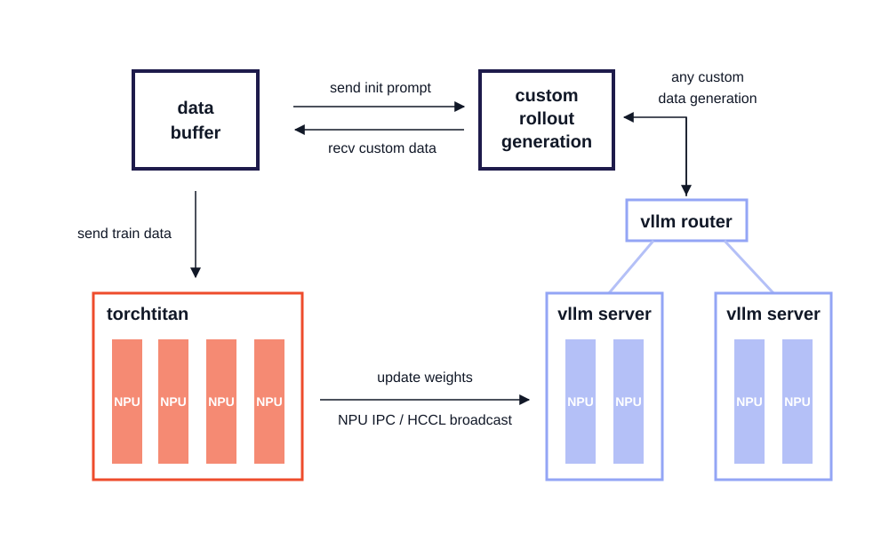
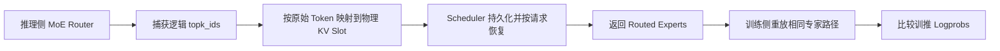
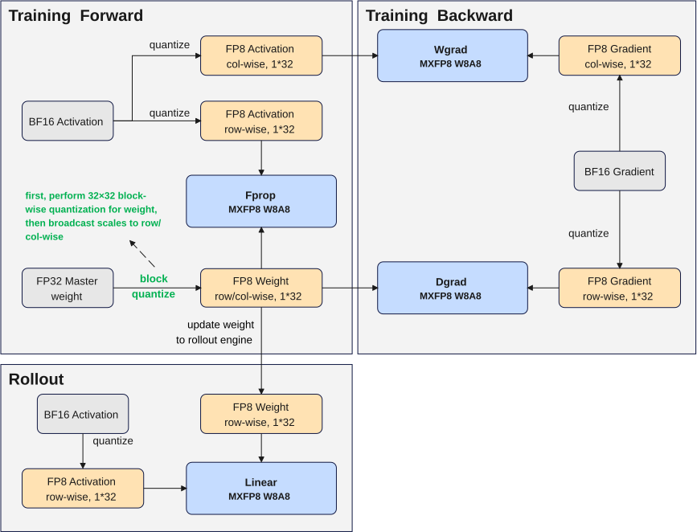
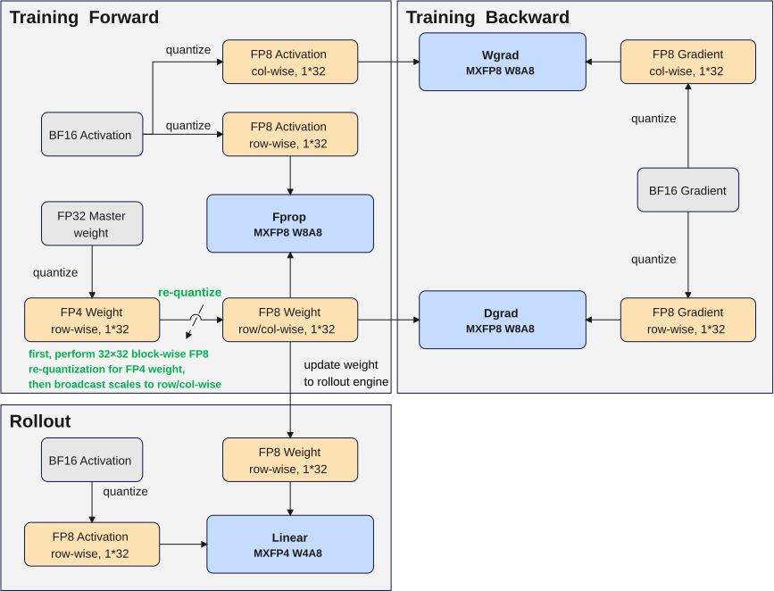
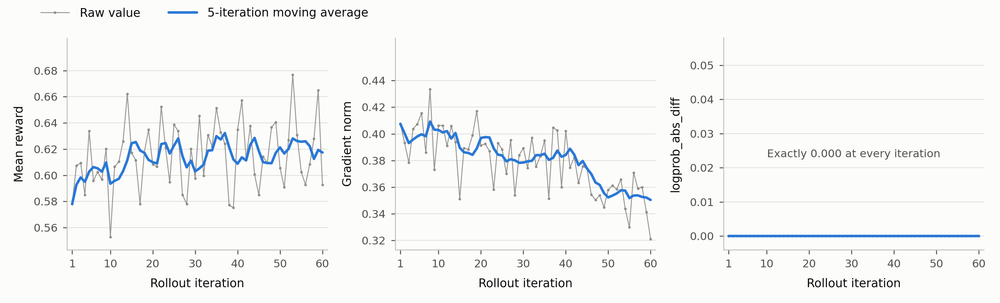
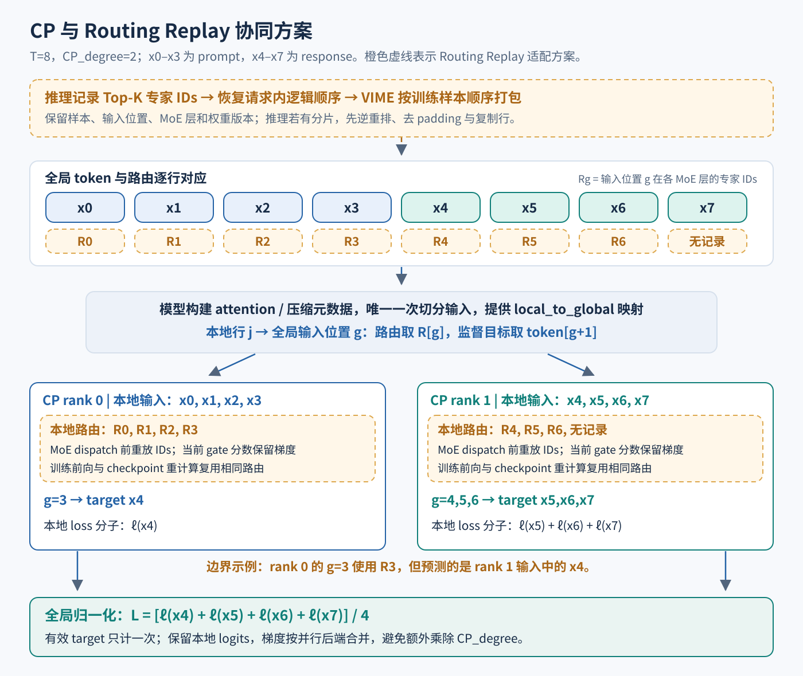
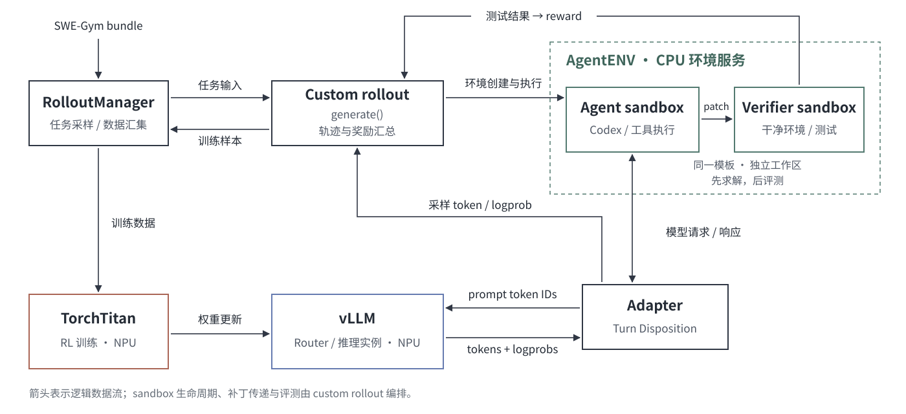
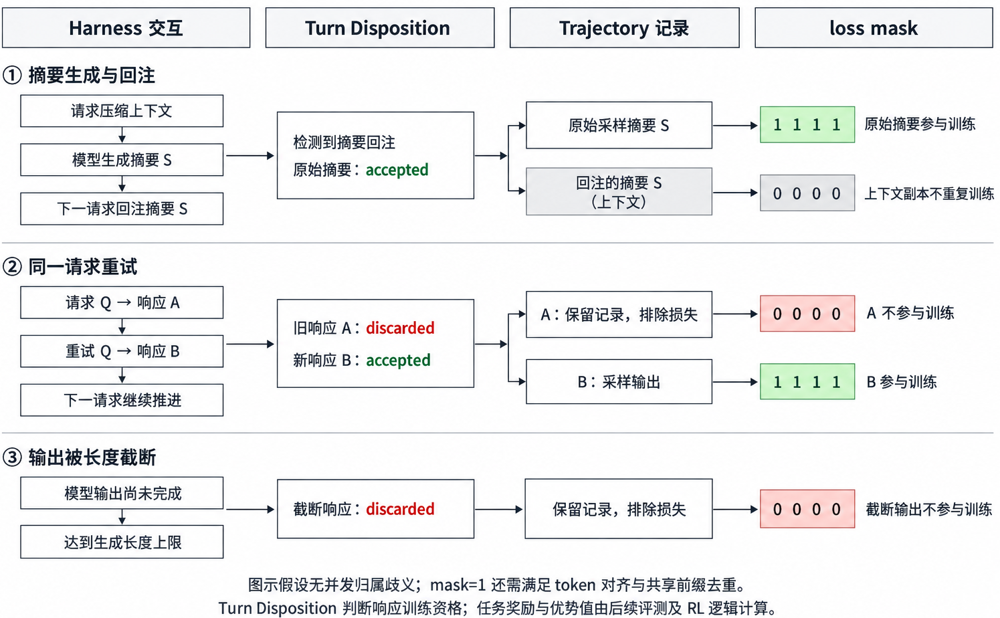
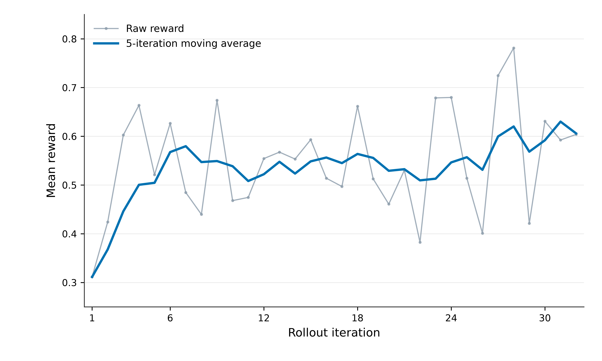
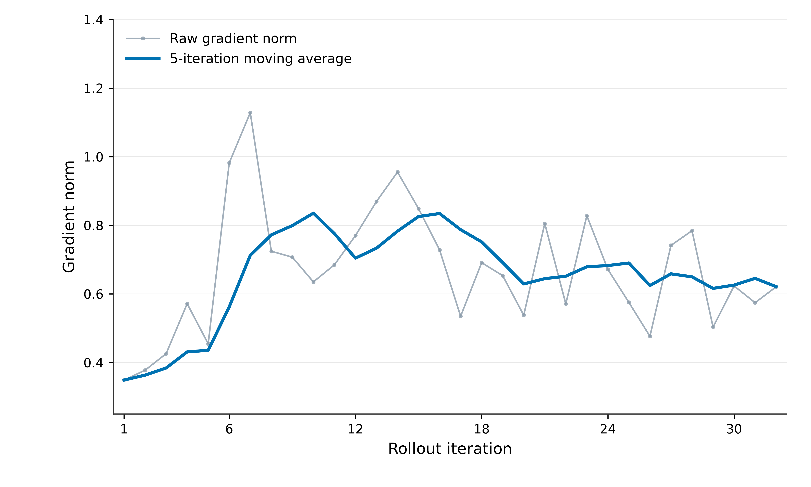

# 基于鲲鹏 CPU、昇腾 950 和灵衢协同的 Agentic RL 训练实践

随着 DeepSeek 等大规模基座模型的发展，大模型技术正经历从“生成文本”向“自主决策智能体”的演进。早期模型主要依靠预训练获得通用语言能力，并通过 SFT、RLHF 等后训练方法提升指令遵循和偏好对齐能力。进一步地，Agentic RL 将强化学习引入智能体场景，使模型能够通过任务规划、工具调用和环境交互，根据反馈不断优化行为策略。围绕这一方向，业界正在构建面向 Agent 的大规模 RL 基础设施，以支持长程任务、多环境交互和持续学习能力的发展。

然而，Agentic RL 的发展仍面临多方面挑战：

- **长序列和超大规模模型带来的内存与通信挑战。** Agentic RL 中的任务轨迹通常包含大量交互历史、工具调用记录以及中间推理过程，导致训练序列长度显著增加。同时，随着千亿甚至万亿参数规模模型的发展，模型参数、梯度、优化器状态以及 KV Cache 均带来了巨大的存储压力和通信开销。

- **高频工具调用对 Agent 环境基础设施提出更高要求。** 与传统 LLM 训练不同，Agentic RL 需要模型频繁调用外部工具，大量工具交互会引入额外的环境执行开销，使 Rollout 阶段成为影响整体训练效率的重要瓶颈。因此，需要构建高性能、安全可靠的 Agent 沙箱环境，实现模型推理、工具执行和环境反馈之间的高效协同。

- **RL 训练稳定性与训推一致性挑战。** RL 训练过程中，训练与推理阶段的计算差异可能导致策略偏移，影响奖励评估准确性、训练稳定性和可复现性。在大规模分布式训练环境下，算子实现、数值精度以及并行策略的不一致，都可能造成训推结果偏差。因此，需要从算法设计和 Kernel 实现等多个层面保证训推一致性，从而提升 RL 训练过程的稳定性、可复现性以及调试效率。

面对上述挑战，我们发布了鲲鹏 CPU、昇腾 950 和灵衢协同的 Agentic RL 实践，充分发挥**鲲鹏 CPU 的环境执行与工具调度能力、昇腾 NPU 的高效训练与推理能力，以及灵衢高速互联的通信能力**，为社区大规模 Agentic RL 训练提供技术参考。

相关源码实现可参考：

- [DeepSeek-V4 Flash RL 训练执行样例](../../llm_rl/deepseek_v4/README.md)

- [Agentic RL 训练执行样例](../../vime-forge/examples/coding_agent_rl/README.md)

## Highlights

- 完成 Ascend 950 与鲲鹏 CPU 协同的 Agentic RL 训练流程，对接运行于鲲鹏 CPU 的 AgentENV 沙箱环境，支持基于多种 Harness 的 Agentic RL 训练和 SWE 任务的稳定 Reward 收敛。

- 完成 DSV4 Flash 在 950DT 上的训推全链路 bitwise 对齐，通过算法、框架到 CANN 算子 Kernel 的层层校准，实现训推 logprob MAE 为 0.0。

- 支持 MXFP8 和 MXFP4 的 RL 低精度训练流程，加速 Rollout 推理，并优化训推权重传输代价与静态内存占用。

- 支持 M 级长序列训推，训练和推理均使用 Context Parallel（CP）并行，通过多卡分担 Activation 峰值内存。

- 依托灵衢 UB 高速互联能力，实现 EP/CP/FSDP 高效通信及训推权重快速同步，提升大规模 RL 训练效率。

## Outline

- [RL Framework 及部署方案](#rl-framework-及部署方案)

- [训推一致性保障](#训推一致性保障)

- [低精度训练](#低精度训练)

- [长序列训练优化](#长序列训练优化)

- [Agentic RL 训练流程](#agentic-rl-训练流程)

- [Future Plan](#future-plan)

## RL Framework 及部署方案

本实践基于 [Vime](https://github.com/vllm-project/vime) RL 训练框架进行扩展：Rollout 侧沿用 Vime 的 vLLM 集成方案，训练侧采用 TorchTitan 替换 Megatron 作为训练后端。模型定义、FSDP2 并行策略以及 Optimizer 等核心训练组件均基于 TorchTitan 构建，同时保持与 Vime 一致的训练流程和接口设计，实现 RL 训练链路的平滑迁移。

<p align="center">
  
</p>

整体架构与 Vime 保持一致，主要包含 Training、Rollout 和 Data Buffer 三个核心模块：

- **Training（TorchTitan）：** 负责 RL 主训练流程，从 Data Buffer 获取训练数据，完成模型优化更新，并将最新权重同步至 Rollout 模块；

- **Rollout（vLLM + Router）：** 负责推理采样流程，通过 vLLM 推理引擎生成轨迹数据，并结合 Router 完成请求调度，产出包含 reward/verifier 信息的新数据；

- **Data Buffer：** 作为训练与 Rollout 的数据桥梁，负责管理 Prompt 初始化、自定义数据以及 Rollout 生成数据。

本实践实际部署中采用**“训推分离 + PD 共卡”**的组合部署形态。

- **训推分离：** 训练侧与 Rollout 侧部署在独立 NPU 资源域中。训练侧保留模型参数、activation、gradient 和 optimizer state；Rollout 侧独立管理推理权重、请求调度和 KV Cache，两侧通过权重同步衔接每一轮 RL 更新，保障训练稳定性与训推资源边界清晰。

- **PD 共卡：** Rollout 内部将 Prefill 和 Decode 共卡部署，按阶段复用 NPU 资源与显存，降低部署复杂度。

> Note：当前实践未启用 PD 分离模式，主要原因是 PD 分离场景下的 Routing Replay 能力尚在完善阶段。后续该特性支持后，用户可结合集群资源规模、模型特点及训推负载特征，在训推共卡/分离和 PD 共卡/分离等多种部署模式之间灵活选择，进一步优化 Agentic RL 系统的资源利用效率。

## 训推一致性保障

在 RL 后训练流程中，推理引擎负责生成训练轨迹，训练引擎负责计算策略概率（Logprobs）并更新模型参数。理论上，两侧加载相同权重后，对同一输入应该得到一致的输出概率。但在实际大模型系统中，由于训练和推理框架在**框架调度、算子调用、Kernel实现、计算精度、并行策略以及权重处理流程**等方面存在差异，即使使用完全相同的模型参数，也可能产生不同的计算结果。

对于 RL 训练而言，这类差异会直接影响策略优化过程：轻微的数值误差可能进一步放大为 MoE 路由选择变化、Lightning Indexer KV选择差异等，最终导致 logprobs 偏差。因此，训推一致性不仅是数值精度问题，更是保证 RL 训练稳定性和结果可复现性的基础能力。

本实践基于 CANN 软件栈，对 TorchTitan-NPU 训练引擎和 vLLM-Ascend 推理引擎进行了从框架到算子的系统性对齐。**最终在相同权重条件下，通过算法、框架到 CANN 算子 Kernel 的层层校准，实现训推全链路 bitwise 一致，logprob MAE 为 0.0。**

### 基础设施

训推一致性的建设并非单点优化，而是由底层基础能力逐步向上收敛。整体按照如下路径推进：

> CANN 基础能力建设 → 单引擎内部一致性 → 训推引擎间一致性

其中两项基础能力是后续所有对齐工作的基石：CANN 算子 Batch 一致性、MoE Routing Replay。

#### CANN 算子 Batch 一致性支持

在实际 RL 场景中，同一个样本可能由于 Batch 内位置和 Batch 大小变化、动态调度策略变化等原因，进入不同的计算路径。如果算子本身无法保证 Batch 一致性，则即使输入数据和权重完全相同，仅改变样本在 Batch 中的位置，也可能产生不同结果。因此，首先需要保证底层算子的 Batch 一致性。

CANN 软件栈针对计算算子和通信算子均提供了 Batch 一致性支持能力，通过统一开关使能后，可以保证同一输入在不同 Batch 排布情况下得到一致结果。

```python
export HCCL_DETERMINISTIC=strict
torch_npu.npu.set_deterministic_level(3)
```

可通过如上开关使能。在此基础上，我们结合实际训推场景，对关键算子进行了验证，确保后续框架级一致性问题不会受到底层算子非确定性的干扰。

#### MoE Routing Replay

对于 MoE 模型，Router 根据每个 token 的 Router Logits 选择 Top-K 专家参与计算。由于 Router Logits 对数值误差敏感，即使训推两侧使用相同权重，微小计算差异也可能导致不同专家选择。

一旦专家路径发生变化，后续计算结果已经不再是简单的数值误差，而是离散计算路径差异。为隔离这一因素，推理侧需要返回每个 token、每一层选择的逻辑专家 ID，训练侧使用这些 ID 重放相同的专家路径。

**推理侧捕获逻辑专家 ID。** vLLM-Ascend 在 MoE Router 产生 `topk_ids` 后、专家 ID 映射到各 EP Rank 的本地编号前完成捕获，保证返回的是训练侧可以直接使用的逻辑专家 ID。DP、TP 和 SP 会改变当前 Rank 上看到的 token 排布，因此捕获时还要恢复原始 token 顺序，并裁掉通信或图执行引入的 padding。最终每个请求返回的数据形状为 `[num_returned_tokens, num_hidden_layers, num_experts_per_tok]`，分别对应返回 token、MoE 层和 Top-K 位置。



**按原始 token 持久化。** 路由数据按逻辑 token 产生，需要建立从逻辑 token 到物理 slot 的映射来保存路由数据。对于 DeepSeek-V4 一类使用 MLA compressed KV Cache 的模型，Attention 路径不会为每个原始 token 区间分配一个物理 slot；routed-expert capture 却必须为每个原始 token 保存一行数据。因此，compressed KV slot 不能直接作为 routed-expert slot。另外，压缩 KV 可能尚未为尾部 token 分配新的物理 block，但这些 token 仍然各自需要一行路由记录。为解决这两个问题，本实践根据已申请的 compressed 物理 block 重建非压缩的物理 block ID，将非尾块 token 的路由信息写入全局 host buffer 的 block 中；暂时无法落盘的尾部保存在请求级 pending buffer 中，返回时再按逻辑 token 顺序拼接。由于 Prefix Cache 和 Chunked Prefill 的复用单位是物理 KV block，该方案既能复用 Prefix Cache 中已有的路由信息，也能覆盖跨多个 Prefill chunk 的请求。

**Async Scheduling 下保持数据对应。** Async Scheduling 允许多个 forward 同时处于执行或回传阶段，而路由捕获 buffer 会被下一轮 forward 清空并复用。为避免数据被覆盖，每轮 forward 都先生成独立的 device snapshot，再执行异步 D2H；同时将物理 block snapshot 保存在对应的 SchedulerOutput 中，使 SchedulerOutput N 与 ModelRunnerOutput N 一一对应。

### 关键问题与解决方案

完成基础能力建设后，我们按照**训推单引擎内部一致性 → 训推引擎间一致性**的顺序逐步推进一致性验证。以下是我们在对齐过程中遇到的关键问题。

#### 框架侧问题

**a\) PD 分离场景下 MoE 路径不一致**

在 PD 分离架构中，Prefill 和 Decode 使用不同执行路径：

- Prefill 通常采用标准 AllToAll 完成 MoE Dispatch；

- Decode 为降低延迟，会采用 Dispatch/Combine 融合算子。

在 PD 混部场景下，Decode token 可能与 Prefill token 被调度进入同一个 Batch，从而在 Prefill 路径执行，导致同样的 token 在不同 Batch 组合下走不同 MoE 计算路径，产生训推差异。

针对该问题，我们统一了推理引擎中的 MoE Dispatch/Combine 实现，全部切换到 CANN 提供的[融合 Kernel](https://gitcode.com/cann/ops-transformer/blob/master/mc2/common/docs/torchapi_ElasticBuffer.md)，保证不同阶段、不同 Batch 组合下执行路径一致。

**b\) 权重与 Activation 数据类型不一致**

LLM 训练和推理通常需要复杂的细粒度数据类型控制，以 DeepSeek\-V4 Flash 为例：

- MoE Router、Compressor、mHC 等模块需要保持 FP32 精度

- Embedding、LMHead、Lightning Indexer 等模块采用 BF16

- Attention 和 MoE Router Expert 权重采用 MXFP8

- MoE Expert 权重采用 MXFP4

如果训推两侧在权重加载、反量化方式、FSDP 通信精度、模型内部 Forward 输入类型转换等任一环节存在差异，都会导致最终结果不一致。针对该问题，我们实现了细粒度的数据类型对齐，使训练侧实际参与计算的数据类型与推理侧保持一致。

**c\) 算子融合粒度差异**

推理引擎为了追求极致性能，通常会采用更大粒度融合 Kernel，训练框架不一定采用相同融合策略。因此，即使数学公式一致，不同融合方式仍可能由于中间结果精度、计算顺序、归约顺序等问题产生数值差异。我们针对该类差异逐点权衡性能：

- 优先训练侧复用推理融合算子，并实现对应反向传播融合 Kernel 或者小算子；

- 对难以复用的融合算子，推理侧回退到基础小算子实现；

#### 算子侧问题

在 CSA Kernel 的 PageAttention 场景中，我们发现即使逻辑 KV 和 Top\-K 顺序一致，仅改变 BlockTable 排布，也会导致计算结果变化。

进一步分析发现，PageAttention 过程中，CSA Kernel 会根据 Top\-K 结果连续搬运两个 token。由于搬运过程按照物理地址排序，导致搬运后的 token 顺序与原始 Top\-K 顺序不一致。最终在 Attention 累加过程中，由于归约顺序变化，引入浮点计算误差，导致输出存在差异。

针对该问题，我们修复 Kernel 内部搬运逻辑，保证计算顺序与逻辑 Top\-K 顺序一致，消除了 BlockTable 变化导致的精度波动。

## 低精度训练

本实践支持 MXFP8 和 MXFP4 两种低精度 RL 训练模式，用户可根据模型结构和性能需求灵活参考。依托 Ascend 950 原生 MXFP8/MXFP4 计算能力，实现低精度矩阵计算加速，有效提升 Rollout 和在线服务推理效率，同时降低大模型训推过程中的静态内存占用和权重传输开销，缓解超大规模模型部署中的内存瓶颈。

### MXFP8 训练

<p align="center">
  
</p>

MXFP8 训练流程如上图所示。为保证 RL 训推一致性，训练阶段与 Rollout 推理阶段采用严格一致的数据类型和量化策略。

**在训练正向阶段，** BF16 Activation 分别沿 M 维和 K 维进行 MXFP8 量化，生成 row\-wise 和 col\-wise 的 FP8 Activation。其中，FP32 Master Weight 按 32×32 block 进行量化，得到 FP8 Weight 以及对应的 E8M0 Scale。Block\-wise Scale 在计算前广播为 row\-wise 的 1×32 Scale，方便直接调用 MXFP8 Matmul Kernel，完成 FP8 Activation 与 FP8 Weight 的矩阵乘计算。

**在训练反向阶段，** BF16 Gradient 分别沿 M 维和 N 维进行 MXFP8 量化，生成 row\-wise 和 col\-wise 的 FP8 Gradient。其中，col\-wise FP8 Gradient 与正向缓存的 col\-wise FP8 Activation 进行矩阵乘，计算权重梯度 dW，用于后续优化器更新；row\-wise FP8 Gradient 与缓存的 FP8 Weight 进行矩阵乘，计算得到输入梯度 dX，完成梯度反向传播。与正向类似，FP8 Weight 对应的 Scale 会广播为 col\-wise Scale。

**在训推权重同步阶段，** 由于 TorchTitan 训练引擎仅保留 FP32 Master Weight，不驻留低精度权重副本，RL Framework 从 TorchTitan 获取 FP32 Master Weight，并按照与训练正向阶段一致的量化流程转换为 FP8 Weight 后传输至 Rollout 引擎。

**在 Rollout 阶段，** 推理引擎获取更新后的低精度权重，调用 W8A8 Matmul Kernel 完成推理计算，实现低精度推理加速。

值得注意的是，本实践对权重量化采用**FP8 32×32 Per Block 量化**。相比 DeepSeek-V4 原生的 128×128 粒度，该方案能提供更细粒度的 Scale 表征，从而获得更高的量化精度；同时，生成的 Block-wise E8M0 Scale 经广播后，可直接复用 Ascend 950DT 上的 MXFP8 Kernel（该 Kernel 为 per-group 粒度），无需引入额外计算路径，进而提升算子执行效率。

在 MXFP8 计算中，Ascend 950DT 硬件支持在 L0C 内完成随路反量化，无需将数据搬出至 UB 再由 Vector 单元执行反量化，避免受 UB buffer 容量、Vector算力及带宽的制约，进一步提升低精度矩阵计算效率。

此外，本实践没有直接采用 MXFP8 per group 权重量化，主要还基于以下两点考虑：

1. **保证训推一致性与训练稳定性**
MXFP8 量化会导致前向与反向阶段权重量化轴不一致，引入权重数值偏差，存在影响 RL 训练稳定性的风险。采用 FP8 per-block 权重量化，可保证前向、反向计算过程中的权重表示完全一致。

2. **提升计算复用效率，降低量化开销**
前向阶段生成的 FP8 Weight 可缓存，并复用于 Recompute 与反向传播，避免在反向阶段重复执行权重量化操作，减少额外计算开销，提升训练效率。

综合上述原因，本实践对权重量化采用**FP8 32×32 Per Block 量化**，也和后续的 DeepSeek-V4.1 原生量化策略保持一致。

### MXFP4 训练

<p align="center">
  
</p>

MXFP4 训练主要应用于 MoE 模型的 GroupedMatmul，其整体数据流与 MXFP8 基本保持一致。主要区别在于：训练正向阶段，FP32 Master Weight 首先量化为 MXFP4 格式，后续重量化为 per-block FP8 权重，用于训练过程中的重计算和反向传播。

在训推权重传输阶段，采用 MXFP4 格式传输权重，相较于 MXFP8 可进一步降低权重传输带宽需求和存储开销。推理阶段，推理引擎直接调用 W4A8 GroupedMatmul Kernel 完成计算，在保持计算效率的同时进一步优化 MoE 模型权重访存效率。

### DSV4 Flash MXFP8 训练效果

本次实践基于 GRPO、DSV4 Flash MXFP8，在 dapo-math-17k 数据集完成 60 步训练，实现了 logprob MAE 为 0.0 的训推对齐效果。实验采用 `--rollout-batch-size=128`、`n-samples-per-prompt=8`、`rollout-max-response-len=3072`的参数配置，reward 逐步收敛，gradient norm 整体稳定，效果如下图所示。

> DSV4 Flash MXFP8 发布的权重在dapo-math-17k 数据集上效果很好，初始 `reward=0.7`，每个 prompt 生成 8 个样本下大量样本全 0 或 1，训练信号太弱。为了方便观测训练收敛效果，本次实验先离线收集该数据集的 `reward` 评分（每个 prompt 生成 8 个样本），将 `reward` 之和在区间 [1, 6] 的样本过滤出来用于训练。

<p align="center">
  
</p>

## 长序列训练优化

Agentic RL 场景多轮工具调用通常会导致序列长度显著增加，除 Prefix Cache、Partial Rollout 等常见优化外，针对 1M 超长序列的 RL 训练，我们重点优化了以下两个方面：一是降低训练过程中的局部内存峰值；二是采用上下文并行（Context Parallelism，CP）将长序列计算分散到多个设备上，并完成 RL 训练中 CP 场景下数据准备、loss 处理及权重同步等相关环节的适配。

### 激活峰值内存优化

**Activation Checkpoint 调整** 激活重计算通过减少前向阶段保存的中间结果来节省内存，但反向恢复这些结果时，仍可能出现局部峰值。因此，除了检查保存了多少激活，还需要关注重计算发生时有哪些张量同时驻留。我们针对 `hc_head` 调整了 activation checkpoint 的位置，使激活保存与重计算的边界更适合长序列场景。在 32K 序列长度配置下，该阶段的局部峰值降低近 20%。

**Chunked loss** 为保持数值精度，我们在 loss 的 softmax 与 log 相关计算中使用 FP32。长序列下，这部分操作会产生较大的词表维度中间结果。为降低一次计算的内存需求，我们沿 token 维度将其拆成多个 chunk，逐块计算 log\-probability，再按原顺序重排结果。分块保持了每个 token 的词表归一化范围不变；使用lm\_head TP 时，也保留了对应的跨设备归约。

chunk 大小需要在内存和执行效率之间取舍，较小的 chunk 可以减少单次操作的临时空间，但会增加算子调用，并可能增加通信次数。本次使用的 chunk 大小为 8192，32K序列长度配置下，loss 计算阶段峰值由 45 GB 降至 38 GB。

<p align="center">
  
</p>

### RL 训练的 CP 适配

为进一步减少长序列下激活的内存占用，我们考虑在RL场景引入了 CP 并行。CP 将一条长序列切分到多个Rank计算，使每个 Rank 主要处理本地 token 对应的激活，在Attention阶段通过通信获取完整序列的KV信息。

我们接入了 TorchTitan-NPU 后端已有的 CP 训练能力，采用连续序列切分。框架将完整 packed tokens、位置信息和 CP 通信组交给模型，由模型统一构造 Forward 输入并完成切分，避免框架和模型各切一次。由于 Rollout 过程产生的 Response 长度并不固定，因此框架将对不满足 `CP_degree` 倍数的训练输入做 padding 处理，并且 padding 部分不参与 loss 计算。

**对齐 token 归属与训练目标。** CP 方案还需要保证 response、mask、advantage 和 log\-probability 与本地 logits 一一对应，其关键是区分输入位置与预测目标：位置 g 的 logit 预测位置 g\+1 的 token。因此，分片最后一个 logit 可能负责预测下一分片的第一个 token，不能直接按输入边界切分所有训练字段。我们按全局预测目标映射分配这些字段，并将 old/reference 前向的局部 log\-probability 恢复为完整 response，供后续 advantage 计算和指标统计使用。

**保持 loss 与梯度尺度不变。** CP 的多个 Rank 共同处理同一组输入，各 Rank 只需计算本地有效 token 的 loss；按 rollout 归一化时保留完整 rollout 的有效 token 分母，按 token 归一化时使用全局唯一有效 token 数。CP 汇总 loss 的前向值，反向保留本地贡献，并与 FSDP 的梯度归约配套，避免额外乘除 CP\_degree。在恢复完整 response 的数据布局下，advantage 和样本分母只按独立的数据并行样本统计，避免重复计数。

### CP 场景下的 Routing Replay 支持

在已有 Routing Replay 的基础上，CP 主要增加了路由布局和重计算管理两方面的适配，对应图中的橙色路径。

**路由与输入使用同一映射。** 若推理侧也进行了分片，需先将路由恢复到请求内的逻辑 token 顺序，去除 padding 和重复行；训练侧再按模型提供的 `local_to_global` 映射取出本地路由，避免重复实现切分规则。路由按输入位置 `g` 取 `route[g]`，loss 则对应目标 `token[g+1]`。缺失记录和末 token 需显式标记；没有 response target 的 Rank 仍可能有 prompt 路由和通信，不能直接跳过。

**重计算复用本地路由。** 将推理记录的 routed experts 绑定到对应的 microbatch、层和 CP 布局，保证原前向与 checkpoint 重计算读取同一份记录，避免调用顺序变化造成错位。

## Agentic RL 训练流程

本实践以 Qwen3.5 和 SWE-Gym 代码修复任务为例，基于鲲鹏平台部署 AgentENV 与 Codex Harness，使能多轮模型推理、工具执行、独立评测和策略更新，形成从任务采样到训练更新的端到端 Agentic RL 流程。

<p align="center">
  
</p>

### 沙箱环境与 RL 框架解耦，支持多种 Harness

本实践实现了环境执行与 RL 训推分离部署下的稳定训练：AgentENV 沙箱环境在 CPU 侧承载代码执行与工具交互，TorchTitan 和 vLLM-Ascend 在 NPU 侧完成策略优化与推理采样，两侧通过环境控制和模型请求接口协同。框架将任务环境、Harness 与模型协议适配分开，支持 Codex、Claude Code 等不同 Harness 复用同一套训练主干，使 Agent 执行方式的扩展无需重写 RL 后端。

### AgentENV 在鲲鹏 CPU 上的适配和优化

与传统 Reasoning RL 不同，Agentic RL 的 Rollout 采样过程不仅包含模型自身的推理，也涉及与外部环境进行持续、多轮的高并发交互。本实践基于 AgentENV，在鲲鹏 CPU（ARM64 架构）上完成部署和 SWE-Gym 训练环境的构建；基于 openEuler OS 完成 PVspinlock 优化，提升 vCPU 在超高并发下的资源利用率，同时提升沙箱的恢复和调度效率。

**PVspinlock 实战优化：** 在 AgentENV 所用的 KVM 虚拟化场景中，Host 与 Guest 分别进行独立调度。当 vCPU 存在超分时，如果持有 spinlock 的 vCPU 被 Host 调度出去，其余 vCPU 会持续等待，造成无效 CPU 消耗。Agentic RL 场景下，沙箱在高并发场景下通常存在较高的 vCPU 超分比例，因此该问题会直接影响沙箱的执行效率和性能。

openEuler OLK-6.6 已在 ARM 平台支持 **PVspinlock**。当 Guest vCPU 抢锁超时后，可通过 WFI 陷出至 Host 并暂时退出运行队列；锁释放后，再由 Guest 通知 Hypervisor 定向唤醒等待 vCPU，从而减少无意义自旋并提升物理 CPU 利用率。本实践基于 AgentENV MicroVM，在 Host 和 Guest 均使用支持 PVspinlock 的 openEuler OLK-6.6 内核，并构造两种 CPU 调度场景：

- **1:1**：2 个 vCPU 分别绑定至两个独立 pCPU；

- **1:2 超分**：2 个 vCPU 共同绑定至同一个 pCPU。

使用 `hackbench` 进行高并发进程通信压测。每组实验执行 13 次，前 3 次预热，取后 10 次平均值。同时通过 Guest 启动参数 `nopvspin` 控制 PVspinlock 开关，以进行对比测试。

测试结果数值越小越好。在 **1:2 vCPU 超分场景**下，开启 PVspinlock 后 hackbench 完成时间由 **8\.2052 s 降低至 7\.2483 s**，性能提升约 **11\.66%**。相比之下，在无超分的 1:1 场景中收益并不明显，说明 PVspinlock 的主要价值体现在高超分、强锁竞争场景下。

### `CONFIG_HZ` 优化实践：缩短沙箱恢复调度时延

`CONFIG_HZ` 是 Linux 内核的编译配置项，用于定义内核每秒的时钟 tick 频率，并影响调度器定时处理、线程唤醒及时间管理等机制的时间粒度。`HZ=250` 对应约 4 ms 的 tick 间隔，而 `HZ=1000` 对应约 1 ms。

在 AgentEnv 的 `concurrent_resume` 测试中，每个 sample 会并发恢复 **50 个沙箱**。测试发现，openEuler 内核默认 `CONFIG_HZ=250` 时，大部分恢复耗时位于 40–60 ms，但会出现较多 **100 ms 以上的长尾异常点**，最大时延达到 147 ms，整体方差和长尾延迟均明显高于 Ubuntu。

分析发现，沙箱恢复过程中需要并发创建和删除 ublk 设备，多个线程会竞争全局 `ublk_ctl_mutex`。未获取锁的线程进入睡眠并在锁释放后重新参与调度。在此类高并发锁竞争场景下，提高 HZ 可以提供更细粒度的调度机会，降低等待线程重新获得 CPU 的调度延迟，从而减少多个锁竞争阶段累积形成的 resume 长尾时延。

以 openEuler 6\.6\.0、每组 150 个 samples 为例：

将 `CONFIG_HZ` 从 250 调整至 1000 后，openEuler 的平均 resume 时延由 **57\.6 ms 降低至 37\.9 ms，下降约 34%**；超过 80 ms 的长尾 sample 从 **13 个下降至 1 个**。剩余异常点主要出现在每轮第一个 sample，属于缓存未热等因素带来的冷启动开销；除冷启动外，测试结果基本稳定在 **25–60 ms**。

Ubuntu 6\.8\.12 上也观察到了相同趋势：将 HZ 从 250 调整至 1000 后，平均时延由 **53\.9 ms 降至 45\.2 ms（约 16%）**，剔除每轮首个冷启动 sample 后，超过 80 ms 的长尾样本由 **5 个降至 0 个**。

因此，对于 Agent 沙箱这类包含大量并发恢复、锁竞争和线程唤醒的低时延场景，将 `CONFIG_HZ` 提升至 **1000** 可以明显改善调度响应速度，尤其能够有效降低沙箱 resume 的**平均时延和长尾抖动**。

### 准确的优势估计与信用分配

针对多轮交互中轨迹分支、上下文重写和请求重试带来的训练数据偏差，本实践保留模型实际采样的 token 与 logprob，通过 `loss mask` 和共享前缀去重，明确参与策略优化的输出范围。本工作引入 `Turn Disposition` 机制判断多轮轨迹片段的训练资格，减少训练噪声，并最终在任务级结果奖励与 token 级优化之间建立一致的归属关系，为 advantage 计算与 credit assignment 提供可信的数据基础。

#### Turn Disposition：从响应采纳到训练资格

Agent 在多轮执行中可能重试同一请求、压缩上下文或并发发起模型调用。在 RL 训练过程中，模型产生的行为并非全部都值得训练。以常见的 Coding Agent 为例，正确的思考方向 + 被迫截断的上下文（reward = 0）并不能作为合适的训练样本。本实践引入 `Turn Disposition`，以会话为单位，为每个已生成响应维护状态，并根据后续协议事件确定其训练资格。

<p align="center">
  
</p>

- **先记录，暂不训练。** 模型响应生成后进入 `pending`，保留原始 token 和 logprob，但设置 `trainable=False`，等待下一次请求或会话收尾。

- **请求推进或会话结束时确认。** 仅有一个待定响应、且未发生长度截断时，后续请求若未重试同一请求，上一响应转为 `accepted`；若会话直接结束，则转为 `terminal`，保留最后一次输出的训练资格。

- **重试、截断和归属不明时排除。** 相同请求再次出现、响应因长度限制截断，或同时存在多个无法明确关联的待定响应时，相关响应转为 `discarded`。排除的是其训练损失贡献，原始交互记录仍可保留。

状态更新最终写入轨迹节点：`accepted` 和 `terminal` 获得训练资格，再结合 token 对齐与共享前缀去重形成最终 `loss mask`；`pending` 和 `discarded` 不贡献该响应的训练损失。Turn Disposition 因而负责明确“哪些模型输出可以承接学习信号”，任务奖励仍由独立评测产生，优势值由后续 RL 逻辑计算。即使一次任务失败，被采纳的输出仍可以参与训练，从失败反馈中更新策略。

### 求解与验证隔离

Agentic RL 与 AgentENV 协同管理两类独立沙箱：执行沙箱承载 Agent 的代码修改与工具调用，验证沙箱从相同模板重新创建，仅接收候选补丁并执行评测。两者保持一致的任务起点，同时隔离可写工作区、临时文件和后台进程，使奖励依据可复现的测试结果生成。隔离的执行和验证环境，保证了奖励信号的准确性，并规避模型 Reward Hacking 的风险。

### SWE-Gym 任务上的稳定奖励收敛

本实践基于 GRPO、Qwen3.5-4B 模型以及 NovaSky-AI/SkyRL-v0-293-data 数据集，完成了基于 Codex 的 SWE-Gym Agentic RL 训练，并实现了训练 Reward 的稳定收敛。该结果表明，环境交互、轨迹处理、奖励计算以及训推权重更新等关键环节已实现端到端打通与稳定协同。如下图所示，Reward 在训练过程中逐步提升，并且 gradient norm 整体稳定，进一步体现了本实践在长流程训练 + 长程 Agent 交互中的稳定性与可用性，也为后续面向更复杂任务及更大规模模型的训练实践提供了工程基础和验证依据。

<p align="center">
  
</p>

<p align="center">
  
</p>

## Future Plan

1. 支持 DeepSeek-V4.1 等新模型的 Agentic RL 训练

   当前实践仅支持 DeepSeek-V4 Flash 的 Reasoning RL 和 Qwen3.5 的 Agentic RL 训练，后续将持续扩展模型适配范围，支持 DSV4.1 等新一代大模型的 Agentic RL 训练流程。

2. 提升训练稳定性与可靠性保障

   开展长稳运行与可靠性测试，完善故障监控、问题定位与恢复机制，保障 Agentic RL 训练稳定可靠。

3. 完善训推一致性问题定位与调试能力

   增强精度问题分析与维测能力，围绕训推一致性问题沉淀算法/框架问题定位 Skill，并提供 Kernel 级 Dump 与分析工具，实现问题快速定界。

4. 完善异步 RL 性能分析与优化能力

   建设性能问题维测能力，针对异步 RL 训练流程开展端到端效率分析，快速识别 Rollout、通信、训练等环节瓶颈，持续优化系统性能。

5. 完善 PD 分离场景下的 Routing Replay 实现

   针对 PD 分离部署场景，完善 Routing Replay 机制，保障 PD 分离模式下训推路由一致性，提升长上下文 Agentic RL 场景的稳定性与训练效率。

6. 提升 Agentic RL 任务的规模化和丰富度

   当前版本主要展示了 SWE-Gym 的训练效果，之后本项目将聚焦“多任务 + 多 Harness”的 Agentic RL 训练场景。基于已有的稳定训推精度和轻量解耦的环境，本工作将继续演进并提升模型后训练能力的泛化性。
