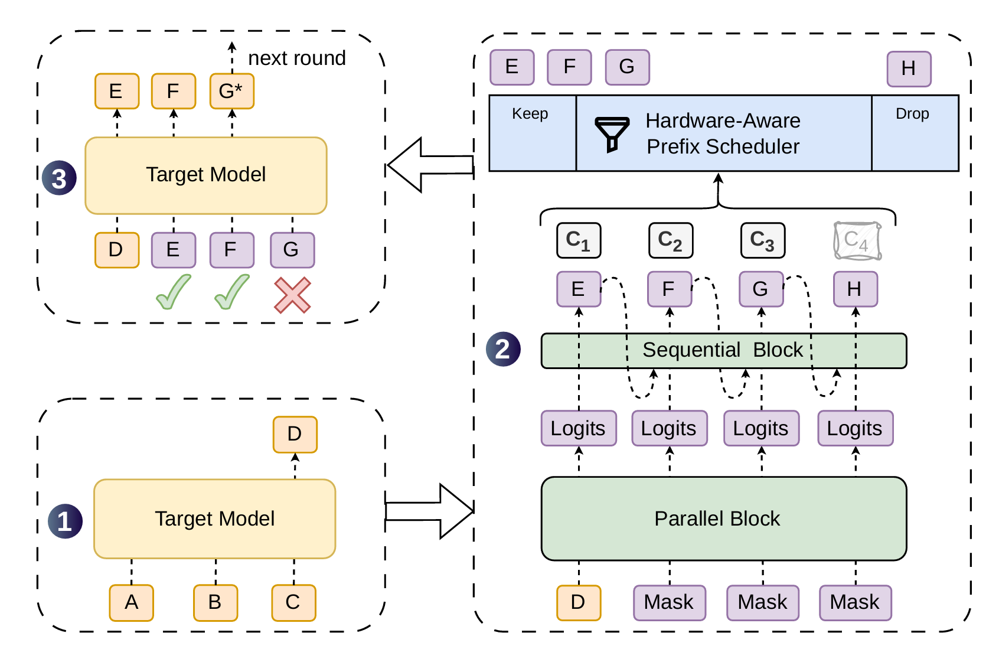
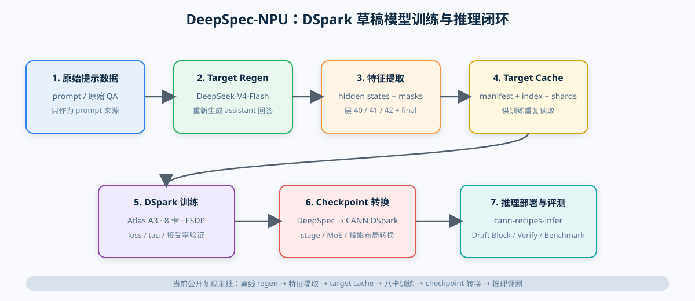
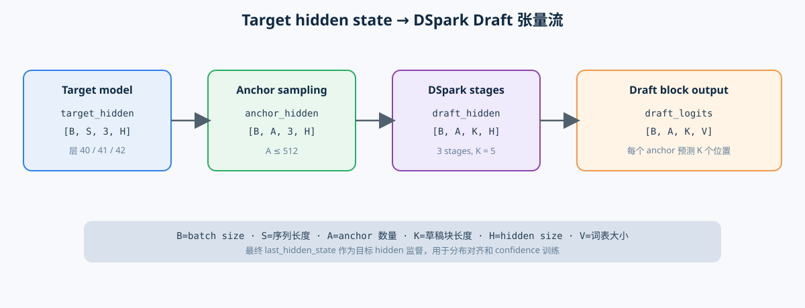
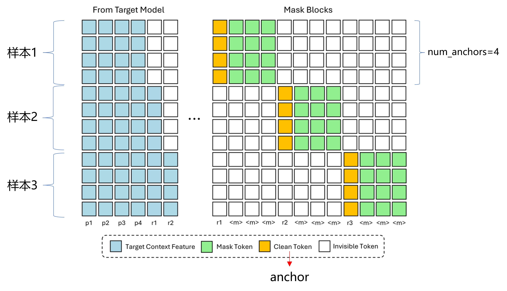
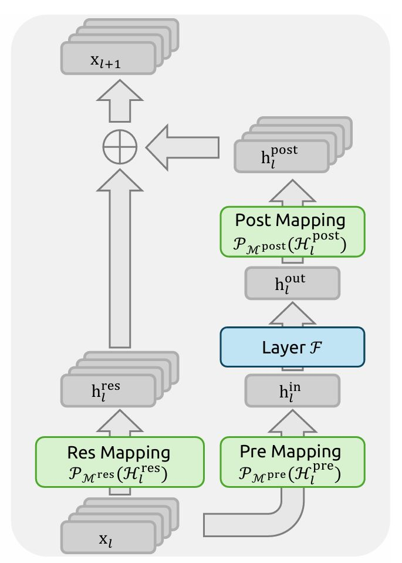

# DeepSpec-NPU：DeepSeek-V4 DSpark 草稿模型昇腾训练实践

## 1. 概述

**投机解码（speculative decoding）**是一种推理加速方法：先由较小的草稿模型（draft model）生成多个候选 token，再由完整的目标模型（target model）一次性校验。目标模型按候选长度加一个位置读取输入：如果前面的候选 token 与目标模型的采样结果一致，就接纳这段连续前缀；遇到第一个不一致的位置时，丢弃其后的候选，并使用目标模型在该位置给出的 token 继续生成。这样一次目标模型计算可以提交多个 token，但最终结果仍由目标模型和同一采样规则决定。

DSpark 是 DeepSeek-V4-Flash 使用的块级投机解码方案。它不同于原生 MTP（multi-token prediction，多 token 预测）逐层、逐位置地产生候选，而是由多个 Proposal Layer（候选层）串联生成一个 Draft Block（草稿块）。在一次草稿执行中，前面的候选层逐步更新块内 hidden state，Markov Head（马尔可夫头）建模同一草稿块内 token 的依赖关系，Confidence Head（置信度头）为每个位置给出接受概率。主模型收集指定层的辅助 hidden state，草稿模型据此生成候选；主模型随后对整组候选做批量 Verify（校验），并根据目标模型与草稿模型的概率执行 rejection sampling（拒绝采样），返回可接受的连续前缀和下一个 token。若候选数为 $N$，主模型的校验宽度固定为 $N+1$；置信度截断只减少有效候选前缀，不改变校验图的宽度。

<p align="center">
  
</p>

本项目使用 DeepSeek 团队开源的 [DeepSpec](https://github.com/deepseek-ai/DeepSpec) 作为草稿模型训练框架。需要明确的是，原始开源 DeepSpec 本身**不包含 DeepSeek-V4-Flash DSpark 草稿模型的模型定义、训练 recipe 和配套数据准备流程**，因此不能直接用于 DSv4 DSpark草稿模型训练。原始框架提供的是草稿模型训练所需的通用组织方式，例如训练器、target feature/cache 接口、接受率验证和 checkpoint 管理。

本项目以DeepSpec开源版本（提交`afdfa7c`）为基线，新增 DeepSeek-V4 DSpark 模型实现、训练配置、离线 target cache 工具、昇腾 NPU patch、融合算子和 checkpoint 转换工具。训练完成后，checkpoint 可通过转换交给 `cann-recipes-infer` 或业界现成推理框架使用。完整链路如下：

<p align="center">
  
</p>


## 2. Highlights

- FSDP（Fully Sharded Data Parallel，全分片数据并行）和 FP32 master weight AdamW；支持可选的 optimizer CPU offload（默认关闭）。
- AscendC/PyPTO mHC 融合算子，并保留 PyTorch fallback；MoE 使用 GMM（Grouped Matrix Multiplication，分组矩阵乘）前向和自定义反向，覆盖输入梯度与专家权重梯度。
- target cache 分片、异步写入和内存映射（mmap，memory-mapped）读取。
- 验证接受率、`tau_probabilistic` 期望接受长度、最佳 checkpoint 和训练 profiling。
- DeepSpec checkpoint 到 CANN DSpark checkpoint 的可复现转换闭环。

全文目录：

- [1. 概述](#1-概述)
- [2. Highlights](#2-highlights)
- [3. DSpark 模型结构](#3-dspark-模型结构)
- [4. 训练目标与评测指标](#4-训练目标与评测指标)
- [5. 数据准备与 Target Cache](#5-数据准备与-target-cache)
- [6. NPU 训练实现与优化](#6-npu-训练实现与优化)
- [7. 训练与部署闭环](#7-训练与部署闭环)
- [8. 未来计划](#8-未来计划)
- [9. 参考资料](#9-参考资料)

## 3. DSpark 模型结构

### 3.1 Target 与 Draft 的关系

`DeepSeek-V4-Flash`配套的DSpark模型结构和target模型基本一致，同样有sliding-window-attention、mhc、moe等基础结构。本实践在具体实现时会尽可能开源模型的配置：对齐数据准备时提取目标模型第 40、41、42 层 hidden state，并保留最终 `last_hidden_state`。草稿模型从这三层特征作为输入，经过三个block，输出若干草稿token；`block_size=5` 表示预测 5 个位置。embedding 和 LM head 使用目标模型对应权重初始化，在草稿训练中冻结；转换后的推理模型继续复用目标模型的 embedding 和 LM head。

<p align="center">
  
</p>

| 符号 | 含义 |
| --- | --- |
| $B$ | batch 中的样本数 |
| $S$ | 输入序列长度 |
| $A$ | anchor 数量，上限为 `num_anchors=512` |
| $K$ | 草稿块长度，当前为 5 |
| $H$ | hidden size |
| $V$ | 词表大小 |

主要tensor形状可写为 $\mathrm{target\_hidden}\in\mathbb{R}^{B\times S\times 3\times H}$、$\mathrm{anchor\_hidden}\in\mathbb{R}^{B\times A\times 3\times H}$、$\mathrm{draft\_logits}\in\mathbb{R}^{B\times A\times K\times V}$；实际实现会按阶段和 mHC 维度重排。

### 3.2 Block drafting

训练时，将会从有效 token 中采样 anchor，在 anchor 后构造长度为 5 的草稿位置。训练采用 teacher forcing：第 $k$ 个位置的输入使用前一个真实或教师 token，后续 5 个为待去噪的 token，约束草稿模型将 noise token 去噪后输出 proposal，并和教师 token 进行 loss 计算。在此过程中，由 anchor-aware attention mask 控制使目标上下文可见，并限制同一草稿块内 token 的可见范围；`sliding_window=128` 时只读取 anchor 前 128 个位置。验证输出 `accept_rate@0..4` 和期望接受长度。

### 3.3 Attention

由于上述的设计，训练时需要指定不同样本的window和proposal token之间不能互相交流信息，因此需要设置如下attention mask控制：

<p align="center">
  
</p>

注意力使用一个共享的 K/V 头，多个 query 头复用该 K/V，降低缓存和计算量。Q、KV 和输出投影沿用 DeepSeek-V4 的低秩结构；旋转位置编码（RoPE，Rotary Position Embedding）采用 C1A 交错布局，并在需要时执行 inverse RoPE，对齐DSpark的处理逻辑。attention sink 是每个 query head 的可学习 logit，对应一个全零 value，允许模型把部分注意力分配给“汇点”。

这是本项目当前唯一和Dspark没有完全对齐的是 `wo_a/wo_b` 是 dense（稠密）线性层，checkpoint用于推理时，转换脚本会把它们映射为 CANN grouped 布局，数学上是可以保持计算逻辑等价。 `wo_b groups` 在当前实现下存在训练稳定性问题，因此将会在后续PR中进行对齐。

### 3.4 mHC 与 MoE

mHC和MoE的结构和target模型完全一致。mHC（multi-head communication，多头通信）在每个阶段形成如下数据流：

<p align="center">
  
</p>

当前 `hc_mult=4`。HC Pre 生成混合矩阵并通过 Sinkhorn 迭代进行归一化，HC Post 合并残差，最终由 HC fold 恢复普通 hidden state。AscendC/PyPTO 后端在可用时调用融合算子，已经支持反向。

MoE（Mixture of Experts，混合专家）包含 routed experts 和 shared experts。gate 计算路由分数，选择 top-k 专家并归一化；shared expert 始终参与。SwiGLU（带门控的前馈结构）路径使用 clamp 防止极端值。训练 checkpoint 中融合专家权重为 `w13_weight/w2_weight` 布局，转换时按 expert 拆为标准 `w1/w2/w3`。

### 3.5 输出头

- LM head：把 hidden state 映射到 $V$ 个词的 logits。
- Markov head：以 rank 为 256 的低秩特征修正各草稿位置的 token 分布。
- Confidence head：输出每个草稿位置的接受概率 logit；当前配置将 Markov embedding 拼接到 confidence 特征。

## 4. 训练目标与评测指标

### 4.1 多目标 loss

默认配置为 `ce_loss_alpha=0.1`、`l1_loss_alpha=0.9`、`tau_loss_alpha=0.05`、`confidence_head_alpha=1.0`、`loss_decay_gamma=4.0`。可将总损失写成：

$$
\mathcal{L}_{\mathrm{total}}
=0.1\mathcal{L}_{\mathrm{CE}}
+0.9\mathcal{L}_{\mathrm{L1}}
+0.05\mathcal{L}_{\tau}
+1.0\mathcal{L}_{\mathrm{confidence}}
$$

其中 token CE 是有效 token 的交叉熵；distribution L1 比较草稿和目标 logits 转成的概率分布；tau loss 优化期望接受长度；confidence loss 是接受标签上的二元交叉熵。各项都使用 attention/loss mask，并按有效元素数归一化；分布式训练后再做跨 rank 汇总。

投机推理的一个特点是只有前面草稿的token被接受了，后面的才可能被接受。因此需要保证考前的token接受概率尽可能高。为此，在设计loss时会引入一个位置衰减因子，对 token CE、distribution L1 和 confidence BCE 的位置加权。设一个草稿块内的位置编号为 $k\in\{0,1,\ldots,K-1\}$，衰减因子为：

$$
w_k=\exp\left(-\frac{k}{\gamma}\right),\qquad
\widetilde{m}_k=m_k w_k
$$

其中 $m_k$ 是原始有效位置 mask，$\widetilde{m}_k$ 同时作为对应损失的分子权重和分母权重。因而第一个草稿位置的权重为 $1$，后续位置逐步降低；默认 $\gamma=4.0$ 时是温和衰减，$\gamma$ 越大衰减越慢。`loss_decay_gamma` 为 `None` 或非正数时不做位置衰减。tau loss 按有效草稿块计算期望接受长度，不使用这组位置权重。

### 4.2 接受率

对第 $k$ 个草稿位置，概率接受率定义为：

$$
a_k = 1-\frac{1}{2}\left\lVert p_k^{\mathrm{draft}}-p_k^{\mathrm{target}}\right\rVert_1
$$

期望接受长度为：

$$
L_{\mathrm{accept}}=1+a_0+a_0a_1+\cdots+\prod_{k=0}^{K-1}a_k
$$

相关指标名称说明：

- `accept_rate@k`：第 `k` 个草稿位置的概率接受率。
- `tau_probabilistic`：本文统一使用的概率期望接受长度指标，按上式计算并包含目标 token 的 $+1$。训练日志直接使用 `train/tau_probabilistic`；验证日志中的同一数值在当前实现中记录为 `validation/accept_length`，这里仅作为实现名称备注，不作为本文主术语。
- `tau_loss`：归一化的未接受比例，不等同于实际 argmax 连续命中长度。

## 5. 数据准备与 Target Cache

### 5.1 QA Regen

DSpark 草稿模型并不是只根据原始 prompt 和答案训练，它还需要目标模型在相同输入上的中间 hidden state、最终 hidden state、token 以及有效位置 mask，用来监督草稿模型的表示、token 分布和接受概率。这里的“相同输入”必须是目标模型实际使用的对话序列，尤其是 assistant 回答部分：原始数据集中的 QA 回答可能由另一个模型生成、经过人工改写，或使用了不同的模板和 token 序列，直接对原始 QA 提取的 hidden state 并不对应当前 target model 的生成分布。因此，数据准备必须先用 target model 重新生成回答（regen），再基于 regen 后的完整对话提取 target features；不能把原始 QA 的 hidden state 当作 target cache。

### 5.2 两种数据方案

有了regen的数据集，才能继续往下提取hiddenstates特征。由此带来一个基本问题：训练前需要决定这些 target features（目标特征）是提前保存，还是在训练过程中持续产生。

目前业界有两种数据方案：

| 方案 | 基本方式 | 适用场景 | 主要代价与要求 |
| --- | --- | --- | --- |
| 离线（offline） | 先用目标模型生成回答和特征，写成 target cache，再由训练任务反复读取 | 固定数据集、需要复现实验、训练会多轮遍历数据 | 需要一次性准备目标模型和磁盘空间；cache 与目标模型、层号、hidden size 必须严格匹配 |
| 在线（online） | 训练过程中由特征服务按需生成目标回答或 hidden state，并把样本交给训练进程 | 数据持续流入、数据规模很大或不希望保存完整 cache | 需要稳定的 producer 服务、传输协议、ACK（确认）和失败重试；训练速度受服务延迟和网络抖动影响 |

两者的核心差异是“计算成本何时支付”：离线方案把目标模型计算集中到训练前，训练阶段读取稳定、容易复用；在线方案把计算和训练并行，减少预存数据，但系统组件更多、故障面更大。当前本项目采用离线方案作为样例。在线方案将作为未来拓展能力。

### 5.3 两种方案的共同输入要求

无论选择哪种方案，目标模型和草稿训练配置必须一致：

- 使用同一个 DeepSeek-V4-Flash target checkpoint 和 tokenizer；
- 对每个 prompt 先由该 target checkpoint 重新生成 assistant 回答，后续 hidden state、logits 和 cache 均来自这份 regen 后的对话；
- 使用相同的 `target_layer_ids=[40,41,42]`，并额外提供最终 `last_hidden_state`；
- 保持 hidden size、`hc_mult`、词表和 token/mask 定义一致；
- 记录样本的 `input_ids`、attention/loss mask、目标层 hidden state 和最终 hidden state；
- 训练配置中的最大长度、对话模板和数据划分要与特征生成阶段一致。

### 5.4 离线主流程

离线训练入口脚本为 `scripts/train/train_offline.sh`：

1. 从 `mlabonne/open-perfectblend` 下载并划分 JSONL 提示数据；此时只把它作为 prompt 来源，不直接使用其中原始回答的 hidden state。
2. 使用目标推理框架调用 DeepSeek-V4-Flash，按照训练时的对话模板和采样配置重新生成 assistant 回答，得到 regen 后的训练 JSONL。
3. 基于 regen 后的完整对话运行 target model，通过 eager hook 取得第 40、41、42 层 hidden state 和最终 hidden state；这些特征与实际训练 token 序列逐位置对齐。
4. 保存 regen 后的 token、mask 和目标特征，生成 target cache，供静态 DataLoader 训练。

具体命令和字段说明见 [target cache 配置说明](../../../llm_sft/DeepSpec/scripts/data/dspark_data_preparation/config/README.md)。

本项目中，当前步骤2采用vLLM-Ascend进行regen，而步骤3采用了 `cann-recipes-infer` 仓提取特征。我们近期会完全切换到统一的regen和特征提取框架，避免两者存在数据GAP。

### 5.5 Cache 存储协议

Target Cache v2 由 manifest、`samples.idx` 和多个 shard 组成。token 使用 int32，mask 使用 uint8，hidden state 使用 BF16；多 rank 先写临时分片，再进行合并。

## 6. NPU 训练实现与优化 

### 6.1 融合算子

本项目使能了多个CANN上的融合算子，减少算子下发等开销：

- NPU RMSNorm 和 add-RMSNorm：归一化与残差相加的融合路径。
- `npu_swiglu`：shared expert 的门控前馈计算。
- `npu_grouped_matmul`：MoE 的 GMM1（gate/up）和 GMM2（down）计算。
- 自定义 autograd：补齐输入梯度及专家权重梯度，保证训练反向可用。
- mHC AscendC/PyPTO backend：通过环境和导入情况选择融合实现。

### 6.2 显存与稳定性

模型和梯度采用 BF16；优化器保留 FP32 master weight 与 AdamW state。optimizer CPU offload 可将这些状态放到主机内存，以设备显存换取主机内存和传输开销，当前默认关闭。

## 7. 训练与部署闭环

### 7.1 环境与源码

源码准备、patch 应用和依赖安装见 [DeepSpec README](../../../llm_sft/DeepSpec/README.md)。

### 7.2 核心配置

| 配置项 | 默认值 |
| --- | --- |
| `config_path` | `config/dspark/dspark_deepseek_v4_flash.py` |
| `target_model_path` | `/path/to/deepseek_v4_int8_w8a8` |
| `target_cache_dir` | `/path/to/deepseek_v4_target_cache` |
| `target_layer_ids` | `40,41,42` |
| `data_max_length` | `4096` |
| `global_batch_size` | `512` |
| `num_train_epochs` | `10` |
| `sharding_strategy` | `full_shard` |
| `ascend_rt_visible_devices` | `0,1,2,3,4,5,6,7` |

启动：

```bash
cd cann-recipes-train/llm_sft/DeepSpec
bash scripts/train/train_offline.sh
```

checkpoint 和 TensorBoard 默认写入 `/workspace/checkpoints/deepspec/<exp_name>/` 与 `/workspace/tensorboard/deepspec/<exp_name>/`，保留 `step_latest`、`step_best` 和最近 checkpoint 的策略由配置控制。

### 7.3 Checkpoint 转换

本项目提供了checkpoint转换脚本，可以将训练好的模型权重格式转换到 `cann-recipes-infer` 仓兼容的格式：
```bash
python3 scripts/tools/convert_deepspec_dspark_checkpoint.py \
  --input-path /data/checkpoints/deepspec/<experiment>/step_latest \
  --output-path /data/checkpoints/deepspec/<experiment>/step_latest_cann \
  --target-root /data/models/deepseek_v4_target
```

其中 `--target-root` 为目标模型权重路径，脚本会将其中 `config.json` 文件作为基准，完善草稿模型 `config.json` 配置文件，并且复制tokenizer文件。


## 8. 未来计划

本文提到诸多特性将在后续计划合入供开发者参考：

- 在线特征提取方案，包括基于临时共享存储落盘的特征传递、基于TCP的Mooncake特征传递等；
- 完全接入vllm/vllm-ascend推理框架，用于特征提取和训练数据生成；
- 面向其他框架的权重转换工具、数据集协议核查脚本工具等。

## 9. 参考资料

- [DeepSpec 原仓](https://github.com/deepseek-ai/DeepSpec)
- [DeepSpec-NPU README](../../../llm_sft/DeepSpec/README.md)
- [配置参考](../../../llm_sft/DeepSpec/docs/configuration.md)
- [checkpoint 转换脚本](../../../llm_sft/DeepSpec/scripts/tools/convert_deepspec_dspark_checkpoint.py)
