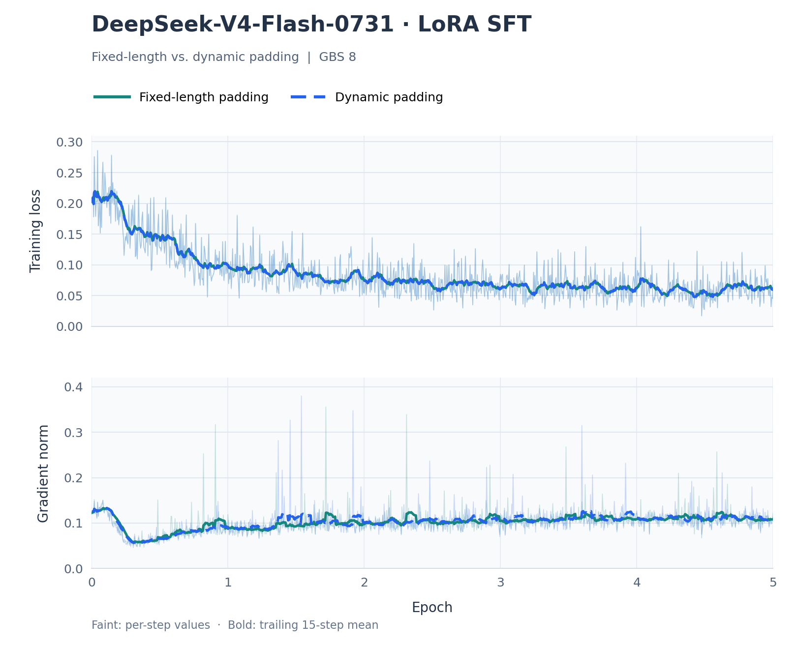
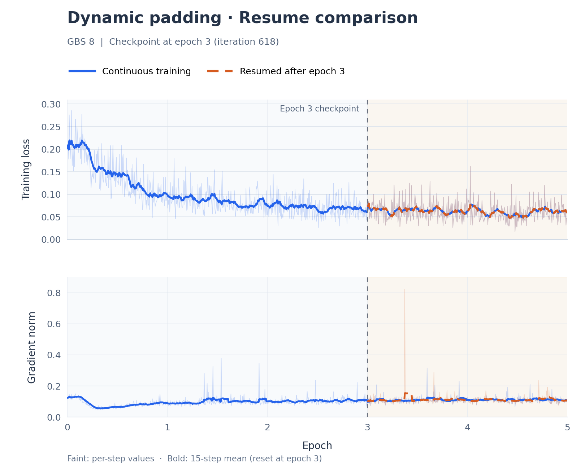

# DeepSeek-V4-Flash-0731 LoRA SFT Guide

This document describes how to perform 64K no-think LoRA SFT on DeepSeek-V4-Flash-0731 with MindSpeed-LLM. For details about the changes, see the [patch description](./patch_description.md).

Example environment:

- CANN: 9.1.0
- Hardware: Two Atlas A3 nodes, 8 NPU cards per node (16 cards total)

## Table of Contents

- [Environment Setup](#environment-setup)
- [Obtaining the Code](#obtaining-the-code)
- [Converting the Base Model](#converting-the-base-model)
- [Preparing the Data](#preparing-the-data)
- [Launching Training](#launching-training)
- [Merging and Exporting LoRA Weights](#merging-and-exporting-lora-weights)
- [Appendix: Training and Resume Curves](#appendix-training-and-resume-curves)

## Environment Setup

Pull the image on the host of each training node:

```bash
docker pull --platform=arm64 swr.cn-south-1.myhuaweicloud.com/ascendhub/mindspeed-llm:v26.1.0-cann9.1.0-torch_npu2.7.1.post8-a3-openeuler24.03-py3.12
```

Start the container:

```bash
docker run -itd --name dsv4_lora \
  --ulimit nproc=65535:65535 \
  --privileged --network=host --ipc=host \
  --device=/dev/davinci0:/dev/davinci0 \
  --device=/dev/davinci1:/dev/davinci1 \
  --device=/dev/davinci2:/dev/davinci2 \
  --device=/dev/davinci3:/dev/davinci3 \
  --device=/dev/davinci4:/dev/davinci4 \
  --device=/dev/davinci5:/dev/davinci5 \
  --device=/dev/davinci6:/dev/davinci6 \
  --device=/dev/davinci7:/dev/davinci7 \
  --device=/dev/davinci8:/dev/davinci8 \
  --device=/dev/davinci9:/dev/davinci9 \
  --device=/dev/davinci10:/dev/davinci10 \
  --device=/dev/davinci11:/dev/davinci11 \
  --device=/dev/davinci12:/dev/davinci12 \
  --device=/dev/davinci13:/dev/davinci13 \
  --device=/dev/davinci14:/dev/davinci14 \
  --device=/dev/davinci15:/dev/davinci15 \
  --device=/dev/davinci_manager \
  --device=/dev/devmm_svm \
  --device=/dev/hisi_hdc \
  -v /usr/local/Ascend/driver:/usr/local/Ascend/driver \
  -v /data/:/data/ \
  -v /home/:/home/ \
  -v /etc/ascend_install.info:/etc/ascend_install.info \
  -v /etc/hccn.conf:/etc/hccn.conf \
  -v /usr/local/bin/npu-smi:/usr/local/bin/npu-smi \
  -v /usr/local/sbin:/usr/local/sbin \
  -v /usr/local/dcmi:/usr/local/dcmi \
  -v /root/.pip:/root/.pip \
  -v /etc/hosts:/etc/hosts \
  swr.cn-south-1.myhuaweicloud.com/ascendhub/mindspeed-llm:v26.1.0-cann9.1.0-torch_npu2.7.1.post8-a3-openeuler24.03-py3.12 \
  /bin/bash
```

Enter the container and run the remaining commands inside it:

```bash
docker exec -it dsv4_lora bash
```

## Obtaining the Code

Obtain the specified MindSpeed-LLM revision and apply the patch provided by this project. Set `RECIPE_DIR` to the actual absolute path of this recipe directory inside the container. The following example places the training code under `/data/dsv4_sft/MindSpeed-LLM`:

```bash
RECIPE_DIR=/data/cann-recipes-train/llm_sft/dsv4_flash_ascendc/mindspeed-llm
mkdir -p /data/dsv4_sft
cd /data/dsv4_sft

git clone https://gitcode.com/Ascend/MindSpeed-LLM.git
cd MindSpeed-LLM
git checkout --detach 0ebf60e35590f981bf86de42c453e283366e68c2

git apply --check --index "${RECIPE_DIR}/mindspeed-llm.patch"
git apply --index "${RECIPE_DIR}/mindspeed-llm.patch"
git submodule update --init 3rdparty/Megatron-LM 3rdparty/MindSpeed
```

The patch updates the MindSpeed submodule revision. Use `git apply --index`, then run the submodule initialization command above to obtain the pinned revision.

Complete these steps on both nodes. Run all subsequent commands from the `MindSpeed-LLM` root directory.

## Converting the Base Model

Prepare the original `deepseek-ai/DeepSeek-V4-Flash-0731` weights in Hugging Face format. The directory must contain the weight shards, index, configuration, and tokenizer files. The following paths are examples; adjust them to your environment:

```bash
export RAW_HF_DIR=/data/models/DeepSeek-V4-Flash-0731
export BF16_HF_DIR=/data/models/DeepSeek-V4-Flash-0731-BF16
export MCORE_DIR=/data/models/DeepSeek-V4-Flash-0731-MCore-TP1-PP2-EP16

bash examples/mcore/deepseek4_flash/ckpt_dequant_deepseek4_flash_0731_to_bf16.sh \
  "${RAW_HF_DIR}" "${BF16_HF_DIR}"

TARGET_TP=1 TARGET_PP=2 TARGET_EP=16 \
bash examples/mcore/deepseek4_flash/ckpt_convert_deepseek4_flash_0731_hf2mcore.sh \
  "${BF16_HF_DIR}" "${MCORE_DIR}"
```

Use a separate new or empty output directory for each step. Dequantization converts the original mixed FP8/FP4 weights to BF16 while preserving existing FP32 state tensors and integer routing tables. HF-to-MCore conversion includes only the 43-layer model backbone and excludes the attached dSPARK modules. MCore uses 44 layer slots, with layer index 43 as a no-op and MTP=0.

## Preparing the Data

Each JSONL row must contain exactly three string fields: `instruction`, `input`, and `output`. The `instruction` field may be empty; `input` and `output` must be non-empty. For example:

```json
{"instruction":"Implement an AscendC operator according to the requirements.","input":"Operator requirements and interface specification.","output":"Complete training answer."}
```

Use the tokenizer that matches the training base model to prepare 64K no-think data:

```bash
bash examples/mcore/deepseek4_flash/prepare_data.sh \
  --input /data/datasets/train.jsonl \
  --tokenizer-name-or-path /data/models/DeepSeek-V4-Flash-0731-BF16 \
  --output-dir /data/datasets/dsv4_flash_0731_nothink_64k \
  --seq-length 65536
```

For multiple JSONL files, specify a separate `--input` for each file. Files are concatenated in the order supplied. For example:

```bash
bash examples/mcore/deepseek4_flash/prepare_data.sh \
  --input /data/datasets/train_1.jsonl \
  --input /data/datasets/train_2.jsonl \
  --input /data/datasets/train_3.jsonl \
  --tokenizer-name-or-path /data/models/DeepSeek-V4-Flash-0731-BF16 \
  --output-dir /data/datasets/dsv4_flash_0731_nothink_64k \
  --seq-length 65536
```

Each `--input` must point to a JSONL file, not a directory. To process multiple files in the same directory, list their paths individually as shown above.

The script uses `--prompt-type deepseek4 --enable-thinking false` and validates the resulting tokens, labels, and loss masks. By default, it skips an entire sample if its total token length, including the template and end markers, is **greater than or equal to 65536**. Retained samples are not truncated. Set `--overlength-policy error` to stop with an error when such a sample is encountered.

The output directory contains `dataset_manifest.json`, which records the number of retained samples. The training scripts use this count to calculate the number of iterations. The `alpaca_packed` file name is a naming convention of the current preprocessor; it does not mean that multiple samples have been packed together.

## Launching Training

The patch provides two no-think training scripts with the following defaults:

| Setting | Fixed-length script | Dynamic padding script (recommended) |
| --- | --- | --- |
| File name | `lora_finetune_deepseek4_flash_0731_nothink_64k_A3_ptd.sh` | `lora_finetune_deepseek4_flash_0731_nothink_dynamic_64k_A3_ptd.sh` |
| Padding | Pad every micro-batch to 65536 tokens | Round the longest sample in each micro-batch up to a multiple of 4096, up to 65536 |
| GBS | 8 | 8 |
| LoRA rank / alpha | 32 / 64 | 32 / 64 |

Both scripts use TP1/PP2/CP16/EP16, MBS=1, LR=`1e-5`, and 5 epochs. Dynamic padding reuses the same dataset without packing multiple samples together. The default GBS, rank, and alpha are aligned between the two scripts. If you customize the settings to compare only the effect of padding, keep these parameters aligned. Both scripts accept the `GBS` environment variable to set the global batch size; the dynamic padding script also accepts `LORA_R` and `LORA_ALPHA` to configure LoRA.

Dynamic padding uses `ceil(L_max / 4096) × 4096`, where `L_max` is the longest sample's total token count after template encoding in the current micro-batch. For example, 9000 tokens are padded to 12288, and 65000 tokens to 65536.

**We recommend the dynamic padding script.** With the current script configuration, the measured average iteration time is approximately **14 s** with dynamic padding and **65 s** with fixed-length padding. Fixed-length padding provides a baseline with fixed input shapes for performance analysis and diagnosing issues related to variable-length execution.

For loss and grad_norm curves and iteration time comparisons, see [Appendix: Fixed-Length vs. Dynamic Padding](#fixed-length-vs-dynamic-padding).

Set the same data and model paths on both nodes. The model and dataset must be accessible on both nodes, and checkpoint shards saved locally on each node must all be retained.

```bash
export MASTER_ADDR="<node-0-training-network-IP>"
export TOKENIZER_PATH=/data/models/DeepSeek-V4-Flash-0731-BF16
export DATA_OUTPUT_DIR=/data/datasets/dsv4_flash_0731_nothink_64k
export CKPT_SAVE_DIR=/data/checkpoints/dsv4_flash_0731_nothink_64k
export MCORE_DIR=/data/models/DeepSeek-V4-Flash-0731-MCore-TP1-PP2-EP16
```

Using the recommended dynamic padding script, run the following on node 0:

```bash
NODE_RANK=0 bash examples/mcore/deepseek4_flash/lora_finetune_deepseek4_flash_0731_nothink_dynamic_64k_A3_ptd.sh \
  "${MCORE_DIR}"
```

On node 1, run:

```bash
NODE_RANK=1 bash examples/mcore/deepseek4_flash/lora_finetune_deepseek4_flash_0731_nothink_dynamic_64k_A3_ptd.sh \
  "${MCORE_DIR}"
```

To use fixed-length training, replace the script name on both nodes with the fixed-length script listed in the table. The default paths in the scripts are generic examples; set the environment variables above to match your environment.

By default, `STEPS_PER_EPOCH=ceil(retained sample count/GBS)`. The total number of training iterations is five times this value, and a checkpoint is saved every `STEPS_PER_EPOCH` iterations. Override these settings with `TRAIN_ITERS` and `SAVE_INTERVAL` as needed. The scripts save LoRA weights, router bias, optimizer state, and RNG state. To resume training, set `RESUME_DIR` to the checkpoint root directory containing `latest_checkpointed_iteration.txt`, and continue passing the original `MCORE_DIR` for the base model. Keep the dataset, parallelism, batch size, and learning rate schedule unchanged when resuming. The patch cannot restore optimizer or RNG state that was not saved.

For curves and training progress comparisons after resuming from epoch 3, see [Appendix: Resuming Dynamic Padding After Epoch 3](#resuming-dynamic-padding-after-epoch-3).

## Merging and Exporting LoRA Weights

First, collect the rank shards for the selected iteration from all nodes into one complete checkpoint root directory. Ensure that its `latest_checkpointed_iteration.txt` points to that iteration. Merging requires both the MCore base checkpoint used for training and the BF16 Hugging Face configuration/tokenizer directory.

Set `CANN_ENV_SCRIPT` to the actual `set_env.sh` path inside the container. The example below uses `/usr/local/Ascend/cann/set_env.sh`. Both training scripts and the merge script default to rank=32 and alpha=64. If you used different values for training, use the same values when merging:

```bash
CANN_ENV_SCRIPT=/usr/local/Ascend/cann/set_env.sh \
BASE_MCORE=/data/models/DeepSeek-V4-Flash-0731-MCore-TP1-PP2-EP16 \
LORA_MCORE=/data/checkpoints/dsv4_flash_0731_nothink_64k_complete \
HF_META=/data/models/DeepSeek-V4-Flash-0731-BF16 \
OUT_HF=/data/models/DeepSeek-V4-Flash-0731-LoRA-BF16 \
LORA_R=32 LORA_ALPHA=64 CONVERT_DEVICE=0 \
bash examples/mcore/deepseek4_flash/ckpt_convert_deepseek4_flash_lora_mcore2hf.sh
```

Use a new or empty directory for `OUT_HF`. The merge script's target modules must match those used for training; the defaults are already aligned with both training scripts. The output is the merged model backbone in BF16 Hugging Face format, including tokenizer files and the updated model configuration.

## Appendix: Training and Resume Curves

Both complete runs use GBS=8 and 206 iterations per epoch, covering 5 epochs and 1,030 iterations. The dynamic padding resume run starts at iteration 619, after epoch 3, and continues through iteration 1,030.

The x-axis shows epochs, with 206 iterations per epoch. Faint lines show raw per-iteration values, and bold lines show a 15-step moving average. Loss corresponds to `lm loss` in the logs, and grad_norm corresponds to `grad norm`.

### Fixed-Length vs. Dynamic Padding

<p align="center">
  
</p>

| Run | Mean time per iteration | Epoch 1 mean loss | Epoch 5 mean loss | Epoch 5 mean grad_norm |
| --- | --- | --- | --- | --- |
| Fixed-length padding | 65.24 s | 0.143511 | 0.060550 | 0.110816 |
| Dynamic padding | 14.00 s | 0.142875 | 0.060401 | 0.110650 |

Mean iteration time is the arithmetic mean of the logged `elapsed time per iteration`, including the first iteration. Loss and grad_norm are per-epoch means of the logged values. Loss decreases during both runs, with similar trends.

### Resuming Dynamic Padding After Epoch 3

<p align="center">
  
</p>

The vertical dashed line marks iteration **618**, the end of epoch 3, with **4,944** consumed samples. Blue shows continuous training; the orange dashed curve shows the resumed run starting at iteration **619**. Both trajectories are shown after the boundary. The moving average is restarted at the resume boundary for both curves.

| Interval | Run | Mean loss | Mean grad_norm |
| --- | --- | --- | --- |
| Epoch 4 (619–824) | Continuous | 0.063784 | 0.110937 |
| Epoch 4 (619–824) | Resumed | 0.063803 | 0.112117 |
| Epoch 5 (825–1,030) | Continuous | 0.060401 | 0.110650 |
| Epoch 5 (825–1,030) | Resumed | 0.060449 | 0.110078 |
