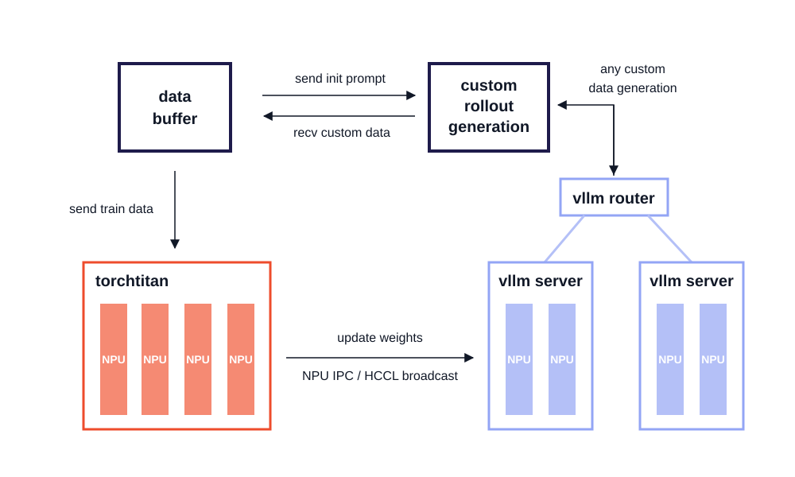

# Vime-forge

[中文版](./README_zh.md) · [Upstream repository](https://github.com/vllm-project/vime)

[](https://docs.vllm.ai/projects/vime/en/latest/)
[](https://deepwiki.com/vllm-project/vime)

**Vime-forge** is an LLM post-training framework for RL scaling, built on [slime](https://github.com/THUDM/slime). It keeps slime's training stack and data-generation design while using [**vLLM**](https://github.com/vllm-project/vllm) (with [vllm-router](https://github.com/vllm-project/router)) as the default rollout backend. Built on top of Vime, this repository targets Ascend NPU and uses [**torchtitan**](https://github.com/pytorch/torchtitan) as the training backend, providing two core capabilities:

1. **High-performance training**: Efficient training in various modes by connecting torchtitan with vLLM;
2. **Flexible data generation**: Arbitrary training data generation workflows through custom data generation interfaces and server-based engines.

> **Maintenance note**: torchtitan is the primary training backend of this repository. The megatron backend currently supports a subset of the Qwen3 series and will no longer be maintained.

## Positioning

The vLLM community horizontally supports many LLM post-training frameworks, including (in alphabetical order) [NeMo RL](https://github.com/NVIDIA-NeMo/RL), [OpenRLHF](https://github.com/openrlhf/openrlhf), [prime-rl](https://github.com/PrimeIntellect-ai/prime-rl), [SkyRL](https://github.com/NovaSky-AI/SkyRL), [verl](https://github.com/verl-project/verl), and so on. We built the Vime project to seamlessly bring slime's proven training paradigm into the vLLM ecosystem, offering a production-ready bridge that aligns both projects' rapid release cycles. We hope that users with different needs can find the right vLLM-ecosystem choice for their workflows. The vLLM community will continue to support the vLLM integration in these post-training frameworks. This repository is the Ascend NPU version: the rollout side reuses Vime's vLLM integration, while the training side replaces megatron with torchtitan — model definitions, FSDP2 parallelism, and DCP checkpoints all come from upstream torchtitan, and the training workflow and interfaces stay consistent with Vime.

## Table of Contents

- [Vime](#vime)
  - [Positioning](#positioning)
  - [Table of Contents](#table-of-contents)
  - [Supported Models and Hardware](#supported-models-and-hardware)
  - [Architecture Overview](#architecture-overview)
  - [Quick Start](#quick-start)
    - [Single-turn AscendC operator generation](#single-turn-ascendc-operator-generation)
    - [Agentic RL examples](#agentic-rl-examples)
  - [Arguments Walkthrough](#arguments-walkthrough)
  - [Engine Deployment](#engine-deployment)
  - [Correctness, Stability, and CI](#correctness-stability-and-ci)
  - [Code Reading Path](#code-reading-path)
  - [Developer Guide](#developer-guide)
  - [slime doc](#slime-doc)
  - [FAQ](#faq)
  - [Acknowledgements](#acknowledgements)
  - [Citation](#citation)

## Supported Models and Hardware

| Model | torchtitan preset config function | Hardware |
|---|---|---|
| Qwen3-4B | `vime_qwen3_4b` | Atlas 800T A3, A5 |
| Qwen3-30B-A3B | `vime_qwen3_30b_a3b` | Atlas 800T A3, A5 |
| DeepSeek V4 Flash | `vime_dsv4_flash` | A5 |

Preset configs live in `vime/backends/torchtitan_utils/models/<model family>/config_registry.py`.

## Architecture Overview



**Module Descriptions**:

- **training (torchtitan)**: Runs the main training loop, reads data from the Data Buffer, and synchronizes parameters to the rollout module after training.
- **rollout (vLLM + router)**: Launches vLLM inference engines and routes generation requests; custom generate functions can wrap them with multi-turn loops, tool calls, environment/sandbox interaction, and verifier-based rewards.
- **data buffer**: A bridge module that manages prompt initialization, custom data, and rollout generation methods, including agentic workflows that produce samples through the same interface.

## Quick Start

For training startup, config overrides, and log troubleshooting, see the [torchtitan launcher](scripts/torchtitan/README.md). For the training backend's run modes, configuration, and data processing flow, see the [torchtitan training backend](docs/torchtitan-backend.md).

We also provide examples for some use cases not covered in the quick start guide; please check [examples](examples/).

### Single-turn AscendC operator generation

[`examples/cann_bench_single_turn`](examples/cann_bench_single_turn/README.md) provides TorchTitan NPU launch configs for Qwen3.5-4B/9B and Qwen3.6-27B, using native single-turn generation and an online reward to plug into CANN-Bench v1 evaluation. See the example docs for data preparation, run steps, and each model's validation boundary; it does not depend on the agent sandbox. The standalone [evaluation client](examples/cann_bench_evaluator/README.md) can be reused by other tasks.

### Agentic RL examples

Agentic workloads use the standard rollout / Data Buffer loop through Vime's customization interfaces; they are not a separate framework:

- [SWE-Gym Agentic RL training](docs/agentic-rl/swe-agentic-rl/training.md): Train a coding agent with Claude Code or Codex using sandboxed tools and test-based rewards.
- [Terminal / TMax Agentic RL training](docs/agentic-rl/terminal-agentic-rl/training.md): Train a terminal agent on a prepared task bundle using Harbor or AgentENV sandboxes.

See the [Agentic RL Training Roadmap](https://docs.vllm.ai/projects/vime/en/latest/get_started/agent.html) and [Customization Guide](https://docs.vllm.ai/projects/vime/en/latest/get_started/customization.html). The coding-agent example ships an E2B-compatible backend, while the shared `vime.agent.sandbox.Sandbox` contract can be implemented for Docker, Modal, or local VMs.

## Arguments Walkthrough

Arguments in Vime are divided into three categories:

1. **torchtitan arguments**: `--module` / `--config` selects a preset config function from `config_registry`, which returns a preset config providing baselines such as model specification, optimizer, and precision; dotted arguments of the form `--<field>.<subfield>` override fields in the preset config, for example `--parallelism.tensor_parallel_degree 4`. See Chapter 6 of the [torchtitan training backend](docs/torchtitan-backend.md).
2. **vLLM arguments**: vLLM server and engine options are exposed with a `--vllm-` prefix (for example, `--vllm-gpu-memory-utilization`). vllm-router's own options are passed with `--router-` (for example, `--router-policy round_robin`); Vime-side router orchestration arguments use the `--vllm-router-` prefix, including `--vllm-router-ip`, `--vllm-router-port`, and the effective `--vllm-router-request-timeout-secs`. See [vime/backends/vllm_utils/arguments.py](vime/backends/vllm_utils/arguments.py) for the full surface.
3. **Framework arguments**: Flags related to Vime orchestration (rollout GPUs, data paths, RL algorithms, etc.), see [vime/utils/arguments.py](vime/utils/arguments.py).

`--rollout-num-gpus-per-engine` sets the tensor parallel size of each vLLM engine. The default rollout entry is `vime.rollout.vllm_rollout.generate_rollout`.

For complete usage instructions, please refer to the [Usage Documentation](https://docs.vllm.ai/projects/vime/en/latest/get_started/usage.html).

## Engine Deployment

Vime organizes the RL dataflow on top of the native torchtitan and vLLM control surfaces. Beyond the argument pass-through described above, see:

- [vLLM Config](https://docs.vllm.ai/projects/vime/en/latest/advanced/vllm-config.html): Optional YAML topology configuration, heterogeneous server groups, multi-model serving, and per-group overrides;
- [PD Disaggregation](https://docs.vllm.ai/projects/vime/en/latest/advanced/pd-disaggregation.html): For multi-turn and agentic workloads with different prefill/decode resource needs;
- Router policies such as session affinity for multi-turn agents (see [vLLM Config](https://docs.vllm.ai/projects/vime/en/latest/advanced/vllm-config.html));
- [External Rollout Engines](https://docs.vllm.ai/projects/vime/en/latest/advanced/external-rollout-engines.html): Serving managed outside the training job. Serving can use an independent environment; disk transport avoids an NCCL group between training and serving. Different GPU models or vendors still require compatible model formats, precision, and vLLM hardware support.

## Correctness, Stability, and CI

RL bugs can be silent. Vime keeps the dataflow explicit and supports separate rollout-only and train-only debugging paths. CPU unit tests, customization-hook contract tests, and GPU end-to-end suites protect different parts of this workflow. Buildkite runs always-on CPU checks; GPU suites require the manual gate, so a green CPU build is not GPU validation.

Useful engineering docs:

- [CI](https://docs.vllm.ai/projects/vime/en/latest/developer_guide/ci.html)
- [Debugging](https://docs.vllm.ai/projects/vime/en/latest/developer_guide/debug.html)
- [Reproducibility](https://docs.vllm.ai/projects/vime/en/latest/advanced/reproducibility.html)
- [Fault Tolerance](https://docs.vllm.ai/projects/vime/en/latest/advanced/fault-tolerance.html)
- [Trace Viewer](https://docs.vllm.ai/projects/vime/en/latest/developer_guide/trace.html)
- [Profiling](https://docs.vllm.ai/projects/vime/en/latest/developer_guide/profiling.html)

## Code Reading Path

Start from the training loop and follow the calls only as deep as needed:

```text
train.py: train
├─ vime/ray/placement_group.py       Ray resource and worker initialization
├─ vime/ray/rollout.py              RolloutManager.generate: rollout orchestration
│  └─ vime/rollout/vllm_rollout.py  Sample generation and reward computation
└─ vime/ray/actor_group.py          RayTrainGroup.async_train: training dispatch
   └─ vime/backends/torchtitan_utils/actor.py
      ├─ engine.py                   torchtitan model execution
      └─ loss.py                     RL losses and advantages
```

On a first pass, treat `vime/utils/arguments.py` as the configuration entry point. The deployment details in `vime/backends/vllm_utils/` and the weight-sync implementations under `vime/backends/torchtitan_utils/update_weight/` can wait until you need to change those areas.

## Developer Guide

- **Contributions are welcome!** If you have suggestions for new features, performance tuning, or feedback on user experience, feel free to submit an Issue or PR.

- Use [pre-commit](https://pre-commit.com/) to ensure code style consistency for your commits:

  ```bash
  apt install pre-commit -y
  pre-commit install

  # run pre-commit to ensure code style consistency
  pre-commit run --all-files --show-diff-on-failure --color=always
  ```

- For debugging tips, please refer to the [Debugging Guide](https://docs.vllm.ai/projects/vime/en/latest/developer_guide/debug.html)

## slime doc

Vime is derived from slime. The following upstream resources and documentation still use the slime naming and remain the reference for shared concepts (torchtitan integration, customization, advanced topics):

[](https://thudm.github.io/slime/)
[](https://deepwiki.com/THUDM/slime)

- Upstream repository: [THUDM/slime](https://github.com/THUDM/slime)
- English documentation: [docs.vllm.ai/projects/vime/en/latest](https://docs.vllm.ai/projects/vime/en/latest/)
- Chinese documentation: [docs.vllm.ai/projects/vime/zh-cn/latest](https://docs.vllm.ai/projects/vime/zh-cn/latest/)

## FAQ

For frequently asked questions, please see the [Q&A](https://docs.vllm.ai/projects/vime/en/latest/get_started/qa.html)

## Acknowledgements

Vime builds on ideas and infrastructure from the open-source RL ecosystem. We especially thank the [slime](https://github.com/THUDM/slime) community, whose great work Vime is directly built on. We also thank [SkyRL](https://github.com/NovaSky-AI/SkyRL) and [verl](https://github.com/verl-project/verl), whose excellent work we referenced. Vime is maintained by the vLLM community.

## Citation

```bibtex
@misc{vime,
  author       = {Vime Contributors},
  title        = {Vime: An LLM post-training framework with vLLM for RL Scaling},
  year         = {2026},
  howpublished = {\url{https://github.com/vllm-project/vime}},
  urldate      = {2026-06}
}
```
