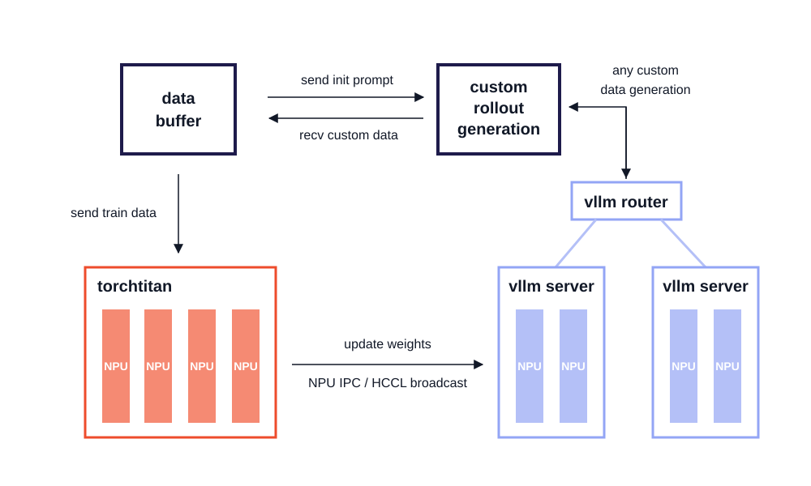

# Vime-forge

[English](./README.md) · [上游代码仓库](https://github.com/vllm-project/vime)

[](https://docs.vllm.ai/projects/vime/zh-cn/latest/)
[](https://deepwiki.com/vllm-project/vime)

**Vime-forge** 是基于 [slime](https://github.com/THUDM/slime) 的 RL scaling 用 LLM post-training 框架。在保留 slime 训练栈与数据生成设计的同时，默认以 [**vLLM**](https://github.com/vllm-project/vllm)（配合 [vllm-router](https://github.com/vllm-project/router)）作为 rollout 后端。本仓库在Vime基础之上面向 Ascend NPU，以 [**torchtitan**](https://github.com/pytorch/torchtitan) 作为训练后端，提供两大核心能力：

1. **高性能训练**：通过连接 torchtitan 与 vLLM，支持各种模式的高效训练；
2. **灵活的数据生成**：通过自定义数据生成接口以及 server based engine，实现任意的训练数据生成流程。

> **维护说明**：torchtitan 是本仓库的主力训练后端。megatron 后端当前支持 Qwen3 系列部分模型，后续不再维护。


## 定位

vLLM 社区横向支持许多 LLM post-training 框架，包括（按字母顺序）[NeMo RL](https://github.com/NVIDIA-NeMo/RL)、[OpenRLHF](https://github.com/openrlhf/openrlhf)、[prime-rl](https://github.com/PrimeIntellect-ai/prime-rl)、[SkyRL](https://github.com/NovaSky-AI/SkyRL)、[verl](https://github.com/verl-project/verl) 等。我们创建了 Vime 项目，旨在将 slime 经过验证的训练范式无缝引入 vLLM 生态系统，提供一个可用于生产的桥梁，对齐两个项目的快速迭代节奏。我们希望有不同需求的用户都能在 vLLM 生态中找到适合自己工作流的选择。vLLM 社区会一如既往地支持这些 post-training 框架中的 vLLM 集成。本仓是面向 Ascend NPU 的版本：rollout 侧沿用 Vime 的 vLLM 集成，训练侧以 torchtitan 替代 megatron，模型定义、FSDP2 并行与 DCP 检查点均来自 torchtitan 上游，训练流程与接口和 Vime 保持一致。

## 目录

- [Vime](#vime)
  - [定位](#定位)
  - [目录](#目录)
  - [支持的模型与硬件](#支持的模型与硬件)
  - [架构总览](#架构总览)
  - [快速开始](#快速开始)
    - [单轮 AscendC 算子生成](#单轮-ascendc-算子生成)
    - [Agentic RL 示例](#agentic-rl-示例)
  - [参数说明](#参数说明)
  - [Engine 部署](#engine-部署)
  - [正确性、稳定性与 CI](#正确性稳定性与-ci)
  - [代码阅读路径](#代码阅读路径)
  - [开发指南](#开发指南)
  - [slime doc](#slime-doc)
  - [FAQ](#faq)
  - [致谢](#致谢)
  - [引用](#引用)

## 支持的模型与硬件

| 模型 | torchtitan 预置配置函数 | 硬件 |
|---|---|---|
| Qwen3-4B | `vime_qwen3_4b` | Atlas 800T A3、A5 |
| Qwen3-30B-A3B | `vime_qwen3_30b_a3b` | Atlas 800T A3、A5 |
| DeepSeek V4 Flash | `vime_dsv4_flash` | A5 |

预置配置位于 `vime/backends/torchtitan_utils/models/<模型族>/config_registry.py`。

## 架构总览



**模块说明**：

- **training (torchtitan)**：负责主训练流程，从 Data Buffer 读取数据，训练完后将参数同步至 rollout 模块；
- **rollout (vLLM + router)**：启动 vLLM 推理引擎并路由生成请求；自定义生成函数可以在其上封装多轮循环、工具调用、环境/沙盒交互和基于 verifier 的奖励；
- **data buffer**：桥梁模块，管理 prompt 初始化、自定义数据与 rollout 生成方法，包括通过同一接口产出样本的 agent 工作流。

## 快速开始

有关训练启动、配置覆盖与日志排障，请参考 [torchtitan 启动器](scripts/torchtitan/README.md)。训练后端的运行模式、配置和数据处理流程，请参考 [torchtitan 训练后端](docs/torchtitan-backend.md)。

我们还提供了一些未在快速开始中覆盖的使用示例，请查看 [examples](examples/)。

### 单轮 AscendC 算子生成

[`examples/cann_bench_single_turn`](examples/cann_bench_single_turn/README.md) 提供 Qwen3.5-4B/9B、Qwen3.6-27B 的 TorchTitan NPU 启动配置，使用原生单轮生成和 online reward 接入 CANN-Bench v1 评测。数据准备、运行步骤及各模型的验证边界见样例文档；不依赖 agent 沙箱。独立的 [评测客户端](examples/cann_bench_evaluator/README.md) 可供其他任务复用。

### Agentic RL 示例

Agent 工作负载通过 Vime 的定制接口接入标准 rollout / Data Buffer 循环，并不是独立框架：

- [SWE-Gym AgenticRL 训练](docs/agentic-rl/swe-agentic-rl/training.md)：使用 Claude Code 或 Codex 在沙箱中执行工具命令，根据测试结果计算奖励。
- [Terminal／TMax AgenticRL 训练](docs/agentic-rl/terminal-agentic-rl/training.md)：使用准备好的任务 bundle，在 Harbor 或 AgentENV 沙箱中训练终端智能体。

请参阅 [Agentic RL 训练路线图](https://docs.vllm.ai/projects/vime/zh-cn/latest/get_started/agent.html)和[定制化指南](https://docs.vllm.ai/projects/vime/zh-cn/latest/get_started/customization.html)。Coding-agent 示例内置 E2B 兼容后端；共享的 `vime.agent.sandbox.Sandbox` 协议也可以由 Docker、Modal 或本地虚拟机实现。

## 参数说明

Vime 的参数分为三类：

1. **torchtitan 参数**：`--module` / `--config` 指定 `config_registry` 中的预置配置函数，由它返回预置配置，给出模型规格、优化器、精度等基线；`--<字段>.<子字段>` 形式的点分参数覆盖预置配置中的字段，例如 `--parallelism.tensor_parallel_degree 4`。详见 [torchtitan 训练后端](docs/torchtitan-backend.md) 第 6 章；
2. **vLLM 参数**：vLLM server 与 engine 相关选项以 `--vllm-` 为前缀（例如 `--vllm-gpu-memory-utilization`）。vllm-router 自身的选项以 `--router-` 传入（例如 `--router-policy round_robin`）；Vime 侧的 router 编排参数使用 `--vllm-router-` 前缀，包括 `--vllm-router-ip`、`--vllm-router-port` 和实际生效的 `--vllm-router-request-timeout-secs`。完整参数见 [vime/backends/vllm_utils/arguments.py](vime/backends/vllm_utils/arguments.py)。
3. **框架参数**：与 Vime 编排相关的开关（rollout GPU、数据路径、RL 算法等），见 [vime/utils/arguments.py](vime/utils/arguments.py)。

`--rollout-num-gpus-per-engine` 对应每个 vLLM engine 的 tensor parallel size。默认 rollout 入口为 `vime.rollout.vllm_rollout.generate_rollout`。

完整使用说明请查阅 [使用文档](https://docs.vllm.ai/projects/vime/zh-cn/latest/get_started/usage.html)。

## Engine 部署

Vime 在 torchtitan 与 vLLM 原生控制接口外组织 RL 数据流。除上述参数透传外，请参阅：

- [vLLM Config](https://docs.vllm.ai/projects/vime/zh-cn/latest/advanced/vllm-config.html)：可选的 YAML 拓扑配置、异构 server group、多模型 serving 和 per-group override；
- [PD Disaggregation](https://docs.vllm.ai/projects/vime/zh-cn/latest/advanced/pd-disaggregation.html)：面向 prefill/decode 资源需求不同的多轮和 agentic 工作负载；
- 面向多轮 agent 的 session affinity 等 router policy，见 [vLLM Config](https://docs.vllm.ai/projects/vime/zh-cn/latest/advanced/vllm-config.html)；
- [External Rollout Engines](https://docs.vllm.ai/projects/vime/zh-cn/latest/advanced/external-rollout-engines.html)：由训练任务外部管理 serving。Serving 可以使用独立环境；disk transport 无需训练端和 serving 端组成 NCCL group。不同 GPU 型号或厂商仍需满足模型格式、精度和 vLLM 硬件支持的兼容要求。

## 正确性、稳定性与 CI

RL bug 可能不会立即报错。Vime 保持显式数据流，支持 rollout-only 和 train-only 分离调试。CPU 单测、customization hook contract test 和 GPU 端到端测试分别保护这条链路的不同部分。Buildkite 自动运行 CPU 检查；GPU suite 需要手动开启 gate，因此 CPU 构建通过不代表 GPU 验证通过。

相关工程文档：

- [CI](https://docs.vllm.ai/projects/vime/zh-cn/latest/developer_guide/ci.html)
- [Debugging](https://docs.vllm.ai/projects/vime/zh-cn/latest/developer_guide/debug.html)
- [Reproducibility](https://docs.vllm.ai/projects/vime/zh-cn/latest/advanced/reproducibility.html)
- [Fault Tolerance](https://docs.vllm.ai/projects/vime/zh-cn/latest/advanced/fault-tolerance.html)
- [Trace Viewer](docs/zh/developer_guide/trace.md)
- [Profiling](https://docs.vllm.ai/projects/vime/zh-cn/latest/developer_guide/profiling.html)

## 代码阅读路径

建议从训练主循环开始，只在需要时继续深入：

```text
train.py: train
├─ vime/ray/placement_group.py       Ray 资源与 worker 初始化
├─ vime/ray/rollout.py              RolloutManager.generate：rollout 编排
│  └─ vime/rollout/vllm_rollout.py  样本生成与奖励计算
└─ vime/ray/actor_group.py          RayTrainGroup.async_train：训练调度
   └─ vime/backends/torchtitan_utils/actor.py
      ├─ engine.py                   torchtitan 模型执行
      └─ loss.py                     RL loss 与 advantage
```

第一次阅读时，可以把 `vime/utils/arguments.py` 当作配置入口。只有需要修改相关区域时，再深入 `vime/backends/vllm_utils/` 的部署细节和 `vime/backends/torchtitan_utils/update_weight/` 下的权重同步实现。

## 开发指南

- **欢迎贡献！** 若有功能建议、性能调优或使用体验反馈，欢迎提交 Issue / PR。

- 使用 [pre-commit](https://pre-commit.com/) 保证提交代码风格：

  ```bash
  apt install pre-commit -y
  pre-commit install

  # 运行 pre-commit 保证代码风格
  pre-commit run --all-files --show-diff-on-failure --color=always
  ```

- 调试技巧请参考 [debug 指南](https://docs.vllm.ai/projects/vime/zh-cn/latest/developer_guide/debug.html)

## slime doc

Vime 由 slime 衍生而来。以下上游资源与文档仍沿用 slime 命名，可作为共享概念（torchtitan 集成、定制化、高级主题）的参考：

[](https://thudm.github.io/slime/)
[](https://deepwiki.com/THUDM/slime)

- 上游仓库：[THUDM/slime](https://github.com/THUDM/slime)
- 英文文档：[docs.vllm.ai/projects/vime/en/latest](https://docs.vllm.ai/projects/vime/en/latest/)
- 中文文档：[docs.vllm.ai/projects/vime/zh-cn/latest](https://docs.vllm.ai/projects/vime/zh-cn/latest/)

## FAQ

常见问题请见 [Q&A](https://docs.vllm.ai/projects/vime/zh-cn/latest/get_started/qa.html)

## 致谢

Vime 构建于开源 RL 生态的想法与基础设施之上。特别感谢 [slime](https://github.com/THUDM/slime) 社区——Vime 直接构建于其出色工作之上；也感谢 [SkyRL](https://github.com/NovaSky-AI/SkyRL) 与 [verl](https://github.com/verl-project/verl)，我们参考了它们的优秀工作。Vime 由 vLLM 社区维护。

## 引用

```bibtex
@misc{vime,
  author       = {Vime Contributors},
  title        = {Vime: An LLM post-training framework with vLLM for RL Scaling},
  year         = {2026},
  howpublished = {\url{https://github.com/vllm-project/vime}},
  urldate      = {2026-06}
}
```
