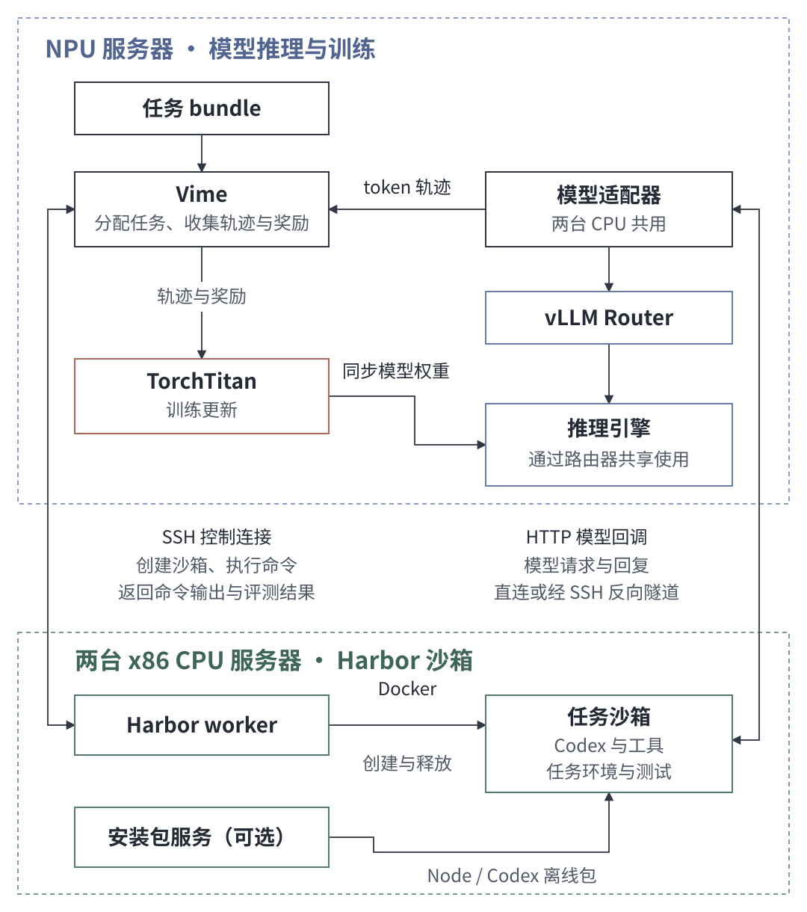

# AgenticRL 训练快速开始

本文档使用 **Qwen3.5-4B + Harbor** 使用 `vime-forge` 跑通一次 AgenticRL 训练：NPU 服务器负责模型推理和训练，CPU 服务器负责运行任务沙箱。

## Step 1：准备并检查环境

### 1.1 准备 NPU 运行环境

本样例使用 8 个空闲的 NPU 设备，4个NPU用于训练，另外 4 个用于推理。

如果使用 **Ascend 950 / Linux ARM**，请按 [DeepSeek-V4 指南第 2 节「环境搭建」](../../llm_rl/deepseek_v4/README.md#2-环境搭建) 下载并加载 `v0.4` 镜像，挂载设备和目录，启动容器。然后进入容器：

```bash
docker exec -it ascend_rl bash
```

下面是本次测试的主要依赖清单，供环境准备和排查时对照。安装时请按包名、版本和来源分别执行：

```text
NPU 运行库
  CANN                 9.2.0/9.3.0
  NNAL / ATB           与所用 CANN、推理侧 PyTorch ABI 配套

主要配置依赖
  Python               3.11 / 3.12
  torch                2.14.0
  torch-npu            2.14.0
  torchtitan           0.3.0
  torchtitan-npu       0.1.0（本次配套源码版本为 8b9e293d）
  triton-ascend        3.2.1
  numpy                2.2.6
  ray                  2.54.0
  vllm-router          0.1.15
  vllm                 0.23.0
  vllm-ascend          0.23.0.post1
  ray                  2.54.0

CPU 沙箱服务器 / 任务容器
  Harbor               0.24.0（CPU 服务器上的独立 Python 环境）
  Docker Engine        已安装，支持 Docker Compose v2
  Node.js              22.20.0（任务容器内）
  Codex                0.153.0（任务容器内，包含 Linux x64 依赖的离线包）
```

### 1.2 服务化沙盒准备

在两台 CPU 服务器上，按[沙箱部署指南](./agentic-rl/env-and-config/sandboxes.md#22-harbor)准备 Harbor、Docker、SSH 登录和 Codex 所需的容器运行配置。再按 [Agent 安装指南](./agentic-rl/env-and-config/harness-preparation.md)准备 Node/Codex 离线包及安装包服务。安装包架构要匹配 CPU 结构。

在 NPU 服务器上保存一份外部 `~/.config/vime/sandboxes.json`，细节配置可以参照[双主机配置示例](./agentic-rl/env-and-config/sandboxes.md#1-选择后端并保存配置)。

> 本工作兼容 AgentENV 和 Harbor 沙盒, 两种沙盒协议共用一套 `sandboxes.json` 配置。快速开始文档使用对CPU和内核版本要求较低的Harbor 沙盒作为实践。


替换主机地址、SSH 密钥和 CPU 端路径后，使用以下容量设置：

| JSON 字段 | 本例取值 | 含义 |
| --- | --- | --- |
| `common.lifetime_sec` | `9000` | 单个沙箱会话的最长生命周期，单位为秒 |
| `common.boot_concurrency` | `8` | 生成进程最多同时准备 8 个沙箱 |
| `common.boot_retries` | `3` | 启动准备最多尝试 3 次，包含首次尝试 |
| 每台主机的 `slots` | `16` | 每台最多占用 16 个沙箱名额 |
| `harbor.prepare_concurrency` | `4` | 每台最多同时准备 4 个沙箱，其余按到达顺序等待 |
| `harbor.prepare_acquire_timeout` | `1800` | 等待准备名额的最长时间，单位为秒 |
| `harbor.prepare_queue_limit` | `32` | 每台主机允许排队等待准备的请求数量 |

开始训练前，要分别确认三条连接：**NPU 到 CPU 的 SSH 控制连接、沙箱到 NPU 的模型回调、沙箱到安装包服务的下载连接**。检查方法见[网络与回调说明](./agentic-rl/env-and-config/sandboxes.md#5-配置三条网络路径)。

下文沿用本次测试的回调方式：每台 CPU 服务器的 Docker 网桥地址 `172.17.0.1:18080`，通过预先建立的 SSH 反向隧道转发到 NPU 的 `127.0.0.1:18001`；同一网桥上的 `18123` 提供安装包下载。`172.17.0.1` 为本次部署的网桥地址，其他部署按实际网桥地址填写。若使用沙箱直连 NPU 的方式，按上述指南调整 `ADAPTER_*`。训练入口不会自动建立隧道或启动安装包服务。

## Step 2：下载模型和准备数据

### 2.1 下载 Qwen3.5-4B

使用 [Qwen/Qwen3.5-4B](https://huggingface.co/Qwen/Qwen3.5-4B) 原始权重。以下下载命令使用 [Hugging Face CLI](https://huggingface.co/docs/huggingface_hub/guides/cli)：

```bash
mkdir -p /data/models /data/agenticrl/raw /data/agenticrl/prepared
hf download Qwen/Qwen3.5-4B --local-dir /data/models/Qwen3.5-4B
```

### 2.2  TMax 任务准备

**TMax** 使用 [allenai/TMax-15K](https://huggingface.co/datasets/allenai/TMax-15K)：

```bash
hf download allenai/TMax-15K --repo-type dataset \
  --revision e3ded940596cc611c9815684ba51a7e8ee0cffc9 \
  --local-dir /data/agenticrl/raw/tmax
```

下载后按 [Terminal／TMax 数据准备指南](./agentic-rl/terminal-agentic-rl/data-preparation.md)转换、筛选任务，准备对应镜像，再用 Harbor 检查并导出 bundle。

**已有 bundle 时，不必重新下载或准备源数据。** 两类任务都通过 `--bundle` 读取完整目录，目录内应包含：

```text
<bundle>/
  rollout/train.no_gold.jsonl          # 训练输入，不含参考答案
  environment/agentenv_templates.jsonl # 任务与模板／固定摘要镜像的对应关系
  verifier/verifier_specs.jsonl        # 评测规格
  preparation_manifest.json           # 准备记录
```

同时把 bundle 引用的任务镜像准备到两台 CPU 服务器，保持镜像 digest 一致。**复制 bundle 不会复制 Docker 镜像**，`hf download` 也不会完成这一步。

## Step 3：启动一次训练

CP 默认为 1。本页沿用该默认值；CP=4 的配置方式见[训练设备分配](./agentic-rl/env-and-config/configuration.md#32-npu-分配)。

### 3.1 编写外部 local 配置

将下面内容保存为 NPU 服务器上的 `~/.config/vime/tmax.local.sh` (基于 [agenticrl.local.sh](../examples/common/agenticrl.local.sh.example) 作为样例进行配置)。它以验证通过的 local 文件为基础，保留训推环境、设备分配和 Harbor 设置；把路径、地址和端口换成实际使用的路径。

```bash
# 训推环境与模型：填写容器内可访问的路径。
export VIME_TRAIN_ENV=/opt/vime/train        # 训练 Python 环境，包含 Ray 和 TorchTitan
export VIME_VLLM_ENV=/opt/vime/rollout       # 推理 Python 环境，包含 vLLM-Ascend
export VIME_CANN_HOME=/opt/ascend/cann       # CANN 的安装路径
export VIME_NNAL_HOME=/opt/ascend/atb        # 配套 ATB 路径
export MODEL_PATH=/data/models/Qwen3.5-4B   # 基线模型文件路径
export MASTER_ADDR=192.0.2.10               # 替换为 NPU 服务器上 Ray 可用的本机 IP

# 使用 8 个设备：训练 TP=4、DP=1、CP=1，推理为四个 TP=1 引擎。
export ASCEND_RT_VISIBLE_DEVICES=0,1,2,3,4,5,6,7 # 可见的NPU ID
export TRAIN_TP=4                          # 训练张量并行度
export TRAIN_DP=1                          # 训练数据并行度
export TRAIN_CP=1                          # 训练上下文并行度，默认值为 1
export ROLLOUT_GPUS=4                      # 推理设备数量，NPU 上也沿用此变量名
export VLLM_RANKS_PER_ENGINE=1              # 每个推理引擎使用的设备数量
export VIME_AGENT_MAX_CONTEXT_TOKENS=32768  # Agent 上下文预算
export MAX_TOKENS_PER_GPU=32768             # 训练动态微批次的 token 预算
export OUTPUT_DIR="/data/agenticrl/outputs/$RUN_NAME"    # 日志、轨迹等产物目录

# RAY 和 HCCL 相关配置 (可复用)
export VIME_WORKSPACE="/data/agenticrl/runtime/$RUN_NAME" # 缓存及运行文件根目录
export VIME_SLOT=51                        # Ray 端口分组编号，同机并行任务需分开
export VIME_RAY_TEMP_DIR=/tmp/vime-tmax-s51  # 本次 Ray 临时目录，保持路径较短
export RAY_MIN_WORKER_PORT=62000            # Ray worker 端口范围起点
export RAY_MAX_WORKER_PORT=62999            # Ray worker 端口范围终点
export HCCL_HOST_SOCKET_PORT_RANGE=64000-64050 # HCCL 主机通信端口范围
export HCCL_NPU_SOCKET_PORT_RANGE=65000-65050  # HCCL NPU 通信端口范围

# 沙箱控制连接与模型回调。
export VIME_AGENT_SANDBOX_BACKEND=harbor    # 选择 Harbor 后端
export VIME_AGENT_SANDBOX_CONFIG="$HOME/.config/vime/sandboxes.json" # 沙盒的配置文件路径
export ADAPTER_BIND_HOST=127.0.0.1          # vime agent adapter 的监听地址
export ADAPTER_PORT=18001                  # vime agent adapter 的监听端口
export ADAPTER_PUBLIC_HOST=172.17.0.1       # 沙箱内agent访问policy model服务的地址
export ADAPTER_PUBLIC_PORT=18080            # Agent 和 model 的通信端口

# 沙盒内 Agent 服务的相关配置
export VIME_AGENT_ARTIFACT_BASE_URL=http://172.17.0.1:18123 # CPU 服务器内加载 agent 安装包的本地服务
export VIME_AGENT_NODE_TARBALL=/data/agenticrl/artifacts/node-v22.20.0-linux-x64.tar.xz # Node 包
export VIME_AGENT_CODEX_TARBALL=/data/agenticrl/artifacts/vime-codex-offline-0.153.0.tgz # Codex 离线包
export VIME_AGENT_CODEX_VERSION=0.153.0      # CODEX CLI 版本
export VIME_AGENT_CODEX_MODEL_PROFILE=gpt-5.2-codex # Codex 工具能力配置
export VIME_AGENT_NPM_ONLINE=0              # 使用离线安装包
export VIME_AGENT_NPM_INSTALL_TIMEOUT_SEC=300 # CLI 安装超时，秒
export VIME_AGENT_WORKSPACE_PREP_TIMEOUT_SEC=300 # 工作区准备超时，秒
export VIME_AGENT_MARKER_TIMEOUT_SEC=15     # 单次完成状态查询超时，秒
export VIME_AGENT_MARKER_TIMEOUT_RETRIES=3  # 状态查询超时后的重试配置
export VIME_AGENT_MAX_TURNS_PER_SESSION=72  # 每个 Agent 会话的轮数上限
export VIME_AGENT_TASK_CONDA_PREFIX=''      # TMax 沿用任务镜像的 PATH
export VIME_AGENT_TASK_CONDA_SH=''          # TMax 不额外激活 Conda

# 冒烟测试可设置不保存模型checkpoint
export VIME_RL_SAVE_INTERVAL=off            # 本次只验证一次更新，不保存 checkpoint
```

`VIME_AGENT_CODEX_MODEL_PROFILE` 设置 Codex 的工具能力。实际推理模型由 `MODEL_PATH` 指定。

### 3.2 启动 TMax 任务的 AgenticRL 训练


在NPU 机器上执行以下命令:

```bash
cd /path/to/cann-recipes-train-rl/vime-forge

RUN_NAME=qwen35-tmax-harbor-4x8-$(date +%Y%m%d-%H%M%S) \
bash examples/terminal_agent_rl/run-qwen35-4B-tbench-torchtitan.sh \
  --local "$HOME/.config/vime/tmax.local.sh" \
  --bundle /data/agenticrl/prepared/tmax-2048 \
  --agent codex \
  -- \
  --rollout-batch-size 4 \
  --n-samples-per-prompt 8 \
  --num-rollout 1 \
  --vllm-server-concurrency 8 \
  --router-policy consistent_hash \
  --optimizer.param-groups.0.optimizer-kwargs.lr 2e-6 \
  --multimodal-keys '{}'
```

快速开始的简单样例每个rollout batch 包含 4 个样本，每个样本由 rollout 采样 8 条轨迹，共 32 条。四个推理引擎各设置并发 8，对应总轨迹并发 32；CPU 端的容量和准备并发仍受 JSON 限制。保持当前每批一次训练更新的设置时，`--num-rollout 1` 会在完成这一批和一次模型更新后自动结束作为冒烟测试。**后续面向长程真是任务场景可自由调整训练配置**。可参照分任务场景的 [TMax 训练指南](./agentic-rl/terminal-agentic-rl/training.md) 和 [SWE-Gym 训练指南](./agentic-rl/swe-agentic-rl/training.md)配置更长的训练。

训练时可以根据数据集大小和 batch size 设置 `--num-rollout`，并按需要将 `VIME_RL_SAVE_INTERVAL` 改为保存间隔，例如 `6`。从 checkpoint 恢复时，`--num-rollout` 仍表示总目标批次数，程序从已完成的位置继续执行。

### 3.4 Vime 和 Harbor 如何连接



SSH 控制连接负责管理沙箱；模型回调负责把沙箱内 Agent 的请求送到 NPU 上推理。两台 CPU 服务器共用同一个模型适配器和路由器，不与推理引擎一一绑定。`consistent_hash` 根据会话标识选择引擎，让同一会话尽量复用同一个引擎的缓存。

## Step 4：查看输出日志和结果

按上面的 local 配置，输出保存在：

```text
/data/agenticrl/outputs/<RUN_NAME>/
  tensorboard/<RUN_NAME>/<时间戳>/train.log
  rollout_dumps/
```
