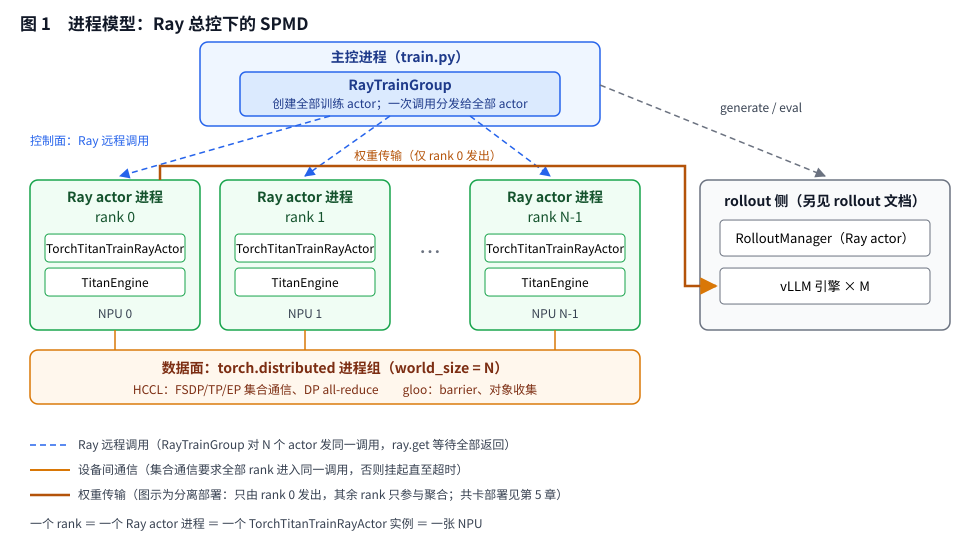
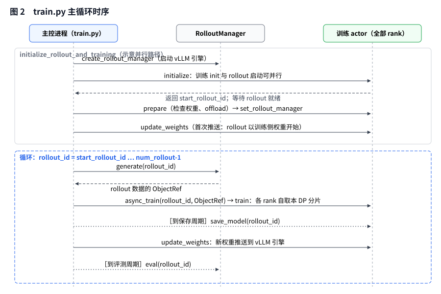
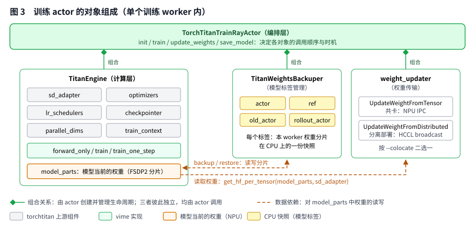
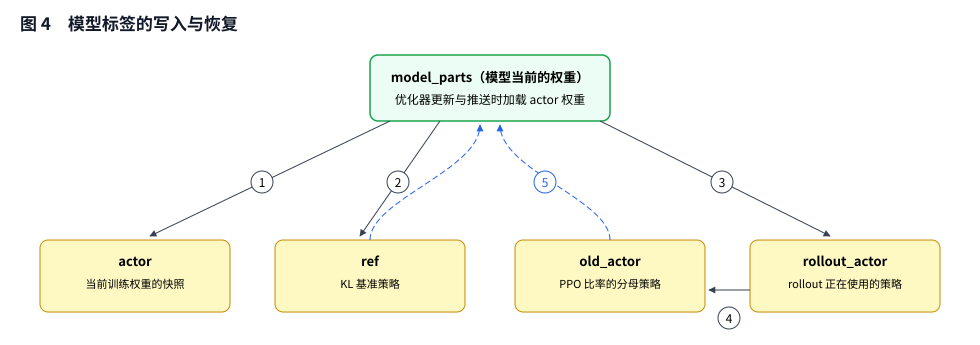
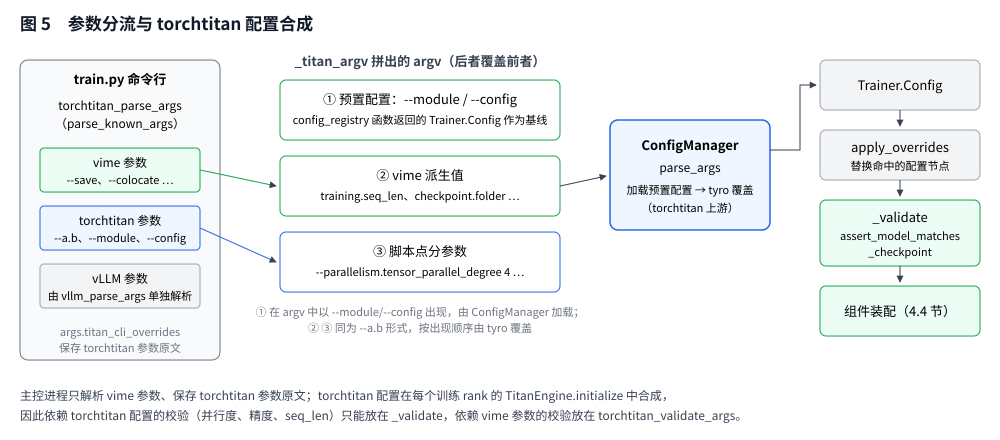
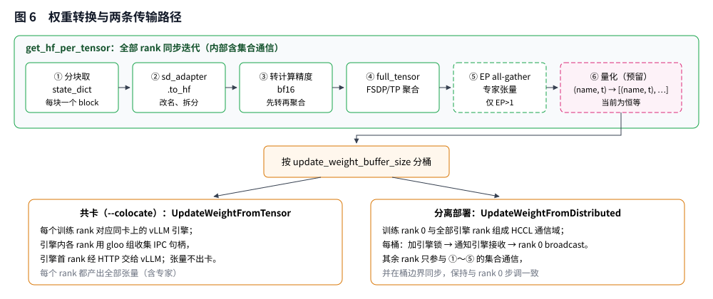

# torchtitan 训练后端

vime 原生只支持 megatron，本代码仓适配了 torchtitan 后端，整体流程上和设计上对齐 megatron 后端，本文档介绍 torchtitan 后端的实现细节和配置方式。

## 目录

- [1 概述](#1-概述)
- [2 总体架构](#2-总体架构)
- [3 训练 Actor](#3-训练-actor)
- [4 训练引擎](#4-训练引擎)
- [5 权重传输](#5-权重传输)
- [6 参数体系](#6-参数体系)
- [附录 与 megatron 后端的对照](#附录-与-megatron-后端的对照)

---

## 1 简介

vime 的 RL 训练由主控进程（运行 `train.py` 的进程，即 [Ray 术语中的 driver](https://docs.ray.io/en/latest/ray-references/glossary.html)）驱动，每轮先由 rollout 侧生成样本，再由训练侧更新权重，最后把新权重推送给 rollout 侧的 vLLM 引擎。其中训练侧在 RayTrainGroup 为每个 Rank 创建一个远程对象，并对主控进程暴露一组固定的方法（`train`、`update_weights`、`save_model`）。vime 原生远程对象只有基于 megatron 的实现，本仓引入 torchtitan 作为训练端。Torchtitan 核心功能是预训练这种预先准备好样本的类型，与 RL 训练之间存在三处差距：

1. **进程与控制**。torchtitan 的 `Trainer` 完成所有训练流程，自行初始化分布式环境，自行驱动"取数据、前向、反向、更新"的循环。而 vime 的 RL 训练过程由主控进程驱动整个 rollout 样本生成、训练和权重更新过程，无法直接复用 `Trainer`。
2. **计算差异**。相比预训练，RL 的训练端在不同场景会部署如 reference、old actor 等模型的前向计算，需要定期切换不同的模型权重，在样本管理、输入构建、loss计算上也有显著差异。
3. **权重形态**。torchtitan 的主权重为 fp32 类型，在训练正向再 cast 或者量化到与推理一致的精度类型，RL 训练一般要求训推一致，每轮 RL 训练结束后权重传输之前同样要完成一次全量的权重转换，并将 torchtitan 中的权重命名方式映射到 hf 格式。

因此本仓的 torchtitan 训练后端主要是对每轮流程进行编排，模型部署、执行、更新等基础功能对接 torchtitan 的原生能力，在此基础之上，增加 RL 流程所需要的权重切换（reference、old actor、actor之间）、数据准备、loss计算、权重传输和 MoE 模型的路由重放等能力。

下文以 `scripts/torchtitan/run-qwen3-4B.sh` 的默认配置作为全文的示例：

| 项目 | 取值 |
|---|---|
| 模型 | Qwen3-4B，参数配置 `vime_qwen3_4b` |
| 卡数 | 8 张 NPU，训练 4 张、rollout 4 张，分离部署 |
| 训练并行 | TP=1，DP=4（dp_shard=4） |
| rollout | 1 个 vLLM engine，TP=4 |
| 批次 | 每轮 32 个 prompt × 8 个样本 = 256 个样本，`--global-batch-size 256` |
| 长度 | `--rollout-max-context-len 10240`，`--rollout-max-response-len 8192`，`--max-tokens-per-gpu 9216` |
| 轮数 | `--num-rollout 200` |
| 算法 | GRPO，无 KL 损失，同步训练（异步由 vime 原生功能支持） |

---

## 2 总体架构

训练侧由一个主控进程（同步：train.py，异步：train_async.py）与若干训练 actor 进程组成。主控进程经由 `RayTrainGroup` 对全部训练 actor（等同本文中的worker） 发出同一 Ray 远程调用。

### 2.1 进程与角色



**主控进程**。运行 `train.py`，负责申请资源、创建 rollout 侧与训练侧的 Ray actor，并执行主循环。主控进程不参与任何张量计算，只进行流程控制，rollout 数据也只以引用（ObjectRef）的形式经过它。

**RayTrainGroup**。主控进程中统一管理全部训练 actor 的类，负责创建训练 actor，并把主控进程的一次调用转换为对全部训练 actor 的远程调用，再汇总返回值。

**训练 actor**。类型为 `TorchTitanTrainRayActor`，每张训练卡一个进程，每个进程一个实例，对应 `torch.distributed` 中的一个 rank，负责本 rank 上的训练流程编排，由计算引擎、模型标签管理与权重传输三个对象组成（第 3 章）。

**RolloutManager 与 vLLM 引擎**。RolloutManager 是一个 Ray actor，管理若干 vLLM 引擎，负责生成样本与评测。训练侧通过它的接口完成权重传输的准备动作。

参数上按 `--train-backend` 选用 torchtitan 后端，`RayTrainGroup` 中依据该参数选用 TorchTitanTrainRayActor 类进行实例化，再往下层对接 torchtitan 相关功能的实现都在 `vime/backends/torchtitan_utils/` 路径下。

### 2.2 训练进程的建立

训练 worker 的建立分为三步：

**1. 申请资源**。`create_placement_groups` 为训练与 rollout 共同申请一个 placement group，每张卡一个 bundle（`{"NPU": 1, "CPU": 1}`）。bundle 按（节点，物理卡号）排序后，前 N 个分给训练侧，其余分给 rollout 侧；共卡部署时两侧共用同一组 bundle。

**2. 创建训练 actor**。`RayTrainGroup` 把 `TorchTitanTrainRayActor` 包装为 Ray actor 类，按 rank 顺序逐个创建实例，并绑定到对应 bundle。rank 0 最先创建，它返回的通信地址作为其余 rank 的构造参数。

```python
TrainActor = ray.remote(runtime_env={"env_vars": env_vars})(TorchTitanTrainRayActor)
master_addr = master_port = None
for rank in range(world_size):
    # options 中以 PlacementGroupSchedulingStrategy 指定 bundle，此处简写
    actor = TrainActor.options(bundle=bundle_indices[rank]).remote(world_size, rank, master_addr, master_port)
    if rank == 0:
        master_addr, master_port = ray.get(actor.get_master_addr_and_port.remote())
```

**3. 建立进程组**。每个训练 actor 在构造时写入 `MASTER_ADDR`、`MASTER_PORT`、`RANK`、`WORLD_SIZE`、`LOCAL_RANK` 环境变量；在 `init` 中绑定设备，初始化进程组，并创建一个全局 gloo 组，用于 CPU 侧的 barrier 与对象收集。

完成后，N 个训练 worker 构成一个 `torch.distributed` world，torchtitan 的 `ParallelDims` 再在这个 world 上划分 DP、TP、EP 子网格（4.4 节）。

### 2.3 远程调用

`RayTrainGroup` 的每个方法都向全部训练 actor 发出同一远程调用，并用 `ray.get` 等待全部返回：

| `RayTrainGroup` 方法 | actor 方法 | 功能 |
|---|---|---|
| `async_init` | `init` | 初始化训练 actor：建立进程组，构造训练引擎并加载权重，确定起始轮次 |
| `set_rollout_manager` | `set_rollout_manager` | 登记 RolloutManager，并向 rollout 侧上报训练并行配置 |
| `async_train` | `train` | 用一轮 rollout 样本完成训练 |
| `save_model` | `save_model` | 保存训练 ckpt，按需导出 HF 格式权重 |
| `update_weights` | `update_weights` | 把训练后的权重推送给 vLLM 引擎 |
| `onload` / `offload` | `wake_up` / `sleep` | 恢复 / 卸载训练显存（共卡部署） |

各 rank 执行的是同一段程序，只是处理各自的数据分片，即 Ray 总控下的 SPMD（单程序多数据）。这一结构带来两条约束，后文多处引用：

- **rank 差异约束**：各 rank 的行为差异：日志、度量数据和文件等由 rank 0 输出；对 rollout 的数据传输由 rank 0 或指定的源 rank 发出。
- **worker 间行为同步**：每个 rank 的流程和节奏相同，在上述有差异的地方，需要通过 barrier 进行全局同步。

### 2.4 主循环



主循环的主干如下，省略了 critic、训练前评测与 rollout 侧显存卸载等分支：

```python
pgs = create_placement_groups(args)
rollout_manager, _, actor, critic, router_addr = initialize_rollout_and_training(args, pgs)
actor.update_weights()                                         # 首次推送：rollout 以训练侧权重为起点

for rollout_id in range(args.start_rollout_id, args.num_rollout):
    data_ref = ray.get(rollout_manager.generate.remote(rollout_id))
    ray.get(actor.async_train(rollout_id, data_ref))
    if 到达保存周期:
        actor.save_model(rollout_id)
    actor.update_weights()
    if 到达评测周期:
        ray.get(rollout_manager.eval.remote(rollout_id))
```

当 rollout 与训练使用互不重叠的设备、显式设置 `num_rollout`，且未启用external/debug-only 模式时，`initialize_rollout_and_training` 会重叠两侧的初始化；否则按串行顺序完成 rollout 就绪、检查权重和显存卸载，再初始化训练 actor。并行路径会在训练 actor 初始化完成后挂载 RolloutManager，因此 rollout 侧的启动异常可能稍晚暴露。`router_addr` 用于更新监控端点。

`rollout_id` 是主循环的轮次编号，起始轮次由 `init` 返回：全新训练为 0，从 `step-N` ckpt 续训为 N+1（4.5 节）。异步入口 `train_async.py` 调用同一组 actor 方法，训练后端无需额外适配。

---

## 3 训练 Actor

训练阶段的主要过程在 `TorchTitanTrainRayActor` 中，主要由三个对象组成：计算引擎 `TitanEngine`、模型标签管理 `TitanWeightsBackuper`（管理同一模型结构上的多份策略权重，3.3 节）与权重传输 weight updater；`train`、`update_weights`、`save_model` 等接口的核心功能均基于这三个对象实现。



actor 对 torchtitan 的访问全部经由 engine。actor 需要的并行信息（DP rank、DP 组）由 engine 以属性形式提供。

### 3.1 初始化

`init` 在基类建立进程组（2.2 节）之后，依次构造训练 actor 的三个组成对象，并返回起始轮次：

1. **训练引擎**：`TitanEngine.initialize` 构造 torchtitan 组件并加载权重（第 4 章），返回加载到的 rollout id，加 1 即为 `start_rollout_id`。开启 `offload_train` 时，这一步在 torch_memory_saver 的 `training` 区域内执行，权重、梯度与优化器状态都分配在区域内，之后 `sleep` 可整体释放（3.4 节）。
2. **模型标签**：以引擎的 `model_parts` 构造 `TitanWeightsBackuper`，之后一次完成 ref 模型加载（按需）和 old_actor 的权重复制（按需，复制 actor 权重）。
3. **权重传输**：共卡部署选用 `UpdateWeightFromTensor`，分离部署选用 `UpdateWeightFromDistributed`，二者都通过公共权重转换迭代器获取 HF 格式的完整权重（第 5 章）。

### 3.2 训练步

一次 `train(rollout_id, data_ref)` 处理一轮 rollout 生成的全部样本。这些样本按 `global_batch_size` 划分 mini-batch（每步执行一次 `optimizers.step()`），每个 mini-batch 再划分 micro-batch 以降低峰值内存：

```python
def train(rollout_id, data_ref):
    wake_up()                                        # 仅 offload_train
    data = get_rollout_data(data_ref)                # ① 取本 rank 的数据并转为设备张量
    it = DataIterator(data)                          # ② 按调度产出 micro-batch：[[mb1, mb2, mb3], [mb4, mb5], ...]，每组构成一个 mini-batch
    if use_rollout_routing_replay:
        fill_routing_replay(it, data)                # ③ 路由重放填充

    if with_ref:                                     # ④ ref 前向（无梯度，遍历全部 micro-batch）
        _switch_model("ref")
        data |= forward_only(it, prefix="ref_")      #    得到 ref_log_probs
    if need_old_log_prob_forward():                  # ⑤ old 前向（无梯度，遍历全部 micro-batch）
        _switch_model("old_actor" if keep_old_actor else "actor")
        data |= forward_only(it)
    _switch_model("actor")

    compute_advantages_and_returns(data, dp_group)   # ⑥ 优势计算

    for step_mbs in it.steps():                      # ⑦ 逐个 mini-batch 更新 actor 权重（engine.train）
        zero_grad()
        for mb in step_mbs:
            loss = loss_fn(forward(mb), mb) * d / D  #    缩放方式见 4.6 节
            loss.backward()                          #    梯度在 micro-batch 间累加
        clip_grad_norm()
        optimizer.step()
        lr_scheduler.step()

    log_train_metrics()                              # ⑧ DP all-reduce，rank 0 记录
    refresh_snapshots(rollout_id)                    # ⑨ 刷新 actor、ref 快照（3.3 节）
    sleep()                                          # 仅 offload_train
```

**①② 数据与调度**。micro-batch 由 RolloutManager 在 `build_dp_schedule` 中先打包、后分发：每 `global_batch_size` 个 rollout 构成一个 mini-batch，其中样本按 `max_tokens_per_gpu` 装箱为 micro-batch，数量补齐为 DP 大小的整数倍后按 token 总数均衡分给各 rank，各 rank 的 micro-batch 数因此相同，集合通信保持同步。actor 用 `process_rollout_data` 取出本 rank 的一份并转为 Tensor（同一 TP 组内的数据相同），`DataIterator` 按其中的 `micro_batch_indices` 依次产出 micro-batch，`reset` 后供 ④⑤⑦ 重复遍历。

**③ 路由重放填充**。开启 `--use-rollout-routing-replay` 时，把 rollout 阶段记录的专家路由按 micro-batch 顺序写入各 MoE 层的回放缓冲，使训练前向与重计算沿用 rollout 的专家选择。

**④⑤ log_prob 前向**。无梯度前向按样本原顺序收集 log_prob，ref 前向的结果带 `ref_` 前缀。`_switch_model` 仅在目标标签与当前加载的不同时从 CPU 快照加载权重（3.3 节）。old 前向在两种情况下省略：开启 `use_rollout_logprobs` 且未开启 `get_mismatch_metrics` 时，以 rollout 记录的 log_prob 作为 old；只有一个 mini-batch，且未开启 KL、`get_mismatch_metrics`、`keep_old_actor`、critic、OPD、路由重放与 GSPO 时，训练前向开始时的权重即 old 策略，直接复用训练前向的 log_prob（detach 后），重要性比率恒为 1。判定封装为 `need_old_log_prob_forward()`。

**⑥～⑨**。开启 `normalize_advantages` 时优势在 DP 组内归一化；指标在 DP 组内 all-reduce 后由 rank 0 记录。

### 3.3 模型标签管理

训练侧同一份模型会有不同版本的权重，除了 actor，其他模型加载后 offload 到 CPU 上，按需加载到 NPU 上：

| 标签 | 含义 | 存在条件 | 写入时机 |
|---|---|---|---|
| `actor` | 当前训练中的策略 | 其他任一标签存在 | 初始化；每轮训练结束 |
| `ref` | KL 的参考策略 | `with_ref`，即 `kl_coef != 0` 或 `use_kl_loss` | 初始化时加载 `--ref-load`；之后每 `ref_update_interval` 步用当前 actor 覆盖 |
| `old_actor` | PPO 重要性比率的分母策略 | `keep_old_actor` | 初始化时等于 actor；每次 `update_weights` 后轮换 |
| `rollout_actor` | rollout 正在使用的策略 | `keep_old_actor` 且 `update_weights_interval == 1` | 同上 |

`update_weights_interval` 为 1 时，`update_weights` 之后先 `rollout_actor → old_actor`、再 `actor → rollout_actor`，使 old 策略始终是生成当前训练数据的那一版权重；`update_weights_interval` 大于 1 时令 `old_actor ← actor`。图 4 中实线 ①～④ 为上述写入，虚线 ⑤ 为 log_prob 前向期间的加载。



1. 进入优化器更新、权重推送与 ckpt 保存时，需切换到 `actor` 权重。
2. 权重切换由 `TitanWeightsBackuper` 实现，只处理本 rank 权重的本地分片。
3. actor 权重在 torchtitan ckpt 实例化时加载，其他标签的权重通过 `load_other_checkpoint` 加载。

## 4 训练引擎

`TitanEngine` 负责对接 torchtitan：配置沿用 torchtitan 的配置机制合成，组件按上游 `Trainer` 的构造顺序装配，数据构造、训练循环由 vime 实现。

### 4.1 torchtitan 的组件与配置机制

**可配置组件**。torchtitan 的每个组件类内嵌一个 `Config` 数据类，由 `Config.build(...)` 构造实例，全部 `Config` 组成以 `Trainer.Config` 为根的配置树，并根据该实例构建各个组件。其中 `tokenizer`、`dataloader`、`loss`、`metrics`、`validator`、`profiler` 由 vime 实现，不进行构建。

**模型规格**。`ModelSpec` 把一个模型需要的定义打包在一起：模型族与规格名（`name`、`flavor`，例如 `qwen3` / `4B`）、模型结构的 `Config`、`parallelize_fn`、`post_optimizer_build_fn`（例如 MoE 负载均衡的 expert bias 更新 hook），以及 torchtitan 与 HF 权重名之间的映射 `state_dict_adapter`。各模型族用 `model_registry(flavor, ...)` 返回 `ModelSpec`，例如 `model_registry("4B", attn_backend="varlen")`。

**预置配置与配置解析**。预置配置由 `config_registry` 模块中的无参函数给出，返回完整的 `Trainer.Config`。`ConfigManager.parse_args(argv)` 按 `--module` 与 `--config` 调用对应的预置配置函数得到基线，再用 tyro 以点分参数（`--<字段>.<子字段> 值`）覆盖，同一字段以最后一次为准。

**实现替换**。上游用 `@override` 注册替换工厂，config 中通过 `override.imports` 指定对应的配置，构建组件前 `apply_overrides` 遍历配置树把命中的 `Config` 节点替换为新的实现。例如 varlen 注意力与 torchtitan-npu 提供的 swap optimizer。

**并行维度**。`ParallelDims` 根据 `ParallelismConfig` 与 world size 确定 `dp_replicate`、`dp_shard`、`tp`、`cp`、`pp`、`ep`，`dp_shard = -1` 表示取其余维度用剩的全部 rank。`build_mesh()` 构造设备网格，子网格按名称获取，例如 `batch`（dp_replicate × dp_shard）、`tp`、`ep`。

### 4.2 配置合成



torchtitan 配置由三层来源合成，优先级从低到高：

| 层 | 内容 | 位置 |
|---|---|---|
| 预置配置 | 模型规格、优化器超参、精度、激活重计算、override 列表、ckpt 开关 | `models/<族>/config_registry.py`，由脚本中的 `--module` / `--config` 指定 |
| vime 派生值 | 由 vime 参数推导出的 torchtitan 字段 | `engine.py::_titan_argv` |
| 脚本点分参数 | 脚本中 `--a.b` 形式参数的原文 | `args.titan_cli_overrides` |

分三层使每个字段只有一个来源：命令行无法表达或随模型固定的内容放在预置配置，由 vime 参数决定的字段由 vime 派生，其余随运行变化的字段由脚本给出。vime 派生值包括：

| torchtitan 字段 | 来源 | 含义 |
|---|---|---|
| `hf_assets_path` | `--hf-checkpoint` | HF 权重与 tokenizer |
| `training.steps` | 式 (1) | 学习率调度的总长度 |
| `checkpoint.initial_load_path`、`checkpoint.initial_load_in_hf` | `--hf-checkpoint` | 冷启动时的初始权重，仅在 ckpt 目录为空时使用 |
| `checkpoint.folder` | `--save` 的绝对路径 | ckpt 目录 |
| `training.seq_len` | `--rollout-max-context-len` | 训练序列长度上界，同时决定 RoPE 缓存大小 |
| `training.local_batch_size` | `--micro-batch-size` | 对 vime 无实际作用，micro-batch 由 vime 自行组织 |

**预置配置**。以 Qwen3 系列为例，`_vime_rl_config` 给出 RL 训练的公共基线，各模型的预置配置函数在其上选择模型规格并做少量修改：

```python
Trainer.Config(
    model_spec=model_registry("4B", attn_backend="varlen"),   # varlen 可表达打包序列中的文档边界
    optimizer=default_adamw(lr=1e-6, betas=(0.9, 0.98), weight_decay=0.1, implementation="foreach"),
    lr_scheduler=...,
    training=TrainingConfig(dtype="float32",                    # 主权重精度
                            mixed_precision_param="bfloat16",   # 计算精度
                            mixed_precision_reduce="float32",   # 梯度归约精度
                            max_norm=1.0, disable_cuda_graphs=True),
    parallelism=ParallelismConfig(spmd_backend="partial_dtensor"),
    activation_checkpoint=FullAC.Config(),
    override=OverrideConfig(imports=["torchtitan_npu.override.common.swiglu_group.asc"]),
    checkpoint=CheckpointManager.Config(enable=True, interval=1),  # 保存时机由 vime 决定
)
```

> **说明**：命令行上的 `--override.imports` 会整体替换预置配置中的列表，无法增量补充，需要整体替换或者修改`config_registry.py`。

### 4.4 组件构建

`TitanEngine.initialize` 先构造引擎、再加载权重，返回引擎与加载到的 rollout id。构造过程如下：

| 序号 | 步骤 | 来源 |
|---|---|---|
| 1 | 绑定设备 | 上游 |
| 2 | 构建 `ParallelDims` 与设备网格；检查 `seq_len` 能被 TP（序列并行时）与 CP 整除 | 上游 |
| 3 | 设置 SPMD 后端与确定性 | 上游 |
| 4 | 用运行时配置更新模型配置；应用 override，并断言至少替换了一个节点 | 上游 |
| 5 | 配置校验与架构校验 | vime |
| 6 | 在 meta 设备上按 `training.dtype` 构建模型 | 上游 |
| 7 | 开启路由重放时，为 router 注册 hook | vime |
| 8 | `parallelize_fn`：TP、EP、FSDP、激活重计算 | 上游 |
| 9 | `to_empty` 分配设备内存，`init_weights` 初始化 | 上游 |
| 10 | 按 `--only-train-params-name-list` / `--freeze-params-name-list` 冻结权重 | vime |
| 11 | 构建优化器并调用 `post_optimizer_build_fn`；构建学习率调度 | 上游 |
| 12 | set_gradient_divide_factor(dp_size)（4.6 节） | vime |
| 13 | 构建 `sd_adapter` 与 `checkpointer`（`dataloader=None`，`states={}`） | 上游 |
| 14 | 构建 `train_context`；确定计算精度；建立 TP 组与 DP 组 | 上游与 vime |

> **说明**：步骤 3 之后，需将启动时设置的 `HCCL_DETERMINISTIC` 重新写回环境变量，以与 rollout 侧保持一致（torchtitan-npu 会将其改为 `true`，vLLM 侧为 `strict`，不一致会导致权重传输死锁）。

### 4.5 ckpt 加载

`--save` 指定续训 ckpt 保存目录；权重加载时查找顺序如下：

| 命令行 | 读取来源 | 读取内容 | 返回的 rollout id |
|---|---|---|---|
| 无 `--load`，且 `--save` 目录为空 | `--hf-checkpoint`，HF 格式 | 仅模型 | -1 |
| 无 `--load`，同上，`--save` 目录非空 | `--save` 下步号最大的 `step-N` | 包含优化器状态 | N |
| `--load` 目录非空 | `--load` 目录（默认为 `--save`）下的 `step-<last_step>` | `--load-mode weights` 时仅模型，否则包含优化器状态 | weights 模式为 -1，否则为`<last_step>` |

actor 以返回值加 1 作为 `start_rollout_id`；weights 模式视为开始一次新训练，步号与随机数状态都不恢复。各 rank 的随机数状态另存在 `step-N/rng-rank{r}.pt` 中，续训时恢复。

### 4.6 前向与反向计算

**打包数据**。每个 micro-batch 把若干样本首尾拼接成一条 token 序列（packed，即 THD 格式）。例如三个样本长度分别为 5、3、3，关键参数：

| 字段 | 值 |
|---|---|
| `packed_ids` | shape 为 [11] |
| `position_ids` | `0 1 2 3 4 0 1 2 0 1 2`：每个样本内从 0 计数 |
| `cu_seqlens` | `0 5 8 11`：各样本的起始偏移位置 |

TP 大于 1 时开启序列并行，token 数补齐为 TP 的倍数，补齐部分作为不参与损失的伪样本。

**单次前向**。`_forward` 把 [T] 扩展为 [1, T] 送入模型，并由 `model.get_attention_masks(positions)` 生成 varlen 注意力所需的累计长度。输出 logits 为 [T, V]，TP 大于 1 时保留为按词表切分的 DTensor。

**无梯度前向与训练**。循环结构见 3.2 节步骤 ④⑤⑦。`forward_only` 结束时按 `micro_batch_indices` 把结果还原为样本原顺序；梯度范数不是有限值时，跳过本步的优化器更新与学习率更新。

**损失缩放**。与 megatron 后端对齐：每个 rank 的损失乘以 DP 大小、除以全局分母，FSDP 梯度除数设为 `dp_size`（torchtitan 默认在损失中除以全局 token 数，不做梯度除法）。记第 m 个 micro-batch 中第 i 个样本的逐 token 损失为 $\ell_{i,t}$、掩码为 $M_{i,t}$，该样本在 rollout 中的掩码总数为 $S_i$（`rollout_mask_sums`）。micro-batch 的归约和为

$$
R_m =
\begin{cases}
\displaystyle\sum_{i \in m} \frac{1}{S_i} \sum_t M_{i,t}\,\ell_{i,t}, & \text{按样本平均} \\[2ex]
\displaystyle\sum_{i \in m} \sum_t M_{i,t}\,\ell_{i,t}, & \text{按 token 平均}
\end{cases} \tag{2}
$$

`loss_function` 返回

$$
L_m = \frac{d}{D}\, R_m \tag{3}
$$

其中 $d$ 为 DP 大小，$D$ 为本 mini-batch 的全局样本数（按样本平均）或全局掩码 token 数（按 token 平均）。FSDP 在 reduce-scatter 时对各 DP rank 的梯度求和并除以 $d$，最终梯度为

$$
g = \frac{1}{d} \sum_{k=1}^{d} \sum_{m \in \mathcal{M}_k} \nabla L_m = \frac{1}{D} \sum_{k=1}^{d} \sum_{m \in \mathcal{M}_k} \nabla R_m \tag{4}
$$

其中 $\mathcal{M}_k$ 为第 k 个 DP rank 在本 mini-batch 中的 micro-batch 集合。式 (4) 即 mini-batch 上的平均梯度，与 DP 大小和 micro-batch 划分方式都无关。

> **说明**：$d$ 取 dp_replicate × dp_shard 的完整 DP 大小。

**损失函数**。`loss_function` 按 `loss_type` 分派到策略损失或 SFT 损失。策略损失由以下各项组成：

| 项 | 计算方式 |
|---|---|
| 策略梯度项 | PPO 截断目标，截断区间下限与上限由 `eps_clip` 与 `eps_clip_high` 给出 |
| TIS（截断重要性采样） | 以训练侧与 rollout 侧 log_prob 之比作为重要性权重并截断，修正两侧策略的数值差异（`--use-tis`） |
| 熵项 | `entropy_coef` 为 0 时仍在无梯度下计算熵，用于监控 |
| KL 损失 | 开启 `use_kl_loss` 时加入，以 ref 为参考 |
| 监控量 | `pg_clipfrac`、`ppo_kl`、`train_rollout_logprob_abs_diff` 等 |

TP 大于 1 时，log_prob 与熵在各 TP rank 的词表分片上计算后归约，不聚合完整 logits。

---

## 5 权重传输

训练侧的权重是 FSDP/TP 分片、fp32、torchtitan 命名（MoE 专家为分组张量），vLLM 需要完整、bf16、HF 命名的逐专家张量。权重转换读取 `model_parts`（推送时加载的是 actor 权重，3.3 节）完成这一转换，再按部署方式传输：共卡时经 NPU IPC，分离部署时经 HCCL broadcast。



### 5.1 权重转换

公共的权重转换迭代器 `get_hf_per_tensor` 逐个产出"(HF 权重名, 完整张量)"，依次经过六个阶段：

| 阶段 | 操作 | 说明 |
|---|---|---|
| ① 分块 | 按 transformer block 逐块获取 `state_dict` | `FusedQKVLinear` 的 state_dict hook 会在 fp32 下聚合融合权重，分块后同一时刻只存在一层的聚合结果 |
| ② 改名 | `sd_adapter.to_hf` | torchtitan 名称与布局转换为 HF；分组专家张量在这里拆成逐专家张量 |
| ③ 转精度 | 浮点张量转为计算精度（bf16） | 与 vLLM 推理及训练前向的精度一致；先转精度后聚合，通信量减半 |
| ④ 聚合 | `DTensor.full_tensor()` | 合并 FSDP 与 TP 分片 |
| ⑤ 专家聚合 | EP 大于 1 时，在 EP 组内 all-gather 专家张量 | 专家名一次性收集；各 EP rank 的专家数须相同 |
| ⑥ 量化 | 预留，目前为恒等变换 | 见 5.4 节 |

`to_hf` 不产出 `lm_head.weight`（它与 embedding 是同一张量）时，直接复用已聚合的 embedding，不再聚合第二次。

由于阶段 ④⑤ 是集合通信，权重转换有一条约束：

- **导出迭代约束**：全部 rank 必须以相同顺序完整遍历权重转换迭代器。产出结果只在需要的 rank 上保留：分离部署时专家张量只在 rank 0 产出，共卡部署时每个 rank 都产出。

### 5.2 共卡传输

共卡部署时，每个训练 rank 与同一张卡上的一个 vLLM 引擎 rank 对应，每个引擎覆盖的训练 rank 组成一个 gloo 组，组内首个 rank 为源 rank。

推送时，rank 0 让全部引擎暂停生成并清空缓存，源 rank 开启更新会话；全部 rank 遍历权重转换迭代器并分桶，每个桶由 vllm-ascend 的 `NPUIPCWeightTransferEngine.trainer_send_weights` 发送：组内 IPC 句柄收集到源 rank，经 HTTP 交给引擎，张量不离开设备。发送完成后源 rank 结束会话，rank 0 恢复生成。

### 5.3 分离部署传输

分离部署时，训练 rank 0 与全部引擎的全部 rank 组成一个 HCCL 通信域，由 vllm-ascend 的 `HCCLWeightTransferEngine.trainer_init` 建立，与引擎侧配对。

推送时，rank 0 让全部引擎暂停生成、清空缓存并开启更新会话；全部 rank 遍历权重转换迭代器，按相同的字节数划分桶（默认 512 MB），每到桶边界全部 rank 同步设备，由 rank 0 在引擎锁保护下 broadcast 该桶。发送完成后 rank 0 同步设备、结束会话并恢复生成。

两处同步需要保证：桶边界的设备同步在全部 rank 上执行，与权重转换中的集合通信保持一致；HCCL 发送是异步的，结束会话前须同步设备，保证后续训练或快照操作不与发送并发。

---

## 6 参数体系

`train.py` 的命令行参数分为 vime 参数、torchtitan 参数与 vLLM 参数三类，由不同的解析器处理。torchtitan 配置按 4.3 节的三层来源合成，优先级由高到低为：脚本点分参数、vime 派生值、预置配置、上游默认值；模型架构以模型配置 `config.json` 为准。

### 6.1 命令行解析

解析分五步：

1. 预解析 `--train-backend` 等控制解析流程的参数。
2. 用独立的解析器解析 vLLM 参数。
3. 后端为 torchtitan 时，用 vime 公共参数与本后端的少量运维参数构造解析器，以 `parse_known_args` 解析；参数"*.*" 作为透传参数传给 `args.titan_cli_overrides` 进行解析，其余丢弃。
4. 从 HF `config.json` 回填 vime 公共代码需要的架构参数，命令行上已给出且与 `config.json` 不一致时报错。
5. 依次执行 vime 公共校验、本后端校验与 vLLM 校验。

本后端使用独立的解析器，避免导入 megatron 解析器时连带导入 MindSpeed 并修改 torch_npu。

### 6.2 启动脚本

`scripts/torchtitan/` 下的启动脚本把参数分为三层，详见 `scripts/torchtitan/README.md`：

| 文件 | 内容 |
|---|---|
| `run-<模型>.sh` | 训练参数，按用途分组后拼成 `train.py` 的命令行；预置配置由其中的 `--module` / `--config` 指定 |
| `common/default.sh` | 开关（`MODE`、`DET`、`EVAL_ON` 等）与环境（路径、端口、ray worker 环境变量）的默认值，写作 `${VAR:-默认值}` |
| `common/local.sh` | 本机路径与实验覆盖，不纳入版本库；可保留多份，用 `--local` 选择 |

启动脚本只接受 `--local`、`--dump-dir`、`--replay-dir` 三个参数；`--` 之后的内容追加到训练命令行末尾，用于临时覆盖训练参数。

### 6.3 关键参数

- `--train-backend torchtitan`：选用 torchtitan 后端。
- `--module`、`--config`：预置配置所在模块与预置配置函数名，必须给出。见 4.3 节。
- `--parallelism.tensor_parallel_degree`、`--parallelism.expert_parallel_degree`：TP 与 EP 并行度，默认为 1；`dp_shard` 自动取剩余的 rank。见 4.1 节。
- `--rollout-max-context-len`：rollout 的上下文上界，同时决定 `training.seq_len`，必须给出。见 4.3 节。
- `--max-tokens-per-gpu`、`--use-dynamic-batch-size`：每个 micro-batch 的 token 上限与动态打包。见 3.2 节。
- `--balance-data`：按 token 总数把 micro-batch 均衡分给各 DP rank，本后端要求开启。见 3.2 节。
- `--calculate-per-token-loss`：损失按 token 平均（默认按样本平均）。见 4.6 节。
- `--colocate`：共卡部署，同时默认开启 `offload_train` 并选用 IPC 传输。见 3.4、5.2 节。
- `--update-weight-buffer-size`：权重传输的桶大小，默认 512 MB。见 5.3 节。
- `--save`、`--save-interval`、`--checkpoint.keep_latest_k`：ckpt 目录、保存周期与保留份数（下限 2）。见 4.5 节。
- `--load`、`--load-step`、`--load-mode {full,weights}`：指定读取其他目录、其他步号，或只读权重。见 4.5 节。
- `--save-hf`：额外导出 HF 格式的路径模板。见 4.5 节。
- `--ref-load`、`--keep-old-actor`、`--update-weights-interval`：决定模型标签的集合与轮换方式。见 3.3 节。
- `--use-rollout-routing-replay`：MoE 路由重放。见 3.2 节。
- `--debug.seed`、`--debug.deterministic`：训练侧确定性；启动脚本的 `DET=on` 会同时设置训练侧、rollout 侧与 HCCL 的确定性。
- `VIME_TORCHTITAN_WEIGHT_SYNC_LEADER_RELAY=1`（环境变量）：分离部署时，训练 rank 0 与每个引擎分别建立一个 2 成员的通信域，只发给引擎的首个 rank，再由引擎内部转发。
